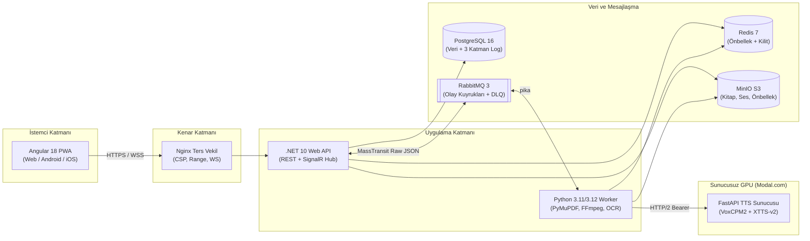

# SesliKitap (`v1.0.0`)

**SesliKitap**, Türkçe ve çok dilli e-kitapları (`PDF`, `EPUB`, `TXT`) akıllı metin temizleme, bölüm tespiti, kapsamlı Türkçe metin normalizasyonu ve sunucusuz GPU üzerinde **VoxCPM2** (ve yedekte **XTTS-v2**) ses klonlama teknolojisiyle doğal insan sesine dönüştüren uçtan uca bir sesli kitap üretim ve dinleme platformudur.

---

## Temel Özellikler

- **Akıllı Kitap İşleme (`PDF` / `EPUB` / `TXT`):** Üst/alt bilgi, sayfa numarası ve dipnot temizliği; tireli kelime birleştirme; 4 katmanlı otomatik bölüm tespiti; etkileşimli bölüm önizleme, bölme, birleştirme ve düzenleme. Taranmış (görüntü tabanlı) PDF'ler için **OCRmyPDF + Tesseract (`tur`)** entegrasyonu.
- **Gerçekçi İnsan Sesi ve Ses Klonlama:** 10–30 saniyelik referans ses kaydıyla kendi sesinizi veya seçtiğiniz anlatıcı sesini klonlayarak (`VoxCPM2` / `Modal.com` Serverless GPU) duygulu ve akıcı okuma; SHA-256 parça önbelleği ile sıfır tekrar maliyetli kesintisiz devam etme.
- **Storytel Benzeri Modern PWA Oynatıcı:** Angular 18 tabanlı karanlık/açık temalı web ve mobil PWA; cümle-ses senkron vurgusu (karaoke modu), uyku zamanlayıcısı, hız kontrolü (`0.5x–3.0x`), yer imleri ve notlar, çevrimdışı dinleme (`IndexedDB`) ve cihazlar arası anlık konum senkronizasyonu (`SignalR` + son-yazan-kazanır).
- **Telaffuz Sözlüğü ve Türkçe Normalizasyon:** Sayılar, tarihler, saatler, Romen rakamları, kısaltmalar ve kullanıcı tanımlı telaffuz kuralları için canlı önizlemeli sözlük.
- **Esnek Dışa Aktarım:** Bölüm bazlı `Opus` (`48 kbps`) / `MP3` (`64 kbps`) HTTP Range (`206 Partial Content`) akışı, `ZIP` arşivi (`cover.jpg` + `playlist.m3u`) ve bölüm işaretli tek dosya `.m4b` (Apple Books / SmartAudioBook Player uyumlu) indirme.
- **Açık Kaynak Kitap Keşfi:** Internet Archive, Open Library, Project Gutenberg (Gutendex) ve isteğe bağlı SearXNG üzerinden doğrudan kitap arama, SSRF korumalı indirme ve tek tıkla kütüphaneye aktarma.
- **Maliyet ve Gözlemlenebilirlik:** Aylık GPU saati ve bütçe koruması, 6 aylık harcama grafiği ve 3 katmanlı veritabanı loglama (`endpoint_logs`, `function_logs`, `pipeline_logs`).

---

## Mimari Diyagram



---

## Ön Koşullar

| Bileşen | Sürüm | Not |
|---|---|---|
| **.NET SDK** | `10.0.100+` | Geliştirme ve test için (`global.json`) |
| **Node.js** | `20 LTS+` | Angular 18 PWA derleme ve testleri için |
| **Python** | `3.11` veya `3.12` | Worker ve GPU TTS sunucusu için |
| **Docker Desktop** | `24+` (Compose v2) | PostgreSQL, Redis, RabbitMQ, MinIO ve üretim konteynerleri için |
| **Modal Hesabı** | İsteğe bağlı | Bulut GPU (`VoxCPM2`) seslendirme için (`ALLOW_MOCK_TTS=true` ile GPU'suz çalışabilir) |

---

## Hızlı Başlangıç

### 1. Ortam Değişkenleri ve Gizli Anahtarların Üretilmesi

```powershell
powershell -ExecutionPolicy Bypass -File .\scripts\generate-secrets.ps1 -WriteEnv
```

Bu komut `.env.example` şablonundan `.env` dosyasını oluşturur ve kriptografik olarak güvenli `ADMIN_API_KEY`, `MEDIA_TOKEN_SECRET` ve `TTS_API_TOKEN` anahtarlarını yazar.

### 2. Geliştirme Ortamı (Tek Tık Başlatma)

```powershell
.\baslat.bat
```

- Altyapı servislerini (`postgres`, `redis`, `rabbitmq`, `minio`, `python-worker`) Docker'da ayağa kaldırır.
- `.NET 10 API` (`http://localhost:5201/swagger`) ve `Angular 18 UI` (`http://localhost:4300`) süreçlerini başlatır.
- Durdurmak için: `.\durdur.bat` (verileri korur) veya `.\durdur.bat --temizle` (tüm geliştirme verilerini sıfırlar).

### 3. Üretim Dağıtımı (`Docker Compose` + `Tailscale HTTPS`)

```powershell
docker compose up -d --build
```

Tüm servisler (`nginx`, `frontend`, `api`, `python-worker`, `postgres`, `redis`, `rabbitmq`, `minio`) iç Docker ağında çalışır; dış dünyaya yalnızca `http://localhost:8080` (`nginx`) portu açılır.

Mobil cihazlardan güvenli HTTPS ile erişmek ve PWA olarak ana ekrana kurmak için:

```powershell
tailscale serve --bg --https=443 http://localhost:8080
```

---

## Modal Sunucusuz GPU Kurulumu (`VoxCPM2`)

```powershell
pip install modal
modal setup
modal secret create seslikitap-tts TTS_API_TOKEN=<.env içindeki TTS_API_TOKEN> HF_TOKEN=<hf_token>
cd gpu
modal deploy modal_deploy.py
```

Dağıtım sonunda üretilen `web` ve `health` adreslerini `.env` dosyasındaki `TTS_MODAL_URL` ve `TTS_MODAL_HEALTH_URL` alanlarına yazın. Doğrulamak için:

```powershell
python .\scripts\gpu-smoke-test.py --url $env:TTS_MODAL_URL --token $env:TTS_API_TOKEN --voice ornek.wav
```

---

## Yedekleme, Geri Yükleme ve Bütünlük Doğrulama

```powershell
# Yedek alma (PostgreSQL custom dump + MinIO nesneleri + ZIP/AES-256 arşiv)
powershell -ExecutionPolicy Bypass -File .\scripts\backup.ps1

# Yedekten geri yükleme
powershell -ExecutionPolicy Bypass -File .\scripts\restore.ps1 -BackupFolder .\backups\<yyyyMMdd_HHmmss>

# Veritabanı ve MinIO nesne bütünlüğü kontrolü
powershell -ExecutionPolicy Bypass -File .\scripts\verify-integrity.ps1

# MinIO TTS parça önbelleği kotası temizliği (varsayılan 30 GB sınır)
python .\scripts\prune-tts-cache.py --max-gb 30
```

---

## Testlerin Çalıştırılması

```powershell
# .NET Birim ve Entegrasyon Testleri
dotnet test SesliKitap.slnx -c Release

# Python Worker Lint ve Birim Testleri
cd src\SesliKitap.PythonWorker
.\.venv\Scripts\ruff check .
.\.venv\Scripts\pytest --cov

# GPU TTS Sunucusu Testleri
cd ..\..\gpu
..\src\SesliKitap.PythonWorker\.venv\Scripts\pytest

# Angular Lint, Production Build ve Birim Testleri
cd ..\src\SesliKitap.Frontend
npm run lint
npm run build
npm test

# Playwright Uçtan Uca (E2E) Testleri
docker compose -f ..\..\docker-compose.e2e.yml up -d --build
npx playwright test
```

---

## Dokümantasyon ve Sorun Giderme

- **[Geliştirici Dokümanı ve Mimari Anayasa](docs/gelistirici-dokumani.md)** (Sorun giderme tablosu için bkz. **Ek A**, komut kılavuzu için **Ek B**)
- **[Mimari Karar Kayıtları (ADR)](docs/kararlar/)**
- **[Kapsamlı Faz 9 Doğrulama ve Test Raporu](docs/test-raporlari/faz9-kapsamli-test.md)**

---

## Lisans ve Telif Notu

Bu proje kişisel kullanım ve eğitim amacıyla geliştirilmiştir. Kullanılan tüm kütüphaneler (`MassTransit 8.x`, `FluentAssertions 7.x`, `VoxCPM2` Apache-2.0, `PyMuPDF` AGPLv3) açık kaynak lisans koşullarına uygun olarak seçilmiştir. Yalnızca telif hakkı süresi dolmuş (kamu malı) veya kullanım hakkına sahip olduğunuz eserleri içe aktarın ve ses klonlama özelliğini yalnızca açık izniniz olan ses kayıtlarıyla kullanın.
