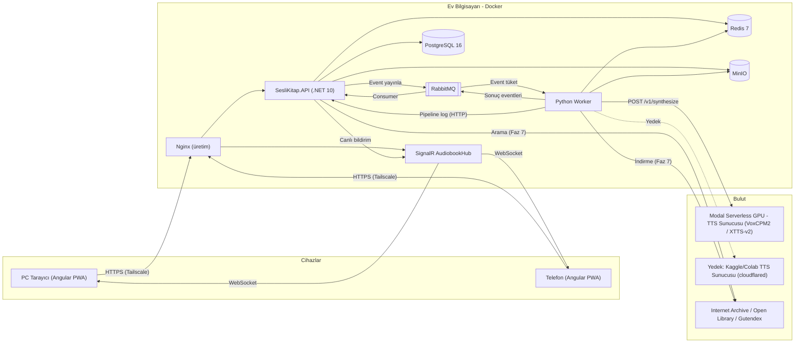
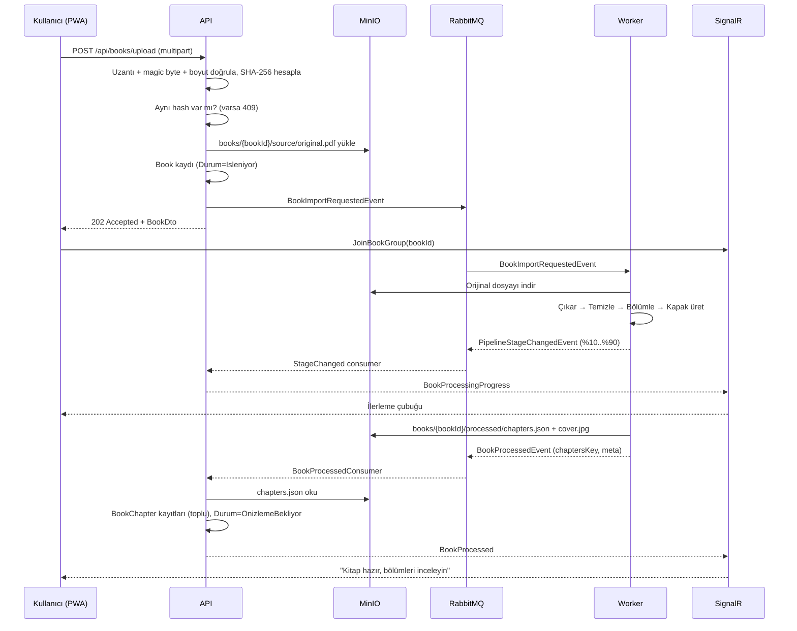
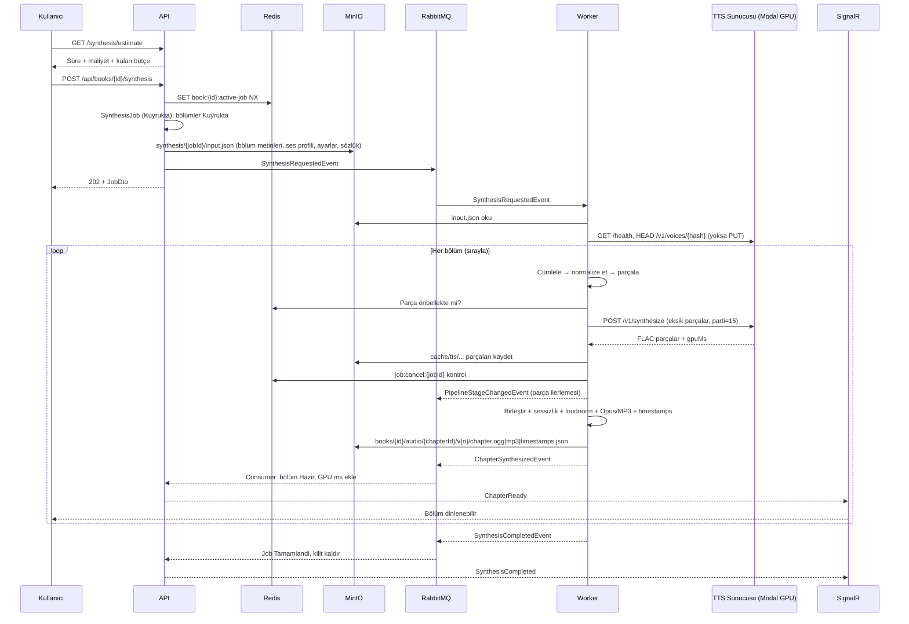
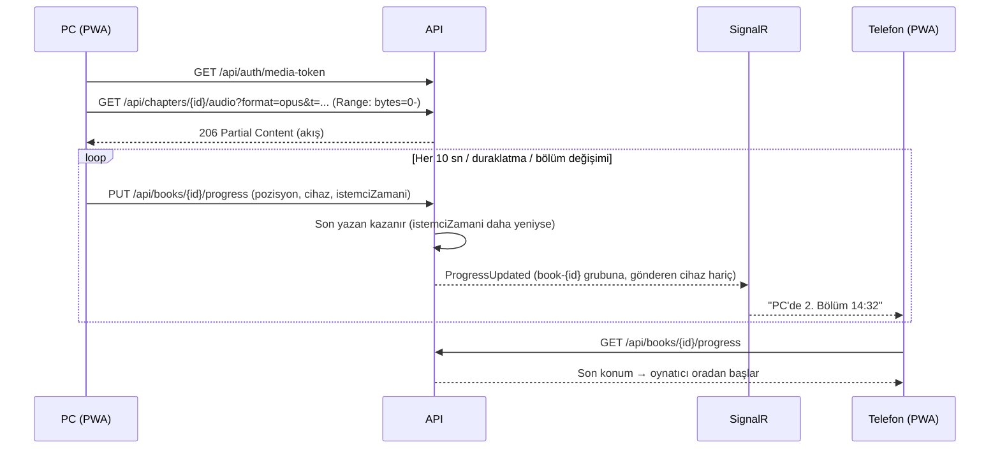
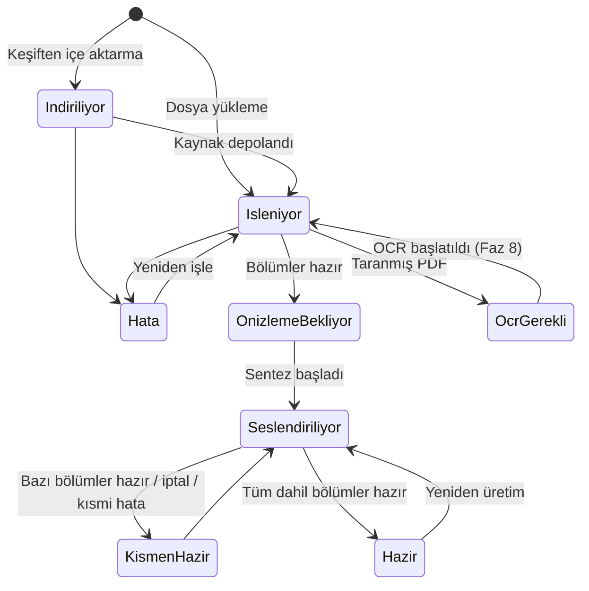
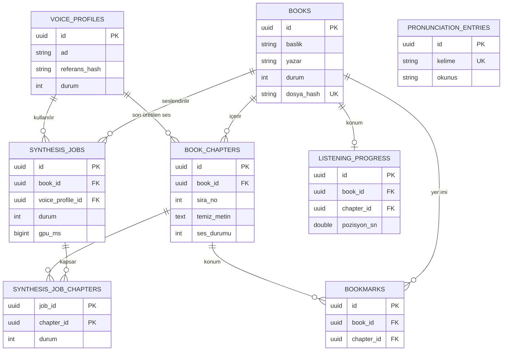

# 🎧 SesliKitap — Geliştirici Dokümanı (Proje Anayasası)

> **Sürüm:** 1.0.0  
> **Doküman tarihi:** 23.10.2026  
> **Repo:** https://github.com/Muhammed-KRM/SesliKitap.git  
> **Referans mimari:** https://github.com/Muhammed-KRM/OtoEdit (aynı geliştiriciye ait, aynı katmanlı mimari, aynı loglama ve kuyruk altyapısı)  
> **Hedef okuyucu:** Bu projeyi sıfırdan tek başına geliştirecek bir yazılımcı **veya** bir yapay zeka kodlama ajanı.

> [!IMPORTANT]
> Bu doküman projenin **tek doğruluk kaynağıdır (single source of truth)**. Kod yazmadan önce, her fazın başında ve her önemli karardan önce bu doküman okunmalı; yapılan iş bu dokümana uygun mu diye kontrol edilmelidir. Dokümanın dışına çıkmak gerekirse, bu durum **gerekçesiyle birlikte** faz raporunda açıkça bildirilmeli ve doküman da güncellenmelidir.

---

## İçindekiler

- [Bölüm 1 — Projenin Amacı](#bölüm-1--projenin-amacı)
  - 1.1 Problem
  - 1.2 Çözüm
  - 1.3 Hedef kullanıcı ve kullanım senaryoları
  - 1.4 Kapsam (MVP içinde / dışında)
  - 1.5 Başarı ölçütleri
  - 1.6 Maliyet modeli
  - 1.7 Yasal ve etik çerçeve
  - 1.8 Sözlük
- [Bölüm 2 — Kesin Uyulması Gereken Kurallar, Prensipler ve Zorunlu Özellikler](#bölüm-2--kesin-uyulması-gereken-kurallar-prensipler-ve-zorunlu-özellikler)
- [Bölüm 3 — Kullanılacak Teknolojiler](#bölüm-3--kullanılacak-teknolojiler)
- [Bölüm 4 — Mimari ve Nihai Dosya Yapısı](#bölüm-4--mimari-ve-nihai-dosya-yapısı)
- [Bölüm 5 — Adım Adım Geliştirme Rehberi ve Fazlar](#bölüm-5--adım-adım-geliştirme-rehberi-ve-fazlar)
- [Ekler](#ekler)

---

# Bölüm 1 — Projenin Amacı

## 1.1 Problem

Proje sahibi sesli kitap dinlemek istemektedir; ancak:

1. **İstenen kitapların sesli versiyonu yoktur.** İnternette PDF/EPUB'ı bulunan birçok Türkçe kitabın (özellikle eski, telif süresi dolmuş, akademik veya niş kitapların) sesli kitabı hiç üretilmemiştir.
2. **Ticari platformların kataloğu sınırlıdır.** Storytel, Audible gibi servislerde istenen her kitap bulunmaz.
3. **Ticari yapay zeka seslendirme servisleri pahalıdır ve limitlidir.** ElevenLabs gibi servislerde ücretsiz kota birkaç dakikalık ses ile sınırlıdır; 200 sayfalık bir kitabı seslendirmenin maliyeti 50–70 USD ve üzerindedir.
4. **Mevcut ücretsiz çözümler robotiktir.** Klasik TTS (ekran okuyucu) sesleri tekdüze, duygusuz ve "haber spikeri" tonundadır; uzun süre dinlendiğinde yorar.
5. **PDF'ler doğrudan seslendirmeye uygun değildir.** Sayfa numaraları, üst/alt bilgiler, dipnotlar, satır sonu tirelemeleri ve kısaltmalar doğrudan okunduğunda dinleme deneyimini bozar ("...ve o gün **seksen dört** kitaplar-**tire**..." gibi).
6. **Proje sahibinin donanımı yerel yapay zeka için yetersizdir.** Evde RTX 3050 Ti (4 GB VRAM), işyerinde GTX 1650/1660 (4–6 GB VRAM) bulunmaktadır; yüksek kaliteli ses klonlama modelleri en az 8–12 GB VRAM ister.

## 1.2 Çözüm

**SesliKitap**, kişisel kullanım için geliştirilen, **PDF/EPUB/TXT kitapları gerçek insan doğallığında sesli kitaba çeviren**, hem bilgisayarda hem telefonda çalışan bir uygulamadır.

Temel fikir:

```text
Kitap bul / yükle  →  Metni çıkar  →  Akıllı temizle (sayfa no, dipnot, tire, kısaltma)
     →  Bölümlere ayır  →  Kullanıcı önizleyip düzenler
     →  Bulut GPU üzerinde VoxCPM2 ile seçilen sesle (ses klonlama) seslendir
     →  Opus + MP3 olarak paketle  →  PC ve telefonda Storytel kalitesinde dinle
```

Ana prensipler:

- **Gerçek insan gibi okuma:** Yeni nesil, bağlam duyarlı, ses klonlama yapabilen açık kaynak model **VoxCPM2** (OpenBMB, Apache-2.0) kullanılır. Kullanıcı 10–30 saniyelik bir referans ses kaydı verir; kitap baştan sona o ses rengi ve tonlamasıyla okunur.
- **Kullanıcının bilgisayarı yorulmaz:** Ağır yapay zeka işi, **Modal.com Serverless GPU** üzerinde çalışır. GPU yalnızca seslendirme sırasında açılır, iş bitince kendiliğinden kapanır. Modal'ın aylık ücretsiz kredisi (30 USD) ile ayda ~30 adet 200 sayfalık kitap **ücretsiz** seslendirilir.
- **Yedekli GPU stratejisi:** Aynı TTS sunucusu kodu Modal dışında Kaggle/Colab ücretsiz GPU'larında (veya ileride ≥ 8 GB VRAM'li yerel bir GPU'da) da çalışabilir. Worker, motor zinciri (engine chain) ile otomatik yedeğe geçer.
- **Kitabı bitmeden dinlemeye başlama:** Bölümler sırayla seslendirilir; ilk bölüm biter bitmez canlı bildirim (SignalR) gelir ve dinlemeye başlanabilir.
- **Tek kod tabanı, iki cihaz:** Angular **PWA** sayesinde aynı arayüz bilgisayarda tarayıcıda, telefonda ise "Ana ekrana ekle" ile uygulama gibi çalışır; kilit ekranı kontrolleri ve çevrimdışı dinleme desteklenir.
- **Kaldığın yerden devam:** Dinleme konumu sunucuda tutulur; PC'de bırakılan kitap telefonda aynı saniyeden devam eder.
- **Kanıtlanmış mimari:** OtoEdit projesindeki .NET (API/Business/Data) + Python Worker + RabbitMQ + MinIO + Redis + PostgreSQL + SignalR + Angular mimarisi aynen kullanılır.

## 1.3 Hedef Kullanıcı ve Kullanım Senaryoları

**Hedef kullanıcı (MVP):** Tek kullanıcı — proje sahibi. Sistem kendi bilgisayarında (Docker) çalışır; telefondan güvenli tünel (Tailscale) veya aynı Wi-Fi üzerinden erişilir. Mimari, ileride çok kullanıcılı yapıya geçişe engel olmayacak şekilde tasarlanır (bkz. 2.12).

### Kullanıcı Hikâyeleri (User Stories)

| Kod | Hikâye | Öncelik |
|---|---|---|
| US-01 | Kullanıcı olarak bilgisayarımdaki bir PDF/EPUB/TXT dosyasını sürükle-bırak ile yüklemek istiyorum. | MVP |
| US-02 | Kullanıcı olarak yüklediğim kitabın otomatik temizlenmiş ve bölümlere ayrılmış halini görmek istiyorum. | MVP |
| US-03 | Kullanıcı olarak bölüm başlıklarını, metinleri düzenlemek, bölümleri birleştirmek/bölmek ve "İçindekiler", "Kaynakça" gibi bölümleri seslendirmeden hariç tutmak istiyorum. | MVP |
| US-04 | Kullanıcı olarak kendi sesimi veya izinli bir referans sesi yükleyip/kaydedip bir "Ses Profili" oluşturmak ve örnek dinlemek istiyorum. | MVP |
| US-05 | Kullanıcı olarak bir kitabı seçtiğim ses profiliyle seslendirmek, başlamadan önce tahmini süre ve maliyeti görmek istiyorum. | MVP |
| US-06 | Kullanıcı olarak seslendirme ilerlemesini canlı görmek ve ilk bölüm hazır olur olmaz dinlemeye başlamak istiyorum. | MVP |
| US-07 | Kullanıcı olarak oynatıcıda durdurmak, 15 sn geri / 30 sn ileri sarmak, bölüm atlamak, hızı 0.5x–3x arasında ses tonu bozulmadan değiştirmek istiyorum. | MVP |
| US-08 | Kullanıcı olarak dinlerken okunan cümlenin ekranda vurgulanmasını, bir cümleye tıklayınca sesin oraya atlamasını istiyorum. | MVP |
| US-09 | Kullanıcı olarak PC'de bıraktığım yerden telefonda devam etmek istiyorum. | MVP |
| US-10 | Kullanıcı olarak telefonun kilit ekranından ve kulaklık tuşlarından oynatıcıyı kontrol etmek istiyorum. | MVP |
| US-11 | Kullanıcı olarak kitabı/bölümü çevrimdışı dinlemek için telefona indirmek istiyorum. | MVP |
| US-12 | Kullanıcı olarak kitabı `.mp3` / `.opus` ZIP arşivi veya bölüm işaretli `.m4b` olarak indirip başka oynatıcılarda dinlemek istiyorum. | MVP (ZIP), Faz 8 (M4B) |
| US-13 | Kullanıcı olarak uygulama içinden Türkçe kitap aramak (Internet Archive, Open Library, Gutenberg) ve tek tıkla kütüphaneme eklemek istiyorum. | Faz 7 |
| US-14 | Kullanıcı olarak yanlış okunan kelimeler için bir "Telaffuz Sözlüğü" tanımlamak istiyorum. | Faz 8 |
| US-15 | Kullanıcı olarak uyku zamanlayıcısı kurmak istiyorum (15/30/45/60 dk, bölüm sonu). | MVP |
| US-16 | Kullanıcı olarak yer imi eklemek ve not almak istiyorum. | Faz 8 |
| US-17 | Kullanıcı olarak bu ayki GPU kullanımımı ve tahmini maliyetimi görmek, bütçe aşılınca yeni iş başlatılmasının engellenmesini istiyorum. | Faz 8 |
| US-18 | Kullanıcı olarak taranmış (resim tabanlı) PDF'lerin OCR ile metne çevrilmesini istiyorum. | Faz 8 |
| US-19 | Kullanıcı olarak yarıda kalan/çöken bir seslendirmenin, daha önce üretilen parçaları tekrar üretmeden (tekrar GPU parası ödemeden) devam etmesini istiyorum. | MVP |
| US-20 | Kullanıcı olarak devam eden bir seslendirmeyi iptal edebilmek istiyorum. | MVP |

## 1.4 Kapsam

### MVP Kapsamında

- Dosya yükleme (PDF, EPUB, TXT) — azami 300 MB.
- Metin çıkarma, akıllı temizlik, Türkçe metin normalizasyonu, bölüm tespiti.
- Bölüm önizleme ve düzenleme (başlık/metin düzenleme, hariç tutma, birleştirme, bölme).
- Ses profili yönetimi (yükleme + tarayıcıdan kayıt + örnek üretimi).
- Modal üzerinde VoxCPM2 TTS sunucusu (ana motor) + XTTS-v2 yedek motoru.
- Motor zinciri, parça önbelleği (resume), iptal, kalite kontrol ve otomatik yeniden deneme.
- Opus + MP3 çıktı, cümle zaman damgaları.
- Canlı ilerleme (SignalR).
- Angular PWA: kütüphane, kitap detayı, oynatıcı (hız, sarma, bölüm, uyku zamanlayıcısı, cümle takibi), mini oynatıcı, Media Session, çevrimdışı indirme.
- Cihazlar arası dinleme konumu senkronizasyonu.
- 3 katmanlı veritabanı loglama (Endpoint/Function/Pipeline) — OtoEdit ile aynı.
- ZIP indirme.

### MVP Sonrası (Faz 7–9)

- Kitap keşfi (Internet Archive, Open Library, Gutendex; opsiyonel SearXNG web araması).
- Telaffuz sözlüğü, yer imleri, M4B dışa aktarım, OCR, GPU bütçe koruması, kullanım raporu.
- Üretim dağıtımı (Tailscale HTTPS), yedekleme betikleri.

### Kapsam Dışı (Bilinçli Olarak Yapılmayacak)

- Çok kullanıcılı hesap sistemi, ödeme, abonelik (ileride eklenebilir; mimari engellemez).
- Uygulama mağazası (Play Store / App Store) yerel uygulaması — PWA yeterlidir.
- Gerçek zamanlı (anlık) metin okuma — sistem önceden üretim (pre-render) mantığıyla çalışır.
- Kullanıcının bilgisayarında yerel GPU ile seslendirme (donanım yetersiz). Kod buna kapı açık bırakır (`gpu/tts_server` her yerde çalışabilir) ama MVP'de desteklenen senaryo değildir.

## 1.5 Başarı Ölçütleri

| Ölçüt | Hedef |
|---|---|
| Ses doğallığı (öznel, 1–5 MOS benzeri dinleme testi) | Ortalama ≥ 4.0 |
| Sayfa numarası / üst bilgi / dipnot sızıntısı | 200 sayfalık test kitabında ≤ 3 hata |
| 200 sayfalık kitabın seslendirme süresi (Modal L4) | ≤ 75 dakika |
| İlk bölümün dinlenebilir hale gelmesi | İş başladıktan sonra ≤ 10 dakika |
| 200 sayfalık kitap başına GPU maliyeti | ≤ 1.00 USD |
| Çöken işin devamında tekrar üretilen parça oranı | %0 (önbellekteki parçalar tekrar üretilmez) |
| Opus çıktı boyutu | 1 saat ses ≈ 20–25 MB (48 kbps mono) |
| PC ↔ telefon konum senkronizasyon gecikmesi | ≤ 10 saniye |
| API p95 yanıt süresi (akış/indirme hariç) | ≤ 200 ms |
| Birim test kapsamı (Business + Python pipeline) | ≥ %75 satır kapsamı |

## 1.6 Maliyet Modeli

Hesap varsayımları (konfigüre edilebilir, bkz. 4.11):

- 200 sayfa ≈ 50.000 kelime ≈ 6 saat ses (Türkçe anlatım ≈ 140 kelime/dk).
- VoxCPM2'nin L4/A10G üzerinde gerçek zaman faktörü (RTF) ≈ 0.15–0.25 → 6 saat ses ≈ 55–90 dk GPU.
- Modal L4 ≈ 0.80 USD/saat → kitap başı ≈ 0.75–1.20 USD.
- Modal Starter planı aylık 30 USD ücretsiz kredi verir → ayda ≈ 25–35 kitap **ücretsiz**.

Uygulama içinde maliyet şeffaf tutulur:
- Seslendirme başlatılmadan önce **tahmin** gösterilir (`GET /api/books/{id}/synthesis/estimate`).
- GPU sunucusu her istekte **gerçek GPU milisaniyesini** döner; bu değer işe ve bölüme yazılır.
- Aylık bütçe (`Tts__MonthlyBudgetUsd`, varsayılan 30) aşılacaksa iş başlatılmaz (kullanıcı `force=true` ile bilinçli olarak aşabilir).

## 1.7 Yasal ve Etik Çerçeve

> [!WARNING]
> - Uygulama **kişisel kullanım** içindir. Üretilen sesli kitaplar yalnızca kullanıcının kendi dinlemesi içindir; dağıtılmamalıdır.
> - Kitap keşfi modülü varsayılan olarak yalnızca **yasal açık arşivleri** (Internet Archive'in herkese açık öğeleri, Open Library "public" erişimli kitaplar, Project Gutenberg) kullanır. Genel web PDF araması (SearXNG) **varsayılan olarak kapalıdır**; açıldığında arayüzde telif uyarısı gösterilir.
> - **Ses klonlama yalnızca kullanıcının kendi sesiyle veya açık izni/lisansı olan seslerle** yapılmalıdır (örneğin Mozilla Common Voice CC0 lisanslı kayıtlar). Ses profili oluşturma formunda "Bu sesi kullanma hakkım var" onay kutusu zorunludur.
> - VoxCPM2 Apache-2.0 lisanslıdır. Yedek motor XTTS-v2 "Coqui Public Model License" (ticari olmayan kullanım) ile lisanslıdır; kişisel kullanım için uygundur, ticari kullanıma geçilirse XTTS-v2 zincirden çıkarılmalıdır.

## 1.8 Sözlük

| Terim | Anlamı |
|---|---|
| **TTS** | Text-to-Speech, metinden sese dönüştürme. |
| **VoxCPM2** | OpenBMB'nin açık kaynak, çok dilli (Türkçe dahil), ses klonlayabilen, bağlam duyarlı TTS modeli. Projenin ana motoru. |
| **XTTS-v2** | Coqui'nin çok dilli ses klonlama modeli. Yedek motor. |
| **Ses Profili (VoiceProfile)** | Klonlanacak referans ses kaydı + (opsiyonel) o kaydın metni + motor parametreleri. |
| **Referans ses / prompt ses** | Modelin taklit edeceği 10–30 saniyelik temiz ses kaydı. |
| **Parça (Chunk)** | TTS sunucusuna tek seferde gönderilen metin birimi (genellikle tek cümle). |
| **Sentez İşi (SynthesisJob)** | Bir kitabın (veya seçili bölümlerinin) seslendirme görevi. |
| **Zaman damgası (Timestamps)** | Her cümlenin bölüm sesindeki başlangıç/bitiş milisaniyesi. Cümle takibi için kullanılır. |
| **Motor zinciri (Engine Chain)** | TTS motorlarının öncelik sırası; biri başarısız olursa sıradakine geçilir. |
| **RTF** | Real-Time Factor. 0.2 = 1 dakikalık sesi 12 saniyede üretmek. |
| **Serverless GPU** | Sadece istek geldiğinde açılan, kullanılmadığında kapanan ve saniye bazlı ücretlendirilen GPU. |
| **Soğuk başlangıç (Cold start)** | Kapalı GPU konteynerinin açılıp modeli belleğe yüklemesi (≈ 30–120 sn). |
| **PWA** | Progressive Web App; tarayıcıdan telefona uygulama gibi kurulabilen web uygulaması. |
| **Media Session API** | Tarayıcının kilit ekranı / bildirim alanı / kulaklık tuşu medya kontrollerini sağlayan API. |
| **LUFS** | Ses yüksekliği ölçüsü. Sesli kitap standardı ≈ -18 ile -16 LUFS. |
| **Opus** | Konuşma için MP3'ten çok daha verimli, açık kaynak ses kodeki. |
| **M4B** | Bölüm işaretli, sesli kitaplara özel AAC tabanlı dosya formatı. |
| **Idempotent** | Aynı işlemin birden çok kez çalıştırılmasının sonucu değiştirmemesi. |
| **Fail-safe log** | Log yazımı başarısız olsa bile ana işin durmaması prensibi. |

---

# Bölüm 2 — Kesin Uyulması Gereken Kurallar, Prensipler ve Zorunlu Özellikler

Bu bölümdeki kurallar **pazarlık konusu değildir**. "MUST / ZORUNLU" olarak işaretlenen her madde, kod incelemesinde (code review) ve faz sonu testlerinde kontrol edilir.

## 2.1 Genel Çalışma Kuralları (Geliştirici / AI Ajanı İçin)

1. **Dokümana sadakat (ZORUNLU):** Her iş başlamadan önce bu doküman ilgili bölümüyle birlikte okunur. Yapılan iş dokümana uygun değilse durulur ve düzeltilir. Dokümanın dışına çıkmak zorunlu hale gelirse (ör. bir kütüphanenin API'si değişmişse) **inisiyatif alınabilir ama faz raporunda "DOKÜMAN DIŞI KARAR" başlığıyla gerekçesi açıkça yazılır** ve bu doküman güncellenir.
2. **Parça parça çalış (ZORUNLU):** Kod veya doküman asla tek seferde dev bloklar halinde yazılmaz. Her dosya/bölüm mantıklı parçalara ayrılır: bir parça yazılır → derlenir/çalıştırılır → kontrol edilir → sonraki parçaya geçilir. Bu kural, hem token/çıktı sınırı hatalarını hem de hata ayıklama zorluğunu önler.
3. **Hata analizi (ZORUNLU):** Bir hata alındığında önce hatanın gerçekten son yazılan koddan mı yoksa projenin başka bir yerinden mi kaynaklandığı analiz edilir; kök neden bulunmadan "deneme-yanılma" yamaları yapılmaz.
4. **Raporlama (ZORUNLU):** Her faz (ve faz içindeki her büyük adım) sonunda şu formatta rapor verilir:
   ```text
   ## Faz X Raporu
   - Yapılanlar: (madde madde, dosya isimleriyle)
   - Testler: (çalıştırılan komutlar ve sonuçları: geçen/kalan test sayısı)
   - Commit(ler): (hash + mesaj)
   - DOKÜMAN DIŞI KARARLAR: (yoksa "Yok")
   - Bilinen sorunlar / sonraki adım:
   ```
5. **Tarih bilinci:** İnternetten araştırma yapılırken güncel tarihin dokümanın yazıldığı tarihten sonra olduğu bilinmelidir (doküman tarihi: 23.10.2026). Kütüphane sürümleri araştırılırken bu tarih esas alınır.
6. **Sürüm doğrulama:** Bölüm 3'te verilen paket sürümleri "en az" sürümlerdir. Yeni bir major sürüme geçmeden önce kırıcı değişiklikler (breaking changes) ve **lisans değişiklikleri** kontrol edilir (bkz. 3.9 — MassTransit 9 ve FluentAssertions 8 ticari lisansa geçmiştir; bu yüzden 8.x / 7.x kullanılır).
7. **Yedekli çalış (ZORUNLU):** Her önemli eklentiden sonra commit atılır ve GitHub'a push edilir. Her fazın son adımı "test et + commit + push"tur.
8. **Önce test edilebilirlik:** Yazılan her servis bir arayüz (interface) arkasında olmalı ve birim test ile test edilebilir olmalıdır. Test edilemeyen kod tasarım hatasıdır.

## 2.2 Kod Kalitesi Prensipleri

### 2.2.1 Clean Code (ZORUNLU)

- Fonksiyonlar **tek bir iş** yapar; ideal uzunluk ≤ 40 satır, azami 80 satır. Daha uzunsa özel (private) yardımcı metotlara bölünür.
- Sınıflar ideal ≤ 300 satır. Daha büyük sınıflar sorumluluklara bölünür.
- İsimler niyeti açıklar: `CleanPageHeaders()` doğru, `Process2()` yanlış.
- Sihirli sayı/metin yasaktır: sabitler `Constants` sınıflarına / Python'da `utils/constants.py`'ye, ayarlanabilir değerler konfigürasyona (`appsettings.json` / `.env`) taşınır.
- Yorumlar "ne" değil "neden" açıklar. Tüm public sınıf ve metotlarda XML doc (`/// <summary>`) — Python'da docstring — **zorunludur**. Açıklamalar Türkçe yazılır (OtoEdit ile aynı).
- Ölü kod, yorum satırına alınmış eski kod, `.bak` dosyaları repoya girmez.
- Erken dönüş (guard clause) tercih edilir; iç içe 3 seviyeden derin `if` yasaktır.
- Nullable reference types (`<Nullable>enable</Nullable>`) açık; tüm uyarılar giderilir. Python'da tüm fonksiyonlar tip ipuçlu (type hints) yazılır.

### 2.2.2 SOLID (ZORUNLU)

| Prensip | Bu projede nasıl uygulanır? |
|---|---|
| **S — Single Responsibility** | `BookManager` sadece kitap iş kurallarını yönetir; dosya depolama `IFileStorageService`, olay yayınlama `IEventPublisher` (MassTransit `IPublishEndpoint` sarmalayıcısı), loglama `ILogService` sorumluluğundadır. Python'da `PdfExtractor` sadece çıkarma yapar, temizlik `TextCleaner`'da, normalizasyon `TurkishNormalizer`'dadır. |
| **O — Open/Closed** | Yeni bir kitap arama kaynağı eklemek için mevcut kod değiştirilmez; yeni bir `IBookSearchProvider` implementasyonu yazılıp DI'a eklenir. Yeni TTS motoru için `BaseTtsEngine`'den türeyen bir sınıf yazılıp `TTS_ENGINE_ORDER`'a eklenir. Yeni dosya formatı için yeni `BaseExtractor` alt sınıfı yazılır. |
| **L — Liskov Substitution** | Tüm `BaseTtsEngine` alt sınıfları aynı sözleşmeyi (girdi: parça listesi + ses profili; çıktı: ses parçaları + GPU ms) eksiksiz uygular; zincir hangi motorla çalıştığını bilmek zorunda değildir. |
| **I — Interface Segregation** | Şişkin arayüz yasak. Örn. `IChapterService` (okuma/düzenleme) ile `IChapterAudioService` (ses akışı) ayrıdır. Frontend'de `ProgressService` ile `AudioPlayerService` ayrıdır. |
| **D — Dependency Inversion** | Üst katmanlar soyutlamalara bağımlıdır. Business katmanı `IBookRepository`'ye bağımlıdır, EF Core'a değil. Python'da consumer'lar bağımlılıklarını constructor'dan alır (test için mock verilebilir). |

### 2.2.3 Diğer Prensipler

- **DRY (Kod tekrarı yasak — ZORUNLU):** Ortak mantıklar yardımcı sınıflara çıkarılır (`HashHelper`, `SensitiveDataMasker`, `TurkishTextHelper`, `RangeStreamHelper`, Python'da `ffmpeg_runner.py`). Aynı kod iki yerde görülürse refactor edilir.
- **KISS & YAGNI:** MVP için gerekmeyen soyutlama yapılmaz; ama genişlemeyi engelleyecek kısa yol da alınmaz.
- **Dilin özelliklerinden sonuna kadar yararlan:** C#'ta primary constructors, records (DTO ve event'ler için), pattern matching, `required` üyeler, collection expressions, `IAsyncEnumerable`, `CancellationToken` her async metotta. Python'da dataclass/pydantic modelleri, `enum.StrEnum`, context manager'lar, generator'lar, `pathlib`. TypeScript'te Angular Signals, `inject()`, standalone component'ler, strict mode.
- **Async her yerde:** I/O yapan tüm .NET metotları `async` ve `CancellationToken` alır. `.Result` / `.Wait()` yasaktır.

## 2.3 İsimlendirme Standartları

OtoEdit ile tutarlılık için **hibrit isimlendirme** kullanılır:

| Öğe | Kural | Örnek |
|---|---|---|
| Teknik sınıflar (C#) | İngilizce, PascalCase | `BookManager`, `GenericRepository<T>`, `ApiKeyAuthMiddleware` |
| Entity sınıf adları | İngilizce, PascalCase | `Book`, `BookChapter`, `VoiceProfile`, `SynthesisJob` |
| Entity/DTO alan adları | **Türkçe, ASCII (Türkçe karakter yok)**, PascalCase | `Baslik`, `Yazar`, `DosyaYolu`, `OlusturmaTarihi`, `SesDurumu` |
| Enum adları ve değerleri | Türkçe ASCII, PascalCase | `KitapDurumu.OnizlemeBekliyor`, `BolumSesDurumu.Hazir` |
| Arayüzler | `I` öneki | `IBookService`, `IFileStorageService` |
| Servis implementasyonları | `...Manager` (iş mantığı), `...Service` (altyapı) | `BookManager : IBookService`, `MinioFileStorageService : IFileStorageService` |
| Event'ler | İngilizce + `Event` soneki, `record` | `BookImportRequestedEvent` |
| PostgreSQL tablo/kolon adları | snake_case, çoğul tablo | `books`, `book_chapters`, `olusturma_tarihi` (EF `ToTable` + `HasColumnName` ile; ya da `EFCore.NamingConventions` paketinin `UseSnakeCaseNamingConvention()`'ı) |
| Python modül/fonksiyon | snake_case | `text_cleaner.py`, `normalize_numbers()` |
| Python sınıf | PascalCase | `TurkishNormalizer` |
| JSON (API + RabbitMQ) | camelCase | `bookId`, `sesDosyaYolu` |
| Angular dosyaları | kebab-case + tür soneki | `book-detail-page.component.ts`, `audio-player.service.ts` |
| Sabitler | C#: `PascalCase` (`const`/`static readonly`), Python: `UPPER_SNAKE_CASE` | `MaxUploadBytes`, `MAX_CHUNK_CHARS` |
| Log hata kodları | `MODUL_EYLEM_ERR` | `BOOK_UPLOAD_ERR`, `TTS_CHUNK_TIMEOUT_ERR` |

## 2.4 Loglama Kuralları (ZORUNLU — OtoEdit 3 Katmanlı Model)

**Her fonksiyon loglanabilir olmalı ve loglar veritabanında saklanabilmelidir.** Bunun için OtoEdit'teki 3 katmanlı model aynen uygulanır:

| Katman | Tablo | Ne zaman yazılır? | Kim yazar? |
|---|---|---|---|
| **1. Endpoint Log** | `endpoint_logs` | Her HTTP isteğinde (otomatik) | `RequestResponseLoggingMiddleware` |
| **2. Function Log** | `function_logs` | Her yakalanan hata / önemli uyarıda | `ILogService.LogFunctionErrorAsync(...)` — `[CallerMemberName]`, `[CallerFilePath]`, `[CallerLineNumber]` ile otomatik konum bilgisi |
| **3. Pipeline Log** | `pipeline_logs` | Her uzun süreli işlem aşamasının başlangıç/bitiş/hatasında | .NET: `ILogService.LogPipelineStartAsync/EndAsync/ErrorAsync`; Python: `PipelineLogger.log_progress(...)` (konsol + RabbitMQ + `/api/internal/logs/pipeline`) |

Kurallar:

1. **Fail-safe:** Log yazımı başarısız olursa ana iş **asla** durmaz. Log metotları kendi içinde `try/catch` ile korunur ve yalnızca `ILogger`'a (Serilog) uyarı düşer.
2. **Hassas veri maskeleme:** `apiKey`, `password`, `token`, `secret`, `authorization`, `t` (medya token) alanları `SensitiveDataMasker` ile `***` olarak maskelenir. Kitap metinleri (çok büyük) loglara yazılmaz; yalnızca uzunluk/özet (`metinUzunlugu: 48211`) yazılır.
3. **Büyük gövdeler:** 64 KB üstü istek/yanıt gövdeleri, multipart yüklemeler, ses akışı (`/audio`), indirme (`/download`) ve SignalR (`/hubs/`) istekleri gövdesiz loglanır (`[SKIPPED_LARGE_STREAM]`).
4. **TraceId korelasyonu:** Her HTTP isteğinin `TraceIdentifier`'ı, o istekten doğan RabbitMQ event'lerine (`traceId` alanı) ve Python loglarına taşınır. Böylece "kullanıcı butona bastı → API → kuyruk → worker → GPU → bildirim" zinciri tek bir `traceId` ile veritabanında baştan sona izlenebilir.
5. **Yapılandırılmış log:** Serilog message template kullanılır (`_logger.LogInformation("Kitap yüklendi {BookId} {Boyut}", id, size)`); string birleştirme ile log yazılmaz. Python'da `logger.info("... %s", x)` biçimi kullanılır.
6. **Seviyeler:** `Debug` (geliştirme ayrıntısı), `Information` (iş olayı), `Warning` (beklenen ama istenmeyen durum: yeniden deneme, motor değişimi), `Error` (işlem başarısız), `Critical` (sistem bütünlüğü riski).
7. **Log saklama:** `endpoint_logs` 30 gün, `pipeline_logs` 90 gün, `function_logs` 180 gün tutulur. `LogRetentionBackgroundService` her gece 03:00'te eski kayıtları siler (Faz 9).
8. **Dosya logu:** Serilog konsol + dönen dosya (`logs/api-.log`, günlük, 14 dosya). Python: konsol + `logs/worker.log` (RotatingFileHandler 10 MB × 5).

## 2.5 Hata Yönetimi Kuralları

- .NET'te özel istisna hiyerarşisi: `BusinessException` (400), `NotFoundException` (404), `ConflictException` (409), `PipelineException` (500, iş akışı hatası), `ExternalServiceException` (502, dış servis hatası), FluentValidation `ValidationException` (400).
- `ExceptionHandlingMiddleware` tüm istisnaları yakalar, `FunctionLog`'a yazar ve **RFC 7807 ProblemDetails** (`application/problem+json`) döner. Üretimde (`Production`) 500 hatalarında `detail` alanına iç hata mesajı yazılmaz, yalnızca `traceId` döner.
- Controller'larda `try/catch` yazılmaz (middleware'in işi). Business katmanında yalnızca **anlamlı bir şey yapılacaksa** (telafi, yeniden deneme, dönüştürme) yakalanır.
- Python worker'da her consumer mesajı `try/except/finally` içinde işler; hata durumunda `PipelineErrorEvent` yayınlar, mesajı `basic_nack(requeue=False)` ile ölü mektup kuyruğuna (DLQ) gönderir. Sonsuz yeniden kuyruğa alma döngüsü yasaktır.
- Dış servis çağrıları (Modal, Internet Archive vb.) **zaman aşımı + üstel geri çekilmeli yeniden deneme** ile yapılır (.NET: `Microsoft.Extensions.Http.Resilience` `AddStandardResilienceHandler`; Python: `tenacity`).

## 2.6 Güvenlik Kuralları (ZORUNLU)

1. **Kimlik doğrulama:** Tüm `/api/*` uç noktaları `X-API-Key` başlığı ister (`ApiKeyAuthMiddleware`, sabit-zamanlı karşılaştırma `CryptographicOperations.FixedTimeEquals`). İstisnalar: `GET /api/health` (sadece "ok" döner, ayrıntı API key ister), Swagger (yalnızca `Development`).
2. **Medya token'ı:** `<audio src>` HTTP başlığı gönderemediği için ses akışı uç noktaları kısa ömürlü, HMAC-SHA256 imzalı **medya token'ı** (`?t=...`) kabul eder. Token `GET /api/auth/media-token` ile alınır, 6 saat geçerlidir ve sadece `/api/chapters/*/audio`, `/api/books/*/cover`, `/api/voice-profiles/*/sample` yollarında geçerlidir.
3. **SignalR:** Hub bağlantısı `access_token` query parametresi ile API key alır; middleware bunu **yalnızca** `/hubs/` yolunda kabul eder.
4. **Gizli bilgiler:** API anahtarları, şifreler, Modal token'ları **asla** koda veya repoya yazılmaz. `.env` (git'e girmez) + `.env.example` (şablon, sahte değerler) kullanılır. `appsettings.json`'da gizli bilgi bulunmaz.
5. **Dosya yükleme güvenliği:** Uzantı beyaz listesi (`.pdf`, `.epub`, `.txt`) **ve** sihirli bayt (magic bytes) kontrolü (`%PDF-`, `PK\x03\x04` + `mimetype=application/epub+zip`, TXT için UTF-8/UTF-16/Windows-1254 çözümlenebilirlik). Azami boyut 300 MB (kitap), 20 MB (ses profili). Dosya adı asla depolama yolu olarak kullanılmaz; depolama anahtarı `Guid` tabanlıdır.
6. **SSRF koruması:** Keşif modülünde indirilecek URL'ler yalnızca `http/https` olabilir; özel IP aralıkları (10.x, 172.16–31.x, 192.168.x, 127.x, 169.254.x, ::1) çözümlendikten sonra engellenir; yönlendirme sayısı ≤ 5; azami indirme boyutu 300 MB; zaman aşımı 120 sn.
7. **EPUB/ZIP güvenliği:** Zip-bomb koruması (açılmış toplam boyut ≤ 1 GB, dosya sayısı ≤ 10.000), path traversal (`../`) içeren girdiler reddedilir. HTML içerik `BeautifulSoup` ile yalnızca metin olarak işlenir; script çalıştırılmaz.
8. **Rate limiting:** Genel `fixed` politika 300 istek/dk; yükleme uç noktaları 10 istek/dk; keşif araması 30 istek/dk.
9. **CORS:** Üretimde yalnızca yapılandırılmış origin'ler (`Cors__AllowedOrigins`); geliştirmede `localhost:4300`.
10. **Bağımlılık güvenliği:** Her faz sonunda `dotnet list package --vulnerable`, `pip-audit`, `npm audit --omit=dev` çalıştırılır; yüksek/kritik açık bırakılmaz.
11. **GPU sunucusu güvenliği:** Modal uç noktası `Authorization: Bearer <TTS_API_TOKEN>` ister; token Modal Secret olarak saklanır. İstek gövdesi boyutu ve parça sayısı sınırlıdır (≤ 32 parça, parça başına ≤ 600 karakter).
12. **Veri güvenliği:** PostgreSQL ve MinIO portları üretimde dışarıya açılmaz (yalnızca Docker ağı). Veritabanı yedekleri şifreli arşivlenir (Faz 9).

## 2.7 Performans ve Önbellek Kuralları

1. **Redis önbellek (ZORUNLU):** Okuma ağırlıklı ve pahalı sorgular önbelleğe alınır:
   - Kütüphane listesi (`books:list:{hash(filtre)}`, 60 sn, kitap değişince geçersiz kılınır),
   - Kitap detayı (`book:{id}`, 5 dk),
   - Bölüm zaman damgaları (`chapter:{id}:timestamps`, 24 saat),
   - Keşif arama sonuçları (`discovery:{provider}:{hash(sorgu)}`, 24 saat),
   - Ses profili listesi (`voices:list`, 10 dk).
   Önbellek "cache-aside" desenindedir ve **Redis erişilemezse sistem önbelleksiz çalışmaya devam eder** (fail-open).
2. **TTS parça önbelleği (ZORUNLU):** Her parçanın sesi `sha256(motor + modelSurumu + sesProfiliHash + parametreler + konuşulacakMetin)` anahtarıyla MinIO'da saklanır. Aynı parça asla iki kez GPU'da üretilmez. Bu, iş çökmesi/yeniden başlatma, metin düzenlemesi sonrası kısmi yeniden üretim ve maliyet tasarrufu sağlar.
3. **EF Core:** Okuma sorgularında `AsNoTracking()`, sadece gereken kolonlar için projeksiyon (`Select(x => new Dto(...))`), sayfalama zorunlu (`sayfa`, `boyut ≤ 100`), N+1 sorgu yasak (gerekirse `Include` veya ayrı sorgu), sık filtrelenen kolonlarda indeks, büyük metin kolonu (`temiz_metin`) liste sorgularında **asla** çekilmez.
4. **Akış (streaming):** Büyük dosyalar belleğe alınmadan akıtılır. Yükleme: `IFormFile.OpenReadStream()` → MinIO. Ses: MinIO'dan `Range` destekli kısmi okuma → yanıt. Python: dosyalar parça parça indirilir/yüklenir.
5. **Yanıt sıkıştırma:** JSON yanıtlarında Brotli/Gzip açık; ses ve resim yanıtlarında kapalı (zaten sıkıştırılmış).
6. **Paralellik:** Python worker TTS isteklerini sınırlı eşzamanlılıkla gönderir (`TTS_MAX_CONCURRENT_REQUESTS`, varsayılan 2) ve her istekte birden çok parça yollar (`TTS_BATCH_SIZE`, varsayılan 16). GPU sunucusu partileri tek seferde işler.
7. **Frontend:** Lazy-loaded route'lar, `OnPush` değişiklik algılama, Signals, `@for ... track`, sanal kaydırma (uzun cümle listelerinde `cdk-virtual-scroll` veya `IntersectionObserver` ile kademeli render), resimlerde `loading="lazy"`, servis worker ile uygulama kabuğu önbelleği.
8. **HTTP önbellek başlıkları:** Kapak ve tamamlanmış bölüm sesleri değişmez dosyalardır (`ETag` + `Cache-Control: private, max-age=31536000, immutable`; dosya yeniden üretilirse yeni anahtar adı verilir).

## 2.8 Veritabanı Kuralları

1. **Gereken her şey veritabanına kaydedilir:** kitaplar, bölümler, ses profilleri, sentez işleri ve aşamaları, dinleme konumu, yer imleri, telaffuz sözlüğü, GPU kullanımı, tüm loglar.
2. PostgreSQL 16, EF Core 10 Code-First, migration'lar `SesliKitap.Data/Migrations` altında. Uygulama başlangıcında otomatik `Migrate()` (OtoEdit gibi).
3. Her entity konfigürasyonu ayrı `IEntityTypeConfiguration<T>` sınıfında; `ApplyConfigurationsFromAssembly` ile yüklenir.
4. Birincil anahtarlar: iş varlıkları `Guid` (`Guid.CreateVersion7()` — sıralı, indeks dostu), log tabloları `long` (identity).
5. Zaman alanları UTC (`timestamptz`). `OlusturmaTarihi`, `GuncellemeTarihi` alanları `AuditableEntity` taban sınıfından gelir ve `SaveChangesAsync` override'ında (veya `SaveChangesInterceptor` ile) otomatik doldurulur.
6. **Soft delete:** `Book` ve `VoiceProfile` için `SilindiMi` + global query filter. Fiziksel dosya silme arka planda (`StorageCleanupBackgroundService`) yapılır.
7. Esnek/yapısal veriler `jsonb` kolonlarda (`Ayarlar`, `Metadata`, `GirdiMetadata`).
8. **Eşzamanlılık:** `SynthesisJob` ve `ListeningProgress` için iyimser eşzamanlılık (`xmin` system column → `UseXminAsConcurrencyToken()` / `IsRowVersion()`).
9. Toplu güncellemelerde `ExecuteUpdateAsync` / `ExecuteDeleteAsync` kullanılır (gereksiz entity yükleme yok).
10. Bağlantı dizesi yalnızca ortam değişkeninden gelir.

## 2.9 Test Kuralları

- Her faz kendi testleriyle biter; testler geçmeden commit atılmaz.
- .NET: xUnit + Moq + FluentAssertions **7.x** + EF Core InMemory (birim) + **Testcontainers** (PostgreSQL/Redis/RabbitMQ/MinIO entegrasyon testleri) + `WebApplicationFactory` (API testleri).
- Python: pytest + pytest-mock + pytest-cov; test PDF/EPUB dosyaları testler içinde **programatik olarak üretilir** (PyMuPDF/ebooklib) — böylece deterministik ve telifsizdir.
- GPU sunucusu: sahte (mock) model ile birim test + gerçek Modal'a karşı duman testi (smoke test) betiği.
- Angular: Jasmine/Karma birim testleri (servisler ve kritik bileşenler) + Playwright uçtan uca testleri.
- Test isimlendirme: `MetotAdi_Durum_BeklenenSonuc` (C#), `test_<fonksiyon>_<durum>_<beklenen>` (Python).
- Hedef kapsam: Business ≥ %75, Python pipeline ≥ %80, Frontend servisleri ≥ %60.

## 2.10 Git ve Commit Kuralları

- **Uzak depo:** `https://github.com/Muhammed-KRM/SesliKitap.git` (`origin`), ana dal `main`.
- **Commit mesajları:** Conventional Commits + Türkçe açıklama:
  ```text
  feat(faz-2): PDF metin çıkarma ve üst/alt bilgi temizleme eklendi
  fix(worker): EPUB bölüm sıralaması düzeltildi
  test(faz-4): TTS motor zinciri yedeğe geçiş testleri
  docs: geliştirici dokümanı Faz 3 bölümü güncellendi
  chore: docker-compose port düzenlemesi
  refactor(business): BookManager sorumlulukları ayrıştırıldı
  ```
- Her fazın sonunda etiket: `git tag -a v0.<faz>.0 -m "Faz <n> tamamlandı"` ve `git push origin main --tags`.
- `.env`, `bin/`, `obj/`, `node_modules/`, `__pycache__/`, `temp/`, `logs/`, model ağırlıkları, ses/kitap dosyaları git'e **girmez**.
- Büyük test dosyaları repoya konmaz; testler kendi verisini üretir.
- Commit öncesi kontrol listesi: derleme başarılı, tüm testler geçti, linter uyarısı yok, gizli bilgi yok (`git diff --staged` gözden geçirildi).

## 2.11 Dokümantasyon Kuralları

- Bu doküman `docs/gelistirici-dokumani.md` yolundadır ve kodla birlikte güncel tutulur.
- `README.md`: kurulum, çalıştırma, ekran görüntüleri (Faz 9'da tamamlanır).
- Mimari kararlar `docs/kararlar/ADR-XXX-baslik.md` formatında (Architecture Decision Record) kaydedilir. Doküman dışı her karar bir ADR'dir.
- API dokümantasyonu Swagger/OpenAPI ile otomatik üretilir; her controller aksiyonunda `ProducesResponseType` ve XML yorum bulunur.

## 2.12 MVP ve Genişletilebilirlik Prensibi

> Kodlar "şu haliyle kalacakmış gibi" yazılmaz. Bu bir MVP'dir; ileride çok kullanıcı, mobil yerel uygulama, farklı TTS modelleri, farklı bulut sağlayıcıları eklenecektir.

Bu yüzden:
- Tüm dış bağımlılıklar arayüz arkasındadır (depolama MinIO → S3/R2 değişebilir; GPU Modal → RunPod değişebilir; arama kaynakları çoğalabilir).
- Entity'lerde ileride `KullaniciId` eklenmesini zorlaştıracak varsayımlar yapılmaz (ör. `ListeningProgress` benzersizliği `BookId + CihazKimligi` değil, `BookId` üzerinden tutulur; çok kullanıcıda `KullaniciId + BookId` olur — tek migration ile).
- Konfigürasyon her zaman `IOptions<T>` sınıfları ile tip güvenli okunur (`TtsOptions`, `StorageOptions`, `DiscoveryOptions`, `SecurityOptions`) ve başlangıçta doğrulanır (`ValidateDataAnnotations().ValidateOnStart()`).
- Event sözleşmelerinde `version` alanı bulunur; geriye dönük uyumluluk korunur.

## 2.13 Projede Kesin Olması Gereken Özellikler (Zorunlu Özellik Listesi)

Her özelliğin **kabul kriteri** test edilebilir şekilde yazılmıştır. Faz sonlarında bu kriterler tek tek doğrulanır.

### A. Kitap Edinme

| Kod | Özellik | Kabul Kriteri |
|---|---|---|
| F-01 | PDF/EPUB/TXT yükleme | 300 MB'a kadar dosya sürükle-bırak veya dosya seçici ile yüklenir; yükleme ilerleme çubuğu gösterilir; geçersiz uzantı/sihirli bayt reddedilir (400). |
| F-02 | Tekrar yükleme tespiti | Aynı dosya (SHA-256 aynı) ikinci kez yüklenirse yeni kitap oluşturulmaz, mevcut kitap döner ve kullanıcı uyarılır (409 + mevcut kitap Id'si). |
| F-03 | Meta veri çıkarma | PDF/EPUB meta verisinden başlık, yazar, dil, kapak resmi çıkarılır; yoksa dosya adından başlık türetilir; PDF'te ilk sayfa kapak olarak render edilir. |
| F-04 | Kitap keşfi (Faz 7) | Arama kutusuna yazılan sorgu en az 3 kaynakta paralel aranır; sonuçlar kapak, başlık, yazar, yıl, kaynak, format ile listelenir; 8 sn içinde yanıt vermeyen kaynak atlanır; "Kütüphaneme Ekle" ile indirilir ve işlenir. |

### B. Metin İşleme

| Kod | Özellik | Kabul Kriteri |
|---|---|---|
| F-10 | Metin çıkarma | PDF (PyMuPDF), EPUB (ebooklib + BeautifulSoup), TXT (otomatik kodlama tespiti: UTF-8, UTF-16, Windows-1254, ISO-8859-9). |
| F-11 | Üst/alt bilgi ve sayfa numarası temizliği | Sayfanın üst/alt bölgesinde (varsayılan %8) sayfaların ≥ %30'unda tekrar eden satırlar ve sayfa numarası desenleri silinir. Test PDF'inde sızıntı = 0. |
| F-12 | Dipnot temizliği | Gövde yazı boyutunun < %85'i boyutunda, sayfa altında, rakam/yıldız ile başlayan bloklar silinir; metin içi üst simge dipnot işaretleri (`¹`, `[12]`, üst simge rakam) kaldırılır. |
| F-13 | Satır birleştirme ve tire birleştirme | `kitap-\nlar` → `kitaplar`; paragraf içi satır sonları boşluğa çevrilir; paragraf sınırları korunur. Gerçek tireli kelimeler (`Türk-İslam`) korunur (sonraki satır büyük harfle başlıyorsa birleştirme yapılmaz). |
| F-14 | Bölüm tespiti | Öncelik: EPUB TOC/spine → PDF outline (yer imleri) → başlık sezgileri (büyük font, "BÖLÜM", "KISIM", Romen rakamı, "1." vb.) → hiçbiri yoksa ≈ 4.000 kelimelik sözde bölümler. 300 kelimeden kısa bölümler bir sonrakiyle birleştirilir. |
| F-15 | Otomatik hariç tutma | "İçindekiler", "Kaynakça", "Kaynaklar", "Dizin", "Indeks", "Bibliyografya", "Notlar" (sonda), "Telif", "Künye" başlıklı bölümler varsayılan olarak `DahilMi=false` işaretlenir. |
| F-16 | Taranmış PDF tespiti | Sayfaların > %50'sinde < 50 karakter metin varsa kitap `OcrGerekli` durumuna alınır ve kullanıcı bilgilendirilir (OCR işlemi Faz 8). |
| F-17 | Bölüm önizleme ve düzenleme | Bölüm listesi, kelime sayısı, tahmini süre; bölüm başlığı/metni düzenleme; dahil et/hariç tut; iki veya daha fazla ardışık bölümü birleştirme; bir bölümü imleç konumundan bölme. Düzenlenen bölümün mevcut sesi "güncel değil" olarak işaretlenir. |
| F-18 | Türkçe metin normalizasyonu | Sayılar (`1923` → "bin dokuz yüz yirmi üç"), sıra sayıları (`3.` bağlamda → "üçüncü"), yüzde (`%25` → "yüzde yirmi beş"), saat (`14:30` → "on dört otuz"), tarih, para (`₺`, `TL`, `$`), kısaltmalar (`Dr.`, `Prof.`, `vb.`, `vs.`, `yy.`, `bkz.`, `M.Ö.`...), Romen rakamları (`IV. Murad` → "dördüncü Murad"), simgeler (`&` → "ve"), URL/e-posta kaldırma. Birim testlerle ≥ 150 örnek doğrulanır. |
| F-19 | Telaffuz sözlüğü (Faz 8) | Kullanıcı `kelime → okunuş` girdileri tanımlar; normalizasyonun son adımında tam kelime eşleşmesi ile uygulanır. |

### C. Ses Profili

| Kod | Özellik | Kabul Kriteri |
|---|---|---|
| F-20 | Ses profili oluşturma | WAV/MP3/M4A/OGG/WEBM, 5–30 sn, ≤ 20 MB referans ses yüklenir **veya** tarayıcıda mikrofonla kaydedilir; opsiyonel referans metni girilir; "kullanım hakkım var" onayı zorunludur. |
| F-21 | Referans ses hazırlama | Worker sesi mono 24 kHz WAV'a çevirir, baştaki/sondaki sessizliği kırpar, -20 LUFS'a normalize eder, süreyi doğrular, SHA-256 hash'ini hesaplar. |
| F-22 | Örnek ses üretimi | Profil hazırlanınca standart bir Türkçe paragraf (≈ 20 sn) bu sesle üretilir ve profil kartında dinlenebilir. |
| F-23 | Varsayılan profil | Bir profil "varsayılan" işaretlenebilir; seslendirme ekranında ön seçili gelir. |
| F-24 | Motor parametreleri | Profil başına `cfgValue` (varsayılan 2.0), `inferenceTimesteps` (varsayılan 10), `konusmaHizi` (0.8–1.2; post-process ile), `tohum` (seed, opsiyonel) ayarlanabilir. |

### D. Seslendirme (Sentez)

| Kod | Özellik | Kabul Kriteri |
|---|---|---|
| F-30 | Maliyet/süre tahmini | Seslendirme öncesi seçili bölümler için tahmini ses süresi, GPU süresi, USD maliyeti ve bu ayki kalan bütçe gösterilir. |
| F-31 | Seslendirme başlatma | Tüm dahil bölümler veya seçili bölümler için iş başlatılır; aynı kitap için aynı anda yalnızca bir aktif iş olabilir (409). |
| F-32 | Sıralı bölüm üretimi ve erken dinleme | Bölümler sırayla üretilir; her bölüm bitince `ChapterReady` SignalR olayı gelir ve bölüm oynatılabilir olur. |
| F-33 | Canlı ilerleme | İş yüzdesi, mevcut bölüm, bölüm içi parça ilerlemesi, geçen süre, tahmini kalan süre, harcanan GPU saniyesi canlı gösterilir. |
| F-34 | Motor zinciri ve yedek | Ana motor (VoxCPM2 @ Modal) 3 denemede başarısız olursa sıradaki motora geçilir; motor değişimi PipelineLog'a `Warning` olarak yazılır ve arayüzde gösterilir. Farklı **modele** geçiş yalnızca bölüm başında yapılır (ses tutarlılığı). |
| F-35 | Parça önbelleği ve devam | İş yeniden başlatıldığında daha önce üretilmiş parçalar önbellekten alınır; GPU'ya yalnızca eksik parçalar gönderilir. |
| F-36 | Kalite kontrol | Her parça için süre/karakter oranı, sessizlik (RMS), kırpılma (clipping) kontrol edilir; anormal parça farklı tohumla en fazla 2 kez yeniden üretilir; yine başarısızsa en iyi aday kullanılır ve uyarı loglanır. |
| F-37 | Doğal duraklamalar | Cümle arası 300 ms, paragraf arası 700 ms, bölüm başlığı sonrası 1.200 ms, diyalog (`—`, `"`) geçişlerinde 400 ms sessizlik eklenir (konfigüre edilebilir). Bölüm başlığı ayrıca okunur ("Birinci Bölüm. Yolculuk."). |
| F-38 | Ses son işleme | Parçalar birleştirilir, iki geçişli EBU R128 loudnorm (-18 LUFS, TP -1.5 dB), 48 kHz mono, Opus 48 kbps (`.ogg` kapsayıcı, `libopus`, `application=audio`) + MP3 64 kbps (`libmp3lame`) üretilir; ID3/Vorbis etiketleri (kitap adı, yazar, bölüm no/başlık, kapak) yazılır. |
| F-39 | Cümle zaman damgaları | Her bölüm için `{index, startMs, endMs, text, paragraf}` listesi, örnek sayısından (sample count) **kesin** olarak hesaplanır ve JSON olarak saklanır. |
| F-40 | İptal | Kullanıcı işi iptal edebilir; worker en geç mevcut parti bittiğinde durur; tamamlanmış bölümler korunur. |
| F-41 | Kısmi yeniden üretim | Düzenlenmiş veya hatalı bölümler tek tek yeniden seslendirilebilir. |
| F-42 | GPU bütçe koruması (Faz 8) | Aylık tahmini harcama + yeni iş tahmini > bütçe ise iş başlatılmaz (400 + açıklama); `force=true` ile aşılabilir. |

### E. Dinleme

| Kod | Özellik | Kabul Kriteri |
|---|---|---|
| F-50 | Oynatıcı temel kontroller | Oynat/duraklat, 15 sn geri, 30 sn ileri (ayarlanabilir), önceki/sonraki bölüm, ilerleme çubuğunda sürükleyerek konum değiştirme, bölüm listesi. |
| F-51 | Hız kontrolü | 0.5x–3.0x (0.05 adım; hazır: 0.75, 1.0, 1.25, 1.5, 1.75, 2.0), `preservesPitch=true` ile ses tonu korunur; hız kitap bazında hatırlanır. |
| F-52 | Uyku zamanlayıcısı | 5/15/30/45/60 dk ve "bölüm sonunda"; son 10 saniyede ses kademeli kısılır. |
| F-53 | Cümle takibi (read-along) | Okunan cümle vurgulanır ve otomatik görünür alana kaydırılır (kullanıcı elle kaydırdıysa 5 sn otomatik kaydırma durur); cümleye tıklayınca o cümlenin başına atlanır. |
| F-54 | Mini oynatıcı | Uygulamanın her sayfasında altta sabit mini oynatıcı; tıklayınca tam ekran oynatıcı açılır; sayfa değişiminde çalma kesilmez. |
| F-55 | Media Session | Kilit ekranı/bildirim alanında kapak, kitap adı, bölüm başlığı; oynat/duraklat, ileri/geri sarma, önceki/sonraki bölüm, konum çubuğu (`setPositionState`). |
| F-56 | Konum senkronizasyonu | Çalarken her 10 sn'de bir, duraklatıldığında, bölüm değiştiğinde ve sayfa gizlendiğinde (`visibilitychange`, `fetch keepalive`) konum sunucuya kaydedilir. Kitap açılınca sunucudaki en güncel konumdan (son güncelleyen cihaz fark etmeksizin) devam edilir; diğer açık cihaz SignalR ile bilgilendirilir ("Telefonda 2. Bölüm 14:32'de bıraktınız — Oraya git"). |
| F-57 | Çevrimdışı dinleme | Kitap veya bölüm "İndir" ile cihaza (IndexedDB) kaydedilir; çevrimdışıyken indirilen bölümler oynatılır; konum güncellemeleri kuyruğa alınıp çevrimiçi olunca gönderilir. Depolama kullanımı ayarlarda gösterilir, indirilenler silinebilir. |
| F-58 | Format uyumluluğu | Tarayıcı Ogg Opus'u destekliyorsa (`canPlayType`) Opus, desteklemiyorsa (bazı iOS Safari sürümleri) MP3 kullanılır. |
| F-59 | Dışa aktarım | Kitap ZIP (bölüm bazlı `.mp3` veya `.opus` + kapak + `playlist.m3u`); Faz 8'de bölüm işaretli `.m4b`. |
| F-60 | Devam et rafı | Ana sayfada "Dinlemeye devam et" — son dinlenen kitaplar ve yüzde ilerleme. |
| F-61 | Yer imleri (Faz 8) | Mevcut konuma not ile yer imi ekleme, listeleme, tıklayıp gitme. |

### F. Sistem

| Kod | Özellik | Kabul Kriteri |
|---|---|---|
| F-70 | 3 katmanlı DB loglama | Bkz. 2.4. Her HTTP isteği `endpoint_logs`'ta, her hata `function_logs`'ta, her pipeline aşaması `pipeline_logs`'ta görünür. |
| F-71 | Sağlık kontrolü | `GET /api/health` → PostgreSQL, Redis, RabbitMQ, MinIO, TTS sunucusu durumları (`Healthy/Degraded/Unhealthy`) ve sürüm bilgisi. |
| F-72 | Tek tık başlatma | `baslat.bat` altyapıyı Docker'da kaldırır, API ve frontend'i başlatır, tarayıcıyı açar; `durdur.bat` hepsini durdurur. |
| F-73 | İş listesi | Tüm sentez işleri, durumları, süreleri, maliyetleri, hata mesajları listelenir; başarısız iş "yeniden dene" ile tekrar başlatılabilir. |
| F-74 | Kullanım raporu (Faz 8) | Aylık GPU saniyesi, maliyet, üretilen ses saati, kitap sayısı; bütçe çubuğu. |
| F-75 | Erişim anahtarı ekranı | Frontend ilk açılışta API anahtarını sorar, cihazda (localStorage) saklar; yanlış anahtarda tekrar sorar. |
| F-76 | Ölü mektup kuyruğu | İşlenemeyen RabbitMQ mesajları `*.dlq` kuyruklarına düşer ve PipelineLog'a yazılır. |
| F-77 | Geçici dosya temizliği | Worker başlangıçta ve her iş sonunda `temp/` klasörünü temizler (Janitor; OtoEdit'teki gibi). |

## 2.14 Fonksiyonel Olmayan Gereksinimler

| Alan | Gereksinim |
|---|---|
| Erişilebilirlik | Tüm butonlarda `aria-label`; klavye kısayolları (Boşluk: oynat/duraklat, ←/→: sarma, Shift+←/→: bölüm, [ / ]: hız); kontrast WCAG AA. |
| Arayüz dili | Türkçe. Tüm metinler `core/i18n/tr.ts` sabitlerinde toplanır (ileride çoklu dil için). |
| Tema | Karanlık mod varsayılan, açık mod seçeneği; sistem tercihini (`prefers-color-scheme`) izler. |
| Tarayıcı desteği | Chrome/Edge ≥ son 2 sürüm, Firefox ≥ son 2, Safari iOS ≥ 17, Android Chrome. |
| Dayanıklılık | Worker/API yeniden başlatıldığında yarım kalan işler kaybolmaz (RabbitMQ kalıcı mesaj + parça önbelleği). `StuckJobWatchdogService` 30 dk boyunca ilerleme bildirmeyen işleri `Hata` olarak işaretler. |
| Gözlemlenebilirlik | Tüm akışlar `traceId` ile izlenebilir; `/api/health` + Docker healthcheck. |
| Taşınabilirlik | Tüm sistem `docker compose up` ile ayağa kalkar; Windows (geliştirici makinesi) ve Linux uyumlu. |
| Bakım kolaylığı | Her modülün testi ve dokümanı vardır; yeni geliştirici bu dokümanla tek başına devam edebilir. |

---

# Bölüm 3 — Kullanılacak Teknolojiler

## 3.1 Genel Bakış

| Katman | Teknoloji | Sürüm (en az) | Nerede / Ne amaçla |
|---|---|---|---|
| Backend çatı | **.NET / ASP.NET Core** | 10.0 (LTS) | Ana REST API, iş mantığı, veri erişimi, SignalR hub, arka plan servisleri |
| ORM | **Entity Framework Core** + **Npgsql** | 10.0.x | PostgreSQL erişimi, migration'lar, jsonb eşlemesi |
| İsimlendirme | **EFCore.NamingConventions** | 10.0.x | Tablo/kolon adlarını otomatik snake_case yapmak |
| Doğrulama | **FluentValidation** | 12.x | DTO doğrulama kuralları |
| Mesajlaşma (.NET) | **MassTransit** + **MassTransit.RabbitMQ** | **8.x (9.x DEĞİL — lisans)** | Event yayınlama/tüketme, raw JSON ile Python uyumu, retry |
| Önbellek (.NET) | **StackExchange.Redis** | 2.8+ (OtoEdit'teki sürüm) | Cache-aside, iptal bayrağı, kısa ömürlü anahtarlar |
| Nesne depolama (.NET) | **Minio** .NET SDK | 7.0.x | Kitap, ses, kapak dosyaları; Range okuma |
| Dayanıklılık | **Microsoft.Extensions.Http.Resilience** | 10.x | Dış HTTP çağrılarında retry/timeout/circuit breaker |
| Loglama | **Serilog.AspNetCore** + Console/File sink | 10.x | Yapılandırılmış log; DB loglama kendi `LogManager`'ımızda |
| API dokümanı | **Swashbuckle.AspNetCore** | 10.x | Swagger UI (Development) |
| Gerçek zamanlı | **ASP.NET Core SignalR** | (.NET ile gelir) | Canlı ilerleme, bölüm hazır, cihazlar arası konum bildirimi |
| Veritabanı | **PostgreSQL** | 16 (alpine) | Tüm kalıcı veri ve loglar |
| Önbellek sunucusu | **Redis** | 7 (alpine) | Önbellek, iptal bayrakları, parça önbellek indeksi |
| Mesaj kuyruğu | **RabbitMQ** | 3.13 (management-alpine) | .NET ↔ Python asenkron iş akışı |
| Nesne depolama | **MinIO** | güncel | S3 uyumlu dosya deposu (kitap, bölüm sesleri, önbellek, ses profilleri) |
| Worker dili | **Python** | 3.11 | Metin çıkarma/temizleme, TTS orkestrasyonu, ses işleme |
| Kuyruk istemcisi | **pika** | 1.3+ | RabbitMQ tüketici/yayıncı |
| PDF | **PyMuPDF (fitz)** | 1.24+ | PDF metin + konum + font bilgisi, outline, kapak render |
| EPUB | **ebooklib** + **BeautifulSoup4** + **lxml** | 0.18+ / 4.12+ / 5.x | EPUB okuma, TOC, HTML'den metin |
| Kodlama tespiti | **charset-normalizer** | 3.x | TXT dosyaları |
| Sayı → yazı | **num2words** | 0.5.13+ | Türkçe sayı okunuşu (`lang="tr"`) |
| Benzerlik | **rapidfuzz** | 3.x | Tekrar eden üst/alt bilgi tespiti, keşifte tekilleştirme |
| Ses işleme | **FFmpeg** (ikili) + **numpy** + **soundfile** | 6.x / 1.26+ / 0.12+ | Birleştirme, loudnorm, Opus/MP3/M4B kodlama, analiz |
| Konfigürasyon | **pydantic** + **pydantic-settings** | 2.x | Tip güvenli ayarlar ve mesaj şemaları |
| HTTP (Python) | **httpx** | 0.27+ | TTS sunucusu ve indirme çağrıları (HTTP/2, timeout, stream) |
| Retry | **tenacity** | 8.x | Üstel geri çekilmeli yeniden deneme |
| Depolama (Python) | **minio** | 7.2+ | MinIO istemcisi |
| Önbellek (Python) | **redis** | 5.x | Parça önbellek indeksi, iptal kontrolü |
| OCR (Faz 8) | **OCRmyPDF** + **Tesseract** (`tur`) | 16.x / 5.x | Taranmış PDF'leri metinli PDF'e çevirmek |
| GPU platformu | **Modal** | 1.x SDK | Serverless GPU (L4/A10G), saniye bazlı ücret, otomatik kapanma |
| Ana TTS modeli | **VoxCPM2** (OpenBMB) | `voxcpm` PyPI paketi | Gerçek insan doğallığında Türkçe ses klonlamalı sentez |
| Yedek TTS modeli | **XTTS-v2** (`coqui-tts`, idiap fork) | 0.24+ | VoxCPM2 kullanılamazsa yedek |
| GPU sunucu API | **FastAPI** + **uvicorn** | 0.115+ | TTS sunucusunun HTTP sözleşmesi (Modal, Kaggle, Colab, yerel — her yerde aynı kod) |
| Derin öğrenme | **PyTorch** + **torchaudio** | 2.5+ (CUDA 12.x) | Model çalıştırma |
| Model deposu | **huggingface_hub** | 0.25+ | Model ağırlıklarını Modal Volume'a indirme |
| Tünel (yedek GPU) | **cloudflared** | güncel | Kaggle/Colab TTS sunucusunu geçici HTTPS adresiyle açmak |
| Frontend çatı | **Angular** | 18.2.x (OtoEdit ile aynı major) | SPA + PWA arayüz |
| Gerçek zamanlı (FE) | **@microsoft/signalr** | 8.x | Hub istemcisi |
| PWA | **@angular/pwa** / `@angular/service-worker` | 18.2.x | Kurulabilir uygulama, uygulama kabuğu önbelleği |
| Çevrimdışı depo | **idb** | 8.x | IndexedDB üzerinde ses blob'ları ve bekleyen konum kuyruğu |
| CDK | **@angular/cdk** | 18.2.x | Sanal kaydırma, sürükle-bırak (bölüm sıralama), overlay |
| Stil | **Tailwind CSS** | 3.4.x | Karanlık mod destekli arayüz |
| İkonlar | **lucide-angular** | güncel | Hafif SVG ikon seti |
| Konteyner | **Docker** + **Docker Compose** | 24+ / v2 | Tüm altyapı ve üretim dağıtımı |
| Ters vekil | **Nginx** | alpine | Üretimde frontend + API + hub tek origin altında |
| Uzaktan erişim | **Tailscale** (`tailscale serve`) | güncel | Telefondan güvenli HTTPS erişim (PWA kurulumu için HTTPS şart) |
| .NET test | xUnit 2.9, Moq 4.20, **FluentAssertions 7.x**, EF InMemory, **Testcontainers** 4.x, `Microsoft.AspNetCore.Mvc.Testing` | — | Birim + entegrasyon + API testleri |
| Python test | pytest 8, pytest-mock, pytest-cov, respx (httpx mock) | — | Pipeline ve worker testleri |
| Frontend test | Jasmine/Karma (Angular varsayılan), **Playwright** | — | Birim + uçtan uca |
| Kod kalitesi | `dotnet format`, **ruff** (Python lint+format), **mypy** (opsiyonel strict), **ESLint** (angular-eslint), Prettier | — | Stil ve statik analiz |

## 3.2 Backend (.NET 10) — Ayrıntılı Kullanım

### 3.2.1 ASP.NET Core Web API (`SesliKitap.API`)
- **Ne için:** Frontend'in konuştuğu tek HTTP kapısı. Controller tabanlı (OtoEdit ile aynı stil; Minimal API değil).
- **Nasıl:** `Program.cs` içinde sırasıyla: `.env` yükleme → Serilog → Controllers + JSON (`JsonStringEnumConverter`, camelCase) → Swagger → SignalR → ResponseCompression → Kestrel limitleri (300 MB) → `AddDataLayer` → `AddBusinessLayer` (MassTransit consumer kayıtlarıyla) → CORS → RateLimiter → HealthChecks → hosted services. Middleware sırası: ResponseCompression → ExceptionHandling → RequestResponseLogging → Swagger (dev) → CORS → RateLimiter → ApiKeyAuth → Authorization → MapControllers → MapHub → MapHealthChecks.
- **Neden controller:** OtoEdit ile birebir aynı kalıp; `[ProducesResponseType]` ile güçlü Swagger; test kolaylığı.

### 3.2.2 Entity Framework Core 10 + Npgsql (`SesliKitap.Data`)
- **Ne için:** Tüm veritabanı erişimi.
- **Nasıl:** `AppDbContext` + ayrı `IEntityTypeConfiguration<T>` sınıfları; `UseSnakeCaseNamingConvention()`; `jsonb` için `HasColumnType("jsonb")` ve `string` ya da `JsonDocument` eşlemesi (OtoEdit'teki EDL gibi); global query filter ile soft delete; `AuditableEntity` otomatik zaman damgası; `UseXminAsConcurrencyToken` (Npgsql 10'da `IsRowVersion()` ile `xmin` eşlemesi). Repository deseni: `GenericRepository<T>` + özel repository'ler (`IBookRepository`, `IChapterRepository`, `ISynthesisJobRepository`).
- **Neden PostgreSQL:** jsonb, güçlü indeksleme, OtoEdit'te kanıtlanmış; SQLite tek dosya kolaylığı yerine eşzamanlı yazım (API + consumer'lar) ve tam metin arama (`tsvector`, Türkçe yapılandırma `simple` + `unaccent`) için tercih edilir.

### 3.2.3 MassTransit 8 + RabbitMQ
- **Ne için:** .NET'ten Python'a iş göndermek (`BookImportRequestedEvent`, `SynthesisRequestedEvent`, `VoiceProfileUploadedEvent`) ve Python'dan .NET'e sonuç almak (`BookProcessedEvent`, `ChapterSynthesizedEvent`, ...).
- **Nasıl:** OtoEdit ile aynı: `cfg.UseRawJsonSerializer()` + `UseRawJsonDeserializer()` (MassTransit zarfı yok → Python düz JSON okur/yazar). Exchange adları MassTransit varsayılanı: `SesliKitap.Business.Events:BookImportRequestedEvent` (fanout). Python tarafı hem bu tam adlı exchange'e hem de kısa ada (`BookImportRequestedEvent`) bağlanır (OtoEdit'teki `RabbitMQPublisher` mantığı). Consumer'larda `UseMessageRetry(Exponential(3, 1s, 10s, 2s))`.
- **Neden 8.x:** MassTransit 9 ticari lisansa geçmiştir; 8.x Apache-2.0 olarak kalır ve ihtiyacımızı tamamen karşılar.

### 3.2.4 Redis (StackExchange.Redis)
- **Ne için:** (1) API sorgu önbelleği, (2) sentez iptal bayrağı `job:cancel:{jobId}`, (3) aktif iş kilidi `book:{id}:active-job` (SET NX EX), (4) medya token iptal listesi (opsiyonel), (5) keşif sonuç önbelleği.
- **Nasıl:** `ICacheService` (`GetAsync<T>`, `SetAsync<T>`, `RemoveAsync`, `RemoveByPrefixAsync`, `GetOrSetAsync<T>`) — `RedisCacheService` implementasyonu, System.Text.Json serileştirme, `AbortOnConnectFail=false`, hatada fail-open.

### 3.2.5 MinIO (.NET SDK)
- **Ne için:** Tüm ikili dosyalar. Veritabanında yalnızca **nesne anahtarı (object key)** tutulur.
- **Nasıl:** `IFileStorageService`: `UploadAsync(key, stream, contentType)`, `DownloadToStreamAsync(key, stream, offset?, length?)`, `GetObjectInfoAsync(key)` (boyut, ETag), `DeleteAsync`, `DeleteByPrefixAsync`, `ExistsAsync`, `GetPresignedUrlAsync` (yalnızca iç kullanım/indirme). Ses akışında **presigned URL ile tarayıcıyı MinIO'ya yönlendirme yapılmaz** (OtoEdit'teki `minio→localhost` hilesine gerek kalmaz): API `Range` başlığını okuyup MinIO'dan `WithOffsetAndLength` ile kısmi okuma yapar ve `206 Partial Content` döner.

### 3.2.6 SignalR
- **Ne için:** Kitap işleme ilerlemesi, sentez ilerlemesi, bölüm hazır, iş tamamlandı, hata, ses profili hazır, **cihazlar arası konum güncellemesi**.
- **Nasıl:** `AudiobookHub` (`/hubs/audiobook`); gruplar: `book-{bookId}`, `library` (genel), `voices`. `INotificationService` arayüzü (Business'ta) → `SignalRNotificationService` implementasyonu (API'de, `IHubContext<AudiobookHub>` ile). Böylece Business katmanı SignalR'a doğrudan bağımlı olmaz (OtoEdit'teki statik delegate yerine temiz DI çözümü).

### 3.2.7 Arka Plan Servisleri (`BackgroundService`)
- `StuckJobWatchdogService`: Her 5 dk'da bir, 30 dk ilerleme almayan `Calisiyor` işleri `Hata` yapar ve bildirir.
- `StorageCleanupBackgroundService`: Soft-delete edilmiş kitapların MinIO dosyalarını siler (24 saatte bir).
- `LogRetentionBackgroundService`: Eski logları siler (Faz 9).

### 3.2.8 Health Checks
- `AspNetCore.HealthChecks.NpgSql`, `.Redis`, `.RabbitMQ` + özel `MinioHealthCheck` ve `TtsServerHealthCheck` (TTS sunucusunun `/health` uç noktası; **soğuk başlatmayı tetiklememek için** Modal'da ayrı, GPU'suz hafif bir fonksiyon olarak çalışır — bkz. 4.15.2).

## 3.3 Python Worker — Ayrıntılı Kullanım

### 3.3.1 Genel
- **Ne için:** .NET'te iyi kütüphanesi olmayan işler: PDF/EPUB derin analizi, Türkçe metin normalizasyonu, TTS orkestrasyonu, FFmpeg ile ses işleme.
- **Nasıl çalışır:** `main.py` 3 tüketiciyi ayrı thread'lerde başlatır (`BookImportConsumer`, `SynthesisConsumer`, `VoiceProfileConsumer`). Her tüketici kendi `pika.BlockingConnection`'ını açar (pika thread-safe değildir), `prefetch_count=1`, `auto_ack=False`. Uzun işlerde OtoEdit'teki `RabbitHeartbeatKeeper` (bağlantı canlı tutucu) kullanılır.
- **GPU gerektirmez:** Worker konteyneri CPU'da çalışır; ağır iş Modal'dadır. Docker compose'ta NVIDIA rezervasyonu **yoktur**.

### 3.3.2 PyMuPDF
- `page.get_text("dict")` ile blok/satır/span seviyesinde metin, `bbox` koordinatları, `size` (font boyutu), `flags` (kalın/italik/üst simge) okunur. Üst/alt bilgi tespiti koordinatla, dipnot tespiti font boyutuyla yapılır. `doc.get_toc()` ile PDF yer imleri (bölümler), `doc.metadata` ile başlık/yazar, `page.get_pixmap(dpi=110)` ile kapak görseli üretilir.

### 3.3.3 ebooklib + BeautifulSoup4
- `epub.read_epub()`; okuma sırası **spine**'dan alınır; bölüm başlıkları `book.toc` (NCX/nav) ile eşlenir. Her XHTML belgesi BeautifulSoup (lxml) ile ayrıştırılır; `<p>`, `<h1-6>`, `<blockquote>`, `<li>` metin olarak alınır; `<sup>`, `<a epub:type="noteref">`, `<aside epub:type="footnote">` dipnot olarak atılır; `<script>`, `<style>` silinir.

### 3.3.4 num2words + Özel Türkçe Kurallar
- `num2words(1923, lang="tr")` → "bin dokuz yüz yirmi üç". Sıra sayıları `to="ordinal"`. Üzerine özel kurallar katmanı: yüzde, saat, tarih, para, Romen rakamı, kısaltma sözlüğü, okunuş sözlüğü (`resources/abbreviations_tr.yaml`, `resources/lexicon_tr.yaml`).

### 3.3.5 FFmpeg
- Python'dan `subprocess` ile çağrılır (tek bir `FfmpegRunner` sınıfı; komut loglanır, stderr yakalanır, zaman aşımı uygulanır). Kullanımlar: format dönüştürme, sessizlik kırpma (`silenceremove`), iki geçişli `loudnorm`, `concat` demuxer, `libopus` / `libmp3lame` kodlama, `ffprobe` ile süre doğrulama, Faz 8'de M4B (`-f mp4`, `aac`, `ffmetadata` bölüm dosyası).

### 3.3.6 httpx + tenacity
- TTS sunucusuna `httpx.Client(timeout=Timeout(connect=10, read=600))` ile POST. 429/5xx/zaman aşımı → `tenacity` ile 3 deneme (2s, 8s, 30s). Soğuk başlatma için ilk istekte ayrı uzun okuma süresi (`TTS_COLD_START_TIMEOUT_SEC=300`).

## 3.4 GPU Katmanı — Ayrıntılı Kullanım

### 3.4.1 Modal
- **Ne için:** VoxCPM2'yi saniye bazlı ücretli, kullanılmadığında kendiliğinden kapanan GPU üzerinde çalıştırmak.
- **Nasıl:** `gpu/modal_deploy.py`:
  - `modal.App("seslikitap-tts")`
  - `modal.Image.debian_slim(python_version="3.11").apt_install("ffmpeg", "libsndfile1").pip_install(...)` + `.add_local_python_source("tts_server")`
  - `modal.Volume.from_name("seslikitap-models", create_if_missing=True)` → `/models` (model ağırlıkları ve ses profili önbelleği; her soğuk başlangıçta yeniden indirme yapılmaz)
  - `modal.Secret.from_name("seslikitap-tts")` → `TTS_API_TOKEN`, `HF_TOKEN`
  - `@app.cls(gpu="L4", scaledown_window=300, timeout=3600, max_containers=1, volumes=..., secrets=...)` + `@modal.concurrent(max_inputs=2)`
  - `@modal.enter()` içinde model belleğe yüklenir (soğuk başlangıçta bir kez).
  - `@modal.asgi_app()` ile FastAPI uygulaması (`tts_server.api.create_app(engine)`) yayınlanır.
  - GPU'suz ayrı `@app.function()` + `@modal.fastapi_endpoint()` → `/health` (GPU açmadan sağlık kontrolü ve sürüm bilgisi).
- **Dağıtım:** `modal deploy gpu/modal_deploy.py` → kalıcı URL (`https://<workspace>--seslikitap-tts-ttsserver-web.modal.run`).
- **Neden L4:** 24 GB VRAM, VoxCPM2 için rahat; A10G'ye yakın performans, daha uygun fiyat. `gpu=` değeri konfigüre edilebilir (`TTS_MODAL_GPU`).
- **Not:** Modal SDK isimleri sürümle değişebilir (`container_idle_timeout` → `scaledown_window`, `web_endpoint` → `fastapi_endpoint` gibi). Faz 3 başında güncel Modal dokümanı kontrol edilir; farklılık varsa ADR yazılır.

### 3.4.2 VoxCPM2
- **Ne için:** Ana TTS motoru.
- **Nasıl (beklenen API — Faz 3 başında README'den doğrulanır):**
  ```python
  from voxcpm import VoxCPM
  model = VoxCPM.from_pretrained("/models/voxcpm2")          # veya HF id
  wav = model.generate(
      text="Konuşulacak cümle.",
      prompt_wav_path="/models/voices/<hash>.wav",           # referans ses
      prompt_text="Referans sesin metni.",                    # opsiyonel/önerilen
      cfg_value=2.0,
      inference_timesteps=10,
      normalize=False,          # normalizasyonu biz yapıyoruz
      denoise=False,
      retry_badcase=True,
  )
  sr = model.tts_model.sample_rate
  ```
- Model kimliği konfigüre edilebilir: `VOXCPM_MODEL_ID` (varsayılan `openbmb/VoxCPM2`). Opsiyonel Türkçe LoRA adaptörü: `VOXCPM_LORA_PATH` (boşsa kullanılmaz). Faz 3'te Türkçe kalite karşılaştırma testi yapılır (bkz. 5.F3).

### 3.4.3 XTTS-v2 (Yedek)
- `from TTS.api import TTS; tts = TTS("tts_models/multilingual/multi-dataset/xtts_v2").to("cuda")`; `tts.tts(text=..., speaker_wav=..., language="tr")`. Aynı `BaseGpuEngine` arayüzünü uygular. Lisans notu: bkz. 1.7.

### 3.4.4 FastAPI TTS Sunucusu (`gpu/tts_server`)
- **Ne için:** GPU platformundan bağımsız tek bir HTTP sözleşmesi. Aynı kod Modal'da, Kaggle/Colab'da (uvicorn + cloudflared) veya ileride yerel bir GPU'da çalışır. Worker için hepsi aynı görünür.
- Uç noktalar: `GET /health`, `GET /v1/info`, `PUT /v1/voices/{voiceHash}`, `HEAD /v1/voices/{voiceHash}`, `POST /v1/synthesize`. Sözleşme 4.8'de.

## 3.5 Frontend (Angular 18.2 PWA) — Ayrıntılı Kullanım

- **Standalone component'ler + Signals + `inject()`** (OtoEdit ile aynı kalıp). Değişiklik algılama `OnPush`.
- **HTTP:** `provideHttpClient(withInterceptors([apiKeyInterceptor, errorInterceptor]))`. `apiKeyInterceptor` localStorage'daki anahtarı `X-API-Key` olarak ekler.
- **SignalR:** OtoEdit'teki `SignalrService` kalıbı (Signals + RxJS Subject + otomatik yeniden bağlanma + grup yeniden katılımı) uyarlanır; `accessTokenFactory` ile API key gönderilir.
- **Oynatıcı:** Tek bir `HTMLAudioElement` (uygulama ömrü boyunca), `AudioPlayerService` (Signals: `currentBook`, `currentChapter`, `isPlaying`, `positionSec`, `durationSec`, `rate`, `sleepTimer`, `currentSentenceIndex`). `preservesPitch = true`. Media Session API `MediaSessionService`'te.
- **PWA:** `ng add @angular/pwa` → `ngsw-config.json` (uygulama kabuğu `prefetch`, API `freshness` — ses dosyaları servis worker'a **dahil edilmez**, çünkü ngsw Range isteklerini iyi yönetmez; çevrimdışı ses IndexedDB + `URL.createObjectURL` ile yönetilir).
- **IndexedDB (`idb`):** `audio-blobs` (anahtar: `chapterId:format`), `book-meta`, `pending-progress` deposu.
- **Tailwind 3.4:** `darkMode: 'class'`; tasarım belirteçleri (renkler) `tailwind.config.js`'de.
- **MediaRecorder API:** Ses profili için tarayıcıdan kayıt (`audio/webm;codecs=opus`).

## 3.6 Altyapı ve DevOps

- **Docker Compose (geliştirme):** `docker-compose.dev.yml` → postgres, redis, rabbitmq, minio, python-worker. API ve frontend lokalde `dotnet run` / `npm start` ile (debug kolaylığı).
- **Docker Compose (üretim):** `docker-compose.yml` → yukarıdakilere ek api, frontend (nginx), nginx (ters vekil). Tek origin: `/` → frontend, `/api` ve `/hubs` → api.
- **Portlar (OtoEdit ile aynı makinede çakışmasın diye farklı):**

  | Servis | Host portu | Konteyner |
  |---|---|---|
  | PostgreSQL | 5433 | 5432 |
  | Redis | 6380 | 6379 |
  | RabbitMQ AMQP / Panel | 5673 / 15673 | 5672 / 15672 |
  | MinIO API / Konsol | 9010 / 9011 | 9000 / 9001 |
  | API (dev) | 5201 | — |
  | Frontend (dev) | 4300 | — |
  | Üretim nginx | 8080 | 80 |

- **Tailscale:** Ev bilgisayarında `tailscale serve --bg --https=443 http://localhost:8080` → telefondan `https://<makine>.<tailnet>.ts.net` adresiyle güvenli erişim; PWA kurulumu için gerekli HTTPS sağlanır.
- **baslat.bat / durdur.bat:** OtoEdit'tekiyle aynı mantık (bkz. 4.15.1).

## 3.7 Kitap Keşif Kaynakları (Faz 7)

| Kaynak | Uç nokta | Ne için | Not |
|---|---|---|---|
| Internet Archive Advanced Search | `https://archive.org/advancedsearch.php?q=...&fl[]=identifier,title,creator,year,language,downloads&rows=..&output=json` | Türkçe metin öğeleri (`mediatype:texts AND language:(tur OR Turkish)`) | En zengin Türkçe kaynak |
| Internet Archive Metadata | `https://archive.org/metadata/{identifier}` | Dosya listesi (PDF/EPUB seçimi), erişim kısıtı kontrolü | `access-restricted-item=true` olanlar atlanır |
| Internet Archive Görsel | `https://archive.org/services/img/{identifier}` | Kapak | — |
| Open Library Search | `https://openlibrary.org/search.json?q=..&language=tur&fields=key,title,author_name,first_publish_year,cover_i,ia,ebook_access` | Meta veri + `ebook_access=public` olanların `ia` kimliği üzerinden indirme | Kapak: `https://covers.openlibrary.org/b/id/{cover_i}-M.jpg` |
| Gutendex | `https://gutendex.com/books?search=..&languages=tr` | Project Gutenberg EPUB/TXT | Türkçe sayısı az ama temiz |
| SearXNG (opsiyonel, kapalı) | Kendi konteynerimiz `http://searxng:8080/search?q=..&format=json` | `"başlık" "yazar" filetype:pdf` web araması | Telif uyarısı; `Discovery__WebSearch__Enabled=false` |

## 3.8 Geliştirme Araçları

- IDE: Visual Studio 2022+ / Rider / VS Code (C# Dev Kit, Python, Angular Language Service).
- `dotnet-ef` global aracı (migration).
- Node.js 20 LTS + npm 10.
- Python 3.11 + `venv` (worker yerel testleri için; çalışma zamanı Docker'da).
- Modal CLI (`pip install modal` → `modal setup`).
- Git + GitHub.

## 3.9 Lisans Uyarıları (Sürüm Seçimini Etkileyenler)

| Paket | Durum | Karar |
|---|---|---|
| MassTransit 9.x | Ticari lisans | **8.x kullan** |
| FluentAssertions 8.x | Ticari lisans (Xceed) | **7.x kullan** |
| Moq 4.20.x | MIT | Kullan |
| XTTS-v2 modeli | CPML (ticari olmayan) | Kişisel kullanımda yedek motor; ticari geçişte kaldır |
| VoxCPM2 | Apache-2.0 | Ana motor |
| PyMuPDF | AGPL-3.0 | Kişisel/açık kaynak kullanımda uygun; ticari kapalı kaynak geçişte `pypdfium2` + `pdfplumber` alternatifi değerlendirilir (ADR) |

---

# Bölüm 4 — Mimari ve Nihai Dosya Yapısı

## 4.1 Mimari Tarzı

- **Katmanlı monolit API + olay güdümlü (event-driven) worker + serverless GPU servisi.**
- .NET tarafında **3 katman** (OtoEdit ile aynı): `API` (sunum) → `Business` (iş mantığı, arayüzler, altyapı implementasyonları) → `Data` (entity, DbContext, repository). Bağımlılık yönü tek yönlüdür: API → Business → Data.
- .NET ↔ Python haberleşmesi **yalnızca RabbitMQ** (komutlar ve sonuçlar) + **MinIO** (büyük veri yükleri) + **internal REST log uç noktası** üzerinden olur. Python veritabanına **doğrudan yazmaz** (tek yazıcı prensibi: veritabanının sahibi .NET'tir).
- Python ↔ GPU haberleşmesi **HTTP (TTS sunucu sözleşmesi)** üzerinden olur.
- Frontend yalnızca .NET API ve SignalR hub ile konuşur.

## 4.2 Genel Mimari Diyagramı



## 4.3 Bileşen Sorumlulukları

| Bileşen | Sorumluluk | Sorumlu OLMADIĞI şeyler |
|---|---|---|
| **Angular PWA** | Arayüz, oynatma, çevrimdışı depolama, konum gönderme, canlı bildirim gösterme | İş kuralı, dosya işleme |
| **SesliKitap.API** | HTTP uç noktaları, kimlik doğrulama, doğrulama, Range ses akışı, SignalR, consumer'ların kaydı, arka plan servisleri | PDF ayrıştırma, TTS |
| **SesliKitap.Business** | İş kuralları (Manager'lar), DTO'lar, validator'lar, event tanımları, altyapı servisleri (Minio, Redis, keşif sağlayıcıları, medya token, maliyet hesabı) | HTTP ayrıntıları, EF konfigürasyonu |
| **SesliKitap.Data** | Entity'ler, enum'lar, DbContext, konfigürasyonlar, migration'lar, repository'ler | İş kuralı |
| **Python Worker** | Kitap indirme/doğrulama, metin çıkarma/temizleme/bölümleme, ses profili hazırlama, segmentasyon/normalizasyon, TTS orkestrasyonu, ses birleştirme/kodlama, zaman damgaları | Veritabanına yazma, HTTP API sunma |
| **TTS Sunucusu (GPU)** | Model yükleme, ses profili önbelleği, parti halinde sentez, GPU süresi ölçümü | Metin temizliği, dosya birleştirme, iş yönetimi |
| **PostgreSQL** | Kalıcı veri + loglar | Dosyalar |
| **MinIO** | Dosyalar (kitap, kapak, bölüm sesleri, zaman damgaları, önbellek parçaları, ses profilleri, ara JSON yükleri) | — |
| **Redis** | Önbellek, kilitler, iptal bayrakları | Kalıcı veri |
| **RabbitMQ** | Asenkron komut/sonuç taşıma, DLQ | Büyük yük taşıma (≤ 256 KB mesaj kuralı; büyük veri MinIO'da) |

## 4.4 Veri Akışları

### 4.4.1 Kitap Yükleme ve İşleme



### 4.4.2 Seslendirme (Sentez)



### 4.4.3 Dinleme ve Konum Senkronizasyonu



### 4.4.4 Ses Profili Oluşturma

1. Kullanıcı `POST /api/voice-profiles` (multipart: ses dosyası + ad + referans metni + onay).
2. API doğrular (uzantı, magic byte, ≤ 20 MB), `voices/{id}/raw.{ext}` olarak MinIO'ya yazar, `VoiceProfile` kaydı (`Durum=Hazirlaniyor`) oluşturur, `VoiceProfileUploadedEvent` yayınlar.
3. Worker: indir → FFmpeg ile mono 24 kHz WAV → sessizlik kırp → -20 LUFS → süre kontrolü (5–30 sn; uzunsa ilk 30 sn) → SHA-256 → `voices/{id}/reference.wav` yükle → TTS sunucusuna `PUT /v1/voices/{hash}` → örnek paragrafı sentezle → `voices/{id}/sample.ogg` → `VoiceProfileReadyEvent` (hash, süre, örnek anahtarı, gpuMs).
4. API consumer: profil `Hazir`, SignalR `VoiceProfileReady`.

### 4.4.5 Kitap Keşfi ve İçe Aktarma (Faz 7)

1. `GET /api/discovery/search?q=...` → `DiscoveryManager` tüm etkin `IBookSearchProvider`'ları paralel çağırır (her biri 8 sn zaman aşımı) → sonuçlar tekilleştirilir, sıralanır, Redis'te 24 saat önbelleklenir.
2. Kullanıcı bir sonucu seçer → `POST /api/books/import` (kaynak tipi, kaynak kimliği, indirme URL'si, meta veri).
3. API `Book` (`Durum=Indiriliyor`) oluşturur, `BookImportRequestedEvent` (`indirmeUrl` dolu) yayınlar.
4. Worker: SSRF kontrolü → akışlı indirme (≤ 300 MB) → magic byte doğrulama → MinIO'ya yükleme → `BookSourceStoredEvent` (hash, boyut, anahtar) → işleme normal akışla devam eder (4.4.1).
5. API, `BookSourceStoredEvent`'te hash çakışması varsa yeni kitabı mevcut kitapla birleştirir/siler ve kullanıcıyı bilgilendirir.

## 4.5 Durum Makineleri

### 4.5.1 KitapDurumu



Enum değerleri (sabit tamsayılar — veritabanında int olarak tutulur, sıra değiştirilmez):
`Indiriliyor=0, Isleniyor=1, OnizlemeBekliyor=2, Seslendiriliyor=3, KismenHazir=4, Hazir=5, OcrGerekli=6, Hata=9`.

### 4.5.2 BolumSesDurumu
`Yok=0` (hiç üretilmedi), `Kuyrukta=1`, `Seslendiriliyor=2`, `Hazir=3`, `GuncelDegil=4` (metin değişti), `Hata=9`.

### 4.5.3 SentezIsDurumu
`Kuyrukta=0`, `Calisiyor=1`, `Tamamlandi=2`, `KismenTamamlandi=3`, `IptalEdildi=4`, `Hata=9`.

### 4.5.4 SesProfiliDurumu
`Hazirlaniyor=0`, `Hazir=1`, `Hata=9`.

### 4.5.5 Diğer Enum'lar
- `KaynakTipi`: `Yukleme=0, InternetArchive=1, OpenLibrary=2, Gutenberg=3, Web=4`.
- `DosyaFormati`: `Pdf=0, Epub=1, Txt=2`.
- `TtsMotoru`: `VoxCpm2=0, Xtts2=1, Mock=99`.
- `PipelineAsamasi` (string olarak da loglanır): `Indirme, MetinCikarma, Temizleme, BolumTespiti, KapakUretimi, SesProfiliHazirlama, Segmentasyon, Normalizasyon, Sentez, SesBirlestirme, Kodlama, Yukleme, Tamamlandi`.

## 4.6 Veritabanı Şeması

### 4.6.1 ER Diyagramı



Log tabloları (`endpoint_logs`, `function_logs`, `pipeline_logs`) bağımsızdır (FK yok; performans ve fail-safe için).

### 4.6.2 Tablo Ayrıntıları

Tüm `Auditable` tablolar `olusturma_tarihi timestamptz NOT NULL`, `guncelleme_tarihi timestamptz NULL` içerir.

#### `books`
| Kolon | Tip | Null | Açıklama |
|---|---|---|---|
| id | uuid | Hayır | PK (Guid v7) |
| baslik | varchar(500) | Hayır | Kitap adı |
| yazar | varchar(300) | Evet | Yazar(lar) |
| aciklama | text | Evet | Özet |
| dil | varchar(10) | Hayır | `tr` (varsayılan) |
| yayin_yili | int | Evet | — |
| kaynak_tipi | int | Hayır | `KaynakTipi` |
| kaynak_kimligi | varchar(300) | Evet | IA identifier, OL key, Gutenberg id |
| kaynak_url | varchar(2000) | Evet | İndirme/sayfa URL'si |
| dosya_formati | int | Hayır | `DosyaFormati` |
| orijinal_dosya_yolu | varchar(500) | Evet | MinIO anahtarı |
| orijinal_dosya_adi | varchar(500) | Evet | Kullanıcının yüklediği ad (sadece gösterim) |
| dosya_boyutu | bigint | Hayır | Bayt |
| dosya_hash | char(64) | Evet | SHA-256 (hex). **Benzersiz indeks (filtreli: silinmemiş)** |
| kapak_yolu | varchar(500) | Evet | MinIO anahtarı |
| sayfa_sayisi | int | Evet | — |
| kelime_sayisi | int | Hayır | Dahil bölümler toplamı |
| toplam_sure_sn | double | Hayır | Hazır bölümlerin toplam süresi |
| durum | int | Hayır | `KitapDurumu` (indeksli) |
| hata_mesaji | text | Evet | Son hata |
| varsayilan_ses_profili_id | uuid | Evet | FK → voice_profiles |
| son_dinlenme_tarihi | timestamptz | Evet | "Devam et" rafı için (indeksli) |
| metadata | jsonb | Evet | Çıkarım istatistikleri (silinen üst bilgi sayısı vb.) |
| arama_vektoru | tsvector | Evet | `baslik + yazar` (Faz 9, GIN indeks) |
| silindi_mi | bool | Hayır | Soft delete |
| silinme_tarihi | timestamptz | Evet | — |

#### `book_chapters`
| Kolon | Tip | Null | Açıklama |
|---|---|---|---|
| id | uuid | Hayır | PK |
| book_id | uuid | Hayır | FK (cascade) |
| sira_no | int | Hayır | 1'den başlar. `(book_id, sira_no)` benzersiz |
| baslik | varchar(500) | Hayır | Bölüm başlığı |
| temiz_metin | text | Hayır | Görüntülenen/düzenlenen temiz metin (normalizasyon ÖNCESİ) |
| kelime_sayisi | int | Hayır | — |
| karakter_sayisi | int | Hayır | — |
| dahil_mi | bool | Hayır | Seslendirmeye dahil mi |
| otomatik_haric_nedeni | varchar(100) | Evet | Ör. "İçindekiler başlığı" |
| metin_surumu | int | Hayır | Her düzenlemede +1 |
| ses_durumu | int | Hayır | `BolumSesDurumu` |
| ses_metin_surumu | int | Evet | Sesin üretildiği metin sürümü (≠ metin_surumu → GuncelDegil) |
| ses_profili_id | uuid | Evet | Sesin üretildiği profil |
| ses_motoru | int | Evet | `TtsMotoru` |
| opus_yolu | varchar(500) | Evet | MinIO anahtarı |
| mp3_yolu | varchar(500) | Evet | MinIO anahtarı |
| zaman_damgasi_yolu | varchar(500) | Evet | MinIO anahtarı |
| opus_boyutu | bigint | Evet | Bayt |
| mp3_boyutu | bigint | Evet | Bayt |
| sure_sn | double | Evet | — |
| cumle_sayisi | int | Evet | — |
| gpu_ms | bigint | Hayır | Bu bölüm için toplam GPU süresi |
| hata_mesaji | text | Evet | — |

İndeksler: `(book_id, sira_no)` UNIQUE, `(book_id, dahil_mi)`, `(ses_durumu)`.

#### `voice_profiles`
| Kolon | Tip | Null | Açıklama |
|---|---|---|---|
| id | uuid | Hayır | PK |
| ad | varchar(100) | Hayır | Benzersiz (silinmemişler arasında) |
| aciklama | varchar(500) | Evet | — |
| cinsiyet | int | Evet | `Erkek=0, Kadin=1, Diger=2` |
| ham_ses_yolu | varchar(500) | Hayır | Yüklenen orijinal |
| referans_ses_yolu | varchar(500) | Evet | Hazırlanmış WAV |
| referans_hash | char(64) | Evet | WAV SHA-256 (TTS sunucusu önbellek anahtarı) |
| referans_metin | text | Evet | Kayıttaki konuşmanın metni |
| referans_sure_sn | double | Evet | — |
| ornek_ses_yolu | varchar(500) | Evet | Örnek paragraf sesi |
| parametreler | jsonb | Hayır | `{ "cfgValue": 2.0, "inferenceTimesteps": 10, "konusmaHizi": 1.0, "tohum": null }` |
| varsayilan_mi | bool | Hayır | Tek bir varsayılan (filtreli benzersiz indeks `WHERE varsayilan_mi AND NOT silindi_mi`) |
| kullanim_onayi | bool | Hayır | Etik onay (true olmak zorunda) |
| durum | int | Hayır | `SesProfiliDurumu` |
| hata_mesaji | text | Evet | — |
| silindi_mi | bool | Hayır | Soft delete |

#### `synthesis_jobs`
| Kolon | Tip | Null | Açıklama |
|---|---|---|---|
| id | uuid | Hayır | PK |
| book_id | uuid | Hayır | FK |
| voice_profile_id | uuid | Hayır | FK |
| motor_sirasi | varchar(200) | Hayır | Ör. `voxcpm2_modal,voxcpm2_alt,xtts2_modal` |
| kullanilan_motorlar | varchar(200) | Evet | Gerçekte kullanılanlar |
| durum | int | Hayır | `SentezIsDurumu` (indeksli) |
| toplam_bolum | int | Hayır | — |
| tamamlanan_bolum | int | Hayır | — |
| hatali_bolum | int | Hayır | — |
| yuzde | int | Hayır | 0–100 |
| mevcut_bolum_id | uuid | Evet | — |
| mesaj | varchar(500) | Evet | Son durum mesajı |
| toplam_parca | int | Hayır | — |
| onbellekten_parca | int | Hayır | Önbellekten gelen (maliyetsiz) |
| uretilen_parca | int | Hayır | GPU'da üretilen |
| gpu_ms | bigint | Hayır | Toplam GPU süresi |
| tahmini_maliyet_usd | numeric(10,4) | Hayır | `gpu_ms/1000 × birimFiyat` |
| tahmini_sure_sn | double | Evet | Başlangıç tahmini |
| uretilen_ses_sn | double | Hayır | — |
| ayarlar | jsonb | Hayır | Duraklama süreleri, format, bitrate, yeniden üretim bayrağı |
| trace_id | varchar(100) | Evet | — |
| baslangic_zamani | timestamptz | Evet | — |
| bitis_zamani | timestamptz | Evet | — |
| son_ilerleme_zamani | timestamptz | Evet | Watchdog için |
| hata_mesaji | text | Evet | — |
| xmin | xid | — | Eşzamanlılık belirteci |

#### `synthesis_job_chapters`
| Kolon | Tip | Açıklama |
|---|---|---|
| job_id | uuid | PK parçası, FK |
| chapter_id | uuid | PK parçası, FK |
| sira | int | İşteki sıra |
| durum | int | `BolumSesDurumu` |
| gpu_ms | bigint | — |
| hata_mesaji | text | — |

#### `listening_progress`
| Kolon | Tip | Açıklama |
|---|---|---|
| id | uuid | PK |
| book_id | uuid | FK, **UNIQUE** (MVP tek kullanıcı) |
| chapter_id | uuid | FK |
| pozisyon_sn | double | Bölüm içi konum |
| oynatma_hizi | double | Kitaba özel hız |
| tamamlanma_yuzdesi | double | Kitap geneli (süre bazlı) |
| cihaz_kimligi | varchar(64) | Son güncelleyen cihaz (frontend'de rastgele üretilip saklanan UUID) |
| cihaz_adi | varchar(100) | "Windows Chrome", "Android Telefon" |
| istemci_zamani | timestamptz | İstemcinin olay zamanı (son-yazan-kazanır karşılaştırması) |
| tamamlandi_mi | bool | Kitap bitti mi |
| xmin | xid | Eşzamanlılık |

#### `bookmarks` (Faz 8)
`id, book_id, chapter_id, pozisyon_sn, not (varchar 1000), olusturma_tarihi`.

#### `pronunciation_entries` (Faz 8)
`id, kelime (varchar 100, UNIQUE lower), okunus (varchar 200), buyuk_kucuk_duyarli (bool), aktif_mi (bool), aciklama`.

#### `endpoint_logs` (OtoEdit ile aynı)
`id bigint identity, trace_id, method, path, query, request_body, response_body, status_code, ip_address, user_agent, duration_ms, created_at` — indeks: `created_at`, `trace_id`, `status_code`.

#### `function_logs` (OtoEdit ile aynı)
`id, error_code, class_name, method_name, file_path, line_number, error_message, stack_trace, input_type, input_value, trace_id, severity, created_at` — indeks: `created_at`, `error_code`, `trace_id`.

#### `pipeline_logs` (OtoEdit'ten uyarlanmış)
`id, book_id, job_id, chapter_id, asama (varchar 50), durum (Basladi/Devam/Tamamlandi/Hata/Uyari), yuzde, mesaj, girdi_metadata jsonb, cikti_metadata jsonb, hata_mesaji, hata_detayi, kaynak (Api/Worker/Gpu), trace_id, baslangic_zamani, bitis_zamani, sure_ms, created_at` — indeks: `book_id`, `job_id`, `trace_id`, `created_at`.

## 4.7 RabbitMQ Event Sözleşmeleri

Genel kurallar:
- Tüm mesajlar camelCase düz JSON, UTF-8, `delivery_mode=2` (kalıcı).
- Her mesajda: `version` (int, şu an 1), `traceId` (string), `occurredAtUtc` (ISO-8601).
- Büyük veri MinIO anahtarı ile taşınır (mesaj ≤ 256 KB).
- Exchange: `SesliKitap.Business.Events:<EventAdı>` (fanout) — Python ayrıca kısa adlı exchange'i de deklare eder ve ikisine birden yayın yapar/bağlanır.
- Kuyruklar (Python tarafı): `seslikitap.book-import`, `seslikitap.synthesis`, `seslikitap.voice-profile`; her biri `x-dead-letter-exchange=seslikitap.dlx` ile, DLQ'lar `seslikitap.book-import.dlq` vb.
- Kuyruklar (.NET tarafı): MassTransit `ConfigureEndpoints` ile otomatik (`book-processed`, `chapter-synthesized` ...).

### 4.7.1 .NET → Python

**BookImportRequestedEvent**
```json
{
  "version": 1,
  "traceId": "0HN7...:00000001",
  "occurredAtUtc": "2026-10-23T19:00:00Z",
  "bookId": "0192c7b2-...",
  "kaynakTipi": 0,
  "orijinalDosyaYolu": "books/0192c7b2-.../source/original.pdf",
  "indirmeUrl": null,
  "dosyaFormati": 0,
  "beklenenFormat": "pdf",
  "ayarlar": {
    "ustAltBolgeOrani": 0.08,
    "tekrarEsigi": 0.3,
    "minBolumKelime": 300,
    "sozdeBolumKelime": 4000
  }
}
```

**SynthesisRequestedEvent**
```json
{
  "version": 1,
  "traceId": "...",
  "occurredAtUtc": "...",
  "jobId": "0192c7c0-...",
  "bookId": "0192c7b2-...",
  "girdiYolu": "synthesis/0192c7c0-.../input.json"
}
```

`synthesis/{jobId}/input.json` içeriği:
```json
{
  "jobId": "0192c7c0-...",
  "book": { "id": "...", "baslik": "Sefiller", "yazar": "Victor Hugo", "kapakYolu": "books/.../cover.jpg" },
  "voiceProfile": {
    "id": "...", "ad": "Tok Anlatıcı",
    "referansSesYolu": "voices/.../reference.wav",
    "referansHash": "ab12...",
    "referansMetin": "Bu bir referans ses kaydıdır...",
    "parametreler": { "cfgValue": 2.0, "inferenceTimesteps": 10, "konusmaHizi": 1.0, "tohum": 42 }
  },
  "motorSirasi": ["voxcpm2_modal", "voxcpm2_alt", "xtts2_modal"],
  "ayarlar": {
    "cumleArasiMs": 300, "paragrafArasiMs": 700, "baslikSonrasiMs": 1200, "diyalogMs": 400,
    "bolumBasligiOku": true, "opusBitrateKbps": 48, "mp3BitrateKbps": 64, "hedefLufs": -18
  },
  "telaffuzSozlugu": [ { "kelime": "Nietzsche", "okunus": "niçe", "buyukKucukDuyarli": false } ],
  "chapters": [
    { "id": "...", "siraNo": 1, "baslik": "Birinci Bölüm", "metinSurumu": 3, "temizMetin": "...", "sesSurumu": 2 }
  ]
}
```

**VoiceProfileUploadedEvent**
```json
{ "version": 1, "traceId": "...", "occurredAtUtc": "...",
  "voiceProfileId": "...", "hamSesYolu": "voices/.../raw.m4a", "referansMetin": "...", "ornekMetin": "..." }
```

### 4.7.2 Python → .NET

**BookSourceStoredEvent** (yalnızca keşiften içe aktarmada)
```json
{ "version": 1, "traceId": "...", "occurredAtUtc": "...",
  "bookId": "...", "orijinalDosyaYolu": "books/.../source/original.epub",
  "dosyaFormati": 1, "dosyaBoyutu": 1048576, "dosyaHash": "e3b0..." }
```

**BookProcessedEvent**
```json
{ "version": 1, "traceId": "...", "occurredAtUtc": "...",
  "bookId": "...",
  "bolumlerYolu": "books/.../processed/chapters.json",
  "kapakYolu": "books/.../cover.jpg",
  "meta": { "baslik": "Sefiller", "yazar": "Victor Hugo", "dil": "tr", "yayinYili": 1862, "sayfaSayisi": 412 },
  "istatistik": { "silinenUstBilgi": 398, "silinenSayfaNo": 410, "silinenDipnot": 57, "birlesenTire": 1203, "bolumTespitYontemi": "pdf_outline" },
  "ocrGerekli": false
}
```

`chapters.json`:
```json
{ "bookId": "...", "chapters": [ { "siraNo": 1, "baslik": "Önsöz", "temizMetin": "...", "kelimeSayisi": 812, "karakterSayisi": 5120, "dahilMi": true, "otomatikHaricNedeni": null } ] }
```

**PipelineStageChangedEvent**
```json
{ "version": 1, "traceId": "...", "occurredAtUtc": "...",
  "bookId": "...", "jobId": null, "chapterId": null,
  "asama": "Temizleme", "yuzde": 45, "mesaj": "Üst bilgiler temizleniyor (180/412 sayfa)",
  "detay": { "sayfa": 180, "toplamSayfa": 412 } }
```

**PipelineErrorEvent**
```json
{ "version": 1, "traceId": "...", "occurredAtUtc": "...",
  "bookId": "...", "jobId": "...", "chapterId": "...", "voiceProfileId": null,
  "asama": "Sentez", "hataKodu": "TTS_ALL_ENGINES_FAILED", "hataMesaji": "...", "kurtarilabilir": true }
```

**ChapterSynthesizedEvent**
```json
{ "version": 1, "traceId": "...", "occurredAtUtc": "...",
  "jobId": "...", "bookId": "...", "chapterId": "...", "metinSurumu": 3,
  "opusYolu": "books/.../audio/<chapterId>/v3/chapter.ogg",
  "mp3Yolu": "books/.../audio/<chapterId>/v3/chapter.mp3",
  "zamanDamgasiYolu": "books/.../audio/<chapterId>/v3/timestamps.json",
  "opusBoyutu": 2150000, "mp3Boyutu": 2880000,
  "sureSn": 361.42, "cumleSayisi": 118,
  "motor": "voxcpm2_modal", "gpuMs": 61230,
  "onbellekParca": 20, "uretilenParca": 98, "uyarilar": ["Parça 57 kalite eşiği altında, en iyi aday kullanıldı"] }
```

**SynthesisCompletedEvent**
```json
{ "version": 1, "traceId": "...", "occurredAtUtc": "...",
  "jobId": "...", "bookId": "...", "sonuc": "Tamamlandi",
  "tamamlananBolum": 24, "hataliBolum": 0, "toplamGpuMs": 3540000, "uretilenSesSn": 21950.4, "iptalEdildi": false }
```

**VoiceProfileReadyEvent**
```json
{ "version": 1, "traceId": "...", "occurredAtUtc": "...",
  "voiceProfileId": "...", "basarili": true,
  "referansSesYolu": "voices/.../reference.wav", "referansHash": "ab12...", "referansSureSn": 14.2,
  "ornekSesYolu": "voices/.../sample.ogg", "gpuMs": 4100, "hataMesaji": null }
```

## 4.8 TTS Sunucusu HTTP Sözleşmesi (GPU)

Tüm isteklerde `Authorization: Bearer <TTS_API_TOKEN>` (yalnızca `/health` hariç).

### `GET /health`
```json
{ "status": "ok", "service": "seslikitap-tts", "version": "1.0.0" }
```
GPU açmaz (Modal'da ayrı CPU fonksiyonu).

### `GET /v1/info`
```json
{ "engine": "voxcpm2", "modelId": "openbmb/VoxCPM2", "modelRevision": "abc123", "loraPath": null,
  "sampleRate": 48000, "device": "cuda", "gpuName": "NVIDIA L4",
  "maxBatch": 32, "maxCharsPerChunk": 600, "supportedLanguages": ["tr", "en", "..."] }
```

### `HEAD /v1/voices/{voiceHash}` → 200 (önbellekte var) / 404
### `PUT /v1/voices/{voiceHash}`
- Gövde: `multipart/form-data` → `audio` (WAV), `promptText` (opsiyonel).
- Sunucu hash'i doğrular (gönderilen dosyanın SHA-256'sı ≠ `voiceHash` ise 400), `/models/voices/{hash}.wav` + `.txt` olarak saklar (Volume commit).
- 201 → `{ "voiceHash": "...", "durationSec": 14.2 }`

### `POST /v1/synthesize`
İstek:
```json
{
  "requestId": "job-0192c7c0:ch-5:batch-3",
  "engine": "voxcpm2",
  "voiceHash": "ab12...",
  "language": "tr",
  "params": { "cfgValue": 2.0, "inferenceTimesteps": 10, "seed": 42 },
  "output": { "codec": "flac", "sampleRate": 24000 },
  "chunks": [
    { "id": "c-000123", "text": "Yolculuk sabahın erken saatlerinde başladı." },
    { "id": "c-000124", "text": "Kimse konuşmuyordu." }
  ]
}
```
Yanıt (200):
```json
{
  "requestId": "job-0192c7c0:ch-5:batch-3",
  "engine": "voxcpm2",
  "modelRevision": "abc123",
  "sampleRate": 24000,
  "gpuMs": 4120,
  "results": [
    { "id": "c-000123", "ok": true, "audioB64": "<FLAC base64>", "durationMs": 2810, "attempts": 1 },
    { "id": "c-000124", "ok": false, "error": "badcase_retry_exhausted" }
  ]
}
```
Hata kodları: 401 (token), 404 (`voice_not_cached` → worker `PUT` yapıp tekrar dener), 413 (çok büyük parti), 422 (geçersiz parametre), 429 (meşgul), 500/503 (model/GPU hatası).

Tasarım notları:
- `gpuMs` sunucu tarafında `time.perf_counter()` ile **yalnızca model çıkarımı süresi** olarak ölçülür (maliyet görünürlüğü). Modal faturası konteyner açık kalma süresini de içerir; `TtsOptions.IdleOverheadFactor` (varsayılan 1.15) ile tahmine yansıtılır.
- Kısmi başarı desteklenir; worker yalnızca `ok=false` parçaları tekrar dener.
- Çıktı FLAC 24 kHz mono (aktarım boyutunu küçültür, kayıpsız). Nihai 48 kHz Opus/MP3 worker'da üretilir.

## 4.9 REST API Uç Noktaları

Temel yol: `/api`. Tüm yanıtlar JSON (camelCase). Hata formatı ProblemDetails. Sayfalı listeler: `{ "items": [...], "toplam": 123, "sayfa": 1, "boyut": 20 }`.

### Sistem / Kimlik
| Metot | Yol | Açıklama | Yanıt |
|---|---|---|---|
| GET | `/api/health` | Kısa sağlık (anahtarsız: sadece status) / ayrıntılı (anahtarlı) | 200/503 |
| GET | `/api/auth/verify` | API anahtarını doğrula (erişim ekranı) | 204 / 401 |
| GET | `/api/auth/media-token` | 6 saatlik medya token'ı | `{ token, sonGecerlilik }` |

### Kitaplar
| Metot | Yol | Açıklama |
|---|---|---|
| GET | `/api/books?arama=&durum=&siralama=sonDinlenen|eklenme|baslik&sayfa=1&boyut=20` | Kütüphane listesi (`BookListDto`) |
| GET | `/api/books/continue?adet=10` | "Dinlemeye devam et" rafı |
| GET | `/api/books/{id}` | Detay (`BookDetailDto` — bölüm özetleri dahil, metinsiz) |
| POST | `/api/books/upload` | Multipart: `dosya`, `baslik?`, `yazar?` → 202 `BookDetailDto` / 409 (aynı hash) |
| POST | `/api/books/import` | Keşiften içe aktar (Faz 7) → 202 |
| PUT | `/api/books/{id}` | Başlık, yazar, açıklama, varsayılan ses profili güncelle |
| DELETE | `/api/books/{id}` | Soft delete → 204 |
| POST | `/api/books/{id}/reprocess` | Metni baştan çıkar (bölüm düzenlemeleri silinir, onay gerekir: `?onay=true`) → 202 |
| POST | `/api/books/{id}/ocr` | (Faz 8) `OcrGerekli` kitabı OCR ile yeniden işle → 202 |
| GET | `/api/books/{id}/cover` | Kapak (medya token veya API key) |
| GET | `/api/books/{id}/source` | Orijinal dosyayı indir |
| GET | `/api/books/{id}/export?format=mp3|opus` | ZIP akışı (hazır bölümler) |
| GET | `/api/books/{id}/export/m4b` | M4B (Faz 8; yoksa 202 + üretim başlatır) |

### Bölümler
| Metot | Yol | Açıklama |
|---|---|---|
| GET | `/api/books/{bookId}/chapters` | Bölüm listesi (metinsiz) |
| GET | `/api/chapters/{id}` | Bölüm detayı (metin dahil) |
| PUT | `/api/chapters/{id}` | `{ baslik, temizMetin, dahilMi, metinSurumu }` — `metinSurumu` iyimser kilit (uyuşmazsa 409) |
| POST | `/api/books/{bookId}/chapters/merge` | `{ chapterIds: [...] }` ardışık olmalı |
| POST | `/api/chapters/{id}/split` | `{ karakterIndeksi, yeniBaslik }` |
| PUT | `/api/books/{bookId}/chapters/order` | `{ chapterIds: [...] }` yeni sıra |
| PATCH | `/api/books/{bookId}/chapters/inclusion` | `{ chapterIds, dahilMi }` toplu |
| GET | `/api/chapters/{id}/audio?format=opus|mp3&t=` | **Range destekli** ses akışı (206) |
| GET | `/api/chapters/{id}/timestamps` | Cümle zaman damgaları JSON (Redis önbellekli) |

### Seslendirme
| Metot | Yol | Açıklama |
|---|---|---|
| GET | `/api/books/{bookId}/synthesis/estimate?voiceProfileId=&chapterIds=` | Tahmin (`SynthesisEstimateDto`) |
| POST | `/api/books/{bookId}/synthesis` | `{ voiceProfileId, chapterIds?, sadeceEksikler=true, force=false }` → 202 `SynthesisJobDto` / 409 (aktif iş var) / 400 (bütçe) |
| GET | `/api/synthesis?durum=&sayfa=&boyut=` | İş listesi |
| GET | `/api/synthesis/{jobId}` | İş detayı (bölüm durumlarıyla) |
| POST | `/api/synthesis/{jobId}/cancel` | İptal → 202 |
| POST | `/api/synthesis/{jobId}/retry` | Başarısız/iptal işi eksik bölümlerle yeniden başlat → 202 |

### Ses Profilleri
| Metot | Yol | Açıklama |
|---|---|---|
| GET | `/api/voice-profiles` | Liste |
| GET | `/api/voice-profiles/{id}` | Detay |
| POST | `/api/voice-profiles` | Multipart: `ses`, `ad`, `aciklama?`, `cinsiyet?`, `referansMetin?`, `kullanimOnayi=true` → 202 |
| PUT | `/api/voice-profiles/{id}` | Ad, açıklama, parametreler |
| POST | `/api/voice-profiles/{id}/default` | Varsayılan yap → 204 |
| POST | `/api/voice-profiles/{id}/regenerate-sample` | `{ metin? }` örneği yeniden üret → 202 |
| GET | `/api/voice-profiles/{id}/sample` | Örnek ses akışı |
| DELETE | `/api/voice-profiles/{id}` | Soft delete (aktif işte kullanılıyorsa 409) |

### Dinleme Konumu ve Yer İmleri
| Metot | Yol | Açıklama |
|---|---|---|
| GET | `/api/books/{bookId}/progress` | Konum (yoksa 204) |
| PUT | `/api/books/{bookId}/progress` | `{ chapterId, pozisyonSn, oynatmaHizi, cihazKimligi, cihazAdi, istemciZamani }` → 200 (kabul edilen güncel konum döner; daha eski bir `istemciZamani` ise sunucudaki daha yeni konum döner) |
| GET | `/api/books/{bookId}/bookmarks` | (Faz 8) |
| POST | `/api/books/{bookId}/bookmarks` | (Faz 8) |
| DELETE | `/api/bookmarks/{id}` | (Faz 8) |

### Keşif (Faz 7)
| Metot | Yol | Açıklama |
|---|---|---|
| GET | `/api/discovery/providers` | Etkin kaynaklar |
| GET | `/api/discovery/search?q=&kaynaklar=ia,ol,gutenberg&sayfa=1` | Birleşik arama (`DiscoveryResultDto[]`) |
| GET | `/api/discovery/{provider}/{kimlik}/files` | Kaynaktaki indirilebilir dosyalar (format, boyut) |

### Telaffuz Sözlüğü ve Kullanım (Faz 8)
| Metot | Yol | Açıklama |
|---|---|---|
| GET/POST | `/api/pronunciations` | Liste / ekle |
| PUT/DELETE | `/api/pronunciations/{id}` | Güncelle / sil |
| POST | `/api/pronunciations/preview` | `{ metin }` → normalizasyon sonrası metni döndürür (worker'a RPC değil; .NET'te sözlük önizlemesi) |
| GET | `/api/usage/monthly?yil=&ay=` | GPU kullanım raporu |

### İç (Internal — worker için)
| Metot | Yol | Açıklama |
|---|---|---|
| POST | `/api/internal/logs/pipeline` | Python PipelineLogger kalıcılığı (OtoEdit ile aynı) |

## 4.10 SignalR Olayları (`/hubs/audiobook`)

İstemci → Sunucu metotları:
- `JoinBookGroup(bookId)`, `LeaveBookGroup(bookId)`, `JoinLibrary()`, `JoinVoices()`.

Sunucu → İstemci olayları:

| Olay | Grup | Yük |
|---|---|---|
| `BookProcessingProgress` | `book-{id}`, `library` | `{ bookId, asama, yuzde, mesaj }` |
| `BookProcessed` | `book-{id}`, `library` | `{ bookId, durum, bolumSayisi, ocrGerekli }` |
| `BookStatusChanged` | `library` | `{ bookId, durum }` |
| `SynthesisProgress` | `book-{id}` | `{ jobId, bookId, chapterId, yuzde, bolumYuzde, tamamlananBolum, toplamBolum, mesaj, gpuMs, tahminiKalanSn }` |
| `ChapterReady` | `book-{id}` | `{ jobId, bookId, chapterId, sureSn, motor }` |
| `SynthesisCompleted` | `book-{id}`, `library` | `{ jobId, bookId, sonuc, tamamlananBolum, hataliBolum, maliyetUsd }` |
| `PipelineError` | `book-{id}` / `voices` | `{ bookId?, jobId?, voiceProfileId?, asama, hataMesaji, kurtarilabilir }` |
| `VoiceProfileReady` | `voices` | `{ voiceProfileId, basarili, hataMesaji }` |
| `ProgressUpdated` | `book-{id}` (gönderen bağlantı hariç: `Clients.GroupExcept`) | `{ bookId, chapterId, pozisyonSn, cihazAdi, istemciZamani }` |
| `ExportReady` | `book-{id}` | (Faz 8) `{ bookId, format: "m4b", boyut }` |

Not: `ProgressUpdated`'te gönderen bağlantıyı dışlamak için istemci `PUT progress` isteğinde `X-SignalR-ConnectionId` başlığını gönderir.

## 4.11 Konfigürasyon (`.env` ve `appsettings.json`)

`.env.example` (repo'ya girer; gerçek değerler `.env`'de):

```dotenv
# ---------- Genel ----------
ASPNETCORE_ENVIRONMENT=Development
ADMIN_API_KEY=DEGISTIR_BENI_uzun_rastgele_anahtar_64_karakter
MEDIA_TOKEN_SECRET=DEGISTIR_BENI_32_bayttan_uzun_rastgele_gizli
CORS_ALLOWED_ORIGINS=http://localhost:4300

# ---------- PostgreSQL ----------
DB_HOST=localhost
DB_PORT=5433
DB_NAME=seslikitap
DB_USER=postgres
DB_PASSWORD=postgres

# ---------- Redis ----------
REDIS_CONNECTION_STRING=localhost:6380

# ---------- RabbitMQ ----------
RABBITMQ_HOST=localhost
RABBITMQ_PORT=5673
RABBITMQ_USER=guest
RABBITMQ_PASSWORD=guest

# ---------- MinIO ----------
MINIO_ENDPOINT=localhost:9010
MINIO_ROOT_USER=minioadmin
MINIO_ROOT_PASSWORD=minioadmin
MINIO_BUCKET_NAME=seslikitap
MINIO_USE_SSL=false

# ---------- TTS / GPU ----------
TTS_ENGINE_ORDER=voxcpm2_modal,voxcpm2_alt,xtts2_modal
TTS_MODAL_URL=https://<workspace>--seslikitap-tts-ttsserver-web.modal.run
TTS_MODAL_HEALTH_URL=https://<workspace>--seslikitap-tts-health.modal.run
TTS_ALT_URL=
TTS_XTTS_URL=
TTS_API_TOKEN=DEGISTIR_BENI
TTS_BATCH_SIZE=16
TTS_MAX_CONCURRENT_REQUESTS=2
TTS_REQUEST_TIMEOUT_SEC=600
TTS_COLD_START_TIMEOUT_SEC=300
TTS_MAX_RETRIES=3
TTS_MAX_CHUNK_CHARS=280
TTS_MIN_CHUNK_CHARS=25
TTS_GPU_PRICE_PER_HOUR_USD=0.80
TTS_IDLE_OVERHEAD_FACTOR=1.15
TTS_ESTIMATED_RTF=0.20
TTS_MONTHLY_BUDGET_USD=30

# ---------- Worker ----------
API_BASE_URL=http://host.docker.internal:5201
WORKER_TEMP_DIR=/app/temp
TEMP_RETENTION=after_job
LOG_LEVEL=INFO

# ---------- Keşif (Faz 7) ----------
DISCOVERY_WEBSEARCH_ENABLED=false
SEARXNG_URL=http://searxng:8080
```

.NET tarafında bu değişkenler `Program.cs`'teki `.env` yükleyici ile ortam değişkenine aktarılır ve `appsettings.json`'daki bölümlere eşlenir (`Tts__BatchSize` gibi çift alt çizgi kullanılan isimler de desteklenir). Tip güvenli seçenek sınıfları:

| Sınıf | Bölüm | Önemli alanlar |
|---|---|---|
| `SecurityOptions` | `Security` | `ApiKey`, `MediaTokenSecret`, `MediaTokenLifetimeHours=6`, `AllowedOrigins[]` |
| `StorageOptions` | `Minio` | `Endpoint`, `AccessKey`, `SecretKey`, `BucketName`, `UseSsl` |
| `UploadOptions` | `Upload` | `MaxBookBytes=314572800`, `MaxVoiceBytes=20971520`, `AllowedBookExtensions`, `AllowedVoiceExtensions` |
| `TtsOptions` | `Tts` | `EngineOrder[]`, `GpuPricePerHourUsd`, `IdleOverheadFactor`, `EstimatedRtf`, `MonthlyBudgetUsd`, `WordsPerMinute=140`, `ColdStartSec=90`, `HealthUrl`, `ApiToken` |
| `SynthesisDefaultsOptions` | `SynthesisDefaults` | `CumleArasiMs=300`, `ParagrafArasiMs=700`, `BaslikSonrasiMs=1200`, `DiyalogMs=400`, `OpusBitrateKbps=48`, `Mp3BitrateKbps=64`, `HedefLufs=-18` |
| `CacheOptions` | `Cache` | TTL değerleri |
| `DiscoveryOptions` | `Discovery` | `ProviderTimeoutSec=8`, `ResultCacheHours=24`, `WebSearch:Enabled`, `WebSearch:SearxngUrl` |

## 4.12 MinIO Nesne Anahtarı Düzeni

Tek bucket: `seslikitap` (API başlangıçta yoksa oluşturur).

```text
seslikitap/
├── books/{bookId}/
│   ├── source/original.{pdf|epub|txt}            # Orijinal kaynak dosya
│   ├── cover.jpg                                  # Kapak (≤ 600px genişlik, JPEG q=85)
│   ├── processed/chapters.json                    # Worker'ın çıkardığı bölümler (ara yük)
│   ├── processed/extraction-report.json           # Temizlik istatistikleri ve örnek silinen satırlar (debug)
│   ├── audio/{chapterId}/v{metinSurumu}/chapter.ogg        # Opus
│   ├── audio/{chapterId}/v{metinSurumu}/chapter.mp3        # MP3
│   ├── audio/{chapterId}/v{metinSurumu}/timestamps.json    # Cümle zaman damgaları
│   └── export/{book-slug}.m4b                     # Faz 8
├── voices/{voiceProfileId}/
│   ├── raw.{ext}                                  # Yüklenen ham ses
│   ├── reference.wav                              # Hazırlanmış referans (24 kHz mono)
│   └── sample.ogg                                 # Örnek paragraf
├── synthesis/{jobId}/input.json                   # İş girdisi (bölüm metinleri vb.)
├── cache/tts/{motor}/{hash[0:2]}/{hash}.flac      # Parça önbelleği (kalıcı; LRU temizlik Faz 9)
└── tmp/...                                        # Geçici (24 saat lifecycle kuralı)
```

`timestamps.json` biçimi:
```json
{
  "version": 1,
  "chapterId": "...",
  "durationMs": 361420,
  "sentences": [
    { "i": 0, "p": 0, "s": 0, "e": 2810, "t": "Yolculuk sabahın erken saatlerinde başladı." },
    { "i": 1, "p": 0, "s": 3110, "e": 4620, "t": "Kimse konuşmuyordu." },
    { "i": 2, "p": 1, "s": 5320, "e": 9870, "t": "Kasaba, sisin içinden yavaşça belirdi." }
  ]
}
```
`i`: cümle sırası, `p`: paragraf sırası, `s`/`e`: başlangıç/bitiş ms, `t`: **görüntülenecek** (normalizasyon öncesi) cümle metni. Bölüm başlığı okunuyorsa `p = -1` olarak ilk öğedir.

## 4.13 Redis Anahtar Düzeni

| Anahtar | Tip | TTL | Kullanım |
|---|---|---|---|
| `sk:books:list:{sha1(filtre)}` | string (JSON) | 60 sn | Kütüphane listesi |
| `sk:book:{id}` | string | 5 dk | Kitap detayı |
| `sk:chapter:{id}:ts` | string | 24 sa | Zaman damgaları |
| `sk:voices:list` | string | 10 dk | Ses profili listesi |
| `sk:discovery:{provider}:{sha1(sorgu+sayfa)}` | string | 24 sa | Keşif sonuçları |
| `sk:book:{id}:active-job` | string (jobId) | 24 sa (iş bitince silinir) | Kitap başına tek aktif iş kilidi |
| `sk:job:{jobId}:cancel` | string "1" | 24 sa | İptal bayrağı (worker okur) |
| `sk:tts:chunk:{hash}` | string (MinIO anahtarı) | yok | Parça önbellek indeksi (MinIO'da var mı hızlı kontrol) |
| `sk:usage:{yyyy-MM}` | hash | 40 gün | Aylık GPU ms özet sayacı (DB'den yeniden hesaplanabilir) |

Önek `sk:` tüm anahtarlarda zorunludur (aynı Redis'i başka proje kullanırsa çakışmasın).

---

## 4.14 Nihai Dosya Yapısı (Tam Ağaç)

> Aşağıdaki ağaç projenin **tamamlanmış** (Faz 9 sonu) halidir. `(Fx)` etiketi dosyanın hangi fazda oluşturulduğunu gösterir. Her dosyanın ayrıntılı açıklaması 4.15'tedir.

```text
SesliKitap/
├── .env.example                                  # (F0) Ortam değişkenleri şablonu (sahte değerler)
├── .gitignore                                    # (F0) Git dışı tutulacaklar
├── .gitattributes                                # (F0) Satır sonu (LF/CRLF) ve ikili dosya kuralları
├── .editorconfig                                 # (F0) C#/TS/Python ortak kod stili kuralları
├── README.md                                     # (F0→F9) Kurulum, çalıştırma, ekran görüntüleri
├── SesliKitap.slnx                               # (F1) .NET çözüm dosyası (src + tests)
├── Directory.Build.props                         # (F1) Tüm .NET projeleri için ortak ayarlar (net10.0, Nullable, uyarı=hata)
├── Directory.Packages.props                      # (F1) Merkezi NuGet sürüm yönetimi (CPM)
├── global.json                                   # (F1) .NET SDK sürüm sabitleme
├── baslat.bat                                    # (F1) Tek tıkla geliştirme ortamını başlatır
├── durdur.bat                                    # (F1) Tüm servisleri durdurur
├── docker-compose.dev.yml                        # (F1) Geliştirme altyapısı (pg, redis, rabbit, minio, worker)
├── docker-compose.yml                            # (F9) Üretim (tüm servisler + nginx)
├── docker-compose.e2e.yml                        # (F9) E2E test ortamı (mock TTS motoru, GPU maliyetsiz)
├── nginx/
│   └── nginx.conf                                # (F9) Ters vekil: / → frontend, /api,/hubs → api
├── scripts/
│   ├── backup.ps1                                # (F9) pg_dump + MinIO mirror yedekleme
│   ├── restore.ps1                               # (F9) Yedekten geri yükleme
│   ├── gpu-smoke-test.py                         # (F3) Deploy edilen TTS sunucusuna duman testi
│   ├── seed-dev-data.ps1                         # (F5) Geliştirme için örnek kitap/profil yükleme
│   ├── signalr-test.html                         # (F2) Arayüz yokken SignalR olaylarını izleme sayfası
│   ├── verify-integrity.ps1                      # (F9) DB ↔ MinIO tutarlılık kontrolü
│   ├── prune-tts-cache.py                        # (F9, opsiyonel) Parça önbelleği boyut temizliği
│   └── generate-secrets.ps1                      # (F0) Rastgele API key / medya secret üretir
├── tests/contracts/                              # (F4) .NET ↔ Python sözleşme örnek JSON'ları (iki taraf da test eder)
├── docs/
│   ├── gelistirici-dokumani.md                   # (F0) BU DOKÜMAN
│   ├── arka-plan/ilk-arastirma-notlari.txt       # (F0) Proje öncesi araştırma notları (tarihsel)
│   ├── kararlar/
│   │   ├── ADR-000-sablon.md                     # (F0) Mimari karar kaydı şablonu
│   │   └── ADR-001-tts-motoru-voxcpm2.md         # (F0) VoxCPM2 + Modal seçim gerekçesi
│   ├── test-raporlari/
│   │   └── dinleme-kalite-testi.md               # (F4) MOS dinleme testi sonuçları
│   └── ekran-goruntuleri/                        # (F9) README için görseller
│
├── gpu/                                          # ===== GPU TTS SUNUCUSU (Modal / Kaggle / Colab) =====
│   ├── README.md                                 # (F3) Deploy ve yerel test talimatları
│   ├── requirements.txt                          # (F3) Sunucu bağımlılıkları (torch, voxcpm, fastapi...)
│   ├── requirements-xtts.txt                     # (F3) XTTS-v2 yedek motor bağımlılıkları
│   ├── modal_deploy.py                           # (F3) Modal App: imaj, volume, secret, GPU sınıfı, health
│   ├── modal_deploy_xtts.py                      # (F3) XTTS-v2 yedek motor için ayrı Modal App
│   ├── tts_server/
│   │   ├── __init__.py                           # (F3) Paket tanımı + __version__
│   │   ├── config.py                             # (F3) pydantic-settings: model id, yollar, limitler
│   │   ├── api.py                                # (F3) FastAPI uygulama fabrikası (create_app)
│   │   ├── local_main.py                         # (F3) Modal'sız çalıştırma girişi (Kaggle/Colab/yerel uvicorn)
│   │   ├── schemas.py                            # (F3) İstek/yanıt pydantic modelleri
│   │   ├── auth.py                               # (F3) Bearer token doğrulama bağımlılığı
│   │   ├── voice_store.py                        # (F3) Ses profili önbelleği (Volume'da hash.wav)
│   │   ├── audio_codec.py                        # (F3) numpy → FLAC/WAV base64, yeniden örnekleme
│   │   ├── gpu_timer.py                          # (F3) GPU süresi ölçümü (cuda.synchronize + perf_counter)
│   │   ├── logging_setup.py                      # (F3) JSON yapılandırılmış log
│   │   └── engines/
│   │       ├── __init__.py                       # (F3) Motor fabrikası (create_engine(name))
│   │       ├── base.py                           # (F3) BaseGpuEngine soyut sınıfı
│   │       ├── voxcpm_engine.py                  # (F3) VoxCPM2 implementasyonu (+opsiyonel LoRA)
│   │       ├── xtts_engine.py                    # (F3) XTTS-v2 implementasyonu
│   │       └── mock_engine.py                    # (F3) Test için sinüs/sessizlik üreten sahte motor
│   ├── notebooks/
│   │   └── kaggle_colab_tts_server.ipynb         # (F3) Yedek: Kaggle/Colab'da sunucu + cloudflared tünel
│   └── tests/
│       ├── conftest.py                           # (F3) TestClient + mock motor fikstürleri
│       ├── test_api.py                           # (F3) Uç nokta sözleşme testleri
│       ├── test_voice_store.py                   # (F3) Hash doğrulama, önbellek
│       └── test_audio_codec.py                   # (F3) FLAC kodlama/çözme doğruluğu
│
├── src/
│   ├── SesliKitap.API/                           # ===== SUNUM KATMANI =====
│   │   ├── SesliKitap.API.csproj                 # (F1)
│   │   ├── Program.cs                            # (F1) Uygulama giriş noktası, DI, middleware sırası
│   │   ├── appsettings.json                      # (F1) Gizli olmayan varsayılan ayarlar
│   │   ├── appsettings.Development.json.example  # (F1) Geliştirme ayar şablonu
│   │   ├── Dockerfile                            # (F9) Çok aşamalı (sdk → aspnet) imaj
│   │   ├── SesliKitap.API.http                   # (F1) Hızlı manuel istek koleksiyonu
│   │   ├── Properties/
│   │   │   └── launchSettings.json               # (F1) Port 5201
│   │   ├── Extensions/
│   │   │   ├── EnvFileLoader.cs                  # (F1) Kök dizindeki .env'yi bulup yükler (OtoEdit'ten)
│   │   │   ├── ServiceCollectionExtensions.cs    # (F1) API'ye özel DI kayıtları (CORS, RateLimit, Swagger, Health)
│   │   │   └── ApplicationBuilderExtensions.cs   # (F1) Middleware sırası + migration + bucket oluşturma
│   │   ├── Controllers/
│   │   │   ├── BaseApiController.cs              # (F1) Ortak taban (TraceId erişimi, ProducesProblem)
│   │   │   ├── HealthController.cs               # (F1) /api/health
│   │   │   ├── AuthController.cs                 # (F1) /api/auth/verify, media-token
│   │   │   ├── InternalLogsController.cs         # (F1) /api/internal/logs/pipeline
│   │   │   ├── BooksController.cs                # (F2) Kitap CRUD, yükleme, kapak, kaynak, export
│   │   │   ├── ChaptersController.cs             # (F2) Bölüm okuma/düzenleme/birleştirme/bölme
│   │   │   ├── ChapterAudioController.cs         # (F4) Range ses akışı + zaman damgaları
│   │   │   ├── VoiceProfilesController.cs        # (F3) Ses profili yönetimi
│   │   │   ├── SynthesisController.cs            # (F4) Tahmin, başlat, iptal, yeniden dene, liste
│   │   │   ├── ProgressController.cs             # (F6) Dinleme konumu
│   │   │   ├── DiscoveryController.cs            # (F7) Kitap keşfi
│   │   │   ├── BookmarksController.cs            # (F8) Yer imleri
│   │   │   ├── PronunciationsController.cs       # (F8) Telaffuz sözlüğü
│   │   │   └── UsageController.cs                # (F8) Aylık kullanım raporu
│   │   ├── Hubs/
│   │   │   ├── AudiobookHub.cs                   # (F2) SignalR hub (grup yönetimi)
│   │   │   ├── IAudiobookClient.cs               # (F2) Güçlü tipli istemci olay arayüzü (4.10 olayları)
│   │   │   ├── HubMessages.cs                    # (F2) SignalR mesaj record'ları
│   │   │   ├── HubGroups.cs                      # (F2) Grup adı üretici sabitler
│   │   │   └── SignalRNotificationService.cs     # (F2) INotificationService implementasyonu
│   │   ├── Consumers/
│   │   │   ├── BookSourceStoredConsumer.cs       # (F7) Keşiften indirilen kaynak depolandı
│   │   │   ├── BookProcessedConsumer.cs          # (F2) Bölümleri DB'ye yazar
│   │   │   ├── PipelineStageChangedConsumer.cs   # (F2) İlerleme → SignalR + PipelineLog
│   │   │   ├── PipelineErrorConsumer.cs          # (F2) Hata → durum güncelle + SignalR
│   │   │   ├── VoiceProfileReadyConsumer.cs      # (F3) Profil hazır
│   │   │   ├── BookExportCompletedConsumer.cs    # (F8) M4B hazır → SignalR ExportReady
│   │   │   ├── ChapterSynthesizedConsumer.cs     # (F4) Bölüm sesi hazır
│   │   │   └── SynthesisCompletedConsumer.cs     # (F4) İş bitti, kilit kaldır
│   │   ├── Middleware/
│   │   │   ├── AllowAnonymousApiKeyAttribute.cs  # (F1) API key istemeyen uç nokta işareti (/api/health)
│   │   │   ├── ExceptionHandlingMiddleware.cs    # (F1) Global hata → ProblemDetails + FunctionLog
│   │   │   ├── RequestResponseLoggingMiddleware.cs # (F1) EndpointLog (OtoEdit'ten, genişletilmiş atlama listesi)
│   │   │   └── ApiKeyAuthMiddleware.cs           # (F1) X-API-Key / medya token / hub access_token
│   │   ├── BackgroundServices/
│   │   │   ├── StuckJobWatchdogService.cs        # (F4) Takılan işleri yakalar
│   │   │   ├── StorageCleanupBackgroundService.cs # (F2) Silinen kitap dosyalarını temizler
│   │   │   └── LogRetentionBackgroundService.cs  # (F9) Eski logları siler
│   │   ├── HealthChecks/
│   │   │   ├── MinioHealthCheck.cs               # (F1) Bucket erişimi
│   │   │   └── TtsServerHealthCheck.cs           # (F3) GPU açmadan TTS /health
│   │   └── Streaming/
│   │       └── RangeRequestParser.cs             # (F4) "Range: bytes=a-b" ayrıştırıcı (tek aralık)
│   │
│   ├── SesliKitap.Business/                      # ===== İŞ KATMANI =====
│   │   ├── SesliKitap.Business.csproj            # (F1)
│   │   ├── DependencyInjection.cs                # (F1) AddBusinessLayer: servisler, MassTransit, Redis, MinIO, Options
│   │   ├── Constants/
│   │   │   ├── CacheKeys.cs                      # (F1) Redis anahtar üreticileri (sk: önekli)
│   │   │   ├── ErrorCodes.cs                     # (F1) Log hata kodları
│   │   │   ├── StorageKeys.cs                    # (F2) MinIO anahtar üreticileri
│   │   │   └── ChapterTitleRules.cs              # (F2) Otomatik hariç tutulacak başlık listesi (sunucu tarafı tekrar kontrol)
│   │   ├── Options/
│   │   │   ├── SecurityOptions.cs                # (F1)
│   │   │   ├── StorageOptions.cs                 # (F1)
│   │   │   ├── UploadOptions.cs                  # (F2)
│   │   │   ├── CacheOptions.cs                   # (F1)
│   │   │   ├── TtsOptions.cs                     # (F3)
│   │   │   ├── SynthesisDefaultsOptions.cs       # (F4)
│   │   │   └── DiscoveryOptions.cs               # (F7)
│   │   ├── DTOs/
│   │   │   ├── Common/PagedResult.cs             # (F1) Sayfalı sonuç kaydı
│   │   │   ├── Common/PageQuery.cs               # (F1) sayfa/boyut sorgu modeli
│   │   │   ├── Book/BookListDto.cs               # (F2)
│   │   │   ├── Book/BookDetailDto.cs             # (F2)
│   │   │   ├── Book/BookUploadRequest.cs         # (F2)
│   │   │   ├── Book/BookUpdateRequest.cs         # (F2)
│   │   │   ├── Book/BookImportRequest.cs         # (F7)
│   │   │   ├── Book/BookQuery.cs                 # (F2) Liste filtreleri
│   │   │   ├── Chapter/ChapterSummaryDto.cs      # (F2)
│   │   │   ├── Chapter/ChapterDetailDto.cs       # (F2)
│   │   │   ├── Chapter/ChapterUpdateRequest.cs   # (F2)
│   │   │   ├── Chapter/ChapterMergeRequest.cs    # (F2)
│   │   │   ├── Chapter/ChapterSplitRequest.cs    # (F2)
│   │   │   ├── Chapter/ChapterOrderRequest.cs    # (F2)
│   │   │   ├── Chapter/ChapterInclusionRequest.cs # (F2)
│   │   │   ├── Voice/VoiceProfileDto.cs          # (F3)
│   │   │   ├── Voice/VoiceProfileCreateRequest.cs # (F3)
│   │   │   ├── Voice/VoiceProfileUpdateRequest.cs # (F3)
│   │   │   ├── Voice/VoiceParameters.cs          # (F3) cfgValue, timesteps, hız, tohum
│   │   │   ├── Synthesis/SynthesisEstimateDto.cs # (F4)
│   │   │   ├── Synthesis/SynthesisStartRequest.cs # (F4)
│   │   │   ├── Synthesis/SynthesisJobDto.cs      # (F4)
│   │   │   ├── Synthesis/SynthesisJobDetailDto.cs # (F4)
│   │   │   ├── Synthesis/SynthesisInputPayload.cs # (F4) input.json şeması
│   │   │   ├── Progress/ProgressDto.cs           # (F6)
│   │   │   ├── Progress/ProgressUpdateRequest.cs # (F6)
│   │   │   ├── Discovery/DiscoveryResultDto.cs   # (F7)
│   │   │   ├── Discovery/DiscoveryFileDto.cs     # (F7)
│   │   │   ├── Bookmark/BookmarkDto.cs           # (F8)
│   │   │   ├── Pronunciation/PronunciationDto.cs # (F8)
│   │   │   ├── Usage/MonthlyUsageDto.cs          # (F8)
│   │   │   ├── Health/HealthReportDto.cs         # (F1)
│   │   │   └── Logs/PipelineLogRequest.cs        # (F1) Worker'dan gelen log
│   │   ├── Events/
│   │   │   ├── IntegrationEvent.cs               # (F2) Ortak taban record (version, traceId, occurredAtUtc)
│   │   │   ├── BookImportRequestedEvent.cs       # (F2)
│   │   │   ├── BookSourceStoredEvent.cs          # (F7)
│   │   │   ├── BookProcessedEvent.cs             # (F2)
│   │   │   ├── PipelineStageChangedEvent.cs      # (F2)
│   │   │   ├── PipelineErrorEvent.cs             # (F2)
│   │   │   ├── VoiceProfileUploadedEvent.cs      # (F3)
│   │   │   ├── VoiceProfileReadyEvent.cs         # (F3)
│   │   │   ├── SynthesisRequestedEvent.cs        # (F4)
│   │   │   ├── ChapterSynthesizedEvent.cs        # (F4)
│   │   │   ├── SynthesisCompletedEvent.cs        # (F4)
│   │   │   ├── BookExportRequestedEvent.cs       # (F8) M4B üretim isteği
│   │   │   └── BookExportCompletedEvent.cs       # (F8)
│   │   ├── Exceptions/
│   │   │   ├── BusinessException.cs              # (F1) 400
│   │   │   ├── NotFoundException.cs              # (F1) 404
│   │   │   ├── ConflictException.cs              # (F1) 409 (ek veri: mevcut kaynak id)
│   │   │   ├── PipelineException.cs              # (F1) 500
│   │   │   └── ExternalServiceException.cs       # (F1) 502
│   │   ├── Helpers/
│   │   │   ├── HashHelper.cs                     # (F1) Akış üzerinden SHA-256 (OtoEdit'ten)
│   │   │   ├── SensitiveDataMasker.cs            # (F1) JSON maskeleme (OtoEdit'ten + "t" alanı)
│   │   │   ├── FileSignatureValidator.cs         # (F2) Magic byte doğrulama (PDF/EPUB/TXT/ses)
│   │   │   ├── TurkishTextHelper.cs              # (F2) Türkçe büyük/küçük harf, slug, kelime sayımı
│   │   │   ├── DurationEstimator.cs              # (F4) Kelime → ses süresi, GPU süresi, maliyet
│   │   │   └── ContentTypeMap.cs                 # (F2) Uzantı ↔ MIME eşlemesi
│   │   ├── Interfaces/
│   │   │   ├── ILogService.cs                    # (F1)
│   │   │   ├── ICacheService.cs                  # (F1)
│   │   │   ├── IFileStorageService.cs            # (F1)
│   │   │   ├── IEventPublisher.cs                # (F2) MassTransit soyutlaması
│   │   │   ├── INotificationService.cs           # (F2) SignalR soyutlaması
│   │   │   ├── IMediaTokenService.cs             # (F1)
│   │   │   ├── IClock.cs                         # (F1) Test edilebilir zaman (TimeProvider sarmalayıcı)
│   │   │   ├── IBookService.cs                   # (F2)
│   │   │   ├── IChapterService.cs                # (F2)
│   │   │   ├── IChapterAudioService.cs           # (F4)
│   │   │   ├── IVoiceProfileService.cs           # (F3)
│   │   │   ├── ISynthesisService.cs              # (F4)
│   │   │   ├── ICostEstimator.cs                 # (F4)
│   │   │   ├── IProgressService.cs               # (F6)
│   │   │   ├── IExportService.cs                 # (F6)
│   │   │   ├── IDiscoveryService.cs              # (F7)
│   │   │   ├── IBookSearchProvider.cs            # (F7) Strateji arayüzü
│   │   │   ├── IBookmarkService.cs               # (F8)
│   │   │   ├── IPronunciationService.cs          # (F8)
│   │   │   ├── IUsageService.cs                  # (F8)
│   │   │   └── IHealthReportService.cs           # (F1)
│   │   ├── Services/
│   │   │   ├── LogManager.cs                     # (F1) 3 katmanlı DB loglama (OtoEdit'ten uyarlama)
│   │   │   ├── MediaTokenManager.cs              # (F1) HMAC token üret/doğrula
│   │   │   ├── HealthReportManager.cs            # (F1) Sağlık raporu derleme
│   │   │   ├── BookManager.cs                    # (F2) Yükleme, listeleme, güncelleme, silme, yeniden işleme
│   │   │   ├── BookProcessingResultHandler.cs    # (F2) BookProcessedEvent işleme mantığı (consumer'dan çağrılır)
│   │   │   ├── ChapterManager.cs                 # (F2) Bölüm düzenleme, birleştirme, bölme, sıralama
│   │   │   ├── ChapterAudioManager.cs            # (F4) Ses akışı için anahtar/boyut çözümleme, zaman damgası önbelleği
│   │   │   ├── VoiceProfileManager.cs            # (F3)
│   │   │   ├── SynthesisManager.cs               # (F4) Tahmin, başlatma, iptal, yeniden deneme, sonuç işleme
│   │   │   ├── CostEstimator.cs                  # (F4) ICostEstimator implementasyonu
│   │   │   ├── ProgressManager.cs                # (F6) Son-yazan-kazanır konum
│   │   │   ├── ExportManager.cs                  # (F6) ZIP akışı (System.IO.Compression, akış halinde)
│   │   │   ├── DiscoveryManager.cs               # (F7) Sağlayıcıları paralel çağırma, tekilleştirme, sıralama
│   │   │   ├── BookmarkManager.cs                # (F8)
│   │   │   ├── PronunciationManager.cs           # (F8)
│   │   │   └── UsageManager.cs                   # (F8)
│   │   ├── Infrastructure/
│   │   │   ├── Cache/RedisCacheService.cs        # (F1) ICacheService (fail-open)
│   │   │   ├── Storage/MinioFileStorageService.cs # (F1) IFileStorageService (Range destekli)
│   │   │   ├── Messaging/MassTransitEventPublisher.cs # (F2) IEventPublisher
│   │   │   ├── Time/SystemClock.cs               # (F1) IClock
│   │   │   └── Discovery/
│   │   │       ├── InternetArchiveSearchProvider.cs # (F7)
│   │   │       ├── OpenLibrarySearchProvider.cs  # (F7)
│   │   │       ├── GutendexSearchProvider.cs     # (F7)
│   │   │       ├── SearxngSearchProvider.cs      # (F7, varsayılan kapalı)
│   │   │       ├── DiscoveryResultRanker.cs      # (F7) Puanlama
│   │   │       └── DiscoveryDeduplicator.cs      # (F7) Başlık+yazar bulanık eşleştirme
│   │   └── Validators/
│   │       ├── BookValidators.cs                 # (F2) Upload/Update/Import
│   │       ├── ChapterValidators.cs              # (F2)
│   │       ├── VoiceProfileValidators.cs         # (F3)
│   │       ├── SynthesisValidators.cs            # (F4)
│   │       ├── ProgressValidators.cs             # (F6)
│   │       └── PronunciationValidators.cs        # (F8)
│   │
│   ├── SesliKitap.Data/                          # ===== VERİ KATMANI =====
│   │   ├── SesliKitap.Data.csproj                # (F1)
│   │   ├── ServiceRegistration.cs                # (F1) AddDataLayer: DbContext + repository'ler
│   │   ├── Context/
│   │   │   ├── AppDbContext.cs                   # (F1) DbSet'ler, ApplyConfigurationsFromAssembly, global filtreler
│   │   │   ├── AppDbContextFactory.cs            # (F1) Design-time factory (dotnet ef için)
│   │   │   └── AuditingInterceptor.cs            # (F1) OlusturmaTarihi/GuncellemeTarihi otomatik
│   │   ├── Entities/
│   │   │   ├── Base/AuditableEntity.cs           # (F1) Id (Guid v7) + tarih alanları
│   │   │   ├── Base/ISoftDeletable.cs            # (F1)
│   │   │   ├── Book.cs                           # (F2)
│   │   │   ├── BookChapter.cs                    # (F2)
│   │   │   ├── VoiceProfile.cs                   # (F3)
│   │   │   ├── SynthesisJob.cs                   # (F4)
│   │   │   ├── SynthesisJobChapter.cs            # (F4)
│   │   │   ├── ListeningProgress.cs              # (F6)
│   │   │   ├── Bookmark.cs                       # (F8)
│   │   │   ├── PronunciationEntry.cs             # (F8)
│   │   │   ├── EndpointLog.cs                    # (F1)
│   │   │   ├── FunctionLog.cs                    # (F1)
│   │   │   └── PipelineLog.cs                    # (F1)
│   │   ├── Enums/
│   │   │   ├── KitapDurumu.cs                    # (F2)
│   │   │   ├── BolumSesDurumu.cs                 # (F2)
│   │   │   ├── SentezIsDurumu.cs                 # (F4)
│   │   │   ├── SesProfiliDurumu.cs               # (F3)
│   │   │   ├── KaynakTipi.cs                     # (F2)
│   │   │   ├── DosyaFormati.cs                   # (F2)
│   │   │   ├── TtsMotoru.cs                      # (F3)
│   │   │   ├── Cinsiyet.cs                       # (F3)
│   │   │   └── PipelineAsamasi.cs                # (F1)
│   │   ├── Configurations/
│   │   │   ├── BookConfiguration.cs              # (F2)
│   │   │   ├── BookChapterConfiguration.cs       # (F2)
│   │   │   ├── VoiceProfileConfiguration.cs      # (F3)
│   │   │   ├── SynthesisJobConfiguration.cs      # (F4)
│   │   │   ├── SynthesisJobChapterConfiguration.cs # (F4)
│   │   │   ├── ListeningProgressConfiguration.cs # (F6)
│   │   │   ├── BookmarkConfiguration.cs          # (F8)
│   │   │   ├── PronunciationEntryConfiguration.cs # (F8)
│   │   │   ├── EndpointLogConfiguration.cs       # (F1)
│   │   │   ├── FunctionLogConfiguration.cs       # (F1)
│   │   │   └── PipelineLogConfiguration.cs       # (F1)
│   │   ├── Repositories/
│   │   │   ├── IRepository.cs                    # (F1) Generic arayüz (OtoEdit'ten + CancellationToken)
│   │   │   ├── GenericRepository.cs              # (F1)
│   │   │   ├── IBookRepository.cs                # (F2)
│   │   │   ├── BookRepository.cs                 # (F2) Sayfalı liste, hash ile bulma, durum güncelleme
│   │   │   ├── IChapterRepository.cs             # (F2)
│   │   │   ├── ChapterRepository.cs              # (F2) Metinsiz projeksiyonlar, toplu ekleme, yeniden sıralama
│   │   │   ├── IVoiceProfileRepository.cs        # (F3)
│   │   │   ├── VoiceProfileRepository.cs         # (F3)
│   │   │   ├── ISynthesisJobRepository.cs        # (F4)
│   │   │   ├── SynthesisJobRepository.cs         # (F4) Aktif iş, aylık maliyet toplamı, takılan işler
│   │   │   ├── IProgressRepository.cs            # (F6)
│   │   │   └── ProgressRepository.cs             # (F6)
│   │   └── Migrations/                           # (F1+) EF Core migration dosyaları (otomatik üretilir)
│   │
│   ├── SesliKitap.PythonWorker/                  # ===== PYTHON WORKER =====
│   │   ├── Dockerfile                            # (F2) python:3.11-slim + ffmpeg (+ F8: tesseract-ocr-tur, ocrmypdf)
│   │   ├── requirements.txt                      # (F2) Çalışma zamanı bağımlılıkları
│   │   ├── requirements-dev.txt                  # (F2) pytest, ruff, respx...
│   │   ├── pyproject.toml                        # (F2) ruff + pytest + mypy ayarları
│   │   ├── main.py                               # (F2) Giriş: loglama, janitor, 3 consumer thread
│   │   ├── config.py                             # (F2) pydantic-settings Config
│   │   ├── consumers/
│   │   │   ├── __init__.py
│   │   │   ├── base_consumer.py                  # (F2) Ortak pika döngüsü, ack/nack, DLQ, heartbeat
│   │   │   ├── heartbeat_manager.py              # (F2) RabbitHeartbeatKeeper (OtoEdit'ten)
│   │   │   ├── book_import_consumer.py           # (F2) İndirme/doğrulama → işleme pipeline'ı
│   │   │   ├── voice_profile_consumer.py         # (F3) Referans ses hazırlama + örnek üretme
│   │   │   ├── synthesis_consumer.py             # (F4) Sentez işi orkestrasyonu
│   │   │   └── export_consumer.py                # (F8) M4B üretimi
│   │   ├── models/
│   │   │   ├── __init__.py
│   │   │   ├── events.py                         # (F2) Gelen/giden event pydantic modelleri
│   │   │   ├── book_models.py                    # (F2) ExtractedPage, TextBlock, ChapterDraft, BookMeta
│   │   │   ├── synthesis_models.py               # (F4) SynthesisInput, Sentence, Chunk, ChunkAudio
│   │   │   └── voice_models.py                   # (F3)
│   │   ├── pipeline/
│   │   │   ├── __init__.py
│   │   │   ├── extraction/
│   │   │   │   ├── __init__.py                   # (F2) get_extractor(format) fabrikası
│   │   │   │   ├── base_extractor.py             # (F2) BaseExtractor soyut sınıfı
│   │   │   │   ├── pdf_extractor.py              # (F2) PyMuPDF: bloklar, fontlar, outline, kapak
│   │   │   │   ├── epub_extractor.py             # (F2) ebooklib: spine, TOC, HTML → metin
│   │   │   │   ├── txt_extractor.py              # (F2) Kodlama tespiti + paragraf ayırma
│   │   │   │   └── ocr_processor.py              # (F8) OCRmyPDF ile metin katmanı ekleme
│   │   │   ├── cleaning/
│   │   │   │   ├── __init__.py
│   │   │   │   ├── header_footer_remover.py      # (F2) Tekrar eden üst/alt bilgi + sayfa no
│   │   │   │   ├── footnote_remover.py           # (F2) Dipnot blokları ve işaretleri
│   │   │   │   ├── line_joiner.py                # (F2) Satır/tire birleştirme, paragraf kurma
│   │   │   │   ├── text_cleaner.py               # (F2) Temizlik orkestratörü (sıralı adımlar)
│   │   │   │   └── scanned_pdf_detector.py       # (F2) OCR gerekli mi?
│   │   │   ├── structure/
│   │   │   │   ├── __init__.py
│   │   │   │   ├── chapter_detector.py           # (F2) Çok stratejili bölüm tespiti
│   │   │   │   ├── chapter_post_processor.py     # (F2) Kısa bölüm birleştirme, otomatik hariç tutma
│   │   │   │   └── metadata_resolver.py          # (F2) Başlık/yazar/dil/yıl birleştirme
│   │   │   ├── text/
│   │   │   │   ├── __init__.py
│   │   │   │   ├── sentence_segmenter.py         # (F4) Türkçe cümle bölücü (kısaltma duyarlı)
│   │   │   │   ├── turkish_normalizer.py         # (F4) Sayı, tarih, saat, para, kısaltma, Romen rakamı
│   │   │   │   ├── number_verbalizer.py          # (F4) num2words sarmalayıcı + Türkçe özel durumlar
│   │   │   │   ├── pronunciation_applier.py      # (F4/F8) Telaffuz sözlüğü uygulama
│   │   │   │   └── chunk_planner.py              # (F4) Cümle → parça planı (min/max karakter)
│   │   │   ├── tts/
│   │   │   │   ├── __init__.py
│   │   │   │   ├── base_engine.py                # (F4) BaseTtsEngine soyut sınıfı
│   │   │   │   ├── remote_http_engine.py         # (F4) TTS sunucu sözleşmesi istemcisi (Modal/Alt/XTTS hepsi)
│   │   │   │   ├── mock_engine.py                # (F4) Testler için yerel sahte motor
│   │   │   │   ├── engine_chain.py               # (F4) TtsEngineChain (OtoEdit STTEngineChain kalıbı)
│   │   │   │   ├── chunk_cache.py                # (F4) Redis+MinIO parça önbelleği
│   │   │   │   ├── quality_checker.py            # (F4) Süre oranı, RMS, clipping kontrolleri
│   │   │   │   └── voice_sync.py                 # (F4) Sunucuda ses profili var mı / yükle
│   │   │   └── audio/
│   │   │       ├── __init__.py
│   │   │       ├── ffmpeg_runner.py              # (F2) FFmpeg/ffprobe çağrı sarmalayıcı (tek yer)
│   │   │       ├── reference_preparer.py         # (F3) Referans ses dönüştürme/kırpma/normalize
│   │   │       ├── chapter_assembler.py          # (F4) Parçaları sessizliklerle birleştir + zaman damgası
│   │   │       ├── loudness_normalizer.py        # (F4) İki geçişli loudnorm
│   │   │       ├── encoder.py                    # (F4) Opus/MP3 kodlama + etiketler
│   │   │       └── m4b_builder.py                # (F8) Bölüm işaretli M4B
│   │   ├── discovery/
│   │   │   ├── __init__.py
│   │   │   ├── safe_downloader.py                # (F7) SSRF korumalı akışlı indirici
│   │   │   └── file_validator.py                 # (F7) Magic byte + boyut doğrulama
│   │   ├── services/
│   │   │   ├── __init__.py
│   │   │   ├── minio_client.py                   # (F2) Yükle/indir/var mı/JSON oku-yaz
│   │   │   ├── rabbitmq_publisher.py             # (F2) Raw JSON yayıncı (OtoEdit'ten uyarlama)
│   │   │   ├── pipeline_logger.py                # (F2) 3 katmanlı fail-safe log (OtoEdit'ten)
│   │   │   ├── redis_client.py                   # (F2) Bağlantı + iptal bayrağı okuma
│   │   │   └── progress_reporter.py              # (F4) Kısıtlı sıklıkta (throttle) ilerleme yayını
│   │   ├── resources/
│   │   │   ├── abbreviations_tr.yaml             # (F4) Kısaltma → açılım sözlüğü
│   │   │   ├── lexicon_tr.yaml                   # (F4) Varsayılan okunuş sözlüğü (yabancı isimler vb.)
│   │   │   ├── excluded_chapter_titles.yaml      # (F2) Otomatik hariç tutulacak başlıklar
│   │   │   └── sample_paragraph_tr.txt           # (F3) Ses profili örnek metni
│   │   ├── utils/
│   │   │   ├── __init__.py
│   │   │   ├── constants.py                      # (F2) Kuyruk/exchange adları, aşama adları, sınırlar
│   │   │   ├── logger.py                         # (F2) Loglama kurulumu (OtoEdit'ten + rotating)
│   │   │   ├── janitor.py                        # (F2) Geçici dosya temizliği
│   │   │   ├── hashing.py                        # (F2) Dosya/metin SHA-256
│   │   │   ├── turkish.py                        # (F2) Türkçe lower/upper (İ/ı), harf sınıfları
│   │   │   └── timing.py                         # (F2) Süre ölçüm context manager'ı
│   │   ├── temp/                                 # (çalışma zamanı, git dışı) Geçici dosyalar
│   │   └── tests/
│   │       ├── __init__.py
│   │       ├── conftest.py                       # (F2) Fikstürler: sahte MinIO/Rabbit/Redis, örnek dosya üreticiler
│   │       ├── factories/
│   │       │   ├── pdf_factory.py                # (F2) Üst/alt bilgili, dipnotlu, outline'lı test PDF'i üretir
│   │       │   ├── epub_factory.py               # (F2) TOC'lu test EPUB'ı üretir
│   │       │   └── audio_factory.py              # (F3) Sinüs/sessizlik test sesleri
│   │       ├── test_pdf_extractor.py             # (F2)
│   │       ├── test_epub_extractor.py            # (F2)
│   │       ├── test_txt_extractor.py             # (F2)
│   │       ├── test_header_footer_remover.py     # (F2)
│   │       ├── test_footnote_remover.py          # (F2)
│   │       ├── test_line_joiner.py               # (F2)
│   │       ├── test_chapter_detector.py          # (F2)
│   │       ├── test_book_import_consumer.py      # (F2)
│   │       ├── test_reference_preparer.py        # (F3)
│   │       ├── test_voice_profile_consumer.py    # (F3)
│   │       ├── test_sentence_segmenter.py        # (F4)
│   │       ├── test_turkish_normalizer.py        # (F4) ≥150 örnek
│   │       ├── test_chunk_planner.py             # (F4)
│   │       ├── test_engine_chain.py              # (F4)
│   │       ├── test_remote_http_engine.py        # (F4) respx ile
│   │       ├── test_chunk_cache.py               # (F4)
│   │       ├── test_quality_checker.py           # (F4)
│   │       ├── test_chapter_assembler.py         # (F4) zaman damgası kesinliği
│   │       ├── test_encoder.py                   # (F4)
│   │       ├── test_synthesis_consumer.py        # (F4) iptal, devam, yedeğe geçiş
│   │       ├── test_safe_downloader.py           # (F7) SSRF
│   │       └── test_m4b_builder.py               # (F8)
│   │
│   └── SesliKitap.Frontend/                      # ===== ANGULAR 18 PWA =====
│       ├── angular.json                          # (F5) PWA, budgets, proxy
│       ├── package.json                          # (F5)
│       ├── tsconfig.json / tsconfig.app.json / tsconfig.spec.json # (F5) strict
│       ├── tailwind.config.js                    # (F5) darkMode: 'class', renk belirteçleri
│       ├── postcss.config.js                     # (F5)
│       ├── proxy.conf.json                       # (F5) /api,/hubs → localhost:5201
│       ├── ngsw-config.json                      # (F6) Servis worker önbellek kuralları
│       ├── playwright.config.ts                  # (F9) E2E ayarları
│       ├── Dockerfile                            # (F9) node build → nginx
│       ├── nginx.conf                            # (F9) SPA fallback + önbellek başlıkları
│       ├── .eslintrc.json / .prettierrc          # (F5)
│       ├── public/
│       │   ├── manifest.webmanifest              # (F6) PWA manifest (ad, ikonlar, tema, standalone)
│       │   ├── favicon.svg
│       │   └── icons/icon-{72..512}.png, maskable-512.png # (F6)
│       ├── e2e/
│       │   ├── library.spec.ts                   # (F9)
│       │   ├── upload-and-process.spec.ts        # (F9)
│       │   ├── player.spec.ts                    # (F9)
│       │   └── progress-sync.spec.ts             # (F9) İki tarayıcı bağlamı ile senkron testi
│       └── src/
│           ├── index.html                        # (F5) Tema rengi meta, manifest link
│           ├── main.ts                           # (F5) bootstrapApplication
│           ├── styles.scss                       # (F5) Tailwind direktifleri + global stiller
│           ├── environments/
│           │   ├── environment.ts                # (F5) apiUrl: '/api', hubUrl: '/hubs/audiobook'
│           │   └── environment.prod.ts           # (F5)
│           └── app/
│               ├── app.component.ts              # (F5) Kabuk: üst bar, router-outlet, mini oynatıcı, alt nav
│               ├── app.config.ts                 # (F5) provideRouter, provideHttpClient, interceptors, ngsw
│               ├── app.routes.ts                 # (F5) Lazy route'lar + accessGuard
│               ├── core/
│               │   ├── i18n/tr.ts                # (F5) Tüm arayüz metinleri
│               │   ├── guards/access.guard.ts    # (F5) API key yoksa /erisim'e yönlendir
│               │   ├── interceptors/
│               │   │   ├── api-key.interceptor.ts # (F5)
│               │   │   └── error.interceptor.ts  # (F5) ProblemDetails → toast; 401 → erişim ekranı
│               │   ├── models/
│               │   │   ├── book.model.ts         # (F5)
│               │   │   ├── chapter.model.ts      # (F5)
│               │   │   ├── voice-profile.model.ts # (F5)
│               │   │   ├── synthesis.model.ts    # (F5)
│               │   │   ├── progress.model.ts     # (F6)
│               │   │   ├── timestamps.model.ts   # (F6)
│               │   │   ├── discovery.model.ts    # (F7)
│               │   │   ├── enums.ts              # (F5) Backend enum'ları ile birebir
│               │   │   └── paged-result.model.ts # (F5)
│               │   └── services/
│               │       ├── api-base.service.ts   # (F5) Ortak URL/HTTP yardımcıları
│               │       ├── access-key.service.ts # (F5) Anahtar sakla/doğrula
│               │       ├── device.service.ts     # (F6) Cihaz kimliği + cihaz adı
│               │       ├── media-token.service.ts # (F6) Token alma/yenileme (süre dolmadan)
│               │       ├── book.service.ts       # (F5)
│               │       ├── chapter.service.ts    # (F5)
│               │       ├── voice-profile.service.ts # (F5)
│               │       ├── synthesis.service.ts  # (F5)
│               │       ├── progress.service.ts   # (F6) Konum kaydet/al, çevrimdışı kuyruk
│               │       ├── signalr.service.ts    # (F5) OtoEdit kalıbı
│               │       ├── audio-player.service.ts # (F6) Merkezi oynatıcı durumu (Signals)
│               │       ├── media-session.service.ts # (F6) Kilit ekranı kontrolleri
│               │       ├── sleep-timer.service.ts # (F6)
│               │       ├── offline-storage.service.ts # (F6) IndexedDB (idb)
│               │       ├── download-manager.service.ts # (F6) Bölüm/kitap indirme kuyruğu
│               │       ├── audio-format.service.ts # (F6) Opus/MP3 seçimi
│               │       ├── discovery.service.ts  # (F7)
│               │       ├── bookmark.service.ts   # (F8)
│               │       ├── pronunciation.service.ts # (F8)
│               │       ├── usage.service.ts      # (F8)
│               │       ├── theme.service.ts      # (F5) Karanlık/açık
│               │       ├── keyboard-shortcuts.service.ts # (F6)
│               │       └── toast.service.ts      # (F5)
│               ├── features/
│               │   ├── access/access-page.component.ts # (F5) API anahtarı giriş ekranı
│               │   ├── library/
│               │   │   ├── library-page.component.ts # (F5) Kütüphane + devam et rafı + arama/filtre
│               │   │   ├── book-card.component.ts # (F5) Kapak, başlık, durum rozeti, ilerleme
│               │   │   └── upload-dialog.component.ts # (F5) Sürükle-bırak yükleme, ilerleme
│               │   ├── book-detail/
│               │   │   ├── book-detail-page.component.ts # (F5) Kitap başlığı, eylemler, sekmeler
│               │   │   ├── chapter-list.component.ts # (F5) Bölümler, durum, dahil/hariç, sürükle sırala
│               │   │   ├── chapter-editor.component.ts # (F5) Metin düzenleme, bölme
│               │   │   ├── synthesis-panel.component.ts # (F5) Profil seçimi, tahmin, başlat/iptal, canlı ilerleme
│               │   │   └── processing-status.component.ts # (F5) İşleme aşamaları göstergesi
│               │   ├── player/
│               │   │   ├── player-page.component.ts # (F6) Tam ekran oynatıcı
│               │   │   ├── mini-player.component.ts # (F6) Alt sabit çubuk
│               │   │   ├── sentence-reader.component.ts # (F6) Cümle vurgulama + tıklayıp atlama
│               │   │   ├── speed-menu.component.ts # (F6)
│               │   │   ├── sleep-timer-menu.component.ts # (F6)
│               │   │   ├── chapter-drawer.component.ts # (F6) Bölüm listesi çekmecesi
│               │   │   └── seek-bar.component.ts  # (F6) Sürüklenebilir ilerleme çubuğu
│               │   ├── voices/
│               │   │   ├── voices-page.component.ts # (F5)
│               │   │   ├── voice-card.component.ts # (F5) Örnek dinleme, varsayılan yap
│               │   │   ├── voice-form.component.ts # (F5) Yükleme/kayıt formu
│               │   │   └── voice-recorder.component.ts # (F5) MediaRecorder ile kayıt, dalga göstergesi
│               │   ├── jobs/jobs-page.component.ts # (F5) İş listesi
│               │   ├── downloads/downloads-page.component.ts # (F6) Çevrimdışı indirilenler
│               │   ├── discover/
│               │   │   ├── discover-page.component.ts # (F7)
│               │   │   └── discovery-result-card.component.ts # (F7)
│               │   └── settings/
│               │       ├── settings-page.component.ts # (F5→F8) Tema, sarma süreleri, kullanım, sözlük
│               │       ├── usage-panel.component.ts # (F8)
│               │       └── pronunciation-editor.component.ts # (F8)
│               └── shared/
│                   ├── components/
│                   │   ├── top-bar.component.ts  # (F5)
│                   │   ├── bottom-nav.component.ts # (F5) Mobil alt navigasyon
│                   │   ├── status-badge.component.ts # (F5)
│                   │   ├── progress-bar.component.ts # (F5)
│                   │   ├── cover-image.component.ts # (F5) Medya token'lı kapak, yer tutucu
│                   │   ├── empty-state.component.ts # (F5)
│                   │   ├── confirm-dialog.component.ts # (F5)
│                   │   └── toast-container.component.ts # (F5)
│                   ├── pipes/
│                   │   ├── duration.pipe.ts      # (F5) 3725 → "1 sa 2 dk"
│                   │   ├── clock.pipe.ts         # (F6) 3725 → "1:02:05"
│                   │   ├── file-size.pipe.ts     # (F5)
│                   │   └── relative-time.pipe.ts # (F5) "3 dk önce"
│                   └── directives/
│                       └── drop-zone.directive.ts # (F5) Sürükle-bırak
│
└── tests/
    ├── SesliKitap.UnitTests/                     # ===== .NET BİRİM TESTLERİ =====
    │   ├── SesliKitap.UnitTests.csproj           # (F1)
    │   ├── TestUtilities/
    │   │   ├── InMemoryDbContextFactory.cs       # (F1)
    │   │   ├── FakeClock.cs                      # (F1)
    │   │   └── FormFileBuilder.cs                # (F2) Test IFormFile üretici
    │   ├── Helpers/                              # (F1-F4) HashHelper, Masker, FileSignature, DurationEstimator testleri
    │   ├── Middleware/                           # (F1) ApiKeyAuth, ExceptionHandling testleri
    │   ├── Services/                             # (F1-F8) Her Manager için test sınıfı
    │   ├── Consumers/                            # (F2-F4) Consumer testleri
    │   ├── Validators/                           # (F2-F8)
    │   └── Streaming/RangeRequestParserTests.cs  # (F4)
    └── SesliKitap.IntegrationTests/              # ===== .NET ENTEGRASYON TESTLERİ =====
        ├── SesliKitap.IntegrationTests.csproj    # (F2)
        ├── Infrastructure/
        │   ├── ContainersFixture.cs              # (F2) Testcontainers: Postgres, Redis, RabbitMQ, MinIO
        │   └── ApiFactory.cs                     # (F2) WebApplicationFactory<Program>
        ├── BooksApiTests.cs                      # (F2) Yükleme → 202, tekrar → 409
        ├── ChapterAudioStreamingTests.cs         # (F4) Range 206, Content-Range doğruluğu
        ├── ProgressApiTests.cs                   # (F6) Son-yazan-kazanır
        └── MigrationTests.cs                     # (F1) Tüm migration'lar temiz DB'ye uygulanır
```

---

## 4.15 Dosyaların Ayrıntılı Açıklamaları

Bu bölümde her dosyanın **ne işe yaradığı, hangi teknolojiyi nasıl kullandığı, içinde hangi fonksiyonların/sınıfların olacağı ve dikkat edilmesi gerekenler** anlatılır. Kod örnekleri **iskelet ve sözleşme** niteliğindedir; implementasyon bu sözleşmelere uymalıdır.

### 4.15.1 Kök Dizin ve Altyapı Dosyaları

#### `.env.example`
- 4.11'deki tüm değişkenleri sahte değerlerle içerir. Yeni bir değişken eklendiğinde **mutlaka** buraya da eklenir.
- `baslat.bat`, `.env` yoksa bu dosyadan kopyalar (OtoEdit davranışı).

#### `.gitignore`
OtoEdit'teki `.gitignore` temel alınır; ek olarak:
```gitignore
src/SesliKitap.PythonWorker/temp/
src/SesliKitap.PythonWorker/logs/
gpu/**/__pycache__/
gpu/.modal/
*.wav
*.flac
*.ogg
*.mp3
*.m4b
*.pdf
*.epub
!docs/**/*.pdf
coverage/
playwright-report/
test-results/
```

#### `.gitattributes`
```gitattributes
* text=auto eol=lf
*.bat text eol=crlf
*.ps1 text eol=crlf
*.png binary
*.jpg binary
*.ico binary
```

#### `.editorconfig`
- C#: 4 boşluk, `file_scoped` namespace, `var` tercihi, `using` dışarıda, `csharp_style_namespace_declarations = file_scoped:warning`.
- TS/HTML/SCSS/JSON/YAML: 2 boşluk.
- Python: 4 boşluk, maksimum satır 110 (ruff ile aynı).

#### `Directory.Build.props`
```xml
<Project>
  <PropertyGroup>
    <TargetFramework>net10.0</TargetFramework>
    <Nullable>enable</Nullable>
    <ImplicitUsings>enable</ImplicitUsings>
    <LangVersion>latest</LangVersion>
    <TreatWarningsAsErrors>true</TreatWarningsAsErrors>
    <GenerateDocumentationFile>true</GenerateDocumentationFile>
    <NoWarn>$(NoWarn);CS1591</NoWarn> <!-- Test projelerinde doc zorunluluğunu kaldırmak için test csproj'da override edilir -->
    <AnalysisLevel>latest-recommended</AnalysisLevel>
  </PropertyGroup>
</Project>
```
> `CS1591` yalnızca test projesinde bastırılır; `src` projelerinde public üyelerde XML doc eksikse **derleme hatası** verir (2.2.1 kuralının otomatik denetimi). Bunun için `src/Directory.Build.props` içinde `<NoWarn>` override edilmez.

#### `Directory.Packages.props`
Merkezi paket yönetimi (`ManagePackageVersionsCentrally=true`). Tüm sürümler tek yerde:
`Microsoft.EntityFrameworkCore*` 10.0.x, `Npgsql.EntityFrameworkCore.PostgreSQL` 10.0.x, `EFCore.NamingConventions` 10.0.x, `FluentValidation(.DependencyInjectionExtensions)` 12.x, `MassTransit` / `MassTransit.RabbitMQ` **8.x**, `StackExchange.Redis`, `Minio` 7.0.x, `Microsoft.Extensions.Http.Resilience` 10.x, `Serilog.AspNetCore` 10.x, `Serilog.Sinks.Console`, `Serilog.Sinks.File`, `Swashbuckle.AspNetCore` 10.x, `AspNetCore.HealthChecks.NpgSql`, `AspNetCore.HealthChecks.Redis`, `AspNetCore.HealthChecks.Rabbitmq`, test paketleri (`xunit` 2.9.x, `xunit.runner.visualstudio`, `Microsoft.NET.Test.Sdk`, `Moq` 4.20.x, `FluentAssertions` **7.x**, `Microsoft.EntityFrameworkCore.InMemory`, `Microsoft.AspNetCore.Mvc.Testing`, `Testcontainers.PostgreSql`, `Testcontainers.Redis`, `Testcontainers.RabbitMq`, `Testcontainers.Minio`, `coverlet.collector`).

#### `global.json`
```json
{ "sdk": { "version": "10.0.100", "rollForward": "latestFeature" } }
```

#### `SesliKitap.slnx`
OtoEdit'teki `.slnx` formatı: `/src/` klasöründe API, Business, Data; `/tests/` klasöründe UnitTests, IntegrationTests.

#### `docker-compose.dev.yml`
Geliştirme altyapısı. OtoEdit'teki dosyadan uyarlanır, farklar:
- Konteyner adları `seslikitap-dev-*`, portlar 3.6'daki tablodan.
- `rabbitmq` ortamında `RABBITMQ_SERVER_ADDITIONAL_ERL_ARGS: "-rabbit consumer_timeout 36000000"` (10 saat — uzun sentez işlerinde tüketici zaman aşımını önler; OtoEdit'te de var).
- `python-worker` servisinde **NVIDIA `deploy.resources` bloğu YOKTUR** (GPU bulutta).
- `python-worker` için `volumes: - ./src/SesliKitap.PythonWorker:/app` (canlı kod), `extra_hosts: ["host.docker.internal:host-gateway"]` (Linux uyumu), `env_file: .env`, worker'a özel ortam değişkenleri (konteyner içinden servis adları: `RABBITMQ_HOST=rabbitmq`, `RABBITMQ_PORT=5672`, `MINIO_ENDPOINT=minio:9000`, `REDIS_URL=redis://redis:6379/0`).
- Healthcheck'ler: postgres `pg_isready`, rabbitmq `rabbitmq-diagnostics check_running`, redis `redis-cli ping`, minio `mc ready local` veya `curl -f http://localhost:9000/minio/health/live`.
- Volume'lar: `sk_dev_postgres`, `sk_dev_minio`, `sk_dev_rabbitmq`.

#### `docker-compose.yml` (Üretim, F9)
- `api` (SesliKitap.API Dockerfile), `python-worker`, `frontend` (nginx ile statik), `nginx` (ters vekil, host 8080), `postgres`, `redis`, `rabbitmq`, `minio`.
- Sadece `nginx` dışarı port açar; diğerleri iç ağda (`networks: [internal]`). MinIO konsolu ve RabbitMQ paneli yalnızca `127.0.0.1` üzerinden bağlanır.
- `restart: unless-stopped`, log sürücüsü boyut sınırı (`max-size: 10m, max-file: 3`).

#### `nginx/nginx.conf` (F9)
- `location /` → `frontend:80` (SPA).
- `location /api/` → `api:8080`, `client_max_body_size 320m`, `proxy_request_buffering off` (büyük yüklemeler akış halinde), `proxy_read_timeout 300s`.
- `location /api/chapters/` → `proxy_buffering off` (Range akışı), `proxy_set_header Range $http_range; proxy_set_header If-Range $http_if_range;`.
- `location /hubs/` → WebSocket yükseltme başlıkları (`Upgrade`, `Connection "upgrade"`), `proxy_read_timeout 3600s`.
- Güvenlik başlıkları: `X-Content-Type-Options nosniff`, `Referrer-Policy same-origin`, `Permissions-Policy microphone=(self)` (ses kaydı için), CSP (`default-src 'self'; media-src 'self' blob:; img-src 'self' data: blob: https://covers.openlibrary.org https://archive.org; connect-src 'self' wss:`).

#### `baslat.bat`
OtoEdit'teki betik temel alınır. Adımlar:
1. `NG_CLI_ANALYTICS=false`.
2. Eski `SesliKitap.API.exe` süreçlerini ve `SesliKitap-*` başlıklı pencereleri kapat.
3. `.env` yoksa `.env.example`'dan kopyala; `.env`'yi ortama yükle.
4. `docker compose -f docker-compose.dev.yml up -d --wait`.
5. `docker compose ps`.
6. `dotnet build SesliKitap.slnx -c Debug` (hata varsa dur).
7. Frontend `node_modules` yoksa `npm ci`.
8. Pencereler: `SesliKitap-API` (`dotnet run --no-build` src/SesliKitap.API), `SesliKitap-Worker` (`docker logs -f seslikitap-dev-worker`), `SesliKitap-UI` (`npm start`).
9. 7 sn bekle, `http://localhost:4300` ve `http://localhost:5201/swagger` aç.
10. Bilgi özeti (URL'ler, MinIO/RabbitMQ panelleri). **API anahtarı ekrana yazdırılmaz** (OtoEdit'ten farklı — güvenlik).

#### `durdur.bat`
API ve UI pencerelerini kapatır, `docker compose -f docker-compose.dev.yml stop` çalıştırır (verileri silmez). `durdur.bat --temizle` parametresiyle `down -v` (kullanıcı onayı sorulur — veri kaybı uyarısı).

#### `scripts/generate-secrets.ps1`
`[System.Security.Cryptography.RandomNumberGenerator]` ile 48 baytlık base64url `ADMIN_API_KEY`, `MEDIA_TOKEN_SECRET`, `TTS_API_TOKEN` üretip ekrana yazar (veya `-WriteEnv` ile `.env`'deki `DEGISTIR_BENI` değerlerini değiştirir).

#### `scripts/gpu-smoke-test.py`
Komut satırı: `python scripts/gpu-smoke-test.py --url $TTS_MODAL_URL --token $TTS_API_TOKEN --voice ornek.wav`.
Adımlar: `/health` → `/v1/info` → `PUT /v1/voices/{hash}` → 3 cümlelik `POST /v1/synthesize` → dönen FLAC'ları `smoke-out/` altına yazar → süre, gpuMs, RTF ve soğuk başlatma süresini tablo halinde raporlar. Çıkış kodu: başarısızsa 1.

#### `scripts/backup.ps1` / `restore.ps1` (F9)
- Yedek: `docker exec seslikitap-postgres pg_dump -Fc` → `backups/yyyyMMdd/db.dump`; `mc mirror` ile MinIO bucket → `backups/yyyyMMdd/minio/` (önbellek klasörü `cache/` hariç tutulabilir: `--exclude "cache/*"`); 7-Zip AES-256 ile şifreli arşiv (parola ortam değişkeninden); 14 günden eski yedekleri siler.
- Geri yükleme: kullanıcı onayı → `pg_restore --clean` → `mc mirror` ters yönde.

#### `scripts/seed-dev-data.ps1` (F5)
API'ye `X-API-Key` ile örnek bir TXT kitap (betik içinde üretilen telifsiz metin) ve test ses profili yükler; arayüz geliştirmesini hızlandırır.

#### `docs/kararlar/ADR-000-sablon.md`
```markdown
# ADR-XXX: Başlık
- Tarih:
- Durum: Önerildi | Kabul | Değiştirildi (ADR-YYY)
## Bağlam
## Karar
## Sonuçlar (artı/eksi)
## Alternatifler
```

#### `docs/kararlar/ADR-001-tts-motoru-voxcpm2.md`
Bu dokümanın 1. ve 3. bölümlerindeki VoxCPM2 + Modal kararının gerekçesi (kalite, Türkçe desteği, lisans, VRAM ihtiyacı, maliyet; alternatifler: edge-tts — duygusuz/klonlama yok, ElevenLabs — pahalı, yerel XTTS — 4 GB VRAM'de yavaş).

---

### 4.15.2 GPU TTS Sunucusu (`gpu/`)

> Amaç: Platformdan bağımsız, tek bir FastAPI uygulaması. Modal sadece bir "barındırma sarmalayıcısıdır".

#### `gpu/requirements.txt`
```text
torch>=2.5          # Modal imajında CUDA 12 tekerleği ile
torchaudio>=2.5
voxcpm              # Faz 3 başında PyPI'daki güncel sürüm sabitlenir (==x.y.z)
huggingface_hub>=0.25
fastapi>=0.115
uvicorn[standard]>=0.30
pydantic>=2.7
pydantic-settings>=2.3
numpy>=1.26
soundfile>=0.12
python-multipart>=0.0.9
```

#### `gpu/tts_server/config.py`
```python
class ServerSettings(BaseSettings):
    """TTS sunucusu ayarları. Ortam değişkenlerinden okunur."""
    engine: Literal["voxcpm2", "xtts2", "mock"] = "voxcpm2"
    model_id: str = "openbmb/VoxCPM2"
    model_dir: Path = Path("/models/voxcpm2")
    lora_path: Path | None = None
    voices_dir: Path = Path("/models/voices")
    api_token: SecretStr                      # TTS_API_TOKEN
    hf_token: SecretStr | None = None         # HF_TOKEN
    max_batch: int = 32
    max_chars_per_chunk: int = 600
    default_output_sample_rate: int = 24000
    max_attempts_per_chunk: int = 3           # badcase yeniden deneme
    model_config = SettingsConfigDict(env_prefix="TTS_", env_file=".env", extra="ignore")
```

#### `gpu/tts_server/schemas.py`
4.8'deki sözleşmenin pydantic modelleri: `SynthesisParams(cfg_value: float = Field(2.0, ge=0.5, le=5.0), inference_timesteps: int = Field(10, ge=4, le=50), seed: int | None)`, `OutputSpec(codec: Literal["flac","wav"], sample_rate: Literal[16000, 22050, 24000, 44100, 48000])`, `ChunkIn(id: str = Field(max_length=64), text: str = Field(min_length=1, max_length=600))`, `SynthesizeRequest(request_id, engine, voice_hash: str = Field(pattern=r"^[a-f0-9]{64}$"), language="tr", params, output, chunks: list[ChunkIn] = Field(min_length=1, max_length=32))`, `ChunkOut`, `SynthesizeResponse`, `InfoResponse`. Alias'lar camelCase (`model_config = ConfigDict(alias_generator=to_camel, populate_by_name=True)`).

#### `gpu/tts_server/auth.py`
`verify_token(authorization: str = Header(...))` — `Bearer` önekini ayıklar, `hmac.compare_digest` ile `settings.api_token` karşılaştırır; uyuşmazsa 401.

#### `gpu/tts_server/voice_store.py`
```python
class VoiceStore:
    """Ses profillerini hash adıyla kalıcı volume'da saklar."""
    def __init__(self, voices_dir: Path, on_commit: Callable[[], None] | None = None): ...
    def exists(self, voice_hash: str) -> bool: ...
    def save(self, voice_hash: str, wav_bytes: bytes, prompt_text: str | None) -> float:
        """Hash doğrular (sha256(wav_bytes) == voice_hash), wav + txt yazar, süreyi döner. Modal'da on_commit = volume.commit."""
    def paths(self, voice_hash: str) -> tuple[Path, str | None]:
        """(wav yolu, prompt metni) döner; yoksa VoiceNotFoundError."""
```
- Dosya yazımı atomik: önce `*.tmp`, sonra `os.replace`.
- Geçersiz WAV (soundfile açamıyor, süre < 2 sn veya > 60 sn) → `ValueError` → 400.

#### `gpu/tts_server/audio_codec.py`
- `encode(wave: np.ndarray, src_sr: int, dst_sr: int, codec: str) -> bytes`: `torchaudio.functional.resample` ile örnekleme dönüşümü, float32 → int16 (kırpmalı), `soundfile.write(BytesIO, format="FLAC", subtype="PCM_16")`.
- `to_b64(bytes) -> str`.
- `peak_normalize(wave, target_dbfs=-1.0)` — yalnızca kırpılma riskine karşı tepe sınırlama (asıl loudnorm worker'da).

#### `gpu/tts_server/gpu_timer.py`
```python
@contextmanager
def gpu_timer() -> Iterator[Callable[[], int]]:
    """CUDA senkronizasyonu ile model çıkarım süresini ms olarak ölçer."""
    if torch.cuda.is_available(): torch.cuda.synchronize()
    start = time.perf_counter()
    elapsed = {"ms": 0}
    yield lambda: elapsed["ms"]
    if torch.cuda.is_available(): torch.cuda.synchronize()
    elapsed["ms"] = int((time.perf_counter() - start) * 1000)
```

#### `gpu/tts_server/engines/base.py`
```python
class BaseGpuEngine(ABC):
    """Tüm GPU TTS motorlarının uyması gereken sözleşme."""
    name: str
    @property
    @abstractmethod
    def sample_rate(self) -> int: ...
    @property
    @abstractmethod
    def model_revision(self) -> str: ...
    @abstractmethod
    def load(self) -> None:
        """Modeli belleğe yükler (soğuk başlangıçta bir kez)."""
    @abstractmethod
    def synthesize_one(self, text: str, voice_wav: Path, prompt_text: str | None,
                       params: SynthesisParams, language: str) -> np.ndarray:
        """Tek parça üretir; float32 mono numpy dizi döner."""
    def synthesize_batch(self, chunks, voice_wav, prompt_text, params, language) -> list[ChunkResult]:
        """Varsayılan: parçaları sırayla üretir, parça bazında hata yakalar (kısmi başarı)."""
```
- `synthesize_batch` her parçada `max_attempts_per_chunk` kadar dener; her denemede `seed + attempt` kullanılır (deterministik ama farklı). Basit sunucu tarafı kontrol: üretilen süre < `len(text) * 0.02 sn` veya > `len(text) * 0.25 sn` ise "badcase" sayılır ve tekrar denenir.

#### `gpu/tts_server/engines/voxcpm_engine.py`
- `load()`: model yoksa `huggingface_hub.snapshot_download(model_id, local_dir=model_dir, token=hf_token)` (Volume'a — sonraki soğuk başlangıçlarda indirme yok), `VoxCPM.from_pretrained(str(model_dir))`; `lora_path` varsa LoRA ağırlıkları yüklenir (VoxCPM'in LoRA API'sine göre; Faz 3'te doğrulanır). Isınma (warm-up): kısa bir Türkçe cümle üretilir (ilk çağrıdaki CUDA graph/derleme gecikmesini sunucu açılışına taşır).
- `synthesize_one()`: `model.generate(text=..., prompt_wav_path=str(voice_wav), prompt_text=prompt_text, cfg_value=params.cfg_value, inference_timesteps=params.inference_timesteps, normalize=False, denoise=False, retry_badcase=True)`; seed varsa `torch.manual_seed(seed)` çağrı öncesi.
- `sample_rate`: `model.tts_model.sample_rate` (veya kütüphanenin sağladığı özellik).
- `model_revision`: indirilen snapshot'ın commit hash'i (önbellek anahtarının parçası — model güncellenince eski parçalar yeniden kullanılmaz).
- **Uyumluluk notu:** VoxCPM'in `prompt_text` olmadan klonlama (yalnız referans ses) desteği sürüme bağlıdır; desteklenmiyorsa ve `prompt_text` boşsa sunucu 422 `prompt_text_required` döner, worker profili hatalı olarak raporlar. Bu yüzden arayüzde referans metni **önerilen** alan olarak gösterilir.

#### `gpu/tts_server/engines/xtts_engine.py`
- `TTS("tts_models/multilingual/multi-dataset/xtts_v2").to("cuda")` (Coqui TOS kabulü için `COQUI_TOS_AGREED=1` ortam değişkeni), `tts.tts(text=..., speaker_wav=str(voice_wav), language="tr")`, `sample_rate=24000`. `prompt_text` kullanılmaz.

#### `gpu/tts_server/engines/mock_engine.py`
Testler ve worker'ın GPU'suz uçtan uca testi için: metin uzunluğuyla orantılı (karakter başına 60 ms) 220 Hz sinüs + başta/sonda 50 ms sessizlik üretir; `sample_rate=24000`. **Üretimde kullanılamaz** (`engine=mock` yalnızca `TTS_ALLOW_MOCK=true` iken).

#### `gpu/tts_server/engines/__init__.py`
`create_engine(settings) -> BaseGpuEngine` — `settings.engine`'e göre sınıfı seçer (O/C prensibi: yeni motor için sadece eşleme eklenir).

#### `gpu/tts_server/api.py`
```python
def create_app(engine: BaseGpuEngine, store: VoiceStore, settings: ServerSettings) -> FastAPI:
    """Uç noktaları tanımlar. Motor ve depo dışarıdan verilir (test edilebilirlik)."""
    app = FastAPI(title="SesliKitap TTS", version=__version__)
    gpu_lock = threading.Lock()   # tek GPU'da eşzamanlı çıkarımı sıraya sokar

    @app.get("/health") ...
    @app.get("/v1/info", dependencies=[Depends(verify_token)]) ...
    @app.head("/v1/voices/{voice_hash}", dependencies=[Depends(verify_token)]) ...
    @app.put("/v1/voices/{voice_hash}", status_code=201, dependencies=[Depends(verify_token)]) ...
    @app.post("/v1/synthesize", response_model=SynthesizeResponse, dependencies=[Depends(verify_token)])
    def synthesize(req: SynthesizeRequest) -> SynthesizeResponse:
        # 1) motor adı uyuşmalı (req.engine == engine.name) yoksa 422
        # 2) voice yoksa 404 {"error":"voice_not_cached"}
        # 3) with gpu_lock, gpu_timer() as t: results = engine.synthesize_batch(...)
        # 4) her başarılı sonucu audio_codec.encode(...) ile FLAC'a çevir
        # 5) yapılandırılmış log: requestId, parça sayısı, başarısız sayısı, gpuMs, toplam ses ms
        ...
    return app
```
- Uç noktalar senkron (`def`) tanımlanır; FastAPI bunları thread havuzunda çalıştırır, GPU kilidi sıralamayı garanti eder.
- İstek/yanıt logunda metinler **yazılmaz** (yalnızca uzunluk).

#### `gpu/modal_deploy.py`
```python
import modal
from tts_server.config import ServerSettings

APP_NAME = "seslikitap-tts"
app = modal.App(APP_NAME)

image = (
    modal.Image.debian_slim(python_version="3.11")
    .apt_install("ffmpeg", "libsndfile1", "git")
    .pip_install_from_requirements("requirements.txt")
    .env({"HF_HUB_ENABLE_HF_TRANSFER": "0", "TTS_ENGINE": "voxcpm2"})
    .add_local_python_source("tts_server")
)
models_volume = modal.Volume.from_name("seslikitap-models", create_if_missing=True)
secrets = [modal.Secret.from_name("seslikitap-tts")]   # TTS_API_TOKEN, HF_TOKEN

@app.cls(gpu="L4", image=image, volumes={"/models": models_volume}, secrets=secrets,
         scaledown_window=300, timeout=3600, max_containers=1)
@modal.concurrent(max_inputs=2)
class TtsServer:
    @modal.enter()
    def load(self) -> None:
        self.settings = ServerSettings()
        self.engine = create_engine(self.settings); self.engine.load()
        self.store = VoiceStore(self.settings.voices_dir, on_commit=models_volume.commit)
        models_volume.commit()          # ilk indirmeden sonra model ağırlıklarını kalıcılaştır

    @modal.asgi_app()
    def web(self):
        return create_app(self.engine, self.store, self.settings)

@app.function(image=image, secrets=secrets)
@modal.fastapi_endpoint(method="GET")
def health() -> dict:
    """GPU açmadan sağlık kontrolü (API'nin health check'i bunu çağırır)."""
    return {"status": "ok", "service": APP_NAME, "version": __version__}
```
- `scaledown_window=300`: İş sırasında partiler arası boşlukta GPU kapanmasın; iş bitince 5 dk sonra kapanır.
- `max_containers=1`: Maliyet kontrolü (aynı anda tek GPU).
- Model güncellemesi gerekiyorsa: `modal volume rm seslikitap-models /voxcpm2 -r` → sonraki açılışta yeniden indirilir.
- **Kurulum komutları (Faz 3'te):**
  ```powershell
  pip install modal
  modal setup
  modal secret create seslikitap-tts TTS_API_TOKEN=<token> HF_TOKEN=<hf_token>
  cd gpu
  modal deploy modal_deploy.py
  ```

#### `gpu/modal_deploy_xtts.py`
Aynı yapı; uygulama adı `seslikitap-tts-xtts`, `TTS_ENGINE=xtts2`, `requirements-xtts.txt`, `COQUI_TOS_AGREED=1`. Ayrı App olması iki modelin aynı imajda çakışan bağımlılıklarını önler.

#### `gpu/notebooks/kaggle_colab_tts_server.ipynb`
Hücreler: (1) GPU kontrolü `nvidia-smi`; (2) repo'nun `gpu/` klasörünü indirme (`git clone --depth 1` + sparse checkout); (3) `pip install -r requirements.txt`; (4) `TTS_API_TOKEN` girişi (`getpass`); (5) arka planda `uvicorn tts_server.local_main:app --port 8000`; (6) `cloudflared tunnel --url http://localhost:8000` ve çıkan `https://*.trycloudflare.com` adresini yazdırma; (7) kullanıcıya "bu adresi `.env` içindeki `TTS_ALT_URL`'ye yazın" talimatı. Not: Kaggle haftalık 30 saat GPU verir; oturum ≤ 12 saat.
> `tts_server/local_main.py` (küçük dosya): `ServerSettings()` + `create_engine` + `VoiceStore` ile `app = create_app(...)` oluşturan, Modal'sız çalıştırma giriş noktası. (Ağaçta `api.py` yanında yer alır.)

#### `gpu/tests/*`
- `conftest.py`: `ServerSettings(engine="mock", api_token="test", voices_dir=tmp_path)`, `TestClient(create_app(MockEngine(), VoiceStore(tmp_path), settings))`, test WAV üretici.
- `test_api.py`: token yok → 401; yanlış token → 401; voice yok → 404 `voice_not_cached`; PUT yanlış hash → 400; PUT doğru → 201; synthesize 2 parça → 200, 2 sonuç, FLAC çözülebilir, `durationMs` > 0, `gpuMs` ≥ 0; 33 parça → 422; 601 karakter → 422; motor adı uyuşmazlığı → 422.
- `test_voice_store.py`: atomik yazım, hash doğrulama, kısa ses reddi.
- `test_audio_codec.py`: 48k → 24k yeniden örnekleme sonrası süre korunur (±1 ms), FLAC kodla/çöz RMS farkı < 1e-3.

---

### 4.15.3 Sunum Katmanı (`src/SesliKitap.API/`)

#### `SesliKitap.API.csproj`
- `Microsoft.NET.Sdk.Web`; referans: `SesliKitap.Business`.
- Paketler: `Microsoft.EntityFrameworkCore.Design` (PrivateAssets=all), `Serilog.AspNetCore`, `Serilog.Sinks.Console`, `Serilog.Sinks.File`, `Swashbuckle.AspNetCore`, `AspNetCore.HealthChecks.*`.
- `<InternalsVisibleTo Include="SesliKitap.UnitTests" />`, `<InternalsVisibleTo Include="SesliKitap.IntegrationTests" />`.

#### `Program.cs`
Kısa ve okunabilir tutulur; ayrıntılar extension metotlarında:
```csharp
var builder = WebApplication.CreateBuilder(args);
EnvFileLoader.LoadNearest(builder.Configuration);          // OtoEdit'teki .env yükleyici

builder.Host.UseSerilog((ctx, cfg) => cfg.ReadFrom.Configuration(ctx.Configuration));

builder.Services
    .AddApiPresentation(builder.Configuration)               // Controllers+JSON, Swagger, SignalR, Compression, CORS, RateLimiter, HealthChecks, Kestrel/Form limitleri
    .AddDataLayer(builder.Configuration.GetConnectionString("DefaultConnection")
                  ?? throw new InvalidOperationException("ConnectionStrings:DefaultConnection eksik."))
    .AddBusinessLayer(builder.Configuration, bus =>
    {
        bus.AddConsumer<BookProcessedConsumer>();
        bus.AddConsumer<BookSourceStoredConsumer>();
        bus.AddConsumer<PipelineStageChangedConsumer>();
        bus.AddConsumer<PipelineErrorConsumer>();
        bus.AddConsumer<VoiceProfileReadyConsumer>();
        bus.AddConsumer<ChapterSynthesizedConsumer>();
        bus.AddConsumer<SynthesisCompletedConsumer>();
    })
    .AddScoped<INotificationService, SignalRNotificationService>()
    .AddHostedService<StuckJobWatchdogService>()
    .AddHostedService<StorageCleanupBackgroundService>()
    .AddHostedService<LogRetentionBackgroundService>();

var app = builder.Build();
app.UseApiPipeline();                                      // middleware sırası (3.2.1)
await app.InitializeInfrastructureAsync();                 // Migrate + MinIO bucket oluştur
app.Run();

public partial class Program;                              // WebApplicationFactory için
```
- Bağlantı dizesi `.env`'deki `DB_*` değişkenlerinden `EnvFileLoader` tarafından `ConnectionStrings:DefaultConnection` olarak kurulur. **OtoEdit'teki gibi koda gömülü varsayılan bağlantı dizesi YOKTUR** (güvenlik).
- `if (app.Environment.IsDevelopment() || true)` gibi kısa yollar yasaktır: Swagger yalnızca Development'ta.

#### `appsettings.json`
Gizli olmayan varsayılanlar: `Serilog` (MinimumLevel: Information; Override: Microsoft=Warning, EF=Warning; Console + File `logs/api-.log` RollingInterval=Day, retainedFileCountLimit=14), `Upload`, `Cache` (TTL'ler), `Tts` (gizli olmayan alanlar), `SynthesisDefaults`, `Discovery`, `RateLimiting` (`GeneralPerMinute=300`, `UploadPerMinute=10`, `DiscoveryPerMinute=30`).

#### `Extensions/EnvFileLoader.cs`
- OtoEdit `Program.cs` içindeki döngünün sınıfa çıkarılmış hali: çalışma dizininden yukarı doğru `.env` arar, `KEY=VALUE` satırlarını (yorum `#` ve boş satırları atlar, tırnakları kaldırır) hem `Environment`'a hem `IConfiguration`'a yazar.
- Ek: `DB_HOST/DB_PORT/DB_NAME/DB_USER/DB_PASSWORD` → `ConnectionStrings:DefaultConnection`; `ADMIN_API_KEY` → `Security:ApiKey`; `MINIO_*` → `Minio:*`; `REDIS_CONNECTION_STRING` → `Redis:ConnectionString`; `RABBITMQ_*` → `RabbitMQ:*`; `TTS_*` → `Tts:*` eşlemesini **tek bir eşleme tablosu** (`Dictionary<string,string>`) üzerinden yapar (DRY).
- Ortamda zaten tanımlı değişkenleri ezmez (Docker ortam değişkenleri önceliklidir).

#### `Extensions/ServiceCollectionExtensions.cs`
`AddApiPresentation(this IServiceCollection, IConfiguration)`:
- `AddControllers().AddJsonOptions(o => { o.JsonSerializerOptions.Converters.Add(new JsonStringEnumConverter()); o.JsonSerializerOptions.PropertyNamingPolicy = JsonNamingPolicy.CamelCase; })` — Not: Enum'lar API'de **string** olarak döner (`"OnizlemeBekliyor"`), frontend `enums.ts` bu stringlerle birebir eşleşir.
- `AddEndpointsApiExplorer`, `AddSwaggerGen` (XML yorumlarını dahil et, `X-API-Key` güvenlik şeması tanımla).
- `AddSignalR(o => { o.MaximumReceiveMessageSize = 64 * 1024; o.EnableDetailedErrors = env.IsDevelopment(); })`.
- `AddResponseCompression(o => { o.EnableForHttps = true; o.Providers.Add<BrotliCompressionProvider>(); o.Providers.Add<GzipCompressionProvider>(); o.MimeTypes = ResponseCompressionDefaults.MimeTypes.Concat(["application/problem+json"]); })` — ses MIME'ları listede yoktur.
- Kestrel `MaxRequestBodySize = UploadOptions.MaxBookBytes + 1 MB`, `FormOptions.MultipartBodyLengthLimit` aynı.
- CORS: `SecurityOptions.AllowedOrigins` (boşsa Development'ta `http://localhost:4300`), `AllowCredentials` (SignalR için), `WithExposedHeaders("Content-Range", "Accept-Ranges", "Content-Length", "Content-Disposition")`.
- RateLimiter: üç politika (`general`, `upload`, `discovery`) — `FixedWindowLimiter`; reddedilince 429 + `Retry-After`.
- HealthChecks: `AddNpgSql`, `AddRedis`, `AddRabbitMQ`, `AddCheck<MinioHealthCheck>("minio")`, `AddCheck<TtsServerHealthCheck>("tts", failureStatus: HealthStatus.Degraded)` (TTS yoksa sistem "Degraded" ama çalışır).
- `AddHttpClient<TtsServerHealthCheck>()` (5 sn timeout).

#### `Extensions/ApplicationBuilderExtensions.cs`
- `UseApiPipeline(this WebApplication app)`: 3.2.1'deki sırayla middleware'leri ekler; `MapControllers().RequireRateLimiting("general")`, `MapHub<AudiobookHub>("/hubs/audiobook")`.
- `InitializeInfrastructureAsync(this WebApplication app)`: scope içinde `db.Database.MigrateAsync()` (hata → Critical log + uygulama durur; OtoEdit'te sadece uyarıydı, burada veri bütünlüğü için durdurulur), `IFileStorageService.EnsureBucketAsync()`.

#### `Controllers/BaseApiController.cs`
```csharp
[ApiController]
[Route("api/[controller]")]
[Produces("application/json")]
[ProducesResponseType(typeof(ProblemDetails), StatusCodes.Status400BadRequest)]
[ProducesResponseType(typeof(ProblemDetails), StatusCodes.Status401Unauthorized)]
[ProducesResponseType(typeof(ProblemDetails), StatusCodes.Status500InternalServerError)]
public abstract class BaseApiController : ControllerBase
{
    /// <summary>Mevcut isteğin izleme kimliği (event'lere taşınır).</summary>
    protected string TraceId => HttpContext.TraceIdentifier;
}
```
Controller'lar **ince** tutulur: doğrula (FluentValidation otomatik değil, Manager içinde `ValidateAndThrowAsync`), servisi çağır, sonucu dön. İş mantığı controller'da yazılmaz.

#### `Controllers/HealthController.cs`
- `GET /api/health` `[AllowAnonymousApiKey]` özel attribute'u (middleware bu attribute'u endpoint metadata'sından okur). Anahtarsız istek: `{ "status": "Healthy" }`. Anahtarlı istek: `HealthReportDto` (her bileşenin durumu, süre ms, uygulama sürümü, `Tts` motor bilgisi).

#### `Controllers/AuthController.cs`
- `GET /api/auth/verify` → 204 (middleware zaten doğruladıysa).
- `GET /api/auth/media-token` → `IMediaTokenService.Create()` → `{ token, sonGecerlilik }`.

#### `Controllers/InternalLogsController.cs`
- `POST /api/internal/logs/pipeline` (`PipelineLogRequest`) → `ILogService.LogPipelineEventAsync(...)`. Rate limit'ten muaf; yalnızca API key ile. Hızlı yanıt için `202 Accepted` döner ve yazımı bekler (kısa süreli; OtoEdit ile aynı).

#### `Controllers/BooksController.cs`
| Aksiyon | Açıklama |
|---|---|
| `GetList([FromQuery] BookQuery q, CancellationToken ct)` | `IBookService.GetListAsync` → `PagedResult<BookListDto>` |
| `GetContinue(int adet = 10)` | Devam et rafı |
| `GetById(Guid id)` | `BookDetailDto` / 404 |
| `Upload([FromForm] BookUploadRequest req)` | `[RequestSizeLimit]`, `[EnableRateLimiting("upload")]`, `[DisableRequestSizeLimit]` YOK; 202 + `Location` başlığı |
| `Import([FromBody] BookImportRequest req)` | (F7) |
| `Update(Guid id, BookUpdateRequest req)` | 200 |
| `Delete(Guid id)` | 204 |
| `Reprocess(Guid id, bool onay)` | onay=false → 400 "Bölüm düzenlemeleri silinecek, onaylayın" |
| `GetCover(Guid id)` | `File(stream, "image/jpeg", enableRangeProcessing: false)` + `ETag`/`Cache-Control` |
| `GetSource(Guid id)` | Orijinal dosya, `Content-Disposition: attachment; filename*=UTF-8''...` |
| `Export(Guid id, string format)` | `IExportService.WriteZipAsync(id, format, Response.Body, ct)` — `Response.ContentType="application/zip"`; ZIP **akış halinde** yazılır (bellekte tam arşiv oluşturulmaz) |

#### `Controllers/ChaptersController.cs`
Rota karışık olduğu için aksiyon seviyesinde mutlak rotalar kullanılır (`[Route("api")]` + `[HttpGet("books/{bookId:guid}/chapters")]` vb.). Aksiyonlar 4.9 tablosundaki gibidir. `Update` aksiyonu `metinSurumu` iyimser kilit uyuşmazlığında `ConflictException` (409) üretir.

#### `Controllers/ChapterAudioController.cs`
Projenin en kritik performans uç noktası:
```csharp
[HttpGet("api/chapters/{id:guid}/audio")]
public async Task Stream(Guid id, [FromQuery] string format = "opus", CancellationToken ct = default)
{
    var info = await _audioService.GetAudioInfoAsync(id, format, ct);     // anahtar, boyut, etag, mime (Redis önbellekli)
    Response.Headers.AcceptRanges = "bytes";
    Response.Headers.ETag = info.ETag;
    Response.Headers.CacheControl = "private, max-age=31536000, immutable";

    if (Request.Headers.IfNoneMatch == info.ETag) { Response.StatusCode = 304; return; }

    var range = RangeRequestParser.Parse(Request.Headers.Range, info.Length);  // null = tam dosya
    if (range is { IsSatisfiable: false })
    {
        Response.StatusCode = 416;
        Response.Headers.ContentRange = $"bytes */{info.Length}";
        return;
    }
    var (offset, length) = range is null ? (0L, info.Length) : (range.Start, range.Length);
    Response.StatusCode = range is null ? 200 : 206;
    if (range is not null) Response.Headers.ContentRange = $"bytes {range.Start}-{range.End}/{info.Length}";
    Response.ContentType = info.ContentType;          // audio/ogg veya audio/mpeg
    Response.ContentLength = length;
    await _audioService.CopyRangeToAsync(info.ObjectKey, offset, length, Response.Body, ct);
}
```
- `GET /api/chapters/{id}/timestamps` → `ChapterAudioManager.GetTimestampsJsonAsync` (MinIO'dan ham JSON string; Redis 24 sa; `Content-Type: application/json`; gzip sıkıştırma middleware'i uygular).
- İstemci bağlantıyı kesince (`ct` iptal) akış sessizce sonlanır; `OperationCanceledException` hata olarak loglanmaz (Debug seviyesi).

#### `Controllers/VoiceProfilesController.cs`, `SynthesisController.cs`, `ProgressController.cs`, `DiscoveryController.cs`, `BookmarksController.cs`, `PronunciationsController.cs`, `UsageController.cs`
4.9'daki uç noktaları birebir uygular. Ortak kurallar: her aksiyonda `CancellationToken`, `ProducesResponseType`, XML doc; dönüş tipleri DTO (entity asla dönmez).
- `ProgressController.Update`: `X-SignalR-ConnectionId` başlığını okuyup servise iletir (gönderen bağlantıyı bildirimden dışlamak için).
- `SynthesisController.Start`: 202 + `SynthesisJobDto`; `force` sorgu/gövde alanı.

#### `Hubs/AudiobookHub.cs`
```csharp
/// <summary>Canlı bildirim hub'ı. İstemciler ilgilendikleri gruplara katılır.</summary>
public sealed class AudiobookHub(ILogger<AudiobookHub> logger) : Hub
{
    public Task JoinBookGroup(Guid bookId) => Groups.AddToGroupAsync(Context.ConnectionId, HubGroups.Book(bookId));
    public Task LeaveBookGroup(Guid bookId) => Groups.RemoveFromGroupAsync(Context.ConnectionId, HubGroups.Book(bookId));
    public Task JoinLibrary() => Groups.AddToGroupAsync(Context.ConnectionId, HubGroups.Library);
    public Task JoinVoices() => Groups.AddToGroupAsync(Context.ConnectionId, HubGroups.Voices);
    public override Task OnConnectedAsync() { logger.LogDebug("Hub bağlantısı {ConnectionId}", Context.ConnectionId); return base.OnConnectedAsync(); }
}
```
- Güçlü tipli istemci arayüzü tercih edilir: `Hub<IAudiobookClient>`; `IAudiobookClient` Business'ta değil API'de tanımlanır ve 4.10'daki olay adlarını metot olarak içerir (`Task SynthesisProgress(SynthesisProgressMessage m)` ...). Olay adları sabit string'lerle değil arayüz metot adlarıyla eşleşir (yazım hatası riski yok).

#### `Hubs/SignalRNotificationService.cs`
`INotificationService` implementasyonu; `IHubContext<AudiobookHub, IAudiobookClient>` kullanır. Metotlar: `BookProcessingProgressAsync`, `BookProcessedAsync`, `BookStatusChangedAsync`, `SynthesisProgressAsync`, `ChapterReadyAsync`, `SynthesisCompletedAsync`, `PipelineErrorAsync`, `VoiceProfileReadyAsync`, `ProgressUpdatedAsync(bookId, payload, exceptConnectionId)`. Her metot hata durumunda yalnızca uyarı loglar (bildirim hatası iş akışını bozmaz — fail-safe).

#### `Consumers/*`
Tüm consumer'lar aynı kalıbı izler (ince consumer → Business'taki işleyiciyi çağırır):
```csharp
/// <summary>Worker'dan gelen bölüm sesi hazır olayını işler.</summary>
public sealed class ChapterSynthesizedConsumer(ISynthesisService synthesis, ILogService log) : IConsumer<ChapterSynthesizedEvent>
{
    public async Task Consume(ConsumeContext<ChapterSynthesizedEvent> context)
    {
        var e = context.Message;
        try { await synthesis.HandleChapterSynthesizedAsync(e, context.CancellationToken); }
        catch (Exception ex)
        {
            await log.LogFunctionErrorAsync(ErrorCodes.ConsumerChapterSynthesized, ex, new { e.JobId, e.ChapterId }, e.TraceId);
            throw;   // MassTransit retry politikası devreye girer
        }
    }
}
```
- **İdempotency:** Aynı event iki kez gelirse sonuç değişmemelidir. Örn. `HandleChapterSynthesizedAsync`, bölümün `ses_metin_surumu` zaten bu sürümse ve yollar aynıysa işlem yapmadan döner; GPU ms'yi iki kez eklememek için `synthesis_job_chapters.durum == Hazir` kontrolü yapılır.
- **Sıra dışı mesaj:** İş `IptalEdildi` durumundayken gelen `ChapterSynthesizedEvent` yine işlenir (üretilmiş ses boşa gitmesin) ama iş durumu değişmez.

#### `Middleware/ExceptionHandlingMiddleware.cs`
OtoEdit'teki sınıf temel alınır; farklar:
- `ConflictException` → 409 (+ `extensions.mevcutKaynakId`), `ExternalServiceException` → 502, `OperationCanceledException` (istemci iptali) → loglanmaz, yanıt yazılmaz.
- Üretimde 500 `detail` → "Beklenmeyen bir hata oluştu."; her yanıtta `extensions.traceId`.
- Yanıt başlamışsa (`context.Response.HasStarted`) ProblemDetails yazılmaz, yalnızca loglanır.

#### `Middleware/RequestResponseLoggingMiddleware.cs`
OtoEdit'teki sınıf aynen alınır; atlama listesi genişletilir: `/hubs/`, multipart, `/audio`, `/cover`, `/sample`, `/source`, `/export`, `/api/internal/logs` (kendi kendini loglama döngüsünü önlemek için gövdesiz). Sorgu dizesindeki `t=` ve `access_token=` parametreleri loglanmadan önce maskelenir.

#### `Middleware/ApiKeyAuthMiddleware.cs`
Karar tablosu:

| Koşul | Sonuç |
|---|---|
| `OPTIONS` (CORS preflight) | Geç |
| Endpoint `[AllowAnonymousApiKey]` taşıyor | Geç |
| Yol `/swagger` ve Development | Geç |
| `X-API-Key` başlığı geçerli | Geç |
| Yol `/hubs/` ve `access_token` sorgu parametresi geçerli API key | Geç |
| Yol medya yollarından biri (`/api/chapters/{id}/audio`, `/api/books/{id}/cover`, `/api/voice-profiles/{id}/sample`) ve `t` geçerli medya token'ı | Geç |
| Diğer | 401 ProblemDetails |

- Karşılaştırma: `CryptographicOperations.FixedTimeEquals(Encoding.UTF8.GetBytes(a), Encoding.UTF8.GetBytes(b))` (uzunluklar farklıysa önce hash'lenerek eşit uzunluğa getirilir).
- Başarısız denemeler `Warning` loglanır (IP ile); 1 dakikada aynı IP'den > 20 başarısız deneme → 15 dk 429 (basit bellek içi sayaç, `IMemoryCache`).

#### `BackgroundServices/StuckJobWatchdogService.cs`
`PeriodicTimer(TimeSpan.FromMinutes(5))`; her turda yeni scope; `ISynthesisJobRepository.GetStuckJobsAsync(threshold: 30 dk)` → her biri için `ISynthesisService.MarkJobFailedAsync(jobId, "30 dakikadır ilerleme yok (worker kapanmış olabilir). 'Yeniden dene' ile kaldığı yerden devam edebilirsiniz.")` → Redis aktif iş kilidi silinir → SignalR bildirimi. Hata durumunda servis çökmez (try/catch + FunctionLog).

#### `BackgroundServices/StorageCleanupBackgroundService.cs`
24 saatte bir: `silindi_mi = true` ve `silinme_tarihi < now - 1 gün` kitapların `books/{id}/` önekini MinIO'dan siler, sonra kaydı fiziksel olarak siler (`ExecuteDeleteAsync`); silinen ses profilleri için `voices/{id}/`. Ayrıca `synthesis/{jobId}/input.json` dosyalarını 7 gün sonra siler.

#### `BackgroundServices/LogRetentionBackgroundService.cs` (F9)
Her gece 03:00 (yerel saat): `ExecuteDeleteAsync` ile 2.4.7'deki saklama sürelerini uygular; 10.000'lik partiler halinde (uzun kilitleri önlemek için).

#### `HealthChecks/MinioHealthCheck.cs`
`IFileStorageService.BucketExistsAsync()` → Healthy/Unhealthy, 3 sn timeout.

#### `HealthChecks/TtsServerHealthCheck.cs`
`TtsOptions.HealthUrl`'ye GET (GPU açmayan health fonksiyonu). Başarısız → `Degraded` ("Seslendirme şu an kullanılamıyor; kütüphane ve dinleme çalışır").

#### `Streaming/RangeRequestParser.cs`
```csharp
/// <summary>RFC 7233 tek aralık "bytes=" ayrıştırıcı. Çoklu aralık desteklenmez (tam dosya döner).</summary>
public static class RangeRequestParser
{
    public static ByteRange? Parse(StringValues header, long totalLength);
}
public sealed record ByteRange(long Start, long End, bool IsSatisfiable) { public long Length => End - Start + 1; }
```
Desteklenen biçimler: `bytes=0-`, `bytes=100-199`, `bytes=-500` (son 500 bayt). `End ≥ totalLength` ise `totalLength-1`'e kırpılır. `Start ≥ totalLength` → `IsSatisfiable=false`. Geçersiz sözdizimi → `null` (tam dosya). Birim testleri ≥ 12 durum.

---

### 4.15.4 İş Katmanı (`src/SesliKitap.Business/`)

#### `SesliKitap.Business.csproj`
- `FrameworkReference Microsoft.AspNetCore.App` (IFormFile için; OtoEdit ile aynı), referans: `SesliKitap.Data`.
- Paketler: FluentValidation(+DI), MassTransit + MassTransit.RabbitMQ (8.x), StackExchange.Redis, Minio, Microsoft.Extensions.Http.Resilience.

#### `DependencyInjection.cs`
OtoEdit'teki `AddBusinessLayer` yapısı korunur:
```csharp
public static IServiceCollection AddBusinessLayer(this IServiceCollection services, IConfiguration cfg,
    Action<IBusRegistrationConfigurator>? configureConsumers = null)
{
    // 1) Options (ValidateOnStart)
    services.AddOptions<SecurityOptions>().Bind(cfg.GetSection("Security")).ValidateDataAnnotations().ValidateOnStart();
    services.AddOptions<StorageOptions>().Bind(cfg.GetSection("Minio")).ValidateDataAnnotations().ValidateOnStart();
    services.AddOptions<UploadOptions>().Bind(cfg.GetSection("Upload"));
    services.AddOptions<CacheOptions>().Bind(cfg.GetSection("Cache"));
    services.AddOptions<TtsOptions>().Bind(cfg.GetSection("Tts")).ValidateDataAnnotations().ValidateOnStart();
    services.AddOptions<SynthesisDefaultsOptions>().Bind(cfg.GetSection("SynthesisDefaults"));
    services.AddOptions<DiscoveryOptions>().Bind(cfg.GetSection("Discovery"));

    // 2) FluentValidation
    services.AddValidatorsFromAssembly(Assembly.GetExecutingAssembly());

    // 3) Altyapı: MinIO, Redis, zaman, olay, medya token
    services.AddMinio(...);                               // StorageOptions'tan
    services.AddSingleton<IFileStorageService, MinioFileStorageService>();
    services.AddSingleton<IConnectionMultiplexer>(_ => ConnectionMultiplexer.Connect(redisOptions /* AbortOnConnectFail=false */));
    services.AddSingleton<ICacheService, RedisCacheService>();
    services.AddSingleton(TimeProvider.System);
    services.AddSingleton<IClock, SystemClock>();
    services.AddScoped<IEventPublisher, MassTransitEventPublisher>();
    services.AddSingleton<IMediaTokenService, MediaTokenManager>();

    // 4) İş servisleri
    services.AddScoped<ILogService, LogManager>();
    services.AddScoped<IHealthReportService, HealthReportManager>();
    services.AddScoped<IBookService, BookManager>();
    services.AddScoped<BookProcessingResultHandler>();
    services.AddScoped<IChapterService, ChapterManager>();
    services.AddScoped<IChapterAudioService, ChapterAudioManager>();
    services.AddScoped<IVoiceProfileService, VoiceProfileManager>();
    services.AddScoped<ISynthesisService, SynthesisManager>();
    services.AddSingleton<ICostEstimator, CostEstimator>();
    services.AddScoped<IProgressService, ProgressManager>();
    services.AddScoped<IExportService, ExportManager>();
    // F7: keşif sağlayıcıları (typed HttpClient + resilience)
    services.AddHttpClient<IBookSearchProvider, InternetArchiveSearchProvider>().AddStandardResilienceHandler();
    services.AddHttpClient<IBookSearchProvider, OpenLibrarySearchProvider>().AddStandardResilienceHandler();
    services.AddHttpClient<IBookSearchProvider, GutendexSearchProvider>().AddStandardResilienceHandler();
    services.AddHttpClient<IBookSearchProvider, SearxngSearchProvider>().AddStandardResilienceHandler();
    services.AddScoped<IDiscoveryService, DiscoveryManager>();
    // F8
    services.AddScoped<IBookmarkService, BookmarkManager>();
    services.AddScoped<IPronunciationService, PronunciationManager>();
    services.AddScoped<IUsageService, UsageManager>();

    // 5) MassTransit (RabbitMQ, raw JSON — Python uyumu)
    services.AddMassTransit(x =>
    {
        x.SetKebabCaseEndpointNameFormatter();
        x.SetEndpointNameFormatter(new KebabCaseEndpointNameFormatter("sk", false));
        configureConsumers?.Invoke(x);
        x.UsingRabbitMq((ctx, rmq) =>
        {
            rmq.Host(host, port, "/", h => { h.Username(user); h.Password(pass); });
            rmq.UseRawJsonSerializer();
            rmq.UseRawJsonDeserializer();
            rmq.UseMessageRetry(r => r.Exponential(3, TimeSpan.FromSeconds(1), TimeSpan.FromSeconds(10), TimeSpan.FromSeconds(2)));
            rmq.ConfigureEndpoints(ctx);
        });
    });
    return services;
}
```
> **Dikkat (çoklu `AddHttpClient<IBookSearchProvider, ...>`):** Typed client'ta aynı arayüz için birden çok kayıt sonuncusunu "kazandırabilir". Bu yüzden her sağlayıcı somut tipiyle `AddHttpClient<InternetArchiveSearchProvider>()` olarak kaydedilir ve ardından `services.AddScoped<IBookSearchProvider>(sp => sp.GetRequiredService<InternetArchiveSearchProvider>())` ile arayüze bağlanır. `DiscoveryManager` `IEnumerable<IBookSearchProvider>` alır.

#### `Constants/CacheKeys.cs`
```csharp
public static class CacheKeys
{
    public const string Prefix = "sk:";
    public static string BookList(string filterHash) => $"{Prefix}books:list:{filterHash}";
    public const string BookListPrefix = Prefix + "books:list:";
    public static string Book(Guid id) => $"{Prefix}book:{id}";
    public static string ChapterTimestamps(Guid id) => $"{Prefix}chapter:{id}:ts";
    public static string ChapterAudioInfo(Guid id, string format) => $"{Prefix}chapter:{id}:audio:{format}";
    public const string VoiceList = Prefix + "voices:list";
    public static string Discovery(string provider, string queryHash) => $"{Prefix}discovery:{provider}:{queryHash}";
    public static string ActiveJob(Guid bookId) => $"{Prefix}book:{bookId}:active-job";
    public static string JobCancel(Guid jobId) => $"{Prefix}job:{jobId}:cancel";
}
```
> Python `utils/constants.py` içindeki anahtar desenleri bununla **birebir aynı** olmalıdır (`sk:job:{jobId}:cancel`). Bir test her iki tarafta da aynı örnek anahtarı üretip karşılaştırır (sözleşme testi — 5.F4).

#### `Constants/StorageKeys.cs`
4.12'deki anahtar düzenini üreten saf fonksiyonlar: `BookSource(bookId, ext)`, `BookCover(bookId)`, `BookChaptersJson(bookId)`, `ChapterAudio(bookId, chapterId, version, ext)`, `ChapterTimestamps(...)`, `VoiceRaw(id, ext)`, `VoiceReference(id)`, `VoiceSample(id)`, `SynthesisInput(jobId)`, `BookPrefix(bookId)`, `VoicePrefix(id)`.

#### `Constants/ErrorCodes.cs`
`BOOK_UPLOAD_ERR`, `BOOK_DUPLICATE`, `BOOK_PROCESSED_HANDLER_ERR`, `CHAPTER_UPDATE_CONFLICT`, `AUDIO_STREAM_ERR`, `VOICE_UPLOAD_ERR`, `SYNTHESIS_START_ERR`, `SYNTHESIS_BUDGET_EXCEEDED`, `CONSUMER_*`, `DISCOVERY_PROVIDER_ERR`, `MEDIA_TOKEN_INVALID`, `API_UNHANDLED_ERR` ...

#### `Constants/ChapterTitleRules.cs`
Otomatik hariç tutma başlıkları (Python'daki `excluded_chapter_titles.yaml` ile aynı liste). .NET'te bölme/birleştirme sonrası yeni başlık için tekrar değerlendirmede kullanılır.

#### `Options/*`
DataAnnotations ile doğrulanır. Örnek:
```csharp
public sealed class TtsOptions
{
    [Required, MinLength(1)] public string[] EngineOrder { get; init; } = ["voxcpm2_modal"];
    [Range(0.01, 100)] public decimal GpuPricePerHourUsd { get; init; } = 0.80m;
    [Range(1.0, 3.0)] public double IdleOverheadFactor { get; init; } = 1.15;
    [Range(0.01, 5.0)] public double EstimatedRtf { get; init; } = 0.20;
    [Range(0, 10000)] public decimal MonthlyBudgetUsd { get; init; } = 30m;
    [Range(60, 300)] public int WordsPerMinute { get; init; } = 140;
    [Range(0, 600)] public int ColdStartSec { get; init; } = 90;
    [Url] public string? HealthUrl { get; init; }
}
```
`SecurityOptions.ApiKey` için `[Required, MinLength(32)]`; `MediaTokenSecret` için `[Required, MinLength(32)]` → zayıf anahtarla uygulama **başlamaz**.

#### `DTOs/*`
- Tüm DTO'lar `sealed record`'dur (değişmez). İstek modelleri `required` özellikler kullanır.
- Örnekler:
```csharp
public sealed record BookListDto(Guid Id, string Baslik, string? Yazar, KitapDurumu Durum, int BolumSayisi,
    int HazirBolumSayisi, double ToplamSureSn, double? TamamlanmaYuzdesi, bool KapakVar, DateTime OlusturmaTarihi,
    DateTime? SonDinlenmeTarihi);

public sealed record BookDetailDto(Guid Id, string Baslik, string? Yazar, string? Aciklama, string Dil, int? YayinYili,
    KaynakTipi KaynakTipi, DosyaFormati DosyaFormati, long DosyaBoyutu, int? SayfaSayisi, int KelimeSayisi,
    double ToplamSureSn, KitapDurumu Durum, string? HataMesaji, Guid? VarsayilanSesProfiliId, bool KapakVar,
    IReadOnlyList<ChapterSummaryDto> Bolumler, SynthesisJobDto? AktifIs, ProgressDto? Konum, JsonElement? Istatistik);

public sealed record ChapterSummaryDto(Guid Id, int SiraNo, string Baslik, int KelimeSayisi, bool DahilMi,
    string? OtomatikHaricNedeni, BolumSesDurumu SesDurumu, double? SureSn, double TahminiSureSn, int MetinSurumu);

public sealed record ChapterDetailDto(...ChapterSummaryDto alanları..., string TemizMetin, int KarakterSayisi);

public sealed class BookUploadRequest
{
    public required IFormFile Dosya { get; init; }
    [MaxLength(500)] public string? Baslik { get; init; }
    [MaxLength(300)] public string? Yazar { get; init; }
}

public sealed record SynthesisEstimateDto(int BolumSayisi, int KelimeSayisi, double TahminiSesSn, double TahminiGpuSn,
    decimal TahminiMaliyetUsd, decimal BuAyHarcananUsd, decimal AylikButceUsd, decimal KalanButceUsd,
    bool ButceAsiliyor, int OnbellektekiTahminiParcaOrani);

public sealed record SynthesisStartRequest(Guid VoiceProfileId, IReadOnlyList<Guid>? ChapterIds, bool SadeceEksikler = true, bool Force = false);

public sealed record ProgressUpdateRequest(Guid ChapterId, double PozisyonSn, double OynatmaHizi, string CihazKimligi,
    string CihazAdi, DateTimeOffset IstemciZamani);
```
- `SynthesisInputPayload`: 4.7.1'deki `input.json` şemasının C# karşılığı (System.Text.Json ile camelCase serileştirilir; Python pydantic modeli ile **sözleşme testi** yapılır).

#### `Events/IntegrationEvent.cs` ve event'ler
```csharp
/// <summary>Tüm entegrasyon olaylarının ortak alanları.</summary>
public abstract record IntegrationEvent
{
    public int Version { get; init; } = 1;
    public string? TraceId { get; init; }
    public DateTime OccurredAtUtc { get; init; } = DateTime.UtcNow;
}
public sealed record BookImportRequestedEvent : IntegrationEvent
{
    public required Guid BookId { get; init; }
    public required KaynakTipi KaynakTipi { get; init; }
    public string? OrijinalDosyaYolu { get; init; }
    public string? IndirmeUrl { get; init; }
    public required DosyaFormati DosyaFormati { get; init; }
    public required string BeklenenFormat { get; init; }
    public required ProcessingSettings Ayarlar { get; init; }
}
```
> **Önemli (raw JSON + enum):** Event'lerde enum'lar **sayı** olarak serileşir (MassTransit raw JSON varsayılanı). Python modelleri de sayı bekler. API'deki `JsonStringEnumConverter` yalnızca HTTP'ye uygulanır; MassTransit serileştirici ayarlarına eklenmez. Bu ayrım bir sözleşme testiyle korunur.

#### `Exceptions/*`
```csharp
public class BusinessException(string message) : Exception(message);
public sealed class NotFoundException(string entity, object key) : Exception($"{entity} bulunamadı (Id: {key}).");
public sealed class ConflictException(string message, Guid? existingId = null) : Exception(message) { public Guid? ExistingId { get; } = existingId; }
public sealed class PipelineException(string message, Exception? inner = null) : Exception(message, inner);
public sealed class ExternalServiceException(string service, string message, Exception? inner = null) : Exception($"{service}: {message}", inner);
```

#### `Helpers/HashHelper.cs`
OtoEdit'teki sınıf + `ComputeSha256Async(Stream, CancellationToken)` (80 KB tamponla akış üzerinden, `IncrementalHash`), `Sha1Hex(string)` (önbellek anahtarı için kısa hash).

#### `Helpers/SensitiveDataMasker.cs`
OtoEdit'teki sınıf; maskelenen anahtar listesine `t`, `access_token`, `mediaToken`, `ttsApiToken` eklenir; `MaskQueryString(string)` metodu eklenir.

#### `Helpers/FileSignatureValidator.cs`
```csharp
public static class FileSignatureValidator
{
    /// <summary>Akışın ilk baytlarına bakarak beklenen formatı doğrular. Akış konumunu geri sarar.</summary>
    public static async Task<DosyaFormati?> DetectBookFormatAsync(Stream s, string extension, CancellationToken ct);
    public static async Task<bool> IsSupportedAudioAsync(Stream s, CancellationToken ct);
}
```
- PDF: `%PDF-` (ilk 1024 bayt içinde — bazı PDF'lerde önde çöp bayt olabilir).
- EPUB: `PK\x03\x04` ve 30. bayttan itibaren `mimetype` + `application/epub+zip`.
- TXT: ilk 64 KB'ta NUL baytı yok **ve** UTF-8 / UTF-16 BOM / Windows-1254 olarak çözülebilir.
- Ses: WAV (`RIFF....WAVE`), MP3 (`ID3` veya `0xFFEx` senkron), OGG (`OggS`), WEBM/MKV (`1A 45 DF A3`), M4A/MP4 (`....ftyp`), FLAC (`fLaC`).
- Akış seekable değilse (yükleme akışı genelde değil) dosya önce geçici dosyaya değil, `IFormFile.OpenReadStream()` iki kez açılarak okunur (IFormFile buna izin verir).

#### `Helpers/TurkishTextHelper.cs`
- `CultureInfo Tr = new("tr-TR")`; `ToLowerTr`, `ToUpperTr` (İ/ı doğru), `Slugify` ("Kürk Mantolu Madonna" → "kurk-mantolu-madonna"; ZIP/M4B dosya adları), `CountWords` (Unicode harf dizileri), `NormalizeForSearch` (küçük harf + aksan katlama ç→c, ğ→g, ı→i, ö→o, ş→s, ü→u — arama ve tekilleştirme).

#### `Helpers/DurationEstimator.cs`
- `EstimateAudioSeconds(int words, int wpm) = words / wpm * 60`.
- `EstimateGpuSeconds(double audioSec, double rtf, int coldStartSec, double overhead) = (audioSec * rtf + coldStartSec) * overhead`.
- `EstimateCostUsd(double gpuSec, decimal pricePerHour) = (decimal)gpuSec / 3600m * pricePerHour` (4 basamak yuvarlama).

#### `Interfaces/*` (önemli imzalar)
```csharp
public interface ILogService
{
    Task LogEndpointAsync(EndpointLog log, CancellationToken ct = default);
    Task<long> LogPipelineStartAsync(PipelineLogContext ctx, string asama, string? girdiMetadata = null, CancellationToken ct = default);
    Task LogPipelineEndAsync(long logId, string? ciktiMetadata = null, CancellationToken ct = default);
    Task LogPipelineErrorAsync(long logId, Exception ex, CancellationToken ct = default);
    Task LogPipelineEventAsync(PipelineLogRequest request, CancellationToken ct = default);   // worker'dan
    Task LogFunctionErrorAsync(string errorCode, Exception ex, object? input = null, string? traceId = null,
        [CallerMemberName] string methodName = "", [CallerFilePath] string filePath = "", [CallerLineNumber] int lineNumber = 0,
        CancellationToken ct = default);
    Task LogFunctionWarningAsync(string code, string message, object? input = null, string? traceId = null,
        [CallerMemberName] string methodName = "", [CallerFilePath] string filePath = "", [CallerLineNumber] int lineNumber = 0,
        CancellationToken ct = default);
}

public interface IFileStorageService
{
    Task EnsureBucketAsync(CancellationToken ct = default);
    Task<bool> BucketExistsAsync(CancellationToken ct = default);
    Task UploadAsync(string key, Stream content, long size, string contentType, CancellationToken ct = default);
    Task UploadJsonAsync<T>(string key, T value, CancellationToken ct = default);
    Task<T?> ReadJsonAsync<T>(string key, CancellationToken ct = default);
    Task<string?> ReadTextAsync(string key, CancellationToken ct = default);
    Task CopyToAsync(string key, Stream destination, long offset = 0, long? length = null, CancellationToken ct = default);
    Task<StorageObjectInfo?> GetInfoAsync(string key, CancellationToken ct = default);   // Size, ETag, ContentType
    Task DeleteAsync(string key, CancellationToken ct = default);
    Task DeleteByPrefixAsync(string prefix, CancellationToken ct = default);
}

public interface ICacheService
{
    Task<T?> GetAsync<T>(string key, CancellationToken ct = default);
    Task SetAsync<T>(string key, T value, TimeSpan ttl, CancellationToken ct = default);
    Task<T> GetOrSetAsync<T>(string key, Func<CancellationToken, Task<T>> factory, TimeSpan ttl, CancellationToken ct = default);
    Task RemoveAsync(string key, CancellationToken ct = default);
    Task RemoveByPrefixAsync(string prefix, CancellationToken ct = default);       // SCAN ile (KEYS yasak)
    Task<bool> TryAcquireLockAsync(string key, string value, TimeSpan ttl, CancellationToken ct = default);  // SET NX EX
    Task<string?> GetStringAsync(string key, CancellationToken ct = default);
    Task SetStringAsync(string key, string value, TimeSpan ttl, CancellationToken ct = default);
}

public interface IEventPublisher
{
    Task PublishAsync<T>(T @event, CancellationToken ct = default) where T : IntegrationEvent;
}

public interface IMediaTokenService
{
    (string Token, DateTimeOffset ExpiresAt) Create();
    bool Validate(string? token);
}

public interface IBookService
{
    Task<PagedResult<BookListDto>> GetListAsync(BookQuery query, CancellationToken ct = default);
    Task<IReadOnlyList<BookListDto>> GetContinueListeningAsync(int count, CancellationToken ct = default);
    Task<BookDetailDto> GetByIdAsync(Guid id, CancellationToken ct = default);
    Task<BookDetailDto> UploadAsync(BookUploadRequest request, string traceId, CancellationToken ct = default);
    Task<BookDetailDto> ImportAsync(BookImportRequest request, string traceId, CancellationToken ct = default);
    Task<BookDetailDto> UpdateAsync(Guid id, BookUpdateRequest request, CancellationToken ct = default);
    Task DeleteAsync(Guid id, CancellationToken ct = default);
    Task ReprocessAsync(Guid id, string traceId, CancellationToken ct = default);
    Task<(Stream Stream, string ContentType, string ETag)> OpenCoverAsync(Guid id, CancellationToken ct = default);
    Task<(Stream Stream, string ContentType, string FileName)> OpenSourceAsync(Guid id, CancellationToken ct = default);
}

public interface ISynthesisService
{
    Task<SynthesisEstimateDto> EstimateAsync(Guid bookId, Guid voiceProfileId, IReadOnlyList<Guid>? chapterIds, CancellationToken ct = default);
    Task<SynthesisJobDto> StartAsync(Guid bookId, SynthesisStartRequest request, string traceId, CancellationToken ct = default);
    Task CancelAsync(Guid jobId, CancellationToken ct = default);
    Task<SynthesisJobDto> RetryAsync(Guid jobId, string traceId, CancellationToken ct = default);
    Task<PagedResult<SynthesisJobDto>> GetListAsync(SentezIsDurumu? durum, PageQuery page, CancellationToken ct = default);
    Task<SynthesisJobDetailDto> GetByIdAsync(Guid jobId, CancellationToken ct = default);
    Task HandleStageChangedAsync(PipelineStageChangedEvent e, CancellationToken ct = default);
    Task HandleChapterSynthesizedAsync(ChapterSynthesizedEvent e, CancellationToken ct = default);
    Task HandleCompletedAsync(SynthesisCompletedEvent e, CancellationToken ct = default);
    Task HandleErrorAsync(PipelineErrorEvent e, CancellationToken ct = default);
    Task MarkJobFailedAsync(Guid jobId, string reason, CancellationToken ct = default);
}

public interface IBookSearchProvider
{
    string Key { get; }                 // "ia", "ol", "gutenberg", "web"
    string DisplayName { get; }
    bool IsEnabled { get; }
    Task<IReadOnlyList<DiscoveryResultDto>> SearchAsync(string query, int page, CancellationToken ct);
    Task<IReadOnlyList<DiscoveryFileDto>> GetFilesAsync(string sourceId, CancellationToken ct);
}
```

#### `Services/LogManager.cs`
OtoEdit'teki `LogManager` aynen alınır; değişiklikler:
- `PipelineLogContext(Guid? BookId, Guid? JobId, Guid? ChapterId, string? TraceId, string Kaynak)` parametre nesnesi (uzun parametre listesi yerine).
- `LogPipelineEventAsync`: worker'dan gelen ilerleme kayıtlarını **akıllı birleştirerek** yazar: aynı `jobId + chapterId + asama` için her %1 ilerlemede yeni satır açmak yerine yalnızca `Basladi`, her %25 dilim, `Tamamlandi`, `Hata`, `Uyari` satırları yazılır (tablo şişmesini önler). Ara ilerlemeler yalnızca SignalR'a gider.
- `LogFunctionWarningAsync` eklendi (Severity="Warning").
- Log kaydı için ayrı kısa ömürlü `DbContext` kullanılır (`IDbContextFactory<AppDbContext>`) — böylece iş işleminin `DbContext`'i hata nedeniyle bozulmuşsa (ör. başarısız SaveChanges) log yine yazılabilir. (OtoEdit'te aynı context kullanılıp `Detached` yapılıyordu; bu daha güvenli.)

#### `Services/MediaTokenManager.cs`
- Token biçimi: `base64url(expiresUnix) + "." + base64url(HMACSHA256(secret, "media:" + expiresUnix))`.
- `Validate`: biçim, imza (`CryptographicOperations.FixedTimeEquals`), süre (`IClock.UtcNow`) kontrolü. Durumsuz (stateless) olduğu için Redis gerekmez.

#### `Services/BookManager.cs`
`UploadAsync` akışı (her adım loglanır):
1. `BookUploadRequestValidator` (boyut, uzantı).
2. `FileSignatureValidator.DetectBookFormatAsync` → uyuşmazsa `BusinessException("Dosya içeriği uzantıyla uyuşmuyor")`.
3. SHA-256 (akış üzerinden; aynı anda MinIO'ya yazılmaz — önce hash, sonra yükleme; 300 MB'a kadar iki okuma kabul edilir).
4. `IBookRepository.FindByHashAsync(hash)` → varsa `ConflictException("Bu kitap zaten kütüphanenizde.", existing.Id)`.
5. `bookId = Guid.CreateVersion7()`; MinIO'ya `StorageKeys.BookSource(bookId, ext)` olarak yükle.
6. `Book` kaydı (`Durum=Isleniyor`, `Baslik = request.Baslik ?? dosya adından türetilmiş`), `SaveChanges`.
7. `BookImportRequestedEvent` yayınla (`TraceId` ile). Yayın başarısızsa: kitap `Hata` durumuna alınır ve `ExternalServiceException` fırlatılır (kullanıcı "Yeniden işle" ile tekrar deneyebilir).
8. Kütüphane önbelleğini geçersiz kıl (`RemoveByPrefixAsync(CacheKeys.BookListPrefix)`), `BookStatusChanged` bildir.
9. `BookDetailDto` dön.

Diğer metotlar:
- `GetListAsync`: Redis cache-aside (filtre hash'i); sorgu `ChapterRepository`'den bölüm sayıları ve `ListeningProgress`'ten yüzde ile tek projeksiyon sorgusunda (alt sorgular `Select` içinde) — N+1 yok.
- `DeleteAsync`: aktif iş varsa önce iptal; soft delete; önbellek temizliği.
- `ReprocessAsync`: aktif iş varsa 409; bölümleri sil (`ExecuteDeleteAsync`), durum `Isleniyor`, event yayınla. Mevcut ses dosyaları `StorageCleanup` tarafından değil burada `DeleteByPrefixAsync(books/{id}/audio/)` ile silinir.

#### `Services/BookProcessingResultHandler.cs`
`BookProcessedConsumer`'ın çağırdığı işleyici:
1. Kitap yoksa/silinmişse: logla, çık (idempotent).
2. Kitap zaten `OnizlemeBekliyor` veya ileri bir durumdaysa ve bölümleri varsa: çık (çift mesaj).
3. `ocrGerekli=true` → durum `OcrGerekli`, bildirim, çık.
4. `chapters.json`'u MinIO'dan oku → `BookChapter` listesi oluştur (`MetinSurumu=1`, `SesDurumu=Yok`).
5. Tek transaction içinde: bölümleri `AddRange`, kitap meta verisini güncelle (kullanıcının yüklemede verdiği başlık/yazar **ezilmez**; boşsa meta veriden doldurulur), `KelimeSayisi`, `SayfaSayisi`, `KapakYolu`, `Metadata` (istatistik jsonb), `Durum=OnizlemeBekliyor`.
6. Önbellek geçersizleştir; `BookProcessed` bildirimi; PipelineLog `Tamamlandi`.

#### `Services/ChapterManager.cs`
- `UpdateAsync(id, req)`: `req.MetinSurumu != entity.MetinSurumu` → 409. Metin değiştiyse: `MetinSurumu++`, `KelimeSayisi/KarakterSayisi` yeniden hesapla, ses varsa `SesDurumu=GuncelDegil`. Kitabın toplam kelime sayısını güncelle (`ExecuteUpdateAsync`).
- `MergeAsync(bookId, ids)`: ids ardışık sıra numaralarına sahip olmalı (değilse 400); metinler `\n\n` ile birleştirilir; ilk bölümün başlığı korunur; diğerleri silinir; sonraki bölümlerin `SiraNo`'su kaydırılır (tek SQL `ExecuteUpdateAsync`; benzersiz indeks çakışmasını önlemek için önce negatif geçici sıra numaraları kullanılır). Birleşen bölümlerin sesleri geçersiz olur.
- `SplitAsync(id, karakterIndeksi, yeniBaslik)`: indeks paragraf sınırına yuvarlanır (en yakın `\n\n`); iki bölüm oluşur; sıra kaydırılır.
- `ReorderAsync`, `SetInclusionAsync` (toplu `ExecuteUpdateAsync`).
- Aktif sentez işi olan kitapta yapısal değişiklik (birleştir/böl/sırala) → 409 ("Seslendirme devam ederken bölüm yapısı değiştirilemez").

#### `Services/ChapterAudioManager.cs`
- `GetAudioInfoAsync(chapterId, format)`: bölüm `Hazir` veya `GuncelDegil` değilse 404; format `opus|mp3`; anahtar + boyut + ETag (MinIO stat) Redis'te 24 saat önbelleklenir (`ChapterAudioInfo`).
- `CopyRangeToAsync(key, offset, length, dest, ct)`: `IFileStorageService.CopyToAsync` (MinIO `GetObjectArgs.WithOffsetAndLength` + `WithCallbackStream`).
- `GetTimestampsJsonAsync(chapterId)`: Redis → yoksa MinIO metni → Redis'e yaz.

#### `Services/VoiceProfileManager.cs`
- `CreateAsync`: doğrulama (`KullanimOnayi == true` zorunlu, ad benzersiz, ses ≤ 20 MB, ses imzası) → `voices/{id}/raw.{ext}` → kayıt (`Durum=Hazirlaniyor`, varsayılan parametreler) → `VoiceProfileUploadedEvent` (`ornekMetin` = `resources/sample_paragraph_tr.txt` içeriğiyle aynı sabit metin; .NET tarafında `SynthesisDefaultsOptions.SampleParagraph`).
- `SetDefaultAsync`: transaction içinde diğerlerinin `VarsayilanMi=false`, hedefin `true`.
- `DeleteAsync`: aktif işte kullanılıyorsa 409; varsayılan ise varsayılanlık kaldırılır.
- `HandleReadyAsync(VoiceProfileReadyEvent)`: başarılıysa `ReferansSesYolu`, `ReferansHash`, `ReferansSureSn`, `OrnekSesYolu`, `Durum=Hazir`; değilse `Hata` + mesaj. GPU ms kullanım tablosuna "ses profili" kalemi olarak eklenir (Faz 8 raporu için `metadata`).

#### `Services/SynthesisManager.cs`
Projenin en kritik iş servisi.

`EstimateAsync`:
1. Kitap ve profil (Hazır olmalı) doğrula.
2. Hedef bölümler: `chapterIds` verilmişse onlar, yoksa `DahilMi=true` bölümler; `SadeceEksikler` mantığı (Hazır ve güncel olanlar hariç).
3. Kelime toplamı → `DurationEstimator` → `ICostEstimator`.
4. Bu ayın harcaması: `ISynthesisJobRepository.SumCostForMonthAsync(yıl, ay)`.
5. `ButceAsiliyor = harcanan + tahmin > bütçe`.

`StartAsync`:
1. Doğrulama (`SynthesisStartRequestValidator`): profil var ve `Hazir`; kitap durumu `OnizlemeBekliyor|KismenHazir|Hazir` olmalı; en az bir bölüm.
2. Bütçe kontrolü: aşılıyorsa ve `Force=false` → `BusinessException(ErrorCodes.SynthesisBudgetExceeded)` (mesajda rakamlar).
3. Redis kilidi: `TryAcquireLockAsync(CacheKeys.ActiveJob(bookId), jobId, 24h)` → alınamazsa `ConflictException("Bu kitap için zaten devam eden bir seslendirme var.", aktifJobId)`. Redis erişilemezse veritabanı kontrolüne düşülür (`AnyActiveJobAsync`).
4. Transaction: `SynthesisJob` (`Kuyrukta`, `MotorSirasi = TtsOptions.EngineOrder`, `Ayarlar = SynthesisDefaultsOptions` snapshot'ı, tahmini süre), `SynthesisJobChapter` satırları (sıra ile), bölümlerin `SesDurumu=Kuyrukta`, kitap `Seslendiriliyor`.
5. `SynthesisInputPayload` derle (bölüm metinleri, profil, ayarlar, telaffuz sözlüğü [F8], kitap bilgisi) → MinIO `synthesis/{jobId}/input.json`.
6. `SynthesisRequestedEvent` yayınla. Hata olursa: iş `Hata`, kilit bırak, bölüm durumları geri al, `ExternalServiceException`.
7. Bildirim + PipelineLog `Basladi` (.NET kaynağı).

`CancelAsync`: iş `Kuyrukta|Calisiyor` olmalı → Redis `JobCancel` bayrağı (24 sa) → durum `IptalEdildi` (worker son durumu `SynthesisCompletedEvent(iptalEdildi=true)` ile teyit eder) → `Kuyrukta` kalan bölümler `Yok`'a (veya önceki `Hazir`/`GuncelDegil` durumlarına) döner → kilit bırakılır.

`RetryAsync`: `Hata|IptalEdildi|KismenTamamlandi` iş için, hazır olmayan bölümlerle **yeni** bir iş başlatır (`StartAsync` yeniden kullanılır — DRY). Parça önbelleği sayesinde maliyet yalnızca eksik parçalar içindir.

`HandleStageChangedAsync`: iş `Kuyrukta` ise `Calisiyor` + `BaslangicZamani`; `Yuzde`, `Mesaj`, `MevcutBolumId`, `SonIlerlemeZamani` güncelle (`ExecuteUpdateAsync` — entity yüklemeden, hızlı); `SynthesisProgress` bildirimi (tahmini kalan süre: geçen süre / yüzde oranı).

`HandleChapterSynthesizedAsync`: (idempotent, bkz. Consumers) bölüm alanlarını güncelle (`SesDurumu = (e.MetinSurumu == chapter.MetinSurumu) ? Hazir : GuncelDegil`, yollar, boyutlar, süre, `SesMetinSurumu`, `SesProfiliId`, `SesMotoru`, `GpuMs += e.GpuMs`), `SynthesisJobChapter.Durum=Hazir`, iş sayaçları (`TamamlananBolum++`, `GpuMs += e.GpuMs`, `TahminiMaliyetUsd`, `UretilenSesSn`, `OnbellektenParca`, `UretilenParca`), kitap `ToplamSureSn` yeniden hesapla, ilk hazır bölümde kitap durumu `KismenHazir`; eski sürüm ses dosyaları (farklı `v{n}`) silinir; önbellekler (`ChapterAudioInfo`, `ChapterTimestamps`, `Book`) geçersiz kılınır; `ChapterReady` bildirimi.

`HandleCompletedAsync`: iş sonucu (`Tamamlandi` / `KismenTamamlandi` / `IptalEdildi`), `BitisZamani`, kitap durumu (tüm dahil bölümler `Hazir` → `Hazir`, değilse `KismenHazir`), kilidi bırak, `SynthesisCompleted` bildirimi, PipelineLog `Tamamlandi`.

`HandleErrorAsync`: `chapterId` varsa yalnızca o bölüm `Hata` (iş devam eder — worker diğer bölümlere geçer); `chapterId` yoksa ve `kurtarilabilir=false` ise iş `Hata` + kilit bırak.

#### `Services/CostEstimator.cs`
`ICostEstimator.Estimate(int words) → (audioSec, gpuSec, costUsd)` ve `CostFromGpuMs(long gpuMs) → decimal` (`IdleOverheadFactor` dahil). Saf hesaplama, `TtsOptions`'a bağlı; birim testleri sınır değerleri kapsar.

#### `Services/ProgressManager.cs`
- `GetAsync(bookId)`.
- `UpdateAsync(bookId, req, connectionId)`:
  1. Doğrulama: bölüm bu kitaba ait; `0 ≤ PozisyonSn ≤ SureSn + 5`; `0.5 ≤ OynatmaHizi ≤ 3.0`; `IstemciZamani` gelecekte en fazla 5 dk.
  2. Upsert (`ListeningProgress` yoksa oluştur). **Son-yazan-kazanır:** `req.IstemciZamani <= mevcut.IstemciZamani` ise güncelleme yapılmaz ve mevcut (daha yeni) konum döner (çevrimdışı kuyruktan geç gelen eski güncellemeler yeni konumu ezmesin).
  3. `TamamlanmaYuzdesi` = (önceki bölümlerin süreleri + pozisyon) / toplam süre.
  4. Kitabın `SonDinlenmeTarihi` güncellenir.
  5. `xmin` çakışmasında (iki cihaz aynı anda) bir kez yeniden okuma + tekrar deneme.
  6. `ProgressUpdated` bildirimi (gönderen bağlantı hariç). Bildirim sıklığı kitap başına en fazla 1/5 sn (bellek içi throttle).

#### `Services/ExportManager.cs`
- `WriteZipAsync(bookId, format, Stream output, ct)`: `ZipArchive(output, ZipArchiveMode.Create, leaveOpen: true)`, `CompressionLevel.NoCompression` (ses zaten sıkıştırılmış); her hazır bölüm için `NN - Bölüm Başlığı.mp3|opus` girdisine MinIO'dan doğrudan akıtma; `cover.jpg`; `playlist.m3u` (`#EXTINF:süre,başlık`). Dosya adları `TurkishTextHelper.Slugify`'dan değil, okunabilir ama güvenli (geçersiz karakterler temizlenmiş) Türkçe adlarla.
- Not: `Response.Body` senkron olmayan yazmayı gerektirir; `ZipArchive` senkron I/O yapar → `AllowSynchronousIO` açılmaz; bunun yerine çıktı `System.IO.Pipelines` ile değil, `ZipArchive` + `await entryStream.FlushAsync()` desenini destekleyen .NET 10'daki async ZIP API'leri (varsa `ZipArchive.CreateAsync`) kullanılır; yoksa geçici dosyaya yazıp akıtma (300 MB üst sınır) uygulanır. Karar Faz 6'da `docs/kararlar/ADR-004-zip-akis-bellek-yonetimi.md` ile kaydedilmiştir (`FileOptions.Asynchronous | FileOptions.SequentialScan | FileOptions.DeleteOnClose` bayraklı geçici `FileStream` üzerine `ZipArchive` yazılıp ardından `CopyToAsync(output, 65536)` ile asenkron akıtılır).

#### `Services/DiscoveryManager.cs` (F7)
1. Sorgu doğrulama (2–200 karakter), normalize et.
2. Etkin sağlayıcılar (`kaynaklar` filtresiyle) için `Task.WhenAll`; her sağlayıcı çağrısı `CancellationTokenSource.CreateLinkedTokenSource(ct)` + `CancelAfter(ProviderTimeoutSec)`; hata/zaman aşımı → boş liste + `LogFunctionWarningAsync(DISCOVERY_PROVIDER_ERR)`.
3. Her sağlayıcının sonucu ayrı önbelleklenir (`CacheKeys.Discovery(provider, hash)`).
4. `DiscoveryDeduplicator`: `NormalizeForSearch(baslik)+"|"+NormalizeForSearch(ilkYazar)` anahtarı + `rapidfuzz` benzeri basit Jaro-Winkler/Levenshtein (≥ 0.92) ile birleştirme; birleşen sonuçta kaynak listesi tutulur.
5. `DiscoveryResultRanker`: Türkçe dil eşleşmesi (+3), indirilebilir format (EPUB +2, metinli PDF +1), başlık tam eşleşme (+3), yazar eşleşme (+2), indirme/popülerlik (log ölçekli +0..2), kapak var (+0.5).
6. Kütüphanede zaten var mı işareti (`KaynakTipi + KaynakKimligi` eşleşmesi).

#### `Infrastructure/Cache/RedisCacheService.cs`
OtoEdit'teki sınıf temel alınır; her metot `try/catch (RedisException|RedisConnectionException|RedisTimeoutException)` → uyarı log + varsayılan değer (fail-open). `RemoveByPrefixAsync` → `server.KeysAsync(pattern: prefix + "*", pageSize: 500)` (SCAN). JSON: `JsonSerializerOptions(JsonSerializerDefaults.Web)`.

#### `Infrastructure/Storage/MinioFileStorageService.cs`
OtoEdit'teki `MinioFileStorageService` temel alınır; eklenenler: `CopyToAsync(offset,length)` (Not: `Minio 6.0.3` SDK'sında `WithOffsetAndLength` çağrısı HTTP `206 Partial Content` yanıtını `DefaultErrorHandler` üzerinden `PartialContentException` olarak fırlattığından ve `WithCallbackStream` delegesini atladığından, `CopyToAsync` içinde nesne akışı `WithCallbackStream` üzerinden okunup `ArrayPool<byte>.Shared` ile `(offset, length)` aralığında bellek tahsissiz dilimlenerek hedef akışa aktarılır), `GetInfoAsync` (`StatObjectAsync`; `ObjectNotFoundException` → null), `DeleteByPrefixAsync` (`ListObjectsEnumAsync` + `RemoveObjectsAsync` 1000'lik partiler), `UploadJsonAsync/ReadJsonAsync`. Tüm hatalar `ExternalServiceException("MinIO", ...)` olarak sarılır.

#### `Infrastructure/Messaging/MassTransitEventPublisher.cs`
```csharp
public sealed class MassTransitEventPublisher(IPublishEndpoint publish, ILogger<MassTransitEventPublisher> logger) : IEventPublisher
{
    public async Task PublishAsync<T>(T e, CancellationToken ct = default) where T : IntegrationEvent
    {
        await publish.Publish(e, ct);
        logger.LogInformation("Event yayınlandı {EventType} {TraceId}", typeof(T).Name, e.TraceId);
    }
}
```

#### `Infrastructure/Discovery/*Provider.cs` (F7)
- **InternetArchiveSearchProvider:** `advancedsearch.php` sorgusu: `q = (title:(<q>) OR creator:(<q>)) AND mediatype:texts AND language:(tur OR Turkish OR tr)`; `fl[] = identifier,title,creator,year,downloads,format`; `rows=20&page=n&output=json`. `GetFilesAsync`: `metadata/{id}` → `files` içinden `format in ("EPUB", "Text PDF", "Additional Text PDF", "DjVuTXT")` veya ad `.epub/.pdf` olanlar; `access-restricted-item` veya `is_dark` ise boş. İndirme URL'si: `https://archive.org/download/{id}/{urlencode(name)}`.
- **OpenLibrarySearchProvider:** `search.json?q=<q>&language=tur&fields=key,title,author_name,first_publish_year,cover_i,ia,ebook_access&limit=20&page=n`; yalnızca `ebook_access == "public"` ve `ia` dolu olanlar "indirilebilir" işaretlenir; dosyalar IA sağlayıcısının `GetFilesAsync`'i ile çözülür (kod tekrarı yok — IA sağlayıcısı enjekte edilir).
- **GutendexSearchProvider:** `books?search=<q>&languages=tr`; `formats` içinden `application/epub+zip` (tercih) / `text/plain; charset=utf-8`.
- **SearxngSearchProvider:** `IsEnabled = DiscoveryOptions.WebSearch.Enabled`; `search?q="<baslik>" filetype:pdf&format=json&categories=general`; sonuçlar "doğrulanmamış web kaynağı" olarak işaretlenir; dosya doğrulaması worker'da yapılır.
- Tüm sağlayıcılar `User-Agent: SesliKitap/1.0 (kişisel kullanım)` başlığı gönderir ve yanıtları `System.Text.Json` kaynak üreteci (`JsonSerializerContext`) ile ayrıştırır (performans).

#### `Validators/*`
Örnek:
```csharp
public sealed class SynthesisStartRequestValidator : AbstractValidator<SynthesisStartRequest>
{
    public SynthesisStartRequestValidator()
    {
        RuleFor(x => x.VoiceProfileId).NotEmpty().WithMessage("Ses profili seçilmelidir.");
        RuleFor(x => x.ChapterIds).Must(ids => ids is null || ids.Count is > 0 and <= 2000)
            .WithMessage("Bölüm listesi boş olamaz ve 2000'i geçemez.");
        RuleForEach(x => x.ChapterIds).NotEmpty();
    }
}
```
Tüm hata mesajları Türkçe.

---

### 4.15.5 Veri Katmanı (`src/SesliKitap.Data/`)

#### `SesliKitap.Data.csproj`
Paketler: `Microsoft.EntityFrameworkCore`, `Microsoft.EntityFrameworkCore.Tools` (PrivateAssets), `Npgsql.EntityFrameworkCore.PostgreSQL`, `EFCore.NamingConventions`.

#### `ServiceRegistration.cs`
```csharp
public static IServiceCollection AddDataLayer(this IServiceCollection services, string connectionString)
{
    services.AddSingleton<AuditingInterceptor>();
    services.AddDbContext<AppDbContext>((sp, o) => ConfigureDb(o, sp, connectionString));
    services.AddDbContextFactory<AppDbContext>((sp, o) => ConfigureDb(o, sp, connectionString), ServiceLifetime.Scoped); // LogManager için
    services.AddScoped(typeof(IRepository<>), typeof(GenericRepository<>));
    services.AddScoped<IBookRepository, BookRepository>();
    services.AddScoped<IChapterRepository, ChapterRepository>();
    services.AddScoped<IVoiceProfileRepository, VoiceProfileRepository>();
    services.AddScoped<ISynthesisJobRepository, SynthesisJobRepository>();
    services.AddScoped<IProgressRepository, ProgressRepository>();
    return services;
}

private static void ConfigureDb(DbContextOptionsBuilder o, IServiceProvider sp, string cs) =>
    o.UseNpgsql(cs, npg => { npg.MigrationsAssembly("SesliKitap.Data"); npg.EnableRetryOnFailure(3); })
     .UseSnakeCaseNamingConvention()
     .AddInterceptors(sp.GetRequiredService<AuditingInterceptor>());
```
> `AddDbContext` ve `AddDbContextFactory` birlikte kullanılırken factory'nin ömrü `Scoped` verilir (aksi halde DI doğrulama hatası). `EnableRetryOnFailure` kullanıcı tanımlı transaction'larla birlikte `CreateExecutionStrategy().ExecuteAsync(...)` gerektirir — transaction açan tüm Manager metotları bu deseni kullanır (`DbTransactionHelper` gerekirse Business'ta tek yardımcıda toplanır).

#### `Context/AppDbContext.cs`
- DbSet'ler: `Books`, `BookChapters`, `VoiceProfiles`, `SynthesisJobs`, `SynthesisJobChapters`, `ListeningProgresses`, `Bookmarks`, `PronunciationEntries`, `EndpointLogs`, `FunctionLogs`, `PipelineLogs`.
- `OnModelCreating`: `ApplyConfigurationsFromAssembly`; `ISoftDeletable` uygulayan tüm entity'lere global filtre `e => !e.SilindiMi` (reflection ile tek döngüde — DRY).

#### `Context/AppDbContextFactory.cs`
`IDesignTimeDbContextFactory<AppDbContext>`: `dotnet ef` komutları için bağlantı dizesini `SESLIKITAP_DESIGN_CONNECTION` ortam değişkeninden (yoksa yerel geliştirme varsayılanı `Host=localhost;Port=5433;Database=seslikitap;Username=postgres;Password=postgres`) alır. Yalnızca tasarım zamanında kullanılır.

#### `Context/AuditingInterceptor.cs`
`SaveChangesInterceptor`: `Added` durumundaki `AuditableEntity`'lerde `OlusturmaTarihi = UtcNow` (boşsa), `Modified` olanlarda `GuncellemeTarihi = UtcNow`; `ISoftDeletable` için `Deleted` durumu yakalanıp `Modified` + `SilindiMi=true` + `SilinmeTarihi`'ne çevrilir (yanlışlıkla fiziksel silmeyi önler; fiziksel silme yalnızca `ExecuteDeleteAsync` ile).

#### `Entities/Base/AuditableEntity.cs`
```csharp
/// <summary>Guid v7 kimlikli, oluşturma/güncelleme zamanı otomatik tutulan taban varlık.</summary>
public abstract class AuditableEntity
{
    public Guid Id { get; set; } = Guid.CreateVersion7();
    public DateTime OlusturmaTarihi { get; set; }
    public DateTime? GuncellemeTarihi { get; set; }
}
public interface ISoftDeletable { bool SilindiMi { get; set; } DateTime? SilinmeTarihi { get; set; } }
```

#### `Entities/*.cs`
4.6.2'deki kolonların birebir C# karşılıkları (PascalCase Türkçe ASCII). Navigasyonlar:
- `Book.Bolumler (ICollection<BookChapter>)`, `Book.VarsayilanSesProfili`, `Book.Konum (ListeningProgress?)`.
- `BookChapter.Book`.
- `SynthesisJob.Book`, `SynthesisJob.VoiceProfile`, `SynthesisJob.Bolumler (ICollection<SynthesisJobChapter>)`.
- `ListeningProgress.Book`, `ListeningProgress.Chapter`.
- `uint Xmin` özelliği eşzamanlılık için (`SynthesisJob`, `ListeningProgress`).

#### `Entities/EndpointLog.cs`, `FunctionLog.cs`, `PipelineLog.cs`
OtoEdit'teki sınıflar (bkz. OtoEdit `FunctionLog`); `PipelineLog`'a `BookId`, `JobId`, `ChapterId`, `Kaynak`, `Yuzde` eklenir; `VideoId/ProjectId` kaldırılır.

#### `Enums/*.cs`
4.5'teki değerler, **açık tamsayı atamalarıyla** (`Hazir = 3`). Her enum'a XML doc ve her değere açıklama yorumu.

#### `Configurations/*.cs`
Örnek:
```csharp
public sealed class BookChapterConfiguration : IEntityTypeConfiguration<BookChapter>
{
    public void Configure(EntityTypeBuilder<BookChapter> b)
    {
        b.ToTable("book_chapters");
        b.HasKey(x => x.Id);
        b.Property(x => x.Baslik).HasMaxLength(500).IsRequired();
        b.Property(x => x.TemizMetin).IsRequired();                 // text
        b.Property(x => x.OpusYolu).HasMaxLength(500);
        b.HasIndex(x => new { x.BookId, x.SiraNo }).IsUnique();
        b.HasIndex(x => new { x.BookId, x.DahilMi });
        b.HasIndex(x => x.SesDurumu);
        b.HasOne(x => x.Book).WithMany(x => x.Bolumler).HasForeignKey(x => x.BookId).OnDelete(DeleteBehavior.Cascade);
    }
}
```
- `BookConfiguration`: `dosya_hash` için filtreli benzersiz indeks `.HasFilter("silindi_mi = false AND dosya_hash IS NOT NULL")`; `Metadata` → `jsonb`; `durum`, `son_dinlenme_tarihi` indeksleri; F9'da `arama_vektoru` (`HasGeneratedTsVectorColumn(x => x.AramaVektoru, "simple", x => new { x.Baslik, x.Yazar })` + GIN).
- `VoiceProfileConfiguration`: `Parametreler` jsonb (`VoiceParameters` sınıfı `OwnsOne(...).ToJson()` ile eşlenir — EF Core 10 JSON kolon desteği); varsayılan profil filtreli benzersiz indeks.
- `SynthesisJobConfiguration`: `Ayarlar` jsonb; `TahminiMaliyetUsd` `numeric(10,4)`; `Xmin` → `.IsRowVersion()` (Npgsql xmin eşlemesi); `durum`, `book_id`, `olusturma_tarihi` indeksleri.
- `SynthesisJobChapterConfiguration`: bileşik PK `(JobId, ChapterId)`.
- `ListeningProgressConfiguration`: `book_id` UNIQUE; `Xmin` row version.
- Log konfigürasyonları: OtoEdit'tekilerle aynı + yeni kolonlar; `girdi_metadata`, `cikti_metadata` jsonb.

#### `Repositories/IRepository.cs` / `GenericRepository.cs`
OtoEdit'teki generic repository + tüm metotlara `CancellationToken` + `AddRangeAsync`, `AnyAsync(predicate)`, `CountAsync(predicate)`.

#### `Repositories/BookRepository.cs`
- `FindByHashAsync(string hash)`.
- `GetPagedListAsync(BookQuery q)` → `IQueryable` üzerinde filtre (`arama`: `EF.Functions.ILike(x.Baslik, %q%) || ILike(Yazar)`, F9'da tsvector), sıralama, sayfalama ve **projeksiyon** (`Select(x => new BookListRow(...)`, alt sorgular: `x.Bolumler.Count(c => c.DahilMi)`, `x.Bolumler.Count(c => c.SesDurumu == Hazir)`, `x.Konum!.TamamlanmaYuzdesi`). `TemizMetin` asla seçilmez.
- `GetDetailAsync(id)` → kitap + bölüm özetleri (metinsiz projeksiyon) + aktif iş + konum.
- `UpdateStatusAsync(id, durum, hata?)` → `ExecuteUpdateAsync`.
- `GetContinueListeningAsync(count)` → `SonDinlenmeTarihi != null && !Konum.TamamlandiMi` sıralı.

#### `Repositories/ChapterRepository.cs`
- `GetSummariesAsync(bookId)` (metinsiz), `GetWithTextAsync(id)`, `GetForSynthesisAsync(bookId, ids?, onlyMissing)` (metinli — yalnızca sentez başlatırken), `ShiftOrderAsync(bookId, fromSiraNo, delta)` (iki aşamalı negatif geçici sıra numarası tekniği), `RecalculateBookWordCountAsync(bookId)`.

#### `Repositories/SynthesisJobRepository.cs`
- `GetActiveJobForBookAsync(bookId)`, `AnyActiveJobAsync(bookId)`, `SumCostForMonthAsync(year, month)` (`TahminiMaliyetUsd` toplamı; ses profili örnekleri de dahil edilir — bkz. VoiceProfileManager), `GetStuckJobsAsync(TimeSpan threshold)`, `IncrementChapterCompletedAsync(jobId, gpuMs, audioSec, cached, generated)` (`ExecuteUpdateAsync` ile atomik `+=`).

#### `Repositories/ProgressRepository.cs`
- `GetByBookAsync(bookId)`, `UpsertAsync(...)` (Postgres `INSERT ... ON CONFLICT (book_id) DO UPDATE ... WHERE listening_progress.istemci_zamani < EXCLUDED.istemci_zamani` — **son-yazan-kazanır kuralı veritabanı seviyesinde atomik**; ham SQL `FromSql`/`ExecuteSqlInterpolatedAsync` ile, parametreli).

#### `Migrations/`
- Faz 1: `InitialCreate` (log tabloları).
- Faz 2: `AddBooksAndChapters`.
- Faz 3: `AddVoiceProfiles`.
- Faz 4: `AddSynthesisJobs`.
- Faz 6: `AddListeningProgress`.
- Faz 8: `AddBookmarksAndPronunciations`.
- Faz 9: `AddBookSearchVector`.
Komut: `dotnet ef migrations add <Ad> -p src/SesliKitap.Data -s src/SesliKitap.API -o Migrations`.

---

### 4.15.6 Python Worker (`src/SesliKitap.PythonWorker/`)

#### `Dockerfile`
```dockerfile
FROM python:3.11-slim
ENV PYTHONDONTWRITEBYTECODE=1 PYTHONUNBUFFERED=1 PIP_NO_CACHE_DIR=1
RUN apt-get update && apt-get install -y --no-install-recommends ffmpeg libsndfile1 \
    && rm -rf /var/lib/apt/lists/*
# Faz 8: tesseract-ocr tesseract-ocr-tur ghostscript qpdf (OCRmyPDF için) eklenir
WORKDIR /app
COPY requirements.txt .
RUN pip install -r requirements.txt
COPY . .
RUN useradd -m worker && mkdir -p /app/temp /app/logs && chown -R worker /app
USER worker
CMD ["python", "main.py"]
```

#### `requirements.txt`
```text
pika>=1.3
minio>=7.2
redis>=5.0
pydantic>=2.7
pydantic-settings>=2.3
httpx>=0.27
tenacity>=8.2
PyMuPDF>=1.24
ebooklib>=0.18
beautifulsoup4>=4.12
lxml>=5.2
charset-normalizer>=3.3
num2words>=0.5.13
rapidfuzz>=3.9
numpy>=1.26
soundfile>=0.12
PyYAML>=6.0
```
`requirements-dev.txt`: `pytest>=8`, `pytest-mock`, `pytest-cov`, `respx`, `ruff`, `mypy`, `types-PyYAML`.

#### `pyproject.toml`
`[tool.ruff]` line-length=110, target py311, kurallar `E,F,W,I,N,UP,B,SIM,PL` (makul istisnalarla); `[tool.pytest.ini_options]` `testpaths=["tests"]`, `addopts="-q --cov=pipeline --cov=consumers --cov=services --cov-report=term-missing"`; `[tool.mypy]` `ignore_missing_imports=true`.

#### `config.py`
```python
class Config(BaseSettings):
    """Worker ayarları (.env + ortam değişkenleri). Tek örnek: settings = Config()."""
    rabbitmq_host: str = "rabbitmq"; rabbitmq_port: int = 5672
    rabbitmq_user: str = "guest"; rabbitmq_password: SecretStr = SecretStr("guest"); rabbitmq_vhost: str = "/"
    minio_endpoint: str = "minio:9000"; minio_access_key: str; minio_secret_key: SecretStr
    minio_bucket: str = "seslikitap"; minio_secure: bool = False
    redis_url: str = "redis://redis:6379/0"
    api_base_url: str = "http://host.docker.internal:5201"; internal_api_key: SecretStr   # ADMIN_API_KEY
    temp_dir: Path = Path("/app/temp"); temp_retention: Literal["after_job", "keep"] = "after_job"
    log_level: str = "INFO"
    tts_engine_order: list[str] = ["voxcpm2_modal"]
    tts_modal_url: str | None = None; tts_alt_url: str | None = None; tts_xtts_url: str | None = None
    tts_api_token: SecretStr | None = None
    tts_batch_size: int = 16; tts_max_concurrent_requests: int = 2
    tts_request_timeout_sec: int = 600; tts_cold_start_timeout_sec: int = 300; tts_max_retries: int = 3
    tts_max_chunk_chars: int = 280; tts_min_chunk_chars: int = 25
    tts_transfer_sample_rate: int = 24000
    output_sample_rate: int = 48000
    max_download_bytes: int = 300 * 1024 * 1024
    model_config = SettingsConfigDict(env_file=".env", extra="ignore")

    @field_validator("tts_engine_order", mode="before")
    @classmethod
    def _split(cls, v): return [s.strip() for s in v.split(",")] if isinstance(v, str) else v

settings = Config()
```
`ensure_directories()` yardımcı fonksiyonu `temp_dir` ve `logs/`'u oluşturur.

#### `main.py`
OtoEdit `main.py` kalıbı: `setup_logging()` → başlık bilgileri (RabbitMQ, MinIO, TTS motor sırası — token'lar maskelenir) → `ensure_directories()` → `run_janitor()` → 3 daemon thread (`BookImportConsumer`, `SynthesisConsumer`, `VoiceProfileConsumer`) → ana thread canlı tutma; bir consumer thread'i ölürse 10 sn sonra **yeniden başlatılır** (OtoEdit'te yeniden başlatma yoktu; burada süpervizör döngüsü eklenir) → `SIGTERM`'de nazik kapanış (mevcut mesaj bitene kadar bekleme, en fazla 30 sn).

#### `consumers/base_consumer.py`
```python
class BaseConsumer(ABC):
    """Tüm tüketicilerin ortak RabbitMQ döngüsü: bağlantı, kuyruk/DLQ deklarasyonu, ack/nack, hata yayını."""
    queue_name: ClassVar[str]
    exchange_names: ClassVar[list[str]]       # kısa ad + "SesliKitap.Business.Events:<Ad>"
    message_model: ClassVar[type[BaseModel]]

    def __init__(self, publisher: RabbitMQPublisher, pipeline_logger: PipelineLogger): ...
    def start(self) -> None:
        # pika.BlockingConnection(heartbeat=0, blocked_connection_timeout=0)  (OtoEdit ile aynı; heartbeat keeper ayrı thread)
        # DLX: exchange "seslikitap.dlx" (direct), kuyruk f"{queue}.dlq"
        # queue_declare(queue, durable=True, arguments={"x-dead-letter-exchange": "seslikitap.dlx", "x-dead-letter-routing-key": f"{queue}.dlq"})
        # her exchange için exchange_declare(fanout, durable) + queue_bind
        # basic_qos(prefetch_count=1); basic_consume(auto_ack=False)
    def _on_message(self, ch, method, properties, body: bytes) -> None:
        # 1) JSON parse + pydantic doğrulama → hata: nack(requeue=False) + log (DLQ)
        # 2) RabbitHeartbeatKeeper başlat
        # 3) self.handle(message) — alt sınıf
        # 4) başarı: basic_ack; beklenen iş hatası (ProcessingError): PipelineErrorEvent yayınla + ack (tekrar denemenin anlamı yok)
        #    beklenmeyen hata: PipelineErrorEvent + nack(requeue=False) → DLQ
        # 5) finally: heartbeat.stop(), janitor.cleanup_job(...)
    @abstractmethod
    def handle(self, message: BaseModel) -> None: ...
```
- `ProcessingError(code: str, message: str, recoverable: bool)` özel istisnası `models/events.py`'de tanımlıdır.

#### `consumers/heartbeat_manager.py`
OtoEdit'teki `RabbitHeartbeatKeeper` aynen (bağlantı üzerinde `process_data_events(time_limit=0)` çağrısını `add_callback_threadsafe` ile 10 sn'de bir planlar).

#### `consumers/book_import_consumer.py`
`handle(BookImportRequestedEvent)` adımları ve ilerleme yüzdeleri:

| % | Aşama | İş |
|---|---|---|
| 2 | Indirme | `indirmeUrl` varsa `SafeDownloader` (F7) → doğrula → MinIO'ya yükle → `BookSourceStoredEvent`; yoksa `orijinalDosyaYolu`'nu MinIO'dan indir |
| 10 | MetinCikarma | `get_extractor(format).extract(path)` → `ExtractedDocument` |
| 15 | MetinCikarma | `ScannedPdfDetector` → OCR gerekiyorsa `BookProcessedEvent(ocrGerekli=True)` ve çık |
| 20–60 | Temizleme | `TextCleaner.clean(doc)` (sayfa ilerlemesi raporlanır) |
| 65–80 | BolumTespiti | `ChapterDetector.detect(doc, cleaned)` → `ChapterPostProcessor.process(...)` |
| 85 | KapakUretimi | Kapak (EPUB kapağı / PDF ilk sayfa render / yoksa atla) → `books/{id}/cover.jpg` (≤ 600 px genişlik, JPEG q85; Pillow yerine PyMuPDF `Pixmap` ile — ek bağımlılık yok) |
| 90 | Yukleme | `chapters.json` + `extraction-report.json` MinIO'ya |
| 100 | Tamamlandi | `BookProcessedEvent` |

#### `consumers/voice_profile_consumer.py`
`handle(VoiceProfileUploadedEvent)`: indir → `ReferencePreparer.prepare(raw_path) → PreparedReference(wav_path, duration, sha256)` → MinIO `reference.wav` → `VoiceSync.ensure(engine, hash, wav, prompt_text)` → `TtsEngineChain.synthesize_text(ornekMetin, voice)` (ilk motor; tek parça grubu) → `ChapterAssembler` ile birleştir → `Encoder.to_opus` → `sample.ogg` → `VoiceProfileReadyEvent(basarili=True, ...)`. Herhangi bir hata → `basarili=False` + kullanıcı dostu `hataMesaji` ("Ses kaydı çok kısa (3.1 sn). En az 5 saniyelik temiz bir kayıt yükleyin.").

#### `consumers/synthesis_consumer.py`
Sentez orkestrasyonu (en kritik Python sınıfı):
```python
class SynthesisConsumer(BaseConsumer):
    queue_name = "seslikitap.synthesis"
    def handle(self, msg: SynthesisRequestedEvent) -> None:
        job = self.minio.read_json(msg.girdi_yolu, SynthesisInput)
        chain = self.chain_factory.create(job.motor_sirasi)          # TtsEngineChain
        voice = self._prepare_voice(job.voice_profile, chain)          # referans indir + sunucuya senkronla
        normalizer = TurkishNormalizer(lexicon=job.telaffuz_sozlugu)
        reporter = ProgressReporter(self.publisher, job, throttle_sec=2)
        stats = JobStats()
        for idx, chapter in enumerate(job.chapters):
            if self.cancel_checker.is_cancelled(job.job_id): break
            try:
                result = self._synthesize_chapter(job, chapter, chain, voice, normalizer, reporter, idx)
                self.publisher.publish_chapter_synthesized(result)
                stats.add(result)
            except ChapterFailedError as e:
                self.publisher.publish_pipeline_error(job_id=..., chapter_id=chapter.id, code=e.code, message=e.message, recoverable=True)
                stats.failed += 1
        self.publisher.publish_synthesis_completed(job.job_id, job.book.id, stats, cancelled=self.cancel_checker.is_cancelled(job.job_id))
```
`_synthesize_chapter` adımları:
1. **Segmentasyon:** `SentenceSegmenter.split_paragraphs(chapter.temiz_metin)` → `list[Paragraph(list[Sentence(display_text)])]`.
2. **Başlık:** `ayarlar.bolum_basligi_oku` ise ilk öğe başlık cümlesi (`p=-1`), ör. "Birinci Bölüm. Yolculuk." (`SiraNo`'dan sıra sayısı + başlık; başlık zaten "Bölüm 1" gibi ise tekrar edilmez).
3. **Normalizasyon:** her cümle için `spoken = normalizer.normalize(display)`; boş kalan cümleler (yalnız simge) atlanır.
4. **Parça planı:** `ChunkPlanner.plan(sentences)` → `list[Chunk(id, spoken_text, sentence_refs[(sentence_index, char_weight)])]`.
5. **Önbellek:** her parça için `key = ChunkCache.key(engine_id, model_rev, voice.hash, params, spoken_text)`; önbellekte olanlar yüklenir.
6. **Sentez:** eksik parçalar `chain.synthesize(chunks, voice, params)` ile partiler halinde (`ThreadPoolExecutor(max_workers=tts_max_concurrent_requests)`), her parti sonunda: kalite kontrol (`QualityChecker`) → başarısızlar yeniden partiye → başarılılar önbelleğe → ilerleme raporu (`bolumYuzde`) → iptal kontrolü.
7. **Birleştirme:** `ChapterAssembler.assemble(chunks_audio, layout, pauses) → (wav_path, timestamps)`.
8. **Son işleme:** `LoudnessNormalizer.normalize(wav, target_lufs)`; hız ayarı (`konusmaHizi ≠ 1.0` → FFmpeg `atempo`; zaman damgaları orantılı ölçeklenir); `Encoder.to_opus`, `Encoder.to_mp3` (etiketlerle).
9. **Yükleme:** `books/{bookId}/audio/{chapterId}/v{metinSurumu}/` altına 3 dosya.
10. Sonuç `ChapterSynthesizedEvent` alanlarıyla döner.

Motor tutarlılık kuralı (F-34): `TtsEngineChain` bölüm başında "sabitlenir" (`chain.pin_for_chapter()`); bölüm ortasında aynı **model ailesinden** (ör. `voxcpm2_modal` → `voxcpm2_alt`) geçişe izin verilir, farklı aileye (`xtts2_*`) geçiş gerekirse bölüm o motorla **baştan** üretilir (önceki aileden üretilen parçalar bu bölümde kullanılmaz, önbellekte kalır).

#### `models/events.py`
4.7'deki tüm event'lerin pydantic modelleri (`alias_generator=to_camel`, `populate_by_name=True`). Enum'lar `IntEnum` (`KaynakTipi`, `DosyaFormati`). `ProcessingError`, `ChapterFailedError` istisnaları.

#### `models/book_models.py`
```python
@dataclass(slots=True)
class TextSpan:  text: str; size: float; flags: int; bbox: tuple[float, float, float, float]
@dataclass(slots=True)
class TextLine:  spans: list[TextSpan]; bbox: tuple[float, float, float, float]
    @property
    def text(self) -> str: ...
@dataclass(slots=True)
class TextBlock: lines: list[TextLine]; bbox: tuple[float, float, float, float]; page_index: int; kind: str = "body"  # body|header|footer|footnote|heading
@dataclass(slots=True)
class ExtractedPage: index: int; width: float; height: float; blocks: list[TextBlock]
@dataclass(slots=True)
class TocEntry: level: int; title: str; page_index: int | None; href: str | None = None
@dataclass
class ExtractedDocument:
    format: str; pages: list[ExtractedPage]; toc: list[TocEntry]; meta: BookMeta
    html_sections: list["HtmlSection"] | None = None   # EPUB için (sayfa kavramı yok)
    cover_bytes: bytes | None = None
@dataclass
class ChapterDraft: title: str; paragraphs: list[str]; included: bool = True; exclusion_reason: str | None = None
```

#### `models/synthesis_models.py`
`SynthesisInput` (input.json), `Sentence(index, paragraph, display, spoken)`, `Chunk(id, text, sentence_weights: list[tuple[int, float]])`, `ChunkAudio(chunk_id, samples: np.ndarray, sample_rate, attempts, engine_id, from_cache)`, `ChapterResult`, `JobStats`.

#### `pipeline/extraction/base_extractor.py`
```python
class BaseExtractor(ABC):
    """Kaynak dosyadan yapısal metin çıkaran sınıfların ortak arayüzü."""
    supported_format: ClassVar[str]
    @abstractmethod
    def extract(self, path: Path, progress: ProgressCallback | None = None) -> ExtractedDocument: ...
```
`pipeline/extraction/__init__.py`: `get_extractor(fmt: str) -> BaseExtractor` (sözlük eşlemesi; bilinmeyen format → `ProcessingError("UNSUPPORTED_FORMAT")`).

#### `pipeline/extraction/pdf_extractor.py`
- `fitz.open(path)`; şifreli PDF → `doc.authenticate("")` dene, olmazsa `ProcessingError("PDF_ENCRYPTED")`.
- Her sayfa: `page.get_text("dict", flags=fitz.TEXT_PRESERVE_WHITESPACE | fitz.TEXT_DEHYPHENATE ...)` — **Not:** PyMuPDF'in `TEXT_DEHYPHENATE` bayrağı kullanılmaz; tire birleştirmeyi kendi `LineJoiner`'ımız Türkçe kurallarla yapar (kontrol bizde).
- Bloklar → `TextBlock` (görsel blokları `type==1` atlanır).
- `doc.get_toc(simple=True)` → `TocEntry` listesi (sayfa 1-tabanlı → 0-tabanlı).
- `doc.metadata` → `BookMeta(title, author, language?, year?)`.
- Kapak: `doc[0].get_pixmap(dpi=110)` → JPEG baytları.
- Büyük PDF'lerde bellek: sayfalar tek tek işlenir, sayfa nesneleri tutulmaz; 1000+ sayfada da ≤ 500 MB RAM hedefi.

#### `pipeline/extraction/epub_extractor.py`
- `epub.read_epub(path, options={"ignore_ncx": False})`.
- Zip-bomb/path traversal ön kontrolü (`zipfile.ZipFile` ile `infolist()` toplam boyut/dosya sayısı ve `..` kontrolü) — ebooklib'e vermeden önce.
- Spine sırasıyla her `ITEM_DOCUMENT`: BeautifulSoup(lxml) → dipnot/script/style/nav öğelerini sil → blok öğeleri (`p, h1-h6, blockquote, li, div` yalnız metin içerenler) → `HtmlSection(href, heading?, paragraphs[])`. `<br>` → satır sonu.
- TOC: `book.toc` (iç içe `Link`/`Section`) düzleştirilip `href` → bölüm başlığı eşlemesi.
- Meta: `book.get_metadata("DC", "title"/"creator"/"language"/"date")`.
- Kapak: `ITEM_COVER` veya `meta name="cover"` → resim baytları.

#### `pipeline/extraction/txt_extractor.py`
- `charset_normalizer.from_path(path).best()`; Türkçe karakter skoruna göre `cp1254` / `iso-8859-9` tercihi (normalizer bazen `cp1252` seçer — Türkçe karakter (`ğ ş ı İ`) sayısı daha yüksek olan kodlama seçilir).
- Paragraflar: boş satırla ayrılmış bloklar; tek satır sonları `LineJoiner` mantığıyla birleştirilir. Tek "sayfa" olarak `ExtractedPage` üretilir.

#### `pipeline/cleaning/header_footer_remover.py`
Algoritma:
1. Her sayfa için üst bölge (`y1 < height * ust_alt_bolge_orani`) ve alt bölge (`y0 > height * (1 - oran)`) satırlarını aday al.
2. Aday metni normalize et: rakamları `#` yap, boşlukları sadeleştir, küçük harf (`"Sefiller — 112"` → `"sefiller — #"`).
3. Normalize metin → kaç farklı sayfada geçtiği (`Counter`); tek/çift sayfa farklılıkları için ayrıca tek ve çift sayfalar ayrı sayılır (kitaplarda sol sayfada kitap adı, sağda bölüm adı).
4. Sayfaların ≥ `tekrar_esigi` (%30) kadarında görünen adaylar **üst/alt bilgi** olarak işaretlenir. `rapidfuzz.fuzz.ratio ≥ 90` ile küçük OCR/dizgi farkları tolere edilir.
5. Sayfa numarası desenleri (bölgede tek başına satır): `^\d{1,4}$`, `^[-–—]\s*\d+\s*[-–—]$`, `^(sayfa|s\.)\s*\d+$` (büyük/küçük harf duyarsız), Romen rakamları `^[ivxlcdm]{1,7}$` (önsöz sayfaları).
6. İşaretlenen satırlar bloktan çıkarılır; boş kalan bloklar silinir; istatistik (`silinenUstBilgi`, `silinenSayfaNo`) ve örnek silinen satırlar (ilk 20) rapora yazılır.

#### `pipeline/cleaning/footnote_remover.py`
1. Gövde font boyutu = tüm span'ların karakter ağırlıklı **medyanı**.
2. Sayfanın alt %35'inde olup ortalama span boyutu < gövde × 0.85 olan ve ilk satırı `^(\d{1,3}|[*†‡§¹²³⁴⁵⁶⁷⁸⁹⁰]+)\s?` ile başlayan bloklar → dipnot. Ayrıca bloktan hemen önce yatay çizgi (vektör çizim) varsa güven artar (`page.get_drawings()` ile kısa yatay çizgi tespiti — opsiyonel sezgi).
3. Gövde içi işaretler: `flags & 1` (üst simge) olan ve yalnız rakam/simge içeren span'lar silinir; düz metinde `\[\d{1,3}\]` ve kelimeye bitişik üst simge Unicode rakamlar (`¹²³...`) silinir.
4. EPUB'ta dipnotlar HTML aşamasında zaten atılmıştır; burada yalnız metin içi işaret temizliği uygulanır.

#### `pipeline/cleaning/line_joiner.py`
- Blok içindeki satırları paragraflara dönüştürür.
- Paragraf sınırı: satırlar arası dikey boşluk > satır yüksekliği × 1.5 **veya** satır girintili başlıyor (x0 > blok x0 + 1.5 × ortalama karakter genişliği) **veya** önceki satır kısa (< satır genişliği × 0.6) ve nokta/soru/ünlem/iki nokta ile bitiyor.
- Tire birleştirme: önceki satır `[a-zçğıöşü]-$` ile bitiyor **ve** sonraki satır küçük harfle başlıyorsa → tire silinip birleştirilir (`kitap-` + `lar` → `kitaplar`). Sonraki satır büyük harfle başlıyorsa (`Türk-` + `İslam`) tire korunur, boşluksuz birleştirilir (`Türk-İslam`).
- Sayfa sınırı: bir sayfanın son paragrafı noktalama ile bitmiyorsa ve sonraki sayfanın ilk paragrafı küçük harfle başlıyorsa **sayfalar arası paragraf birleştirmesi** yapılır (üst/alt bilgiler zaten silindiği için mümkündür).
- Boşluk normalizasyonu: çoklu boşluk → tek, `\u00ad` (yumuşak tire) silme, ligatürler (`fi` → `fi`), tırnak normalizasyonu (`“ ” „` → `"`, `‘ ’` → `'`), `…` korunur.

#### `pipeline/cleaning/text_cleaner.py`
Orkestratör (Pipeline/Chain of Responsibility deseni):
```python
class TextCleaner:
    """Temizlik adımlarını sırayla uygular ve istatistik toplar."""
    def __init__(self, steps: Sequence[CleaningStep] | None = None): ...
    def clean(self, doc: ExtractedDocument, progress: ProgressCallback | None = None) -> CleanedDocument:
        # PDF: HeaderFooterRemover → FootnoteRemover → LineJoiner → final normalize (URL/e-posta silme dahil)
        # EPUB/TXT: FootnoteMarkerCleaner → LineJoiner(text mode) → final normalize
```
`CleanedDocument`: `paragraphs_by_page: list[list[ParagraphWithStyle]]` (başlık tespiti için paragrafın ortalama font boyutu ve kalınlık bilgisi korunur) + `stats`.

#### `pipeline/cleaning/scanned_pdf_detector.py`
`is_scanned(doc) -> bool`: metin karakteri < 50 olan sayfa oranı > %50 **ve** bu sayfalarda görsel blok var. Sonuç ve oran rapora yazılır.

#### `pipeline/structure/chapter_detector.py`
Strateji deseni, sırayla denenir; ilk "güvenilir" sonucu veren kullanılır:
1. `EpubTocStrategy`: EPUB TOC'unda ≥ 2 giriş → her giriş bir bölüm (`href` eşlemesiyle `HtmlSection`'lar gruplanır; seviye 1 girişler bölüm, alt seviyeler bölüm içi).
2. `PdfOutlineStrategy`: PDF outline'da ≥ 2 seviye-1 (veya en sığ seviye) giriş → sayfa aralıklarına göre paragrafları dağıt; başlık sayfadaki ilk eşleşen paragraftan itibaren başlar (başlık metni gövdeden çıkarılır).
3. `HeadingHeuristicStrategy`: Aday başlık paragrafı = (font boyutu ≥ gövde × 1.3 **veya** tamamen kalın) **ve** ≤ 80 karakter **ve** ≤ 12 kelime **ve** noktayla bitmiyor; **veya** desen: `^(BÖLÜM|Bölüm|KISIM|Kısım|ÜNİTE|Kitap)\s+([0-9]+|[IVXLC]+|[A-ZÇĞİÖŞÜa-zçğıöşü]+)\b`, `^(BİRİNCİ|İKİNCİ|ÜÇÜNCÜ|...|YİRMİNCİ)\s+BÖLÜM`, `^[IVXLC]+\.?$`, `^\d{1,3}\.?$` (tek başına satır, büyük fontta). En az 2 aday ve adaylar arası ortalama ≥ 500 kelime ise kabul.
4. `FixedSizeStrategy`: hiçbiri yoksa ≈ `sozde_bolum_kelime` (4000) kelimelik parçalar, paragraf sınırında kesilir; başlık "Bölüm 1", "Bölüm 2"...

Sonuç: `list[ChapterDraft]` + `method` adı (istatistiğe).

#### `pipeline/structure/chapter_post_processor.py`
- `min_bolum_kelime` (300) altı bölümleri **sonraki** bölümle birleştir (son bölümse öncekiyle); ancak başlığı otomatik hariç tutma listesindeyse birleştirmeden hariç tut.
- Otomatik hariç tutma: `resources/excluded_chapter_titles.yaml` (Türkçe küçük harf + aksan katlama ile karşılaştırma): `içindekiler, kaynakça, kaynaklar, bibliyografya, dizin, indeks, notlar (yalnız son %15'teki), künye, telif hakkı, copyright, isbn, yayınevi, teşekkür (opsiyonel – listede ama varsayılan dahil)...`. İlk bölüm ≤ 150 kelime ve ISBN/yayınevi/baskı içeriyorsa "Künye" olarak hariç.
- Bölüm başlığı temizliği: sondaki nokta, çoklu boşluk, tamamen büyük harf başlıkları "Başlık Düzenine" çevirme (Türkçe kültürle: `"KÜRK MANTOLU MADONNA"` → `"Kürk Mantolu Madonna"`; bağlaçlar küçük: ve, ile, ya da, bir).
- Boş bölümleri at.

#### `pipeline/structure/metadata_resolver.py`
Öncelik: kullanıcı girdisi (.NET'te korunur) > dosya meta verisi > TOC/ilk sayfa sezgisi > dosya adı. Dil tespiti: Türkçe karakter ve sık kelime (`ve, bir, bu, için, ile, de, da`) oranı; Türkçe değilse `meta.dil` farklı yazılır ve uyarı istatistiğe eklenir (sentez yine yapılabilir; VoxCPM2 çok dillidir ama normalizasyon Türkçe kurallarla yapılır — uyarı gösterilir).

#### `pipeline/text/sentence_segmenter.py`
- Kural tabanlı Türkçe bölücü: cümle sonu adayları `. ! ? …` + kapanış tırnak/parantez; ardından boşluk + büyük harf / tırnak / tire / rakam.
- **Bölünmeyecek durumlar:** kısaltma sözlüğündeki kelimelerden sonra gelen nokta (`Dr.`, `Prof.`, `vb.`, `bkz.`, `s.`, `yy.`, `M.Ö.`), tek harf + nokta (baş harfler: `A. Hamdi Tanpınar`), sayı + nokta + küçük harf/sayı (`3. bölüm`, `1.5`), saat/tarih (`12.30`, `29.10.1923`), üç nokta sonrası küçük harf.
- Diyalog: satır başı `—`/`–`/`-` ile başlayan konuşmalar ayrı cümle; diyalog bayrağı (`is_dialogue`) zaman damgasında değil duraklama hesabında kullanılır.
- Çok uzun cümleler (> `tts_max_chunk_chars`) burada bölünmez; `ChunkPlanner` alt-parçalara ayırır (görüntü cümlesi bütün kalır).
- Çıktı: `list[Paragraph]`, her paragraf `list[Sentence]` (görüntü metni orijinal temiz metin parçasıdır — **değiştirilmez**).

#### `pipeline/text/turkish_normalizer.py`
Sıralı kural zinciri (her kural ayrı, test edilebilir saf fonksiyon). Sıra önemlidir:
1. `remove_urls_emails` — URL/e-posta → "" (veya "bağlantı" — ayarlanabilir).
2. `normalize_symbols` — `&` → "ve", `%` (sayı öncesi) → "yüzde", `°C` → "derece", `№` → "numara", `§` → "paragraf", `×` (sayılar arası) → "çarpı", `+`/`=` matematiksel bağlamda.
3. `expand_abbreviations` — `abbreviations_tr.yaml` (≈ 150 girdi), örnekler: `Dr.`→Doktor, `Prof.`→Profesör, `Doç.`→Doçent, `Yrd.`→Yardımcı, `Av.`→Avukat, `Op.`→Operatör, `Sn.`→Sayın, `vb.`→ve benzeri, `vs.`→vesaire, `vd.`→ve diğerleri, `bkz.`→bakınız, `yy.`→yüzyıl, `y.`→yıl (bağlam: sayıdan sonra), `s.`→sayfa (sayıdan önce), `M.Ö.`→milattan önce, `M.S.`→milattan sonra, `T.C.`→Türkiye Cumhuriyeti, `TBMM`→te be me me, `ABD`→a be de, `AB`→avrupa birliği... Büyük harf kısaltmalar sözlükte yoksa ≤ 4 harfse harf harf okunur (`THY` → "te ha ye"); sesli harf içeren ve okunabilir kısaltmalar (`NATO`, `ASELSAN`) sözlükte "kelime gibi oku" olarak işaretlidir.
4. `verbalize_roman_numerals` — bağlamlı: özel isim + Romen rakamı + nokta (`IV. Murad`, `II. Abdülhamid`) → "dördüncü Murad"; `XIX. yüzyıl` → "on dokuzuncu yüzyıl"; başlıktaki tek başına `III` → "üç". Belirsiz tek harfli `I`, `V` (özne olabilir) dönüştürülmez.
5. `verbalize_dates` — `29 Ekim 1923` → "yirmi dokuz Ekim bin dokuz yüz yirmi üç"; `29.10.1923` → "yirmi dokuz Ekim bin dokuz yüz yirmi üç"; `1923'te` → "bin dokuz yüz yirmi üçte" (ek uyumu: kesme işaretinden sonraki ek korunur, sayı okunuşuna bitiştirilir — ek ünlü uyumu zaten yazıldığı haliyle doğrudur).
6. `verbalize_times` — `14:30`, `14.30` (saat bağlamı: "saat" kelimesi yakınında veya 0–23:00–59 deseni ve önünde/arkasında zaman sözcükleri) → "on dört otuz".
7. `verbalize_currency` — `250 TL`, `₺250`, `$5`, `5 €` → "iki yüz elli lira", "beş dolar", "beş avro"; kuruş: `12,50 TL` → "on iki lira elli kuruş".
8. `verbalize_percent` — `%25` → "yüzde yirmi beş"; `%12,5` → "yüzde on iki virgül beş".
9. `verbalize_ordinals` — `3.` + boşluk + küçük harf (`3. bölüm`) → "üçüncü bölüm"; cümle sonundaki yıl (`1923.`) sıra sayısı **sayılmaz**.
10. `verbalize_decimals_and_numbers` — `3,14` → "üç virgül on dört"; `1.250.000` → "bir milyon iki yüz elli bin"; `1923` → "bin dokuz yüz yirmi üç"; telefon/ISBN gibi uzun rakam dizileri (> 12 hane) rakam rakam okunur; aralıklar `1914-1918` → "bin dokuz yüz on dört bin dokuz yüz on sekiz" (tire → kısa duraklama için virgül).
11. `apply_lexicon` — varsayılan `lexicon_tr.yaml` (yabancı isimler: `Nietzsche`→niçe, `Dostoyevski`, `Shakespeare`→şekspir, `Hugo`→hügo...) + kullanıcının telaffuz sözlüğü (öncelikli). Tam kelime, Türkçe büyük/küçük harf duyarlılığı ayarına göre.
12. `normalize_case` — tamamı büyük harfli ≥ 5 harfli kelimeler (vurgu için yazılmış) küçük harfe çevrilir (TTS bağırarak okumasın); kısaltmalar zaten işlendi.
13. `normalize_punctuation_for_tts` — `...`/`…` → "…" (model duraklama yapar), `—` diyalog tiresi baştan silinir, parantez içi metin korunur ama parantezler virgüle çevrilir, tekrarlanan noktalama sadeleşir (`!!!` → `!`), cümle sonunda noktalama yoksa nokta eklenir.
14. `collapse_whitespace`.
- `number_verbalizer.py`: `num2words(n, lang="tr")` sarmalayıcı + düzeltmeler: "bir yüz" → "yüz", "bir bin" → "bin" (num2words sürümüne göre kontrol), ondalık, sıra sayısı (`to="ordinal"`), negatif ("eksi").
- Tüm kurallar `TurkishNormalizer.normalize(text) -> str` içinde; her kural ayrı birim test grubuna sahiptir (toplam ≥ 150 örnek).

#### `pipeline/text/pronunciation_applier.py`
`PronunciationApplier(entries)`: girdileri uzunluğa göre azalan sırayla tek bir derlenmiş regex'e (`\b(kelime1|kelime2)\b`, `re.IGNORECASE` duyarlılığa göre) çevirir; O(n) tek geçiş.

#### `pipeline/text/chunk_planner.py`
```python
class ChunkPlanner:
    """Normalize edilmiş cümleleri TTS parçalarına dönüştürür; zaman damgası eşlemesini korur."""
    def __init__(self, max_chars: int = 280, min_chars: int = 25): ...
    def plan(self, sentences: list[Sentence]) -> list[Chunk]:
        # Kural 1: Varsayılan 1 cümle = 1 parça (kesin cümle zaman damgası).
        # Kural 2: spoken uzunluğu < min_chars olan cümle, AYNI paragraftaki sonraki cümleyle birleştirilir
        #          (ör. "Evet." + "Gidelim."); ağırlıklar karakter oranıyla.
        # Kural 3: > max_chars cümle; önce ; : sonra , sonra boşluk sınırından alt-parçalara bölünür
        #          (alt parçalar aynı sentence_index'e kendi karakter ağırlıklarıyla bağlanır).
        # Kural 4: Parça id = f"c-{chapter_short}-{n:05d}" (deterministik).
```

#### `pipeline/tts/base_engine.py`
```python
class BaseTtsEngine(ABC):
    """Worker tarafı TTS motor soyutlaması (Liskov: tüm motorlar aynı sözleşme)."""
    engine_id: str            # "voxcpm2_modal"
    family: str               # "voxcpm2" | "xtts2" | "mock"
    @abstractmethod
    def is_available(self) -> bool: ...                       # URL/token tanımlı mı
    @abstractmethod
    def info(self) -> EngineInfo: ...                         # sample_rate, model_revision (önbellekli)
    @abstractmethod
    def ensure_voice(self, voice: PreparedVoice) -> None: ...
    @abstractmethod
    def synthesize(self, chunks: list[Chunk], voice: PreparedVoice, params: VoiceParams) -> BatchResult: ...
    def warm_up(self) -> float: ...                           # soğuk başlatma süresini ölçer (opsiyonel)
```

#### `pipeline/tts/remote_http_engine.py`
- 4.8 sözleşmesinin istemcisi; `voxcpm2_modal`, `voxcpm2_alt`, `xtts2_modal` motorlarının hepsi bu sınıfın farklı yapılandırılmış örnekleridir (URL + family).
- `httpx.Client(http2=True, timeout=httpx.Timeout(connect=10, read=tts_request_timeout_sec, write=60, pool=10))`, `Authorization: Bearer ...`.
- `synthesize`: istek gövdesini kur → POST → 404 `voice_not_cached` → `ensure_voice` + tek yeniden deneme → 429/5xx/timeout → `tenacity` (`stop_after_attempt(tts_max_retries)`, `wait_exponential(multiplier=2, max=30)`) → hâlâ hata → `EngineUnavailableError` (zincir bir sonrakine geçer).
- İlk istek (soğuk) için uzun okuma süresi (`tts_cold_start_timeout_sec`); `warm_up()` iş başında `/v1/info` çağırarak konteyneri ısıtır ve süreyi ölçer.
- Yanıttaki her `audioB64` → `soundfile.read(BytesIO(b64decode(...)), dtype="float32")` → `ChunkAudio`.
- Logda metin yok; `requestId`, parça sayısı, süre, `gpuMs`.

#### `pipeline/tts/mock_engine.py`
Yerel sahte motor (GPU sunucusu olmadan worker'ın uçtan uca testi): metin uzunluğu × 60 ms sinüs; `family="mock"`. Yalnızca `TTS_ENGINE_ORDER` içinde `mock` açıkça yazılırsa ve `ALLOW_MOCK_TTS=true` ise etkin.

#### `pipeline/tts/engine_chain.py`
OtoEdit `STTEngineChain` kalıbı uyarlaması:
```python
class TtsEngineChain:
    """TTS motorlarını öncelik sırasıyla dener; kota/hata durumunda sonrakine geçer."""
    def __init__(self, engines: dict[str, BaseTtsEngine], order: list[str]): ...
    def pin_for_chapter(self) -> None:
        """Bölüm başında kullanılabilir ilk motoru seçer ve ailesini sabitler."""
    def synthesize(self, chunks, voice, params) -> BatchResult:
        """Sabit ailedeki motorları sırayla dener. Aile içi geçiş serbest.
        Ailedeki tüm motorlar tükenirse FamilyExhaustedError fırlatır → consumer bölümü bir sonraki aileyle baştan üretir."""
    @property
    def used_engines(self) -> list[str]: ...
```
- Tükenen motorlar iş süresince `exhausted` kümesine alınır (OtoEdit'teki gibi), "429/kota" mesajları kalıcı tükenme sayılır.
- Her motor değişimi `PipelineLogger.log_progress(status="Warning", message="voxcpm2_modal kullanılamadı, voxcpm2_alt'a geçildi")`.

#### `pipeline/tts/chunk_cache.py`
```python
class ChunkCache:
    """Parça seslerini MinIO'da (FLAC) saklar, Redis'te indeksler."""
    @staticmethod
    def key(engine_family: str, model_rev: str, voice_hash: str, params: VoiceParams, spoken_text: str) -> str:
        payload = json.dumps({"f": engine_family, "m": model_rev, "v": voice_hash,
                              "p": params.cache_dict(), "t": spoken_text}, ensure_ascii=False, sort_keys=True)
        return hashlib.sha256(payload.encode("utf-8")).hexdigest()
    def get_many(self, keys: list[str]) -> dict[str, ChunkAudio]: ...   # Redis MGET → MinIO paralel indirme
    def put(self, key: str, audio: ChunkAudio) -> None: ...             # FLAC kodla → MinIO → Redis SET
```
- Önbellek anahtarında `engine_id` değil **`family`** kullanılır: Modal ve Kaggle'daki aynı VoxCPM2 aynı sonucu üretir → önbellek paylaşılır.
- `params.cache_dict()` yalnızca sesi etkileyen parametreleri içerir (`cfgValue`, `inferenceTimesteps`, `seed`); `konusmaHizi` post-process olduğu için **dahil edilmez**.
- Redis yoksa MinIO `stat` ile kontrol (yavaş ama doğru).

#### `pipeline/tts/quality_checker.py`
```python
@dataclass
class QualityReport: ok: bool; reasons: list[str]; score: float
class QualityChecker:
    def check(self, chunk: Chunk, audio: ChunkAudio) -> QualityReport:
        # 1) Süre oranı: dur_ms / len(spoken) ∈ [25, 160] ms/karakter (Türkçe ~65-75 ortalama); dışı → "duration_ratio"
        # 2) Sessizlik: RMS < -50 dBFS veya konuşma (RMS > -40 dBFS) çerçeve oranı < %30 → "mostly_silent"
        # 3) Kırpılma: |x| ≥ 0.999 örnek oranı > %0.1 → "clipping"
        # 4) Uzun iç sessizlik: > 2.5 sn kesintisiz sessizlik (kısa metinde) → "long_gap"
        # score = 1 - (ihlal ağırlıkları); en iyi aday seçimi için kullanılır
```
Eşikler `utils/constants.py`'de; Faz 4 dinleme testinde kalibre edilir.

#### `pipeline/tts/voice_sync.py`
`ensure(engine, voice)`: `HEAD /v1/voices/{hash}` → 404 ise `PUT`. Sonuç iş süresince bellekte önbelleklenir (`(engine_id, hash)` kümesi).

#### `pipeline/audio/ffmpeg_runner.py`
```python
class FfmpegRunner:
    """FFmpeg/ffprobe çağrılarının tek noktası: komut loglama, zaman aşımı, hata yakalama."""
    def run(self, args: list[str], timeout_sec: int = 600) -> CompletedProcess: ...   # ["-y", "-hide_banner", "-loglevel", "error", ...]
    def probe_duration(self, path: Path) -> float: ...
    def run_json(self, args: list[str]) -> dict: ...                                    # loudnorm ölçüm çıktısını ayrıştırmak için
```
Hata → `ProcessingError("FFMPEG_FAILED", stderr'in son 2000 karakteri)`.

#### `pipeline/audio/reference_preparer.py`
1. `ffmpeg -i raw -ac 1 -ar 24000 -af "silenceremove=start_periods=1:start_threshold=-45dB:stop_periods=1:stop_threshold=-45dB:stop_duration=0.5,highpass=f=70" tmp.wav`.
2. Süre: < 5 sn → `ProcessingError("VOICE_TOO_SHORT")`; > 30 sn → ilk 30 sn (cümle ortasında kesmemek için 30 sn'den önceki son sessizlik noktasında — `silencedetect` çıktısıyla).
3. Loudnorm tek geçiş `-20 LUFS` (referans için yeterli).
4. SHA-256 → `PreparedReference`.

#### `pipeline/audio/chapter_assembler.py`
```python
class ChapterAssembler:
    """Parça seslerini, cümle/paragraf duraklamalarıyla birleştirir ve kesin zaman damgası üretir."""
    def assemble(self, items: list[AssemblyItem], sample_rate: int, pauses: PauseSettings, out_path: Path) -> list[SentenceTimestamp]:
        # Örnek tabanlı (numpy) birleştirme — FFmpeg concat yerine: zaman damgası kesinliği için.
        # 1) Her parçayı hedef örnekleme hızına getir (24k → 48k: worker'da tek seferde soxr/ffmpeg ile; parça bazında numpy interp yapılmaz)
        # 2) Parça başı/sonu sessizlik kırpma (enerji eşiği -45 dBFS, 20 ms pencere) → tutarlı duraklama
        # 3) Parçalar arasına: aynı cümle alt-parçaları → 120 ms; cümle sonu → cumleArasiMs;
        #    paragraf sonu → paragrafArasiMs; başlık sonrası → baslikSonrasiMs; diyalog geçişi → diyalogMs
        # 4) Kısa fade-in/out (5 ms) — tıklama sesi önleme
        # 5) Zaman damgası: cümlenin ilk parçasının başlangıç örneği → s, son parçasının bitiş örneği → e
        #    (birleştirilmiş kısa cümlelerde ağırlıkla bölüştürülür)
        # 6) Bellek: bölüm başına float32 mono 48k ≈ 11.5 MB/dk; 60 dk bölüm ≈ 700 MB → parçalar diske akıtılarak
        #    (soundfile.SoundFile yazma modu) birleştirilir; tümü belleğe alınmaz.
```

#### `pipeline/audio/loudness_normalizer.py`
İki geçişli EBU R128: (1) `ffmpeg -i in.wav -af loudnorm=I=-18:TP=-1.5:LRA=11:print_format=json -f null -` → ölçüm JSON; (2) `loudnorm=I=-18:TP=-1.5:LRA=11:measured_I=..:measured_TP=..:measured_LRA=..:measured_thresh=..:offset=..:linear=true` → çıktı 48 kHz. Hız ayarı varsa (`atempo=x`) aynı filtre zincirine eklenir.

#### `pipeline/audio/encoder.py`
- `to_opus(wav, out, bitrate_kbps=48, tags)`: `-c:a libopus -b:a 48k -vbr on -application audio -frame_duration 20 -ac 1 -ar 48000 -f ogg` + `-metadata title=... artist=... album=... track=N/T`.
- `to_mp3(wav, out, bitrate_kbps=64, tags, cover)`: `-c:a libmp3lame -b:a 64k -ac 1 -ar 44100 -id3v2_version 3` + kapak (`-i cover.jpg -map 0:a -map 1:v -c:v copy -metadata:s:v title="Album cover"`).
- Çıktı süresi `ffprobe` ile doğrulanır (beklenenden ±0.5 sn sapma → hata).

#### `pipeline/audio/m4b_builder.py` (F8)
Hazır bölüm Opus/MP3'lerinden: `concat` → AAC 64 kbps → `ffmetadata` dosyasında `[CHAPTER] TIMEBASE=1/1000 START END title=` blokları → `-f mp4` `.m4b` + kapak + etiketler. Asenkron üretim (ayrı event `BookExportRequestedEvent` — F8'de eklenir).

#### `discovery/safe_downloader.py` (F7)
- Şema yalnızca http/https; hostname DNS çözümü (`socket.getaddrinfo`) → tüm IP'ler `ipaddress.ip_address(x).is_private/is_loopback/is_link_local/is_reserved/is_multicast` değil olmalı; yönlendirmeler elle takip edilir (her adımda aynı kontrol, en fazla 5).
- `httpx.stream("GET", ...)` ile parça parça yaz; `Content-Length` > sınır → iptal; akış sırasında sınır aşılırsa iptal.
- İlk 2 KB ile `FileValidator` (magic byte) → beklenen formatla uyuşmuyorsa `ProcessingError("DOWNLOAD_INVALID_FILE")`.

#### `services/minio_client.py`
`upload_file(key, path, content_type)`, `download_file(key, path)`, `upload_bytes`, `read_json(key, model)`, `write_json(key, model_or_dict)`, `exists(key)`, `stat(key)`. Bağlantı tek örnek; hatalarda `tenacity` ile 3 deneme.

#### `services/rabbitmq_publisher.py`
OtoEdit'teki sınıf; exchange öneki `SesliKitap.Business.Events:`; tip güvenli yayın metotları: `publish_book_source_stored`, `publish_book_processed`, `publish_stage_changed`, `publish_pipeline_error`, `publish_voice_profile_ready`, `publish_chapter_synthesized`, `publish_synthesis_completed`. Her biri pydantic modelinden `model_dump(by_alias=True, mode="json")` ile JSON üretir (elle sözlük kurulmaz — sözleşme tek yerde). `traceId` ve `occurredAtUtc` otomatik eklenir. Thread-safe (`threading.Lock`), yayın hatasında bağlantı sıfırlanıp bir kez yeniden denenir.

#### `services/pipeline_logger.py`
OtoEdit'teki 3 katmanlı fail-safe logger; payload alanları `bookId`, `jobId`, `chapterId`, `stage`, `progressPercentage`, `status` (`InProgress|Completed|Failed|Warning`), `message`, `detailsJson`, `errorMessage`, `timestampUtc`, `traceId`. HTTP katmanı 2 sn zaman aşımı; `requests` yerine `httpx` (tek HTTP kütüphanesi — DRY).

#### `services/redis_client.py`
`get_redis()` tekil bağlantı (`redis.Redis.from_url(..., socket_timeout=2)`); `CancelChecker.is_cancelled(job_id)` → `GET sk:job:{id}:cancel == "1"` (sonuç 3 sn bellek içi önbelleklenir; Redis hatasında `False` — fail-open).

#### `services/progress_reporter.py`
İlerleme olaylarını kısıtlar (en fazla 2 sn'de bir veya yüzde değiştiğinde ≥ 1 puan); iş genel yüzdesini hesaplar: `((tamamlanan_bolum + bolum_ici_oran) / toplam_bolum) * 100` — bölümlerin kelime ağırlığına göre (uzun bölüm daha çok yüzde).

#### `resources/*.yaml`
- `abbreviations_tr.yaml`:
  ```yaml
  - { abbr: "Dr.",  expansion: "Doktor",      case_sensitive: true }
  - { abbr: "vb.",  expansion: "ve benzeri" }
  - { abbr: "s.",   expansion: "sayfa", context: "before_number" }
  - { abbr: "TBMM", expansion: "te be me me", case_sensitive: true }
  - { abbr: "NATO", expansion: "nato", read_as_word: true }
  ```
- `lexicon_tr.yaml`: `- { word: "Shakespeare", spoken: "Şekspir" }`.
- `excluded_chapter_titles.yaml`: başlık listesi + `position` kuralı (`any|end_only|start_only`).
- `sample_paragraph_tr.txt`: ≈ 20 saniyelik, sayılar/soru/ünlem/diyalog içeren telifsiz örnek paragraf (profil örneği ve kalite testi için).

#### `utils/constants.py`
```python
class Queues:   BOOK_IMPORT = "seslikitap.book-import"; SYNTHESIS = "seslikitap.synthesis"; VOICE_PROFILE = "seslikitap.voice-profile"
class Exchanges:
    PREFIX = "SesliKitap.Business.Events:"
    BOOK_IMPORT_REQUESTED = "BookImportRequestedEvent"; SYNTHESIS_REQUESTED = "SynthesisRequestedEvent"
    VOICE_PROFILE_UPLOADED = "VoiceProfileUploadedEvent"; BOOK_SOURCE_STORED = "BookSourceStoredEvent"
    BOOK_PROCESSED = "BookProcessedEvent"; STAGE_CHANGED = "PipelineStageChangedEvent"; PIPELINE_ERROR = "PipelineErrorEvent"
    VOICE_PROFILE_READY = "VoiceProfileReadyEvent"; CHAPTER_SYNTHESIZED = "ChapterSynthesizedEvent"; SYNTHESIS_COMPLETED = "SynthesisCompletedEvent"
    DLX = "seslikitap.dlx"
class Stage(StrEnum): INDIRME = "Indirme"; METIN_CIKARMA = "MetinCikarma"; TEMIZLEME = "Temizleme"; ...
class RedisKeys:
    @staticmethod
    def job_cancel(job_id: str) -> str: return f"sk:job:{job_id}:cancel"
    @staticmethod
    def tts_chunk(h: str) -> str: return f"sk:tts:chunk:{h}"
QUALITY_MS_PER_CHAR_MIN = 25; QUALITY_MS_PER_CHAR_MAX = 160; ...
```

#### `utils/logger.py`
OtoEdit'teki kurulum + `RotatingFileHandler(maxBytes=10MB, backupCount=5)` + `TraceIdFilter` (thread-local `trace_id`'yi her log satırına ekler: `[%(trace_id)s]`). Gürültülü kütüphaneler (`pika`, `httpx`, `urllib3`, `fitz`) WARNING.

#### `utils/janitor.py`
OtoEdit'teki janitor: başlangıçta `temp/` altındaki 6 saatten eski klasörleri siler; `cleanup_job(job_dir)` iş sonunda (`TEMP_RETENTION=after_job`).

#### `utils/hashing.py`, `utils/turkish.py`, `utils/timing.py`
- `sha256_file(path, chunk=1MB)`, `sha256_text(s)`.
- `tr_lower(s)` (`I`→`ı`, `İ`→`i`), `tr_upper(s)`, `fold_turkish(s)` (aksan katlama), `TURKISH_LOWER = "abcçdefgğhıijklmnoöprsştuüvyz"`.
- `@contextmanager def timed(logger, label)` → süreyi ms olarak loglar.

---

### 4.15.7 Frontend (`src/SesliKitap.Frontend/`)

#### Genel Kurallar
- Tüm bileşenler **standalone**, `changeDetection: ChangeDetectionStrategy.OnPush`, bağımlılıklar `inject()` ile.
- Durum yönetimi: servislerde `signal()` / `computed()`; bileşenler servis sinyallerini okur. RxJS yalnızca HTTP ve SignalR akışlarında; bileşen içinde `toSignal()` ile sinyale çevrilir. Abonelikler `takeUntilDestroyed()`.
- Şablonlarda yeni kontrol akışı (`@if`, `@for (...; track x.id)`, `@switch`).
- Tüm metinler `core/i18n/tr.ts` sabitlerinden (`T.library.empty`).
- Bileşen dosyaları tek dosyada (inline template + Tailwind sınıfları) tutulabilir; 150 satırı aşan şablonlar ayrı `.html` dosyasına alınır.
- Mobil öncelikli (mobile-first) tasarım; `md:` kırılımında masaüstü düzeni (sol kenar çubuğu navigasyon).

#### `angular.json`
- `outputPath: dist/seslikitap`, `serviceWorker: "ngsw-config.json"` (production), `budgets` (initial ≤ 600 KB uyarı / 1 MB hata), `proxyConfig: proxy.conf.json`, `port: 4300`.

#### `package.json`
Bağımlılıklar: `@angular/*` 18.2.x, `@angular/cdk` 18.2.x, `@angular/service-worker` 18.2.x, `@microsoft/signalr` ^8, `idb` ^8, `lucide-angular`, `rxjs` ^7.8, `zone.js` ~0.14. Dev: `@angular/cli`, `@angular-devkit/build-angular`, `tailwindcss` ^3.4, `postcss`, `autoprefixer`, `typescript` ~5.5, `@playwright/test`, `angular-eslint`, `prettier`, `karma`/`jasmine` (CLI varsayılanı).
Betikler: `start` (`ng serve --port 4300 --host 0.0.0.0`), `build`, `test` (`ng test --watch=false --browsers=ChromeHeadless --code-coverage`), `lint`, `e2e` (`playwright test`).

#### `proxy.conf.json`
```json
{
  "/api":  { "target": "http://localhost:5201", "secure": false, "changeOrigin": true },
  "/hubs": { "target": "http://localhost:5201", "secure": false, "ws": true, "changeOrigin": true }
}
```
Böylece geliştirmede de tek origin (CORS ve medya token sorunları yaşanmaz).

#### `ngsw-config.json`
- `assetGroups`: `app` (index.html, js, css — `prefetch`), `assets` (ikonlar, fontlar — `lazy`).
- `dataGroups`: `api-library` (`/api/books*`, `freshness`, `maxAge: 1d`, `timeout: 5s` — çevrimdışıyken son kütüphane listesi görünsün), `api-timestamps` (`/api/chapters/*/timestamps`, `performance`, 30 gün).
- `/api/chapters/*/audio` ve `/hubs/**` **hariç** (`navigationUrls` ve dataGroups'ta yer almaz).

#### `public/manifest.webmanifest`
`name: "SesliKitap"`, `short_name: "SesliKitap"`, `start_url: "/"`, `display: "standalone"`, `background_color: "#0b0f19"`, `theme_color: "#0b0f19"`, `orientation: "portrait"`, ikonlar 72–512 + `maskable`, `categories: ["books", "entertainment"]`, `lang: "tr"`.

#### `app.config.ts`
```typescript
export const appConfig: ApplicationConfig = {
  providers: [
    provideZoneChangeDetection({ eventCoalescing: true }),
    provideRouter(routes, withComponentInputBinding(), withViewTransitions()),
    provideHttpClient(withInterceptors([apiKeyInterceptor, errorInterceptor])),
    provideAnimationsAsync(),
    provideServiceWorker('ngsw-worker.js', { enabled: !isDevMode(), registrationStrategy: 'registerWhenStable:30000' }),
    importProvidersFrom(LucideAngularModule.pick({ Play, Pause, SkipBack, SkipForward, Rewind, FastForward, Moon, Library, Search, Upload, Mic, Settings, Download, ListMusic, Gauge, Timer, Bookmark, Trash2, Check, X, RefreshCw }))
  ]
};
```

#### `app.routes.ts`
| Yol | Bileşen (lazy) | Guard |
|---|---|---|
| `erisim` | `AccessPageComponent` | — |
| `` (boş) | `LibraryPageComponent` | `accessGuard` |
| `kitap/:id` | `BookDetailPageComponent` | `accessGuard` |
| `dinle/:bookId` | `PlayerPageComponent` (opsiyonel `?bolum=` & `?t=` saniye) | `accessGuard` |
| `sesler` | `VoicesPageComponent` | `accessGuard` |
| `isler` | `JobsPageComponent` | `accessGuard` |
| `indirilenler` | `DownloadsPageComponent` | — (çevrimdışı da açılabilmeli) |
| `kesfet` | `DiscoverPageComponent` (F7) | `accessGuard` |
| `ayarlar` | `SettingsPageComponent` | `accessGuard` |
| `**` | yönlendirme `''` | — |

#### `app.component.ts`
Kabuk: üst bar (`TopBarComponent`: başlık, tema düğmesi, SignalR bağlantı göstergesi), `<router-outlet>`, `<app-mini-player>` (oynatıcıda bir kitap yüklüyse ve tam ekran oynatıcı sayfasında değilsek görünür), mobilde `<app-bottom-nav>` (Kütüphane, Keşfet, Sesler, İndirilenler, Ayarlar), `<app-toast-container>`. `ngOnInit`: `ThemeService.init()`, `KeyboardShortcutsService.init()`, `SignalrService.connect()` (anahtar varsa), `ProgressService.flushPending()` (çevrimdışı kuyruk), `online` olayına abone olup kuyruğu boşaltma.

#### `core/i18n/tr.ts`
```typescript
export const T = {
  app: { title: 'SesliKitap' },
  access: { title: 'Erişim Anahtarı', placeholder: 'API anahtarınızı girin', invalid: 'Anahtar geçersiz' },
  library: { title: 'Kütüphanem', continue: 'Dinlemeye devam et', empty: 'Henüz kitap yok. Bir PDF/EPUB yükleyin.', upload: 'Kitap Yükle' },
  status: { Indiriliyor: 'İndiriliyor', Isleniyor: 'İşleniyor', OnizlemeBekliyor: 'İnceleme bekliyor', Seslendiriliyor: 'Seslendiriliyor', KismenHazir: 'Kısmen hazır', Hazir: 'Hazır', OcrGerekli: 'OCR gerekli', Hata: 'Hata' },
  // ... tüm ekranlar
} as const;
```

#### `core/guards/access.guard.ts`
`AccessKeyService.hasKey()` değilse `/erisim?donus=<url>`'e yönlendirir.

#### `core/interceptors/api-key.interceptor.ts`
Yalnızca `/api` ile başlayan isteklere `X-API-Key` ekler. `X-SignalR-ConnectionId` başlığını `ProgressService` istekleri kendisi ekler.

#### `core/interceptors/error.interceptor.ts`
- 401 → `AccessKeyService.clear()` + `/erisim`'e yönlendirme.
- 409/400/404 → ProblemDetails `title/detail` ile toast (bileşen kendisi ele almak isterse `HttpContextToken SKIP_ERROR_TOAST` ile atlar).
- 0 (ağ yok) → "Çevrimdışısınız" toast'ı (tek seferlik, art arda gösterilmez).
- 5xx → "Sunucu hatası (izleme kimliği: …)".

#### `core/models/*.ts` ve `enums.ts`
Backend DTO'larının birebir TypeScript karşılıkları (`interface`). Enum'lar string union:
```typescript
export type KitapDurumu = 'Indiriliyor' | 'Isleniyor' | 'OnizlemeBekliyor' | 'Seslendiriliyor' | 'KismenHazir' | 'Hazir' | 'OcrGerekli' | 'Hata';
export type BolumSesDurumu = 'Yok' | 'Kuyrukta' | 'Seslendiriliyor' | 'Hazir' | 'GuncelDegil' | 'Hata';
```
`timestamps.model.ts`: `interface SentenceTs { i: number; p: number; s: number; e: number; t: string }`, `interface ChapterTimestamps { version: number; chapterId: string; durationMs: number; sentences: SentenceTs[] }`.

#### `core/services/access-key.service.ts`
`key = signal<string | null>(localStorage.getItem('sk.apiKey'))`; `verify(candidate)` → `GET /api/auth/verify` (aday başlıkla) → başarılıysa sakla; `clear()`.

#### `core/services/device.service.ts`
`deviceId` (ilk açılışta `crypto.randomUUID()`, localStorage `sk.deviceId`), `deviceName` (`navigator.userAgentData?.platform` / UA ayrıştırma → "Windows · Chrome", "Android · Chrome", "iPhone · Safari"; kullanıcı ayarlardan değiştirebilir).

#### `core/services/media-token.service.ts`
`getToken(): Promise<string>` — bellekte geçerli token varsa (bitişe > 10 dk) onu döner; yoksa `GET /api/auth/media-token`. `audioUrl(chapterId, format)`, `coverUrl(bookId)`, `sampleUrl(voiceId)` yardımcıları `?t=` ekler. Token süresi dolarken çalan ses için: `AudioPlayerService`, `error` olayında (401) token'ı yenileyip aynı konumdan `src`'yi yeniden kurar.

#### `core/services/book.service.ts`, `chapter.service.ts`, `voice-profile.service.ts`, `synthesis.service.ts`
İnce HTTP sarmalayıcıları (4.9 uç noktaları). Yükleme ilerlemesi için `HttpRequest` + `reportProgress: true` + `HttpEventType.UploadProgress` → `Observable<UploadState>` (`{ yuzde, tamamlandi, sonuc? }`).

#### `core/services/signalr.service.ts`
OtoEdit `SignalrService` kalıbı (Signals + Subject + otomatik yeniden bağlanma `[0, 2000, 5000, 10000, 30000]` + grup yeniden katılımı); farklar:
- `withUrl(environment.hubUrl, { accessTokenFactory: () => accessKey.key() ?? '' })`.
- Olaylar 4.10'daki adlarla; her biri için `Subject` + son değer sinyali (`synthesisProgress = signal<Record<string, SynthesisProgressMsg>>({})` — kitap id'sine göre).
- `connectionId` sinyali (ProgressService başlıkta kullanır).
- `joinBook(bookId)` / `leaveBook(bookId)` referans sayımlı (aynı kitap için birden çok bileşen katılırsa son bileşen ayrılınca gruptan çıkar).

#### `core/services/audio-player.service.ts` — Oynatıcının Kalbi
```typescript
@Injectable({ providedIn: 'root' })
export class AudioPlayerService {
  private readonly audio = new Audio();                       // uygulama ömrü boyunca TEK eleman
  // --- Durum (Signals) ---
  readonly book = signal<BookDetail | null>(null);
  readonly chapter = signal<ChapterSummary | null>(null);
  readonly isPlaying = signal(false);
  readonly isBuffering = signal(false);
  readonly position = signal(0);                              // sn
  readonly duration = signal(0);
  readonly rate = signal(1);
  readonly timestamps = signal<ChapterTimestamps | null>(null);
  readonly currentSentence = computed(() => findSentence(this.timestamps(), this.position() * 1000)); // ikili arama
  readonly playableChapters = computed(() => this.book()?.bolumler.filter(c => c.dahilMi && (c.sesDurumu === 'Hazir' || c.sesDurumu === 'GuncelDegil')) ?? []);

  // --- Eylemler ---
  async loadBook(bookId: string, opts?: { chapterId?: string; positionSec?: number; autoplay?: boolean }): Promise<void>;
  async playChapter(chapterId: string, positionSec = 0, autoplay = true): Promise<void>;
  play(): Promise<void>; pause(): void; toggle(): void;
  seek(sec: number): void; skip(deltaSec: number): void;     // ayarlardan: geri 15, ileri 30
  setRate(r: number): void;                                   // 0.5–3.0, preservesPitch, kitap bazında localStorage + progress
  nextChapter(): Promise<void>; prevChapter(): Promise<void>; // prev: konum > 5 sn ise bölüm başına döner
  seekToSentence(index: number): void;
}
```
Uygulama ayrıntıları:
- `audio.preload = 'auto'`, `audio.preservesPitch = true` (+ `webkitPreservesPitch`, `mozPreservesPitch` geriye uyumluluk).
- Kaynak seçimi: `OfflineStorageService.getAudioUrl(chapterId, format)` (IndexedDB blob → `URL.createObjectURL`) varsa o; yoksa `MediaTokenService.audioUrl(...)`. Format: `AudioFormatService.preferred()`.
- Olaylar: `timeupdate` → `position` (4 Hz yeterli; `requestAnimationFrame` ile cümle vurgusu akıcılaştırılır), `loadedmetadata` → `duration`, `waiting`/`playing` → `isBuffering`, `ended` → sonraki bölüm (varsa) otomatik; son bölüm bittiyse kitap "tamamlandı" olarak işaretlenir, `error` → 401 ise token yenile + yeniden dene; diğer hatada toast.
- Zaman damgaları bölüm değişince `ChapterService.getTimestamps` ile yüklenir (çevrimdışı: IndexedDB `book-meta` deposundan).
- Konum kaydı `ProgressService.reportPosition(...)` çağrısıyla: `effect` + 10 sn `interval` (yalnızca çalarken), `pause`, bölüm değişimi, `visibilitychange: hidden` ve `pagehide` anlarında.
- `MediaSessionService.update(...)` her bölüm/meta değişiminde; `setPositionState` her 5 sn'de ve seek/rate değişiminde.
- Önceden yükleme (prefetch): mevcut bölümün son 60 sn'sine girildiğinde sonraki bölümün ilk 256 KB'ı `fetch(Range)` ile ısıtılır (ağ gecikmesini gizler).

#### `core/services/media-session.service.ts`
```typescript
update(meta: { title: string; artist: string; album: string; artworkUrl: string }): void {
  navigator.mediaSession.metadata = new MediaMetadata({ title, artist, album, artwork: [{ src: artworkUrl, sizes: '512x512', type: 'image/jpeg' }] });
}
bindHandlers(player: AudioPlayerService): void {
  const ms = navigator.mediaSession;
  ms.setActionHandler('play', () => player.play());
  ms.setActionHandler('pause', () => player.pause());
  ms.setActionHandler('seekbackward', d => player.skip(-(d.seekOffset ?? 15)));
  ms.setActionHandler('seekforward', d => player.skip(d.seekOffset ?? 30));
  ms.setActionHandler('previoustrack', () => player.prevChapter());
  ms.setActionHandler('nexttrack', () => player.nextChapter());
  ms.setActionHandler('seekto', d => d.seekTime != null && player.seek(d.seekTime));
}
```
Desteklenmeyen tarayıcılarda (`'mediaSession' in navigator` false) sessizce devre dışı. Her `setActionHandler` `try/catch` içinde (bazı tarayıcılar bazı eylemleri desteklemez).

#### `core/services/sleep-timer.service.ts`
Durumlar: `kapali | dakika(n) | bolumSonu`; kalan süre sinyali; son 10 sn'de `audio.volume`'u 1 → 0'a kademeli düşür, sonra `pause()` ve volume'u geri al. `bolumSonu` modunda `ended` olayında sonraki bölüme geçmeden durur.

#### `core/services/progress.service.ts`
- `get(bookId)`, `reportPosition(bookId, chapterId, pos, rate)` (aynı değer art arda gönderilmez — 1 sn eşik).
- Gönderim: `fetch('/api/books/{id}/progress', { method: 'PUT', keepalive: true, headers: { 'X-API-Key', 'Content-Type', 'X-SignalR-ConnectionId' } })` — `keepalive` sayesinde sayfa kapanırken de gider.
- Başarısızsa (çevrimdışı) IndexedDB `pending-progress` deposuna yazılır (kitap başına yalnızca **en son** kayıt tutulur); `online` olayında ve uygulama açılışında `flushPending()`.
- SignalR `ProgressUpdated` geldiğinde: bu kitap şu an çalıyorsa ve fark > 30 sn ise kullanıcıya "Telefon'da 2. Bölüm 14:32'de bıraktınız — Oraya git / Yoksay" toast'ı (otomatik atlama yapılmaz — kullanıcı kontrolü).

#### `core/services/offline-storage.service.ts`
```typescript
// DB: 'seslikitap' v1
//  - 'audio'    key: `${chapterId}:${format}`  value: { blob, size, savedAt, bookId, metinSurumu }
//  - 'book-meta' key: bookId                    value: { book: BookDetail, timestamps: Record<chapterId, ChapterTimestamps>, coverBlob }
//  - 'pending-progress' key: bookId             value: ProgressUpdateRequest
getAudioUrl(chapterId, format): Promise<string | null>;   // objectURL (oluşturulan URL'ler takip edilip revoke edilir)
saveAudio(...): Promise<void>; deleteBook(bookId): Promise<void>; usage(): Promise<{ used: number; quota: number }>; // navigator.storage.estimate()
```
İlk indirmede `navigator.storage.persist()` istenir (tarayıcının veriyi silmemesi için).

#### `core/services/download-manager.service.ts`
Kuyruk (aynı anda 1 indirme), her bölüm için `fetch(audioUrl)` + `ReadableStream` ile ilerleme (`Content-Length`), iptal (`AbortController`), sonuç IndexedDB'ye; kitap meta verisi ve tüm zaman damgaları + kapak da kaydedilir. Bölümün `metinSurumu` sunucudakinden eskiyse "güncelleme var" rozeti.

#### `core/services/audio-format.service.ts`
`preferred(): 'opus' | 'mp3'` → `new Audio().canPlayType('audio/ogg; codecs="opus"')` `'probably'|'maybe'` ise `opus`, değilse `mp3`. Kullanıcı ayarlardan zorlayabilir.

#### `core/services/theme.service.ts`, `keyboard-shortcuts.service.ts`, `toast.service.ts`
- Tema: `dark` sınıfını `<html>`'e uygular; `prefers-color-scheme` dinler; tercih localStorage.
- Kısayollar (input/textarea odakta değilken): `Space` oynat/duraklat, `←/→` sarma, `Shift+←/→` bölüm, `[`/`]` hız −/+0.25, `M` mini/tam oynatıcı.
- Toast: sinyal tabanlı kuyruk; tür (`basari|hata|bilgi|uyari`), otomatik kapanma 4 sn, eylem düğmesi desteği ("Oraya git").

#### `features/access/access-page.component.ts`
Ortalanmış kart: logo, açıklama, şifre tipinde anahtar alanı, "Bağlan" düğmesi; doğrulama sırasında yükleniyor durumu; başarılıysa `donus` parametresine yönlendirme.

#### `features/library/library-page.component.ts`
- Üstte "Dinlemeye devam et" yatay kaydırmalı rafı (`/api/books/continue`) — kart üzerinde ilerleme çubuğu ve "▶ Devam" düğmesi (doğrudan `AudioPlayerService.loadBook(... autoplay)`).
- Arama kutusu (300 ms debounce), durum filtresi çipleri, sıralama seçimi.
- Kitap ızgarası (`BookCardComponent`), sonsuz kaydırma (IntersectionObserver ile sonraki sayfa).
- "Kitap Yükle" düğmesi → `UploadDialogComponent`; sayfanın tamamı da bırakma alanıdır (`dropZone` direktifi).
- `SignalrService.joinLibrary()` → `BookStatusChanged` / `BookProcessingProgress` ile kartlar canlı güncellenir.

#### `features/library/book-card.component.ts`
Girdi: `book = input.required<BookListDto>()`. Kapak (`CoverImageComponent`), başlık (2 satır kırpma), yazar, `StatusBadgeComponent`, işleniyorsa mini ilerleme çubuğu, hazır bölüm/toplam, toplam süre, dinleme yüzdesi.

#### `features/library/upload-dialog.component.ts`
Sürükle-bırak alanı + dosya seçici (`accept=".pdf,.epub,.txt"`), istemci tarafı ön kontrol (uzantı, boyut ≤ 300 MB), opsiyonel başlık/yazar alanları, yükleme ilerleme çubuğu, 409 durumunda "Bu kitap zaten var — Kitaba git" eylemi, başarıda kitap detayına yönlendirme.

#### `features/book-detail/book-detail-page.component.ts`
- Başlık bölümü: kapak, başlık, yazar, durum, toplam süre, eylemler (`▶ Dinle`, `Seslendir`, `İndir (çevrimdışı)`, `Dışa aktar ▾ (ZIP MP3 / ZIP Opus / M4B)`, `⋯` menü: düzenle, yeniden işle, sil).
- `Isleniyor` durumunda `ProcessingStatusComponent` (aşama listesi + yüzde, SignalR).
- `OcrGerekli` durumunda bilgi kartı (F8: "OCR ile metne çevir" düğmesi).
- Sekmeler: **Bölümler** (`ChapterListComponent`), **Seslendirme** (`SynthesisPanelComponent`), **Bilgi** (kaynak, dosya, çıkarım istatistikleri: silinen üst bilgi/dipnot sayıları — kullanıcı temizliğin işe yaradığını görür).
- `SignalrService.joinBook(id)`; `ngOnDestroy`'da ayrılır (`DestroyRef`).

#### `features/book-detail/chapter-list.component.ts`
Satır: sıra no, başlık, kelime sayısı, tahmini/gerçek süre, ses durumu rozeti (`GuncelDegil` → turuncu "Metin değişti"), dahil/hariç anahtarı, otomatik hariç nedeni ipucu, ▶ (hazırsa o bölümden çal), ✎ (editör). Çoklu seçim (onay kutuları) → "Birleştir", "Hariç tut", "Dahil et", "Seçilileri seslendir". CDK `cdkDropList` ile sürükle-sırala (aktif iş varken devre dışı).

#### `features/book-detail/chapter-editor.component.ts`
Tam ekran/yan panel: başlık alanı, büyük `textarea` (monospace değil, okuma fontu), canlı kelime sayısı ve tahmini süre, "İmleçten böl" düğmesi (`selectionStart` → `split`), "Kaydet" (`metinSurumu` ile; 409'da "Bu bölüm başka bir yerde değiştirildi, yeniden yükleyin"), kaydedilmemiş değişiklik uyarısı (`CanDeactivate`). Faz 8: "Önizle (normalize edilmiş metin)" düğmesi (`/api/pronunciations/preview`).

#### `features/book-detail/synthesis-panel.component.ts`
- Ses profili seçimi (varsayılan ön seçili; her profil yanında ▶ örnek dinle).
- Kapsam: "Tüm dahil bölümler" / "Yalnızca eksik/güncel olmayanlar" / "Seçili bölümler".
- Tahmin kartı (`estimate` — seçim değiştikçe yeniden çağrılır, 400 ms debounce): bölüm sayısı, tahmini ses süresi, tahmini GPU süresi, tahmini maliyet, bu ay harcanan/kalan bütçe (çubuk), bütçe aşılıyorsa uyarı + "Yine de başlat" (force).
- "Seslendirmeyi Başlat" → 202 → canlı ilerleme görünümü: genel çubuk, mevcut bölüm adı + bölüm içi çubuk, geçen süre, tahmini kalan, GPU saniyesi/maliyet sayacı, kullanılan motor, uyarılar listesi (motor değişimi, kalite uyarıları), "İptal" düğmesi (onay diyaloğu).
- `ChapterReady` geldiğinde toast: "3. Bölüm hazır — Dinle".

#### `features/book-detail/processing-status.component.ts`
Aşamalar: İndirme → Metin çıkarma → Temizleme → Bölüm tespiti → Kapak → Tamam; aktif aşama animasyonlu; hata durumunda mesaj + "Yeniden işle".

#### `features/player/player-page.component.ts`
Tam ekran oynatıcı (mobilde tüm ekran, masaüstünde iki sütun):
- Sol/üst: büyük kapak, kitap ve bölüm başlığı, `SeekBarComponent` (geçen / kalan süre — hız hesaba katılarak "kalan" gerçek süre gösterilir), ana kontroller (⏮ bölüm, ↺15, ▶/⏸ büyük, ↻30, ⏭ bölüm), alt sıra: hız (`SpeedMenuComponent`), uyku (`SleepTimerMenuComponent`), bölümler (`ChapterDrawerComponent`), yer imi (F8), çevrimdışı indir.
- Sağ/alt: `SentenceReaderComponent` (metin takip görünümü), "Metni gizle" seçeneği.
- Rota açıldığında `bookId` ve opsiyonel `bolum`, `t` parametreleriyle `AudioPlayerService.loadBook`; konum yoksa sunucudaki son konum; o da yoksa ilk hazır bölüm.

#### `features/player/sentence-reader.component.ts`
- Paragraflar halinde cümle `span`'ları; `currentSentence().i` olan span vurgulu (arka plan + kalın), geçmiş cümleler soluk.
- Otomatik kaydırma: vurgulu cümle görünür alanın %35'inde tutulur (`scrollIntoView({ block: 'center', behavior: 'smooth' })` yerine hesaplanmış `scrollTo` — titreme önleme); kullanıcı elle kaydırırsa 5 sn otomatik kaydırma durur, "Okunan yere dön" düğmesi görünür.
- Cümleye tıklama → `seekToSentence(i)`.
- Performans: 2000+ cümlelik bölümlerde yalnızca görünür ±100 cümle render edilir (sanal pencereleme; `@for` + dilim + boşluk yükseklikleri) — `cdk-virtual-scroll` değişken yükseklikte zayıf olduğu için kendi basit pencereleme mantığımız.
- Font boyutu ayarı (A−/A+) localStorage'da.

#### `features/player/mini-player.component.ts`
Alt sabit çubuk (h-16): küçük kapak, başlık/bölüm (kayan metin), ▶/⏸, ↻30, ince ilerleme çizgisi; tıklama → `/dinle/:bookId`. `env(safe-area-inset-bottom)` dolgusu (iPhone).

#### `features/player/speed-menu.component.ts`, `sleep-timer-menu.component.ts`, `chapter-drawer.component.ts`, `seek-bar.component.ts`
- Hız: hazır değerler + ince ayar kaydırıcısı (0.5–3.0, 0.05 adım).
- Uyku: seçenekler + kalan süre göstergesi + iptal.
- Çekmece: bölüm listesi (hazır olmayanlar soluk ve tıklanamaz; seslendiriliyorsa animasyon), mevcut bölüm vurgulu.
- Seek bar: `pointerdown/move/up` ile sürükleme (sürükleme sırasında `seek` yapılmaz, bırakınca yapılır), klavye erişilebilirliği (`role="slider"`, `aria-valuenow`), buffer göstergesi (`audio.buffered`).

#### `features/voices/voices-page.component.ts`, `voice-card.component.ts`, `voice-form.component.ts`, `voice-recorder.component.ts`
- Liste: kart başına ad, açıklama, cinsiyet, referans süresi, durum (Hazırlanıyor animasyonu / Hazır / Hata + mesaj), ▶ örnek, "Varsayılan yap", düzenle (ad, açıklama, gelişmiş parametreler: cfgValue, timesteps, konuşma hızı, tohum), sil.
- Form: "Dosya yükle" veya "Kaydet" sekmeleri; referans metni alanı (öneri metni gösterilir: "Kayıtta şu paragrafı okuyun: …" — kullanıcı önerilen paragrafı okursa referans metni otomatik dolar), zorunlu onay kutusu ("Bu sesi kullanma hakkım var; başkasına ait sesi izinsiz kullanmayacağım."), ipuçları ("Sessiz ortam, 10–20 sn, doğal ve sakin okuma, mikrofona 20 cm").
- Kaydedici: `navigator.mediaDevices.getUserMedia({ audio: { echoCancellation: false, noiseSuppression: true, autoGainControl: false } })` → `MediaRecorder('audio/webm;codecs=opus')`; geri sayım, süre sayacı (5–30 sn sınırı), `AnalyserNode` ile canlı seviye göstergesi, dinle/yeniden kaydet. Safari için `audio/mp4` geri dönüşü (`MediaRecorder.isTypeSupported`).
- `VoiceProfileReady` SignalR olayıyla kart güncellenir.

#### `features/jobs/jobs-page.component.ts`
Tablo/kart listesi: kitap, ses profili, durum, ilerleme, bölümler (tamam/hatalı/toplam), süre, GPU sn, maliyet, başlangıç; eylemler: detay (bölüm durumları + hata mesajları), iptal, yeniden dene.

#### `features/downloads/downloads-page.component.ts`
İndirilen kitaplar (IndexedDB'den — çevrimdışıyken de çalışır), kitap başına boyut, bölüm sayısı, "güncelleme var" rozeti, sil; toplam depolama kullanımı/kota çubuğu; aktif indirme kuyruğu ve ilerlemesi.

#### `features/discover/*` (F7)
Arama kutusu, kaynak filtre çipleri (Internet Archive, Open Library, Gutenberg, [Web — uyarılı]), sonuç kartları (kapak, başlık, yazar, yıl, kaynak rozetleri, mevcut formatlar, "Kütüphanede var" rozeti), "Dosyaları gör" (format/boyut listesi) ve "Kütüphaneme ekle" düğmesi (format seçimiyle) → import → kitap detayına yönlendirme. Web kaynağı seçiliyken üstte kalıcı telif uyarısı bandı.

#### `features/settings/*`
- Genel: tema, oynatıcı sarma süreleri (geri 10/15/30, ileri 15/30/60), varsayılan hız, ses formatı tercihi (Otomatik/Opus/MP3), cihaz adı, metin takip font boyutu.
- Erişim: anahtarı değiştir / çıkış.
- Depolama: çevrimdışı kullanım + "Tümünü sil".
- (F8) Kullanım paneli (`UsagePanelComponent`): bu ay GPU saati, maliyet, bütçe çubuğu, kitap sayısı, son 6 ay grafiği (basit SVG çubuk grafik — ek kütüphane yok).
- (F8) Telaffuz sözlüğü editörü: tablo (kelime, okunuş, büyük/küçük duyarlı, aktif), ekle/düzenle/sil, "Önizle" alanı.
- Hakkında: sürüm, sağlık durumu (`/api/health` ayrıntılı).

#### `shared/components/*`, `shared/pipes/*`, `shared/directives/*`
- `CoverImageComponent`: `MediaTokenService.coverUrl()`, `loading="lazy"`, hata/yok durumunda başlığın baş harflerinden oluşturulan renkli yer tutucu (başlık hash'inden renk).
- `StatusBadgeComponent`: duruma göre renk + ikon + Türkçe etiket (`T.status`).
- `ProgressBarComponent`: `value` (0–100), belirsiz mod, renk varyantı.
- `ConfirmDialogComponent`: CDK Overlay tabanlı, `ConfirmService.ask({ title, message, danger }) → Promise<boolean>`.
- `DurationPipe` (sn → "6 sa 12 dk"), `ClockPipe` (sn → "1:02:05" / "12:05"), `FileSizePipe` (bayt → "12,4 MB" Türkçe ondalık), `RelativeTimePipe` (`Intl.RelativeTimeFormat('tr')`).
- `DropZoneDirective`: `dragenter/over/leave/drop` olayları, `dropped = output<File[]>()`, sürükleme sırasında `isDragging` sınıfı.

---

### 4.15.8 Test Projeleri (`tests/` ve diğer test klasörleri)

#### `tests/SesliKitap.UnitTests/SesliKitap.UnitTests.csproj`
OtoEdit'teki test csproj'u temel alınır (xUnit, Moq, FluentAssertions 7, EF InMemory, coverlet); `<NoWarn>CS1591</NoWarn>`; referanslar: Business, Data, API.

#### `TestUtilities/*`
- `InMemoryDbContextFactory.Create()` → benzersiz veritabanı adıyla `AppDbContext` (jsonb/ham SQL gerektiren testler entegrasyon projesine).
- `FakeClock : IClock` (ayarlanabilir zaman), `FormFileBuilder` (bellek akışından `IFormFile`, PDF/EPUB imzalı sahte içerik).

#### Birim test kapsamı (sınıf başına zorunlu senaryolar)
| Test sınıfı | Zorunlu senaryolar |
|---|---|
| `HashHelperTests` | Bilinen girdinin SHA-256'sı, boş akış, büyük akış |
| `SensitiveDataMaskerTests` | apiKey/token/t maskeleme, iç içe JSON, geçersiz JSON |
| `FileSignatureValidatorTests` | Geçerli PDF/EPUB/TXT, uzantı-içerik uyuşmazlığı, önde çöp baytlı PDF, NUL baytlı TXT, tüm ses formatları |
| `RangeRequestParserTests` | ≥ 12 durum (bkz. 4.15.3) |
| `DurationEstimatorTests` / `CostEstimatorTests` | 50.000 kelime → ≈ 21.428 sn ses; sınırlar; yuvarlama |
| `MediaTokenManagerTests` | Geçerli token, süresi dolmuş, imza bozuk, biçim bozuk |
| `ApiKeyAuthMiddlewareTests` | Karar tablosundaki her satır |
| `ExceptionHandlingMiddlewareTests` | Her istisna tipi → doğru status/ProblemDetails; Production'da detay gizleme; yanıt başlamışsa |
| `BookManagerTests` | Başarılı yükleme (MinIO + event çağrıldı), tekrar → Conflict, imza uyuşmazlığı → Business, event hatası → kitap Hata, silmede aktif iş iptali |
| `BookProcessingResultHandlerTests` | Bölümler oluşturulur, kullanıcı başlığı ezilmez, çift mesaj idempotent, OCR gerekli |
| `ChapterManagerTests` | Sürüm çakışması → 409, metin değişince GuncelDegil, ardışık olmayan birleştirme → 400, bölme paragraf sınırına yuvarlanır, aktif işte yapısal değişiklik → 409 |
| `SynthesisManagerTests` | Tahmin hesapları, bütçe aşımı (force yok/var), kilit alınamaz → 409, input.json içeriği doğru, event hatasında geri alma, iptal, yeniden deneme yalnız eksik bölümler, `HandleChapterSynthesized` idempotent + sürüm uyuşmazlığında GuncelDegil, `HandleCompleted` kitap durumu |
| `ProgressManagerTests` | Eski istemci zamanı yeni konumu ezmez, sınır doğrulamaları, yüzde hesabı |
| `VoiceProfileManagerTests` | Onaysız → 400, ad tekrarı → 409, varsayılan tekilliği, aktif işte silme → 409 |
| `DiscoveryManagerTests` (F7) | Bir sağlayıcı zaman aşımında diğerleri döner, tekilleştirme, sıralama |
| `*ConsumerTests` | Servis çağrısı + hata durumunda FunctionLog ve yeniden fırlatma |
| `*ValidatorTests` | Her kural için geçerli/geçersiz örnek |

#### `tests/SesliKitap.IntegrationTests/`
- `ContainersFixture` (`IAsyncLifetime`, koleksiyon fikstürü): `PostgreSqlContainer("postgres:16-alpine")`, `RedisContainer("redis:7-alpine")`, `RabbitMqContainer("rabbitmq:3.13-management-alpine")`, `MinioContainer`. Docker yoksa testler `Skip` edilir (CI ve geliştirici makinesinde Docker zorunlu).
- `ApiFactory : WebApplicationFactory<Program>`: konteyner bağlantılarını `ConfigureAppConfiguration` ile enjekte eder; MassTransit için `AddMassTransitTestHarness` kullanılabilir.
- `MigrationTests`: boş veritabanına tüm migration'lar uygulanır; `__EFMigrationsHistory` sayısı beklenen.
- `BooksApiTests`: gerçek PDF (test içinde üretilen minimal geçerli PDF baytları) yükleme → 202 → MinIO'da nesne var → RabbitMQ'ya `BookImportRequestedEvent` düştü (harness) → aynı dosya → 409.
- `ChapterAudioStreamingTests`: MinIO'ya 1 MB rastgele "ses" yükle + bölüm kaydı → `Range: bytes=0-99` → 206, `Content-Range: bytes 0-99/1048576`, gövde 100 bayt ve içerik eşleşir; `bytes=-100`; `bytes=2000000-` → 416; medya token'sız → 401; geçerli token → 200.
- `ProgressApiTests`: iki eşzamanlı PUT (farklı istemci zamanları) → kalıcı değer daha yeni olan; ON CONFLICT SQL doğruluğu.

#### `src/SesliKitap.PythonWorker/tests/`
- `conftest.py`: `settings` override (geçici dizin), `fake_minio` (dict tabanlı bellek içi sahte), `fake_publisher` (yayınlanan mesajları listede toplar), `fake_redis` (`fakeredis` yerine basit dict sahte — ek bağımlılık yok), `pdf_factory`, `epub_factory`, `audio_factory` fikstürleri.
- `factories/pdf_factory.py`: PyMuPDF ile **programatik test PDF'i**: N sayfa; her sayfada üst bilgi ("Test Kitabı — Yazar"), alt bilgi sayfa numarası (`- 12 -` ve düz `12` varyantları), gövdede satır sonu tireli kelimeler, küçük fontlu dipnot + gövdede üst simge işaret, isteğe bağlı outline (yer imleri), büyük fontlu "BİRİNCİ BÖLÜM" başlıkları, sayfa geçişinde bölünen paragraf. Fonksiyon, **beklenen temiz metni** de döndürür → testler birebir karşılaştırma yapar.
- `factories/epub_factory.py`: ebooklib ile TOC'lu, dipnotlu (`epub:type="noteref"`), kapaklı EPUB üretir.
- `factories/audio_factory.py`: numpy ile sinüs/sessizlik/kırpılmış/gürültülü test sesleri (WAV/FLAC).

Kritik Python test senaryoları:
| Test | Senaryo |
|---|---|
| `test_header_footer_remover` | Üst/alt bilgi ve 4 farklı sayfa no biçimi tamamen silinir; gövdede geçen aynı metin (ör. kitap adı bir cümlede) **silinmez**; tek/çift sayfa farklı üst bilgiler |
| `test_footnote_remover` | Dipnot blokları silinir; gövdedeki "1. madde" gibi numaralı listeler **silinmez** (font boyutu gövdeyle aynı) |
| `test_line_joiner` | `kitap-\nlar`→`kitaplar`; `Türk-\nİslam`→`Türk-İslam`; sayfalar arası paragraf birleştirme; diyalog satırları ayrı paragraf |
| `test_chapter_detector` | Outline varsa outline; yoksa başlık sezgisi; hiçbiri yoksa sabit boyut; kısa bölüm birleştirme; "İçindekiler" otomatik hariç |
| `test_pdf_extractor` (uçtan uca) | Factory PDF → TextCleaner → beklenen temiz metinle karakter düzeyinde ≥ %99 benzerlik (rapidfuzz), sızıntı = 0 |
| `test_turkish_normalizer` | ≥ 150 örnek (parametrize): sayılar, yıllar, sıra sayıları, Romen, tarih, saat, para, yüzde, kısaltmalar, telefon, aralık, karışık cümleler, "cümle sonu yıl" tuzağı |
| `test_sentence_segmenter` | Kısaltmalar, baş harfler, ondalık, üç nokta, diyalog, tırnak içi soru |
| `test_chunk_planner` | Kısa cümle birleştirme, uzun cümle bölme, ağırlık toplamı = 1, deterministik id |
| `test_engine_chain` | İlk motor 429 → ikinci; aile içi geçiş; aile tükenirse `FamilyExhaustedError`; hepsi tükenirse hata |
| `test_remote_http_engine` (respx) | 200 kısmi başarı, 404 voice → PUT + tekrar, 503 → retry, timeout → `EngineUnavailableError` |
| `test_chunk_cache` | Aynı girdi aynı anahtar; konuşma hızı anahtarı etkilemez; put/get round-trip |
| `test_quality_checker` | Normal konuşma benzeri sinyal ok; sessiz → fail; kırpılmış → fail; aşırı uzun → fail |
| `test_chapter_assembler` | 3 parça + bilinen duraklamalar → zaman damgaları **örnek düzeyinde** beklenen değerle eşit (±1 ms); toplam süre = parçalar + duraklamalar |
| `test_encoder` | Opus/MP3 üretilir, ffprobe süresi ±0.5 sn, etiketler okunabilir |
| `test_synthesis_consumer` (mock motor) | 2 bölümlük iş → 2 `ChapterSynthesized` + 1 `SynthesisCompleted`; 2. çalıştırmada tüm parçalar önbellekten (`uretilenParca=0`); iptal bayrağı → kalan bölümler işlenmez, `iptalEdildi=true`; bir bölümde hata → `PipelineError(chapterId)` ve diğer bölüm devam eder |
| `test_safe_downloader` (F7) | `http://127.0.0.1`, `http://10.0.0.5`, özel IP'ye yönlendirme → reddedilir; boyut aşımı → iptal |

#### `gpu/tests/` — bkz. 4.15.2.

#### `src/SesliKitap.Frontend` testleri
- Birim (Jasmine): `AudioPlayerService` (sahte `HTMLAudioElement` ile: bölüm sonu → sonraki bölüm, hız sınırları, `currentSentence` ikili arama doğruluğu), `ProgressService` (çevrimdışı kuyruk: yalnızca son kayıt; çevrimiçi olunca gönderim), `MediaTokenService` (yenileme eşiği), `AudioFormatService`, `DurationPipe`/`ClockPipe`/`FileSizePipe`, `SleepTimerService` (fakeAsync ile).
- E2E (Playwright, F9): bkz. 5. bölüm Faz 9.

---

# Bölüm 5 — Adım Adım Geliştirme Rehberi ve Fazlar

## 5.0 Faz Haritası


| Faz | Çıktı | MVP? | Tahmini süre (tek geliştirici) |
|---|---|---|---|
| 0 | Repo, doküman, kurallar, şablonlar | Evet | 0.5 gün |
| 1 | Çalışan API iskeleti, Docker altyapısı, 3 katmanlı loglama, sağlık kontrolü | Evet | 2–3 gün |
| 2 | Dosya yükleme → temiz bölümler (Swagger üzerinden) | Evet | 5–7 gün |
| 3 | Modal'da çalışan VoxCPM2 sunucusu, ses profilleri | Evet | 3–4 gün |
| 4 | Bölüm bölüm seslendirme, önbellek, iptal, Opus/MP3, zaman damgaları | Evet | 5–7 gün |
| 5 | Angular: erişim, kütüphane, yükleme, kitap detayı, bölüm editörü, sesler, işler | Evet | 5–7 gün |
| 6 | Oynatıcı, cümle takibi, Media Session, konum senkronu, PWA, çevrimdışı, ZIP | Evet | 5–7 gün |
| 7 | Kitap keşfi ve içe aktarma | Hayır | 3–4 gün |
| 8 | Telaffuz sözlüğü, yer imleri, M4B, OCR, bütçe, kullanım raporu | Hayır | 4–6 gün |
| 9 | E2E testler, güvenlik/performans sertleştirme, üretim dağıtımı, yedekleme, README | Evet (dağıtım) | 3–5 gün |

### Her Faz İçin Ortak Kalıp
1. Bu dokümanın ilgili bölümlerini oku.
2. Adımları **sırayla** ve **parça parça** uygula; her adımdan sonra derle/çalıştır.
3. Fazın test adımlarını eksiksiz çalıştır.
4. Kalite kapısı (Quality Gate):
   ```powershell
   dotnet build SesliKitap.slnx -c Release          # 0 uyarı, 0 hata
   dotnet test SesliKitap.slnx                       # tüm testler geçer
   dotnet format SesliKitap.slnx --verify-no-changes
   cd src/SesliKitap.PythonWorker; ruff check .; ruff format --check .; pytest
   cd gpu; pytest                                    # (Faz 3+)
   cd src/SesliKitap.Frontend; npm run lint; npm test # (Faz 5+)
   ```
5. Faz raporunu yaz (2.1.4 formatı).
6. Commit + etiket + push (her fazın son adımı).

---

## Faz 0 — Hazırlık ve Repo Kurulumu

**Amaç:** Projenin iskelet klasörlerini, kurallarını ve dokümanını GitHub'a koymak.

**Ön koşullar:** Git, .NET 10 SDK, Node 20 LTS, Python 3.11, Docker Desktop, VS Code/VS kurulu; GitHub reposu `https://github.com/Muhammed-KRM/SesliKitap.git` boş olarak oluşturulmuş.

### Adımlar
1. **Klasör yapısı:** `D:\Seslikitap` içinde 4.14'teki üst seviye klasörleri oluştur: `docs/kararlar`, `docs/test-raporlari`, `gpu`, `scripts`, `src`, `tests`, `nginx`.
2. **Doküman:** Bu dosyanın `docs/gelistirici-dokumani.md` yolunda olduğunu doğrula. Proje kökündeki `geminiden aldığım bilgiler.txt` dosyasını `docs/arka-plan/ilk-arastirma-notlari.txt` olarak taşı (tarihsel bağlam; kod değil).
3. **Kök dosyalar:** `.gitignore`, `.gitattributes`, `.editorconfig`, `.env.example` (4.11 içeriğiyle), `README.md` (kısa: proje amacı + "Kurulum Faz 9'da tamamlanacak" notu + dokümana bağlantı).
4. **ADR'ler:** `docs/kararlar/ADR-000-sablon.md`, `docs/kararlar/ADR-001-tts-motoru-voxcpm2.md`.
5. **Gizli anahtar betiği:** `scripts/generate-secrets.ps1` yaz; çalıştırıp yerel `.env` oluştur (`.env` git'e girmez — `git check-ignore .env` ile doğrula).
6. **Git başlatma:**
   ```powershell
   cd D:\Seslikitap
   git init
   git branch -M main
   git remote add origin https://github.com/Muhammed-KRM/SesliKitap.git
   ```

### Faz 0 Testleri
- [ ] `git status` çıktısında `.env` **görünmüyor**.
- [ ] `git check-ignore -v .env` → `.gitignore` kuralını gösteriyor.
- [ ] Doküman Markdown önizlemesinde mermaid diyagramları hatasız render ediliyor.
- [ ] `.env.example` içinde gerçek gizli değer yok (`DEGISTIR_BENI` değerleri).

### Faz 0 Commit (Son Adım)
```powershell
git add .
git commit -m "chore(faz-0): proje iskeleti, geliştirici dokümanı ve kurallar eklendi"
git tag -a v0.0.0 -m "Faz 0 tamamlandı"
git push -u origin main --tags
```

---

## Faz 1 — .NET İskeleti, Docker Altyapısı ve 3 Katmanlı Loglama

**Amaç:** Hiç iş özelliği olmadan, OtoEdit seviyesinde sağlam bir altyapı: çözüm, katmanlar, Docker servisleri, loglama, hata yönetimi, güvenlik, sağlık kontrolü.

### Adım 1.1 — Çözüm ve projeler
```powershell
dotnet new sln -n SesliKitap --format slnx
dotnet new webapi -n SesliKitap.API -o src/SesliKitap.API --use-controllers
dotnet new classlib -n SesliKitap.Business -o src/SesliKitap.Business
dotnet new classlib -n SesliKitap.Data -o src/SesliKitap.Data
dotnet new xunit -n SesliKitap.UnitTests -o tests/SesliKitap.UnitTests
dotnet sln SesliKitap.slnx add src/SesliKitap.API src/SesliKitap.Business src/SesliKitap.Data tests/SesliKitap.UnitTests
dotnet add src/SesliKitap.API reference src/SesliKitap.Business
dotnet add src/SesliKitap.Business reference src/SesliKitap.Data
dotnet add tests/SesliKitap.UnitTests reference src/SesliKitap.API src/SesliKitap.Business src/SesliKitap.Data
```
- `global.json`, `Directory.Build.props`, `Directory.Packages.props` ekle (4.15.1). Şablonun oluşturduğu `WeatherForecast*` dosyalarını ve `Class1.cs` dosyalarını sil.
- `dotnet build` → 0 uyarı.

### Adım 1.2 — Docker geliştirme altyapısı
- `docker-compose.dev.yml` (4.15.1) — bu fazda **python-worker servisi yorum satırı değil, hiç eklenmez**; Faz 2'de eklenir.
- `docker compose -f docker-compose.dev.yml up -d --wait` → 4 servis `healthy`.
- MinIO konsolu `http://localhost:9011`, RabbitMQ paneli `http://localhost:15673` açılıyor.

### Adım 1.3 — Data katmanı temeli
1. `Entities/Base/AuditableEntity.cs`, `ISoftDeletable.cs`.
2. `Entities/EndpointLog.cs`, `FunctionLog.cs`, `PipelineLog.cs`; `Enums/PipelineAsamasi.cs`.
3. `Configurations/EndpointLogConfiguration.cs`, `FunctionLogConfiguration.cs`, `PipelineLogConfiguration.cs`.
4. `Context/AppDbContext.cs`, `AppDbContextFactory.cs`, `AuditingInterceptor.cs`.
5. `Repositories/IRepository.cs`, `GenericRepository.cs`.
6. `ServiceRegistration.cs`.
7. İlk migration:
   ```powershell
   dotnet tool install --global dotnet-ef
   dotnet ef migrations add InitialCreate -p src/SesliKitap.Data -s src/SesliKitap.API -o Migrations
   ```
   Üretilen migration'ı oku: tablo/kolon adları snake_case mi, indeksler var mı?

### Adım 1.4 — Business katmanı temeli
1. `Constants/CacheKeys.cs`, `ErrorCodes.cs`.
2. `Options/SecurityOptions.cs`, `StorageOptions.cs`, `CacheOptions.cs`.
3. `Exceptions/*` (5 sınıf).
4. `Helpers/HashHelper.cs`, `SensitiveDataMasker.cs`.
5. `Interfaces/ILogService.cs`, `ICacheService.cs`, `IFileStorageService.cs`, `IMediaTokenService.cs`, `IClock.cs`, `IHealthReportService.cs`.
6. `Infrastructure/Time/SystemClock.cs`, `Infrastructure/Cache/RedisCacheService.cs`, `Infrastructure/Storage/MinioFileStorageService.cs`.
7. `Services/LogManager.cs`, `MediaTokenManager.cs`, `HealthReportManager.cs`.
8. `DTOs/Common/*`, `DTOs/Health/HealthReportDto.cs`, `DTOs/Logs/PipelineLogRequest.cs`.
9. `DependencyInjection.cs` — bu fazda MassTransit kaydı **eklenir** (RabbitMQ bağlantısı doğrulansın diye) ama consumer yok.

### Adım 1.5 — API katmanı temeli
1. `Extensions/EnvFileLoader.cs`, `ServiceCollectionExtensions.cs`, `ApplicationBuilderExtensions.cs`.
2. `Middleware/ExceptionHandlingMiddleware.cs`, `RequestResponseLoggingMiddleware.cs`, `ApiKeyAuthMiddleware.cs` (+ `AllowAnonymousApiKeyAttribute`).
3. `HealthChecks/MinioHealthCheck.cs`.
4. `Controllers/BaseApiController.cs`, `HealthController.cs`, `AuthController.cs`, `InternalLogsController.cs`.
5. `Program.cs` (4.15.3), `appsettings.json`, `Properties/launchSettings.json` (port 5201), `SesliKitap.API.http`.
6. Serilog yapılandırması.

### Adım 1.6 — Başlatma betikleri
`baslat.bat` ve `durdur.bat` (4.15.1). Bu fazda frontend ve worker pencereleri betikte koşullu: klasör/servis yoksa atlanır.

### Adım 1.7 — Birim testleri
`TestUtilities/*`, `HashHelperTests`, `SensitiveDataMaskerTests`, `MediaTokenManagerTests`, `ApiKeyAuthMiddlewareTests`, `ExceptionHandlingMiddlewareTests`, `LogManagerTests` (InMemory: endpoint log maskeleme, function log caller bilgileri, pipeline start/end süre hesabı, DB hatasında istisna fırlatmaması).

### Faz 1 Testleri
**Otomatik:**
- [ ] `dotnet build -c Release` → 0 uyarı/hata.
- [ ] `dotnet test` → tüm testler geçer.

**Manuel (her biri tek tek doğrulanır):**
1. [ ] `baslat.bat` → Docker servisleri healthy, API penceresi açıldı, Swagger `http://localhost:5201/swagger` açılıyor.
2. [ ] API ilk açılışta migration'ı uyguladı: `docker exec -it seslikitap-dev-postgres psql -U postgres -d seslikitap -c "\dt"` → `endpoint_logs`, `function_logs`, `pipeline_logs`, `__EFMigrationsHistory`.
3. [ ] MinIO'da `seslikitap` bucket'ı otomatik oluştu.
4. [ ] `curl http://localhost:5201/api/health` → `{"status":"Healthy"}` (anahtarsız, ayrıntısız).
5. [ ] `curl -H "X-API-Key: <anahtar>" http://localhost:5201/api/health` → tüm bileşenler (postgres, redis, rabbitmq, minio) `Healthy`.
6. [ ] `curl http://localhost:5201/api/auth/verify` → 401 ProblemDetails; doğru anahtarla → 204.
7. [ ] `GET /api/auth/media-token` → token ve bitiş zamanı.
8. [ ] `endpoint_logs` tablosunda yukarıdaki isteklerin kayıtları var; `X-API-Key` değeri hiçbir log alanında açık metin olarak **yok**.
9. [ ] Redis'i durdur (`docker stop seslikitap-dev-redis`) → `/api/health` ayrıntılı çıktıda redis `Unhealthy`, API çalışmaya devam ediyor; Redis'i geri başlat.
10. [ ] Geçici bir test uç noktasıyla (yalnızca Development, testten sonra silinir) istisna fırlat → 500 ProblemDetails + `traceId`; `function_logs`'ta dosya/satır/metot bilgisiyle kayıt var.
11. [ ] `ASPNETCORE_ENVIRONMENT=Production` ile başlat → Swagger 404; 500 yanıtında iç hata mesajı yok.
12. [ ] `.env`'de `ADMIN_API_KEY`'i 10 karaktere düşür → API başlamaz (Options doğrulama hatası) → geri al.
13. [ ] `POST /api/internal/logs/pipeline` örnek gövdeyle → 202, `pipeline_logs`'ta kayıt.
14. [ ] `durdur.bat` → servisler durdu; `baslat.bat` tekrar → veriler (log kayıtları) korunmuş.

### Faz 1 Commit (Son Adım)
```powershell
git add .
git commit -m "feat(faz-1): .NET çözüm iskeleti, Docker altyapısı, 3 katmanlı DB loglama, API key güvenliği ve sağlık kontrolü"
git tag -a v0.1.0 -m "Faz 1 tamamlandı"
git push origin main --tags
```

---

## Faz 2 — Kitap Yükleme ve Metin İşleme Pipeline'ı

**Amaç:** Kullanıcı (şimdilik Swagger ile) bir PDF/EPUB/TXT yükler; worker metni çıkarır, temizler, bölümlere ayırır; sonuç veritabanında bölümler olarak görünür; canlı ilerleme SignalR'dan gelir.

### Adım 2.1 — Data: Kitap ve bölüm
1. `Enums/KitapDurumu.cs`, `BolumSesDurumu.cs`, `KaynakTipi.cs`, `DosyaFormati.cs`.
2. `Entities/Book.cs`, `BookChapter.cs` (Faz 3/4 alanları — `SesProfiliId`, `OpusYolu` vb. — şimdiden eklenir; nullable).
3. `Configurations/BookConfiguration.cs`, `BookChapterConfiguration.cs`.
4. `Repositories/IBookRepository.cs`, `BookRepository.cs`, `IChapterRepository.cs`, `ChapterRepository.cs`.
5. Migration: `AddBooksAndChapters`.

### Adım 2.2 — Business: Sözleşmeler
1. `Events/IntegrationEvent.cs`, `BookImportRequestedEvent.cs`, `BookProcessedEvent.cs`, `PipelineStageChangedEvent.cs`, `PipelineErrorEvent.cs`.
2. `Constants/StorageKeys.cs`, `ChapterTitleRules.cs`; `Options/UploadOptions.cs`.
3. `Helpers/FileSignatureValidator.cs`, `TurkishTextHelper.cs`, `ContentTypeMap.cs`.
4. `Interfaces/IEventPublisher.cs`, `INotificationService.cs`, `IBookService.cs`, `IChapterService.cs`.
5. `Infrastructure/Messaging/MassTransitEventPublisher.cs`.
6. DTO'lar: `Book/*`, `Chapter/*` (Faz 2 olanlar).
7. `Validators/BookValidators.cs`, `ChapterValidators.cs`.

### Adım 2.3 — Business: Servisler
1. `Services/BookManager.cs` (yükleme, liste, detay, güncelleme, silme, yeniden işleme, kapak, kaynak).
2. `Services/BookProcessingResultHandler.cs`.
3. `Services/ChapterManager.cs`.
4. DI kayıtları.

### Adım 2.4 — API: Uç noktalar, hub, consumer'lar
1. `Hubs/AudiobookHub.cs`, `IAudiobookClient.cs`, `HubGroups.cs`, `SignalRNotificationService.cs`.
2. `Controllers/BooksController.cs` (export hariç), `ChaptersController.cs`.
3. `Consumers/BookProcessedConsumer.cs`, `PipelineStageChangedConsumer.cs`, `PipelineErrorConsumer.cs`.
4. `BackgroundServices/StorageCleanupBackgroundService.cs`.
5. `Program.cs`'e consumer kayıtları.

### Adım 2.5 — Python Worker iskeleti
1. Klasör yapısı (4.14), `requirements.txt`, `requirements-dev.txt`, `pyproject.toml`, `Dockerfile`.
2. `config.py`, `utils/*` (`constants`, `logger`, `janitor`, `hashing`, `turkish`, `timing`).
3. `services/minio_client.py`, `rabbitmq_publisher.py`, `pipeline_logger.py`, `redis_client.py`.
4. `models/events.py`, `models/book_models.py`.
5. `consumers/heartbeat_manager.py`, `base_consumer.py`.
6. `main.py` (bu fazda yalnızca `BookImportConsumer` thread'i).
7. `docker-compose.dev.yml`'a `python-worker` servisini ekle; `docker compose ... up -d --build python-worker`; loglarda "BookImportConsumer başlatıldı, kuyruk dinleniyor".
8. Yerel test ortamı: `python -m venv .venv; .venv\Scripts\activate; pip install -r requirements.txt -r requirements-dev.txt`.

### Adım 2.6 — Metin çıkarma
1. `pipeline/extraction/base_extractor.py`, `__init__.py`.
2. `pdf_extractor.py` → test: `tests/factories/pdf_factory.py` + `test_pdf_extractor.py` (yalnız çıkarma: blok sayısı, font boyutları, TOC).
3. `epub_extractor.py` + `epub_factory.py` + `test_epub_extractor.py`.
4. `txt_extractor.py` + `test_txt_extractor.py` (UTF-8, UTF-8 BOM, Windows-1254, UTF-16 örnekleri).

### Adım 2.7 — Temizlik (sırayla, her biri kendi testiyle)
1. `pipeline/audio/ffmpeg_runner.py` (kapak için gerekmez ama ortak yardımcı olarak burada; test: `ffmpeg -version` erişimi).
2. `header_footer_remover.py` + test.
3. `footnote_remover.py` + test.
4. `line_joiner.py` + test.
5. `scanned_pdf_detector.py` + test (görsel tabanlı sayfa üreten factory varyantı).
6. `text_cleaner.py` + uçtan uca temizlik testi (factory PDF → beklenen temiz metin, ≥ %99 benzerlik, sızıntı = 0).

### Adım 2.8 — Yapı
1. `resources/excluded_chapter_titles.yaml`.
2. `chapter_detector.py` (4 strateji) + test.
3. `chapter_post_processor.py` + test.
4. `metadata_resolver.py` + test.

### Adım 2.9 — Consumer
`consumers/book_import_consumer.py` (4.15.6'daki yüzde tablosu) + `test_book_import_consumer.py` (sahte MinIO/publisher ile: doğru event'ler doğru sırayla, `chapters.json` şeması, OCR dalı, hata dalı → `PipelineErrorEvent` + ack).

### Adım 2.10 — Entegrasyon testleri projesi
`tests/SesliKitap.IntegrationTests` oluştur; `ContainersFixture`, `ApiFactory`, `MigrationTests`, `BooksApiTests`.

### Faz 2 Testleri
**Otomatik:**
- [ ] `dotnet test` (birim + entegrasyon) geçer.
- [ ] `pytest` geçer; kapsam `pipeline/` ≥ %80.
- [ ] `ruff check .` temiz.

**Manuel uçtan uca (gerçek dosyalarla):**
Test kitapları seti hazırla (telifsiz/kişisel): (a) metinli, üst/alt bilgili, dipnotlu bir PDF (ör. Internet Archive'dan kamu malı Türkçe bir kitap), (b) outline'ı olan bir PDF, (c) outline'ı olmayan bir PDF, (d) bir EPUB, (e) Windows-1254 kodlu bir TXT, (f) taranmış (resim) bir PDF, (g) şifreli bir PDF, (h) uzantısı `.pdf` olan bir `.jpg`.
1. [ ] Swagger `POST /api/books/upload` (a) → 202, `durum: Isleniyor`.
2. [ ] Worker logunda aşamalar sırayla görünüyor; `pipeline_logs` tablosunda aynı `traceId` ile API ve Worker kayıtları var.
3. [ ] Basit bir SignalR test istemcisi (tarayıcı konsolunda `@microsoft/signalr` CDN ile veya `SesliKitap.API.http` yerine küçük bir HTML test sayfası `scripts/signalr-test.html`) ile `JoinBookGroup` → `BookProcessingProgress` olayları geliyor.
4. [ ] `GET /api/books/{id}` → `durum: OnizlemeBekliyor`, bölümler listelendi, kelime sayıları mantıklı.
5. [ ] `GET /api/chapters/{id}` → metinde sayfa numarası, üst bilgi, dipnot **yok**; tireli kelimeler birleşmiş; paragraflar düzgün. En az 3 rastgele bölüm gözle kontrol edilir; `extraction-report.json` içindeki silinen satır örnekleri gerçekten üst/alt bilgi.
6. [ ] (b) → bölümler outline ile birebir; (c) → başlık sezgisiyle makul bölümler; "İçindekiler" bölümü `dahilMi=false`.
7. [ ] (d) EPUB → TOC bölümleri, kapak üretildi (`GET /api/books/{id}/cover` → JPEG).
8. [ ] (e) TXT → Türkçe karakterler bozulmamış (`ğ ş ı İ ç ö ü`).
9. [ ] (f) → `durum: OcrGerekli`.
10. [ ] (g) → `durum: Hata`, anlaşılır hata mesajı.
11. [ ] (h) → 400 "Dosya içeriği uzantıyla uyuşmuyor".
12. [ ] (a)'yı tekrar yükle → 409 + mevcut kitap Id'si.
13. [ ] `PUT /api/chapters/{id}` ile metin düzenle → `metinSurumu` arttı; eski sürümle tekrar PUT → 409.
14. [ ] `POST .../chapters/merge` (ardışık 2 bölüm) → tek bölüm, sıra numaraları kaydı; ardışık olmayan → 400.
15. [ ] `POST /api/chapters/{id}/split` → iki bölüm, bölme noktası paragraf sınırında.
16. [ ] `DELETE /api/books/{id}` → 204, listede yok; 24 saat sonrası temizlik `StorageCleanup` testinde zaman simülasyonuyla doğrulanır (birim test).
17. [ ] Worker konteynerini işleme sırasında durdur → mesaj kuyrukta kalır; worker'ı başlat → iş baştan işlenir ve tamamlanır (idempotent: bölümler iki kez oluşmaz).
18. [ ] Bozuk JSON'lu bir mesajı RabbitMQ panelinden kuyruğa elle yayınla → `seslikitap.book-import.dlq` kuyruğuna düştü.
19. [ ] 300 MB'a yakın büyük bir PDF → bellek kullanımı (`docker stats`) worker için ≤ 1 GB, API için ≤ 400 MB.

### Faz 2 Commit (Son Adım)
```powershell
git add .
git commit -m "feat(faz-2): kitap yükleme, PDF/EPUB/TXT metin çıkarma, akıllı temizlik ve bölüm tespiti"
git tag -a v0.2.0 -m "Faz 2 tamamlandı"
git push origin main --tags
```

---

## Faz 3 — GPU TTS Sunucusu (Modal + VoxCPM2) ve Ses Profilleri

**Amaç:** Modal üzerinde VoxCPM2 çalıştıran, sözleşmeye (4.8) uygun TTS sunucusu; uygulamada ses profili oluşturma ve örnek dinleme.

### Adım 3.1 — Araştırma ve doğrulama (kod yazmadan önce, ZORUNLU)
1. VoxCPM GitHub/PyPI sayfasından **güncel** sürüm, Python API imzası (`generate` parametreleri), VoxCPM2 model kimliği, `prompt_text` gerekliliği, örnekleme hızı, VRAM ihtiyacı ve LoRA yükleme yöntemi kontrol edilir.
2. Modal güncel dokümanından `@app.cls`, `scaledown_window`, `@modal.concurrent`, `@modal.asgi_app`, `@modal.fastapi_endpoint`, `Image.add_local_python_source`, `Volume.commit` adları/imzaları kontrol edilir.
3. Farklılıklar `docs/kararlar/ADR-002-voxcpm-modal-api-dogrulama.md` dosyasına yazılır ve 4.15.2'deki iskelet buna göre uyarlanır.

### Adım 3.2 — TTS sunucusu çekirdeği (yerelde, mock motorla)
1. `gpu/tts_server/__init__.py`, `config.py`, `schemas.py`, `auth.py`, `voice_store.py`, `audio_codec.py`, `gpu_timer.py`, `logging_setup.py`.
2. `engines/base.py`, `engines/mock_engine.py`, `engines/__init__.py`.
3. `api.py`, `local_main.py`.
4. `gpu/tests/*` → `pytest` (GPU gerekmez).
5. Yerelde `TTS_ENGINE=mock TTS_ALLOW_MOCK=true uvicorn tts_server.local_main:app --port 8000` → `scripts/gpu-smoke-test.py --url http://localhost:8000` geçer.

### Adım 3.3 — VoxCPM2 motoru ve Modal dağıtımı
1. `engines/voxcpm_engine.py`.
2. `modal_deploy.py`, `requirements.txt` (sürümler sabitlenir).
3. Modal hesabı: `pip install modal`, `modal setup`, Starter planında aylık ücretsiz kredi olduğunu panelden doğrula, **harcama limiti (spend limit)** ayarla (ör. 30 USD — sürpriz fatura önlemi).
4. `modal secret create seslikitap-tts TTS_API_TOKEN=... HF_TOKEN=...`.
5. `cd gpu; modal deploy modal_deploy.py` → iki URL (web + health) `.env`'e yazılır (`TTS_MODAL_URL`, `TTS_MODAL_HEALTH_URL`).
6. `scripts/gpu-smoke-test.py --url $TTS_MODAL_URL --voice <kendi 15 sn kaydın>.wav` → ilk çağrı soğuk başlatma süresi, sonraki çağrılar RTF. Sonuçları `docs/test-raporlari/gpu-smoke-faz3.md`'ye yaz.
7. **Türkçe kalite karşılaştırması:** 10 cümlelik test seti (sayılar normalize edilmiş halde, soru/ünlem/diyalog içerir) ile (a) VoxCPM2 base, (b) varsa Türkçe LoRA, (c) XTTS-v2 üretilir; 1–5 puanla değerlendirilir; kazanan varsayılan yapılır (ADR-003).

### Adım 3.4 — XTTS-v2 yedek motor (opsiyonel ama önerilir)
`engines/xtts_engine.py`, `requirements-xtts.txt`, `modal_deploy_xtts.py` → deploy → `TTS_XTTS_URL`.

### Adım 3.5 — Kaggle/Colab yedek not defteri
`gpu/notebooks/kaggle_colab_tts_server.ipynb` → Kaggle'da bir kez çalıştırılıp tünel URL'si ile duman testi geçirilir (URL geçici olduğu için `.env`'de kalıcı tutulmaz; yalnızca gerektiğinde).

### Adım 3.6 — Backend: Ses profilleri
1. `Enums/SesProfiliDurumu.cs`, `TtsMotoru.cs`, `Cinsiyet.cs`; `Entities/VoiceProfile.cs`; `Configurations/VoiceProfileConfiguration.cs`; `Repositories/IVoiceProfileRepository.cs` + impl; migration `AddVoiceProfiles`.
2. `Options/TtsOptions.cs`; `Events/VoiceProfileUploadedEvent.cs`, `VoiceProfileReadyEvent.cs`; `DTOs/Voice/*`; `Validators/VoiceProfileValidators.cs`.
3. `Interfaces/IVoiceProfileService.cs`; `Services/VoiceProfileManager.cs`.
4. `Controllers/VoiceProfilesController.cs`; `Consumers/VoiceProfileReadyConsumer.cs`; `HealthChecks/TtsServerHealthCheck.cs`.

### Adım 3.7 — Worker: Ses profili hazırlama
1. `models/voice_models.py`; `resources/sample_paragraph_tr.txt`.
2. `pipeline/audio/reference_preparer.py` + test (audio_factory ile: uzun sessizlik kırpılıyor, 3 sn → hata, 45 sn → 30 sn'ye kırpılıyor).
3. `pipeline/tts/base_engine.py`, `remote_http_engine.py`, `mock_engine.py`, `voice_sync.py`, `engine_chain.py` (temel hali — Faz 4'te genişler) + testler (respx).
4. `pipeline/audio/encoder.py` (`to_opus` — örnek ses için) + test.
5. `consumers/voice_profile_consumer.py` + test; `main.py`'ye thread eklenir.

### Faz 3 Testleri
**Otomatik:**
- [ ] `gpu/` → `pytest` geçer.
- [ ] Worker + .NET testleri geçer (yeni testler dahil).

**Manuel:**
1. [ ] `scripts/gpu-smoke-test.py` Modal'a karşı geçer; soğuk başlatma ≤ 180 sn, sıcak RTF ≤ 0.3.
2. [ ] İş bittikten ~5 dk sonra Modal panelinde konteynerin kapandığı (0 aktif) görülüyor.
3. [ ] Modal panelinde gerçek harcama, smoke test raporundaki `gpuMs` toplamıyla tutarlı (± overhead).
4. [ ] Yanlış token → 401; `voiceHash` uyuşmazlığı → 400; 33 parça → 422.
5. [ ] `/api/health` ayrıntılı → `tts: Healthy` (GPU açmadan — Modal panelinde health çağrısı GPU konteyneri başlatmıyor).
6. [ ] Swagger `POST /api/voice-profiles` (kendi sesinle 15 sn WAV/M4A + referans metni + onay) → 202 → SignalR `VoiceProfileReady` → `GET /api/voice-profiles/{id}/sample?t=...` tarayıcıda çalıyor; ses kendi sesine **benziyor**, Türkçe telaffuz anlaşılır.
7. [ ] Onaysız yükleme → 400; 3 sn kayıt → profil `Hata`, mesaj "en az 5 saniye".
8. [ ] Modal URL'sini bozup profil oluştur → `Hata` + anlaşılır mesaj; `/api/health` → `tts: Degraded`; kütüphane uç noktaları çalışmaya devam ediyor.
9. [ ] Kalite karşılaştırma raporu (ADR-003) yazıldı ve varsayılan motor/ayar seçildi.

### Faz 3 Commit (Son Adım)
```powershell
git add .
git commit -m "feat(faz-3): Modal üzerinde VoxCPM2 TTS sunucusu, XTTS-v2 yedeği ve ses profili yönetimi"
git tag -a v0.3.0 -m "Faz 3 tamamlandı"
git push origin main --tags
```

---

## Faz 4 — Seslendirme (Sentez) Pipeline'ı

**Amaç:** Bir kitabın bölümlerini seçilen ses profiliyle sırayla seslendirmek; parça önbelleği, motor zinciri, kalite kontrol, iptal, Opus/MP3, kesin cümle zaman damgaları, canlı ilerleme ve Range destekli ses akışı.

### Adım 4.1 — Data
1. `Enums/SentezIsDurumu.cs`; `Entities/SynthesisJob.cs`, `SynthesisJobChapter.cs`; konfigürasyonlar; `Repositories/ISynthesisJobRepository.cs` + impl.
2. Migration `AddSynthesisJobs`.

### Adım 4.2 — Business
1. `Options/SynthesisDefaultsOptions.cs`; `Helpers/DurationEstimator.cs`; `Interfaces/ICostEstimator.cs` + `Services/CostEstimator.cs` (+ testler).
2. `Events/SynthesisRequestedEvent.cs`, `ChapterSynthesizedEvent.cs`, `SynthesisCompletedEvent.cs`.
3. `DTOs/Synthesis/*` (özellikle `SynthesisInputPayload`).
4. `Validators/SynthesisValidators.cs`.
5. `Interfaces/ISynthesisService.cs`, `IChapterAudioService.cs`; `Services/SynthesisManager.cs`, `ChapterAudioManager.cs` (+ kapsamlı birim testleri, 4.15.8 tablosu).

### Adım 4.3 — API
1. `Streaming/RangeRequestParser.cs` (+ ≥ 12 test).
2. `Controllers/SynthesisController.cs`, `ChapterAudioController.cs`.
3. `Consumers/ChapterSynthesizedConsumer.cs`, `SynthesisCompletedConsumer.cs`; `PipelineStageChangedConsumer` ve `PipelineErrorConsumer`'ı sentez olaylarını da (jobId dolu) işleyecek şekilde genişlet (yönlendirme: `jobId` varsa `ISynthesisService`, yoksa kitap işleme).
4. `BackgroundServices/StuckJobWatchdogService.cs`.
5. `ApiKeyAuthMiddleware`'de medya token yollarını etkinleştir; `RequestResponseLoggingMiddleware` atlama listesini doğrula.

### Adım 4.4 — Worker: Metin → parça
1. `resources/abbreviations_tr.yaml`, `lexicon_tr.yaml`.
2. `pipeline/text/sentence_segmenter.py` + test.
3. `pipeline/text/number_verbalizer.py` + test.
4. `pipeline/text/turkish_normalizer.py` + **≥ 150 örnekli** test (her kural ayrı test grubu; parametrize).
5. `pipeline/text/pronunciation_applier.py` + test.
6. `pipeline/text/chunk_planner.py` + test.

### Adım 4.5 — Worker: TTS orkestrasyonu
1. `models/synthesis_models.py`.
2. `pipeline/tts/chunk_cache.py` + test.
3. `pipeline/tts/quality_checker.py` + test.
4. `pipeline/tts/engine_chain.py` (aile sabitleme, aile içi geçiş, `FamilyExhaustedError`) + test.
5. `services/progress_reporter.py` + test.
6. `services/redis_client.py` → `CancelChecker` + test.

### Adım 4.6 — Worker: Ses birleştirme ve kodlama
1. `pipeline/audio/chapter_assembler.py` + **zaman damgası kesinlik testi**.
2. `pipeline/audio/loudness_normalizer.py` + test (çıkış LUFS'u `ffmpeg ebur128` ile ölçülür: -18 ± 1).
3. `pipeline/audio/encoder.py` (`to_mp3` + etiketler + kapak) + test.

### Adım 4.7 — Worker: Consumer
1. `consumers/synthesis_consumer.py` (4.15.6) + `test_synthesis_consumer.py` (mock motor; devam/önbellek, iptal, bölüm hatası, aile değişimi).
2. `main.py`'ye thread.
3. **Sözleşme testleri:**
   - .NET tarafında `SynthesisInputPayload` örneği serileştirilip `tests/contracts/synthesis_input.sample.json` olarak yazılır (birim testte üretilip dosyayla karşılaştırılır).
   - Python tarafında aynı dosya `SynthesisInput.model_validate_json` ile okunur (test). Aynısı `ChapterSynthesizedEvent` için ters yönde (Python örneği → .NET deserialize testi). Ortak örnekler `tests/contracts/` klasöründe (repo kökü) tutulur.
   - Redis anahtar desenleri: .NET `CacheKeys.JobCancel(guid)` ile Python `RedisKeys.job_cancel(guid)` aynı string (her iki tarafta sabit örnek GUID ile test).

### Adım 4.8 — Dinleme kalite testi ve kalibrasyon
1. Faz 2'deki test kitabından 2 bölüm, kendi ses profilinle seslendirilir.
2. `docs/test-raporlari/dinleme-kalite-testi.md`: 10 rastgele paragraf için 1–5 puan (doğallık, telaffuz, tonlama, duraklama, ses tutarlılığı), sorunlu kelimeler listesi (→ `lexicon_tr.yaml`/kısaltma sözlüğüne eklenir), kalite eşiklerinin kalibrasyonu, duraklama sürelerinin ayarı.
3. Ölçümler: RTF, bölüm başı GPU sn, 1 saat ses için maliyet, ilk bölümün hazır olma süresi → başarı ölçütleriyle (1.5) karşılaştırılır.

### Faz 4 Testleri
**Otomatik:**
- [ ] .NET birim + entegrasyon (`ChapterAudioStreamingTests` dahil) geçer.
- [ ] Python `pytest` geçer; `pipeline/text` ve `pipeline/audio` kapsamı ≥ %85.
- [ ] Sözleşme testleri (her iki taraf) geçer.

**Manuel uçtan uca (Swagger + SignalR test sayfası + tarayıcı):**
1. [ ] `GET /api/books/{id}/synthesis/estimate?voiceProfileId=...` → mantıklı süre/maliyet (50 bin kelime ≈ 6 sa ses, ≈ 1 USD).
2. [ ] `POST /api/books/{id}/synthesis` → 202; aynı kitap için ikinci POST → 409.
3. [ ] SignalR'da `SynthesisProgress` olayları geliyor (≤ 2 sn aralıkla); 1. bölüm bitince `ChapterReady`.
4. [ ] 1. bölüm hazır olur olmaz tarayıcıda `GET /api/chapters/{id}/audio?format=opus&t=<token>` çalıyor; ileri sarma anında oluyor (Network sekmesinde 206 yanıtlar).
5. [ ] `format=mp3` de çalıyor; ID3 etiketleri (kitap adı, bölüm) bir müzik oynatıcıda görünüyor.
6. [ ] `GET /api/chapters/{id}/timestamps` → cümle listesi; 5 rastgele cümlede `s` zamanına sarıldığında **tam o cümle** başlıyor (±250 ms).
7. [ ] Dinlemede: sayfa numarası/dipnot okunmuyor; sayılar, tarihler, kısaltmalar doğru okunuyor; cümle/paragraf duraklamaları doğal; bölüm başlığı okunuyor.
8. [ ] İş sırasında `POST /api/synthesis/{jobId}/cancel` → mevcut parti bitince duruyor; `SynthesisCompleted(iptalEdildi=true)`; tamamlanmış bölümler hazır kalıyor; kilit kalktı (yeni iş başlatılabiliyor).
9. [ ] `POST /api/synthesis/{jobId}/retry` → yalnızca eksik bölümler; worker logunda önceki parçalar "önbellekten" (`onbellekParca` > 0, GPU ms düşük).
10. [ ] Worker'ı bir bölümün ortasında `docker restart` → mesaj yeniden işlenir; o bölümün daha önce üretilmiş parçaları önbellekten gelir; sonuç doğru.
11. [ ] `TTS_ENGINE_ORDER`'ın ilk motorunu bozuk URL yap → `voxcpm2_alt` (tanımlıysa) veya `xtts2_modal`'a geçiliyor; uyarı PipelineLog'da ve SignalR'da; XTTS'e geçiş bölüm başında oluyor.
12. [ ] Bir bölümün metnini düzenle → `GuncelDegil`; "yalnız eksikler" ile yeniden seslendir → yalnız o bölüm üretiliyor; değişmeyen cümlelerin parçaları önbellekten geliyor (sadece değişen cümleler GPU'ya gidiyor).
13. [ ] Worker'ı 35 dk kapalı tut (veya watchdog eşiğini test için 2 dk'ya düşür) → iş `Hata` ("30 dakikadır ilerleme yok"), kilit kalktı.
14. [ ] `pipeline_logs`'ta tek `traceId` ile API → Worker → (GPU istek kimlikleri) zinciri izlenebiliyor; `function_logs`'ta beklenmeyen hata yok.
15. [ ] Bölüm sonu ses dosyası LUFS ölçümü -18 ± 1; tepe ≤ -1.5 dBTP.
16. [ ] Modal panelindeki gerçek maliyet ile `synthesis_jobs.tahmini_maliyet_usd` arasındaki fark ≤ %25 (fark büyükse `IdleOverheadFactor` kalibre edilir).

### Faz 4 Commit (Son Adım)
```powershell
git add .
git commit -m "feat(faz-4): bölüm bölüm seslendirme, Türkçe normalizasyon, parça önbelleği, motor zinciri, Opus/MP3 ve cümle zaman damgaları"
git tag -a v0.4.0 -m "Faz 4 tamamlandı"
git push origin main --tags
```

---

## Faz 5 — Angular Arayüz: Erişim, Kütüphane, Kitap Detayı, Sesler, İşler

**Amaç:** Swagger'a ihtiyaç kalmadan tüm Faz 2–4 özelliklerinin arayüzden kullanılması.

### Adım 5.1 — Proje kurulumu
```powershell
cd src
npx -p @angular/cli@18 ng new SesliKitap.Frontend --standalone --routing --style=scss --skip-git --ssr=false
cd SesliKitap.Frontend
npm i @microsoft/signalr@8 idb lucide-angular @angular/cdk@18
npm i -D tailwindcss@3 postcss autoprefixer @playwright/test
npx tailwindcss init
ng add @angular-eslint/schematics
```
- `tailwind.config.js` (`content: ['./src/**/*.{html,ts}']`, `darkMode: 'class'`, renk paleti: `brand` (amber/turuncu tonları — "kitap ve sıcaklık"), `surface` (koyu laciverts)), `styles.scss` (`@tailwind base; @tailwind components; @tailwind utilities;` + okuma fontu `font-family: 'Literata', Georgia, serif` metin takip alanı için, arayüz `Inter`/system-ui).
- `proxy.conf.json`, `angular.json` (port 4300, proxy), `tsconfig` strict.
- `environment.ts`: `{ apiUrl: '/api', hubUrl: '/hubs/audiobook' }`.

### Adım 5.2 — Çekirdek
1. `core/i18n/tr.ts`, `core/models/*`, `enums.ts`.
2. `core/services/access-key.service.ts`, `toast.service.ts`, `theme.service.ts`, `api-base.service.ts`.
3. `core/interceptors/*`, `core/guards/access.guard.ts`.
4. `app.config.ts`, `app.routes.ts`, `app.component.ts`.
5. `shared/components/*`, `shared/pipes/*`, `shared/directives/drop-zone.directive.ts`.
6. `core/services/signalr.service.ts`, `media-token.service.ts`, `device.service.ts`.

### Adım 5.3 — Ekranlar (her biri ayrı adım; her ekrandan sonra tarayıcıda dene)
1. `features/access/access-page.component.ts`.
2. `features/library/*` (liste, kart, yükleme diyaloğu, canlı durum güncellemesi). "Devam et" rafı Faz 6'da veriyle dolar (şimdilik boş durum).
3. `features/book-detail/book-detail-page.component.ts` + `processing-status.component.ts`.
4. `features/book-detail/chapter-list.component.ts` (dahil/hariç, çoklu seçim, birleştir, sürükle-sırala).
5. `features/book-detail/chapter-editor.component.ts` (düzenle, böl, sürüm çakışması).
6. `features/voices/*` (liste, kart, form, kaydedici).
7. `features/book-detail/synthesis-panel.component.ts` (tahmin, başlat, canlı ilerleme, iptal).
8. `features/jobs/jobs-page.component.ts`.
9. `features/settings/settings-page.component.ts` (tema, erişim, hakkında/sağlık — diğer bölümler sonraki fazlarda).

### Adım 5.4 — baslat.bat güncellemesi
Frontend penceresi ve `npm ci` adımı aktif; tarayıcı `http://localhost:4300`.

### Adım 5.5 — Testler
Servis birim testleri (`AccessKeyService`, `SignalrService` grup referans sayımı, `ToastService`), pipe testleri, `ChapterListComponent` (seçim mantığı) ve `SynthesisPanelComponent` (tahmin debounce) bileşen testleri; `seed-dev-data.ps1`.

### Faz 5 Testleri
**Otomatik:** [ ] `npm run lint` temiz, [ ] `npm test` geçer, [ ] `npm run build` bütçe içinde.

**Manuel (masaüstü Chrome + mobil görünüm emülasyonu + gerçek telefon aynı Wi-Fi'da `http://<pc-ip>:4300` — Not: mikrofon ve PWA HTTPS ister; bu fazda telefon testi yalnızca görsel/akış içindir):**
1. [ ] İlk açılış → erişim ekranı; yanlış anahtar → hata; doğru → kütüphane.
2. [ ] Boş kütüphane boş durum mesajı; "Kitap Yükle" → sürükle-bırak → ilerleme çubuğu → kitap detayına geçiş → işleme aşamaları canlı.
3. [ ] Kütüphane sayfası açıkken başka sekmeden yükleme → kart canlı belirir ve durumu değişir.
4. [ ] Aynı dosya → "Bu kitap zaten var — Kitaba git".
5. [ ] Bölüm listesi: hariç tut/dahil et, iki bölüm birleştir, editörde böl, metni düzenle → "Metin değişti" rozeti (sesi varsa).
6. [ ] İki sekmede aynı bölümü düzenle → ikinci kayıtta çakışma uyarısı.
7. [ ] Sesler: dosyayla profil oluştur → "Hazırlanıyor" → "Hazır" (canlı) → örnek dinleniyor; tarayıcıdan kayıt ile profil oluştur (localhost'ta mikrofon izni çalışır).
8. [ ] Seslendirme paneli: profil seçimi, tahmin kartı, bütçe çubuğu; başlat → canlı ilerleme; 1. bölüm hazır toast'ı; iptal → onay diyaloğu → durdu.
9. [ ] İşler sayfası: iş listesi, yeniden dene.
10. [ ] API'yi durdur → SignalR göstergesi kırmızı + "yeniden bağlanıyor"; API'yi başlat → otomatik yeniden bağlandı, gruplara yeniden katıldı (ilerleme olayları gelmeye devam).
11. [ ] Mobil görünüm (375 px): alt navigasyon, kartlar tek/iki sütun, diyaloglar tam ekran, dokunma hedefleri ≥ 44 px.
12. [ ] Karanlık/açık tema geçişi; tüm metinler Türkçe, İngilizce kalıntı yok.
13. [ ] Lighthouse (masaüstü) Erişilebilirlik ≥ 90, En İyi Uygulamalar ≥ 90.

### Faz 5 Commit (Son Adım)
```powershell
git add .
git commit -m "feat(faz-5): Angular arayüz - erişim, kütüphane, yükleme, kitap detayı, bölüm editörü, ses profilleri, seslendirme paneli"
git tag -a v0.5.0 -m "Faz 5 tamamlandı"
git push origin main --tags
```

---

## Faz 6 — Oynatıcı, Cümle Takibi, Konum Senkronu, PWA ve Çevrimdışı Dinleme

**Amaç:** Storytel kalitesinde dinleme deneyimi; PC ↔ telefon konum senkronizasyonu; telefona kurulabilen, çevrimdışı çalışan PWA; ZIP dışa aktarma.

### Adım 6.1 — Backend: Konum ve dışa aktarma
1. `Entities/ListeningProgress.cs`, konfigürasyon, `Repositories/IProgressRepository.cs` + impl (ON CONFLICT upsert), migration `AddListeningProgress`.
2. `DTOs/Progress/*`, `Validators/ProgressValidators.cs`, `Interfaces/IProgressService.cs`, `Services/ProgressManager.cs` (+ testler), `Controllers/ProgressController.cs`.
3. `BooksController.GetContinue` + `BookRepository.GetContinueListeningAsync`.
4. `Interfaces/IExportService.cs`, `Services/ExportManager.cs` (ZIP akış kararını ADR-004 olarak yaz), `BooksController.Export`.
5. `IntegrationTests/ProgressApiTests.cs`.

### Adım 6.2 — Frontend: Oynatıcı çekirdeği
1. `core/services/audio-format.service.ts`, `audio-player.service.ts`, `media-session.service.ts`, `sleep-timer.service.ts`, `progress.service.ts`, `keyboard-shortcuts.service.ts`.
2. `features/player/seek-bar.component.ts`, `speed-menu.component.ts`, `sleep-timer-menu.component.ts`, `chapter-drawer.component.ts`.
3. `features/player/sentence-reader.component.ts`.
4. `features/player/player-page.component.ts`, `mini-player.component.ts`; `app.component.ts`'e mini oynatıcı.
5. Kütüphane "Devam et" rafı ve kitap detayındaki "▶ Dinle / Devam et" düğmeleri bağlanır; bölüm listesindeki ▶ düğmeleri.

### Adım 6.3 — Frontend: PWA ve çevrimdışı
1. `ng add @angular/pwa` → `ngsw-config.json`'ı 4.15.7'ye göre düzenle; `manifest.webmanifest` ve ikonlar (512 px kaynak logodan üret; maskable güvenli alan).
2. `core/services/offline-storage.service.ts`, `download-manager.service.ts`.
3. `features/downloads/downloads-page.component.ts`; kitap detayı ve oynatıcıda "İndir" eylemleri.
4. Ayarlar: depolama bölümü, sarma süreleri, format tercihi, cihaz adı, font boyutu.
5. Uygulama güncelleme bildirimi: `SwUpdate.versionUpdates` → "Yeni sürüm hazır — Yenile" toast'ı.

### Adım 6.4 — Telefondan HTTPS erişim (geliştirme için)
PWA kurulumu, Media Session ve mikrofon HTTPS ister. Geliştirme sırasında:
1. PC'ye ve telefona Tailscale kur, aynı hesapla giriş yap.
2. Geliştirme modunda: `ng serve` 4300'de proxy ile çalışırken `tailscale serve --bg --https=443 http://localhost:4300` → telefondan `https://<pc-adı>.<tailnet>.ts.net`.
3. (Üretim yapılandırması Faz 9'da nginx 8080 üzerinden.)

### Adım 6.5 — Testler
`AudioPlayerService` (sahte audio elemanı), `ProgressService` (çevrimdışı kuyruk), `SleepTimerService` (fakeAsync), `MediaTokenService`, `currentSentence` ikili arama, `ClockPipe` birim testleri.

### Faz 6 Testleri
**Otomatik:** [ ] .NET ve Angular testleri geçer; [ ] `ProgressApiTests` (son-yazan-kazanır) geçer.

**Manuel — PC (Chrome/Edge):**
1. [ ] Kitap detayı → "Dinle" → tam ekran oynatıcı; oynat/duraklat, ↺15/↻30, bölüm ileri/geri, seek bar sürükleme anında ve doğru.
2. [ ] Hız 0.5x–3.0x arası; 2.0x'te ses inceliyor mu? (**İncelmemeli** — `preservesPitch`); hız kitaba özel hatırlanıyor.
3. [ ] Cümle vurgusu konuşmayla senkron (gözle ±0.3 sn); bir cümleye tıklayınca oraya atlıyor; elle kaydırınca otomatik kaydırma 5 sn duruyor ve "Okunan yere dön" çıkıyor.
4. [ ] Bölüm bitince otomatik sonraki bölüm; son bölüm bitince kitap tamamlandı (%100) olarak işaretleniyor.
5. [ ] Uyku zamanlayıcısı 5 dk (test için) → son 10 sn kısılarak duruyor; "bölüm sonunda" → bölüm bitince duruyor.
6. [ ] Mini oynatıcı tüm sayfalarda; sayfa değişiminde ses kesilmiyor.
7. [ ] Klavye kısayolları çalışıyor (input odaktayken çalışmıyor).
8. [ ] Windows medya tuşları/Chrome medya kontrolü (Media Session) ile oynat/duraklat/sonraki çalışıyor; kapak ve başlık görünüyor.
9. [ ] Sayfayı yenile → kitap detayında "Devam et (2. Bölüm 14:32)" doğru konumu gösteriyor.
10. [ ] ZIP dışa aktarım (MP3 ve Opus) indiriliyor; arşiv içinde sıralı bölüm dosyaları + kapak + m3u; VLC'de m3u ile sırayla çalıyor.
11. [ ] Medya token süresi testte 2 dk'ya düşürülür → çalma sırasında token dolunca otomatik yenilenip kesintisiz/kısa kesintiyle devam ediyor → ayar geri alınır.

**Manuel — Telefon (Android Chrome ve mümkünse iPhone Safari, Tailscale HTTPS):**
12. [ ] "Ana ekrana ekle" / "Uygulamayı yükle" → bağımsız pencerede açılıyor, ikon ve açılış ekranı doğru.
13. [ ] Dinlerken ekran kilitle → ses devam ediyor; kilit ekranında kapak, başlık, oynat/duraklat, ileri/geri sarma, konum çubuğu çalışıyor; Bluetooth kulaklık tuşları çalışıyor.
14. [ ] iPhone'da format otomatik seçimi (Opus desteklemiyorsa MP3) çalışıyor; ses sorunsuz.
15. [ ] **Senkron testi:** PC'de 2. bölüm 10:00'da duraklat → telefonda kitabı aç → 10:00'dan devam ediyor. Telefonda 15:00'a kadar dinle → PC'de (açık sekmede) "Telefonda 2. Bölüm 15:00'da bıraktınız — Oraya git" bildirimi → tıkla → atladı.
16. [ ] **Çevrimdışı testi:** Telefonda bir kitabı indir (ilerleme görünüyor) → uçak modu → uygulamayı kapatıp aç → İndirilenler'den kitap açılıyor, ses çalıyor, cümle takibi çalışıyor; konum ilerlemesi yapılıyor → uçak modunu kapat → konum sunucuya gönderildi (PC'de doğru konum).
17. [ ] Çevrimdışıyken eski kuyruk kaydı, çevrimiçi cihazdaki daha yeni konumu **ezmiyor** (önce PC'de 20:00'a ilerle, sonra telefonu çevrimiçi yap → sunucu 20:00'da kalıyor).
18. [ ] İndirilenleri sil → depolama kullanımı azaldı.
19. [ ] Uygulama yeni sürüm deploy edildiğinde "Yeni sürüm hazır" bildirimi.

### Faz 6 Commit (Son Adım)
```powershell
git add .
git commit -m "feat(faz-6): sesli kitap oynatıcısı, cümle takibi, Media Session, cihazlar arası konum senkronu, PWA, çevrimdışı dinleme ve ZIP dışa aktarım"
git tag -a v0.6.0 -m "Faz 6 tamamlandı - MVP dinleme deneyimi"
git push origin main --tags
```

> [!IMPORTANT]
> **Faz 6 sonunda MVP fonksiyonel olarak tamamdır.** Faz 7–8 isteğe bağlı genişlemeler, Faz 9 ise üretime alma ve kapsamlı test fazıdır. Faz 7–8 atlanacaksa doğrudan Faz 9'a geçilebilir.

---

## Faz 7 — Kitap Keşfi ve İçe Aktarma

**Amaç:** Uygulama içinden Türkçe kitap arayıp tek tıkla kütüphaneye eklemek.

### Adım 7.1 — Backend
1. `Options/DiscoveryOptions.cs`; `DTOs/Discovery/*`, `DTOs/Book/BookImportRequest.cs`; `Interfaces/IDiscoveryService.cs`, `IBookSearchProvider.cs`.
2. Sağlayıcılar (her biri ayrı adım + kayıtlı gerçek yanıt örnekleriyle birim testi — `tests/.../Fixtures/ia_search.json` vb.; testler internete çıkmaz, `HttpMessageHandler` sahte):
   1. `InternetArchiveSearchProvider`
   2. `OpenLibrarySearchProvider` (IA dosya çözümlemesini yeniden kullanır)
   3. `GutendexSearchProvider`
   4. `SearxngSearchProvider` (varsayılan kapalı)
3. `DiscoveryDeduplicator`, `DiscoveryResultRanker` (+ testler), `Services/DiscoveryManager.cs` (+ testler: zaman aşımı, tekilleştirme, önbellek).
4. `Controllers/DiscoveryController.cs` (`[EnableRateLimiting("discovery")]`).
5. `BookManager.ImportAsync` (+ `BookImportRequestValidator`: URL şeması, izinli alan adları — `archive.org`, `*.archive.org`, `gutenberg.org`, `*.gutenberg.org`, `openlibrary.org`; web araması açıksa her alan adı ama SSRF kontrolü worker'da).
6. `Events/BookSourceStoredEvent.cs`, `Consumers/BookSourceStoredConsumer.cs` (hash çakışmasında: yeni kayıt silinir, kullanıcıya "zaten kütüphanede" bildirimi + mevcut kitap id'si).
7. (Opsiyonel) `docker-compose.dev.yml`'a `searxng` servisi (`searxng/searxng`, JSON formatı etkin `settings.yml`).

### Adım 7.2 — Worker
1. `discovery/safe_downloader.py`, `discovery/file_validator.py` (+ `test_safe_downloader.py`).
2. `BookImportConsumer`'da `indirmeUrl` dalı → indir → doğrula → MinIO → `BookSourceStoredEvent` → normal işleme.

### Adım 7.3 — Frontend
`core/services/discovery.service.ts`, `features/discover/*`; alt navigasyona "Keşfet".

### Faz 7 Testleri
**Otomatik:** [ ] Sağlayıcı ve manager testleri geçer; [ ] SSRF testleri geçer.

**Manuel:**
1. [ ] "Ömer Seyfettin" araması → en az 2 kaynaktan Türkçe sonuçlar, kapaklar görünüyor, ≤ 8 sn.
2. [ ] Aynı kitabın iki kaynaktan gelen kaydı tek kartta birleşmiş (kaynak rozetleri ikisini gösteriyor).
3. [ ] Bir sağlayıcının URL'sini bozarak test → diğer sonuçlar yine geliyor, uyarı loglandı.
4. [ ] "Kütüphaneme ekle" (EPUB) → kitap `İndiriliyor` → `İşleniyor` → `İnceleme bekliyor`; bölümler doğru.
5. [ ] Aynı kitabı tekrar ekle → "zaten kütüphanede" + kitaba git.
6. [ ] Aynı arama ikinci kez → anında (Redis önbellek; logda sağlayıcı çağrısı yok).
7. [ ] Web araması kapalıyken "Web" çipi görünmüyor; açıldığında telif uyarısı bandı görünüyor.
8. [ ] Elle `POST /api/books/import` ile `http://127.0.0.1:5201/...` URL'si → doğrulayıcıda veya worker'da reddediliyor; kitap `Hata` ("Güvenli olmayan adres").

### Faz 7 Commit (Son Adım)
```powershell
git add .
git commit -m "feat(faz-7): Internet Archive, Open Library ve Gutenberg ile uygulama içi kitap keşfi ve güvenli içe aktarma"
git tag -a v0.7.0 -m "Faz 7 tamamlandı"
git push origin main --tags
```

---

## Faz 8 — Gelişmiş Özellikler

**Amaç:** Telaffuz sözlüğü, yer imleri, M4B dışa aktarım, OCR, GPU bütçe koruması ve kullanım raporu.

### Adım 8.1 — Telaffuz sözlüğü
1. Backend: `Entities/PronunciationEntry.cs` + konfigürasyon; `DTOs/Pronunciation/*`; `Validators/PronunciationValidators.cs` (kelime 1–100 karakter, okunuş 1–200, tekrar yok); `Services/PronunciationManager.cs` (liste Redis'te önbellekli); `PronunciationsController` (`preview` uç noktası: .NET tarafında basit tam kelime değiştirme önizlemesi — tam normalizasyon worker'dadır; arayüzde bu fark açıklanır).
2. `SynthesisManager.StartAsync` → `input.json`'a `telaffuzSozlugu`.
3. Worker: `PronunciationApplier` zaten var; kullanıcı girdilerinin varsayılan lexicon'dan öncelikli olduğu test edilir.
4. Frontend: `pronunciation.service.ts`, `pronunciation-editor.component.ts` (ayarlarda).

### Adım 8.2 — Yer imleri
Backend: `Entities/Bookmark.cs`, konfigürasyon, `BookmarkManager`, `BookmarksController`. Frontend: oynatıcıda "🔖 Yer imi ekle" (not diyaloğu), bölüm çekmecesinde "Yer imleri" sekmesi, tıklayınca konuma git.
Migration: `AddBookmarksAndPronunciations`.

### Adım 8.3 — M4B dışa aktarım
1. `Events/BookExportRequestedEvent.cs` (+ `BookExportCompletedEvent`), worker'da `export` kuyruğu (`seslikitap.export`) ve `consumers/export_consumer.py` (yeni consumer; `main.py`'ye thread), `pipeline/audio/m4b_builder.py` (+ test: ffprobe ile bölüm sayısı ve başlıkları doğrulanır).
2. `BooksController.ExportM4b`: hazır M4B varsa ve kitap sesleri o zamandan beri değişmediyse akıt; değilse 202 + üretim başlat; tamamlanınca SignalR `ExportReady`.
3. Frontend: "Dışa aktar → M4B" → "Hazırlanıyor" → bildirim → indir.

### Adım 8.4 — OCR (taranmış PDF)
1. Worker Dockerfile: `tesseract-ocr tesseract-ocr-tur ghostscript qpdf` + `pip install ocrmypdf`.
2. `pipeline/extraction/ocr_processor.py`: `ocrmypdf.ocr(input, output, language="tur", skip_text=True, deskew=True, optimize=1, progress_bar=False, jobs=2)` → çıktı PDF ile normal akış.
3. `BookImportRequestedEvent.Ayarlar.ocrUygula=true` bayrağı; `POST /api/books/{id}/ocr` uç noktası (`OcrGerekli` durumundaki kitap için).
4. Frontend: OCR bilgi kartında "OCR ile metne çevir (uzun sürebilir)" düğmesi.
5. Test: factory ile metni resim olarak gömülü (render edilmiş) PDF → OCR sonrası metin benzerliği ≥ %90.

### Adım 8.5 — GPU bütçe koruması ve kullanım raporu
1. `SynthesisManager.StartAsync`'teki bütçe kontrolünü etkinleştir (Faz 4'te kod vardı; burada arayüz ve testleriyle tamamlanır).
2. `Interfaces/IUsageService.cs`, `Services/UsageManager.cs`: aylık GPU ms, maliyet, üretilen ses saati, iş/kitap sayısı, son 6 ay; ses profili örnek maliyetleri dahil.
3. `UsageController`; frontend `usage.service.ts` + `usage-panel.component.ts` (SVG çubuk grafik).

### Faz 8 Testleri
1. [ ] Sözlüğe `Nietzsche → niçe` ekle → o kelimeyi içeren bölümü yeniden seslendir → doğru okunuyor; yalnızca o kelimeyi içeren parçalar yeniden üretildi (diğerleri önbellekten).
2. [ ] Yer imi ekle → listede → tıkla → doğru bölüm ve saniye; sil.
3. [ ] M4B indir → Apple Books / Smart AudioBook Player / VLC'de bölüm listesi ve başlıklar görünüyor; kapak görünüyor.
4. [ ] Taranmış PDF → OCR → bölümler çıkarıldı, Türkçe karakterler doğru (ğ, ş, ı, İ).
5. [ ] Bütçeyi test için 0.10 USD'ye düşür → seslendirme başlatma 400 + açıklama; "Yine de başlat" → başladı → bütçe geri alınır.
6. [ ] Kullanım paneli rakamları `synthesis_jobs` toplamlarıyla ve Modal panelindeki gerçek harcamayla tutarlı.
7. [ ] Tüm otomatik testler geçer.

### Faz 8 Commit (Son Adım)
```powershell
git add .
git commit -m "feat(faz-8): telaffuz sözlüğü, yer imleri, M4B dışa aktarım, OCR, GPU bütçe koruması ve kullanım raporu"
git tag -a v0.8.0 -m "Faz 8 tamamlandı"
git push origin main --tags
```

---

## Faz 9 — Uçtan Uca Test, Sertleştirme ve Üretim Dağıtımı

**Amaç:** Sistemi kalıcı olarak ev bilgisayarında çalışır, telefondan güvenli erişilir, yedeklenen, belgelenmiş ve kapsamlı test edilmiş hale getirmek.

### Adım 9.1 — Üretim imajları ve compose
1. `src/SesliKitap.API/Dockerfile` (çok aşamalı: `mcr.microsoft.com/dotnet/sdk:10.0` build → `aspnet:10.0` runtime, non-root kullanıcı `app`, `HEALTHCHECK curl /api/health`).
2. `src/SesliKitap.Frontend/Dockerfile` (`node:20-alpine` build → `nginx:alpine`) + `nginx.conf` (SPA fallback, `ngsw-worker.js` ve `index.html` için `no-cache`, hash'li dosyalar için 1 yıl `immutable`).
3. `nginx/nginx.conf` (4.15.1) ve `docker-compose.yml` (üretim).
4. `.env` üretim değerleri (`ASPNETCORE_ENVIRONMENT=Production`, güçlü anahtarlar, `CORS_ALLOWED_ORIGINS=https://<pc>.<tailnet>.ts.net`, `API_BASE_URL=http://api:8080`).
5. `docker compose up -d --build` → tüm servisler healthy.

### Adım 9.2 — Uzaktan erişim
1. `tailscale serve --bg --https=443 http://localhost:8080`.
2. Telefonda PWA'yı yeni HTTPS adresinden yeniden kur (geliştirme adresindeki kurulumu kaldır).
3. Windows açılışında Docker Desktop'ın otomatik başlaması ve `restart: unless-stopped` ile servislerin kendiliğinden kalkması doğrulanır.

### Adım 9.3 — Sertleştirme
1. `LogRetentionBackgroundService` (+ test).
2. Güvenlik başlıkları ve CSP (nginx) — tarayıcı konsolunda CSP ihlali olmadığı doğrulanır.
3. Bağımlılık taraması: `dotnet list package --vulnerable --include-transitive`, `pip-audit -r requirements.txt` (worker ve gpu), `npm audit --omit=dev` → yüksek/kritik açık yok.
4. Gizli bilgi taraması: `git log -p | Select-String -Pattern "ADMIN_API_KEY=|TTS_API_TOKEN=|password="` → yalnızca `.env.example` şablon değerleri.
5. `books.arama_vektoru` (tsvector + GIN) migration'ı `AddBookSearchVector`; `BookRepository` aramasını buna geçir; 1000 kitaplık sahte veriyle arama ≤ 50 ms.
6. MinIO `tmp/` önek yaşam döngüsü kuralı (1 gün) ve `cache/tts/` için LRU temizlik betiği (ör. 30 GB üstünde en eski erişilenleri sil — `scripts/prune-tts-cache.py`; opsiyonel).
7. Hata sayfaları: frontend'de genel hata sınırı (global `ErrorHandler` → toast + FunctionLog'a gönderilmeyen istemci hataları konsola).

### Adım 9.4 — Yedekleme
`scripts/backup.ps1`, `scripts/restore.ps1`; Windows Görev Zamanlayıcı ile günlük 04:00 yedek; **geri yükleme provası** temiz bir ortamda yapılır.

### Adım 9.5 — E2E testleri (Playwright)
`playwright.config.ts` (baseURL `http://localhost:8080`, Chromium + WebKit (iPhone emülasyonu) projeleri, `trace: 'retain-on-failure'`). Testler **mock TTS motoru** ile çalışan ayrı bir test ortamına karşı koşar (`docker-compose.e2e.yml`: `TTS_ENGINE_ORDER=mock`, `ALLOW_MOCK_TTS=true` — GPU maliyeti olmadan uçtan uca).
- `library.spec.ts`: erişim anahtarı → boş kütüphane → yükleme → kart görünür → işleniyor → inceleme bekliyor.
- `upload-and-process.spec.ts`: bölüm listesi, hariç tut, birleştir, düzenle.
- `player.spec.ts`: ses profili (fixture WAV) → seslendir (mock) → bölüm hazır → oynat → ↻30 → hız 1.5x → cümleye tıkla → konum değişti.
- `progress-sync.spec.ts`: iki ayrı `browser.newContext()` (PC ve telefon) → birinde konum ilerlet → diğerinde "Oraya git" bildirimi.

### Adım 9.6 — README ve dokümantasyon
`README.md`: proje özeti, ekran görüntüleri (`docs/ekran-goruntuleri/`), mimari diyagram, ön koşullar, hızlı başlangıç (geliştirme: `baslat.bat`; üretim: `docker compose up -d` + Tailscale), Modal kurulumu, yedekleme/geri yükleme, sorun giderme bağlantısı, lisans notları. Bu doküman son durumla güncellenir (sürüm 1.x, değişiklik günlüğü eki).

### Adım 9.7 — Kapsamlı test kampanyası
Aşağıdaki **5.10 Kapsamlı Test ve Doğrulama Planı** eksiksiz uygulanır ve sonuçlar `docs/test-raporlari/faz9-kapsamli-test.md` dosyasına işlenir.

### Faz 9 Commit (Son Adım)
```powershell
git add .
git commit -m "chore(faz-9): üretim dağıtımı, güvenlik sertleştirme, yedekleme, E2E testleri ve README"
git tag -a v1.0.0 -m "SesliKitap v1.0.0 - ilk kararlı sürüm"
git push origin main --tags
```

---

## 5.10 Kapsamlı Test ve Doğrulama Planı (En İnce Ayrıntısına Kadar)

> Bu bölüm projenin **çalıştığından emin olmak** için uygulanacak nihai test kampanyasıdır. Faz 9'da tamamı uygulanır; ayrıca her büyük değişiklikten sonra ilgili kısımlar tekrar edilir (regresyon). Her madde "✅ Geçti / ❌ Kaldı / ⚠️ Kısmen" olarak rapora işlenir; ❌ olan madde düzeltilmeden v1.0.0 etiketi atılmaz.

### 5.10.1 Test Piramidi ve Komutlar

| Seviye | Araç | Komut | Hedef |
|---|---|---|---|
| .NET birim | xUnit/Moq/FA7 | `dotnet test tests/SesliKitap.UnitTests --collect:"XPlat Code Coverage"` | Business ≥ %75 satır |
| .NET entegrasyon | Testcontainers | `dotnet test tests/SesliKitap.IntegrationTests` | Tümü geçer |
| Python worker | pytest | `cd src/SesliKitap.PythonWorker; pytest --cov` | pipeline ≥ %80 |
| GPU sunucu | pytest | `cd gpu; pytest` | Tümü geçer |
| GPU duman | betik | `python scripts/gpu-smoke-test.py --url ... --token ... --voice ...` | Çıkış kodu 0 |
| Sözleşme | her iki taraf | `tests/contracts/*` kullanan testler | Tümü geçer |
| Frontend birim | Jasmine/Karma | `npm test` | Servisler ≥ %60 |
| E2E | Playwright | `docker compose -f docker-compose.e2e.yml up -d; npx playwright test` | Tümü geçer (Chromium + WebKit) |
| Statik analiz | dotnet format, ruff, eslint | (kalite kapısı komutları) | 0 bulgu |
| Güvenlik | audit araçları | (9.3.3) | Yüksek/kritik 0 |

### 5.10.2 Fonksiyonel Kabul Testleri (Özellik Listesi 2.13 ile Birebir)

Her `F-xx` için 2.13'teki kabul kriteri manuel olarak doğrulanır. Ek ayrıntılı senaryolar:

**A. Kitap edinme**
- [ ] F-01: 1 KB'lık TXT, 5 MB PDF, 120 MB PDF, 290 MB PDF, 310 MB PDF (→ reddedilmeli), 0 baytlık dosya (→ 400), dosya adında Türkçe karakter ve boşluk (`Kürk Mantolu Madonna (2. Baskı).pdf`), uzun dosya adı (250 karakter).
- [ ] F-01: Aynı anda 3 dosya yükleme (sırayla işlenir; hiçbiri kaybolmaz).
- [ ] F-02: Aynı içerik farklı ad → 409; silinmiş kitabın dosyası tekrar yüklenince → yeni kitap oluşur (filtreli indeks).
- [ ] F-03: Meta verisi olmayan PDF → başlık dosya adından; meta verili EPUB → başlık/yazar EPUB'tan; kullanıcının girdiği başlık meta veriyi ezmez.
- [ ] F-04: Türkçe karakterli arama (`çalıkuşu` ve `calikusu` aynı sonucu verir — aksan katlama).

**B. Metin işleme (kalite ölçümü)**
- [ ] 5 farklı gerçek kitapta (roman, tarih, akademik, şiir/deneme, çeviri) rastgele 20'şer sayfa gözle incelenir; sızıntı sayısı (sayfa no, üst bilgi, dipnot) kitap başına ≤ 3.
- [ ] Tire birleştirme hatası (yanlış birleşen/yanlış bırakılan) 1000 kelimede ≤ 2.
- [ ] Bölüm tespiti: gerçek bölüm sayısıyla fark ≤ %10; "İçindekiler/Kaynakça/Dizin" otomatik hariç.
- [ ] Şiir/kısa satırlı metinlerde satırlar yanlışlıkla tek paragrafa ezilmiyor (kısa satır + büyük harf başlangıç sezgisi) — ⚠️ kabul edilebilir sınırlama olarak raporlanabilir.
- [ ] F-17: Düzenleme sonrası kelime sayısı ve tahmini süre güncelleniyor.
- [ ] F-18: Normalizasyon test seti (≥ 150) %100 geçer; ayrıca 3 gerçek bölümde sayı/tarih içeren 30 cümle dinlenerek doğrulanır.

**C. Ses profili**
- [ ] F-20/21: WAV, MP3, M4A, OGG, WEBM (tarayıcı kaydı) formatlarının her biriyle profil oluşur.
- [ ] Gürültülü kayıt (fan sesi) → profil oluşur ama örnekte gürültü taşınabilir — kullanıcıya ipucu metni gösterildiği doğrulanır.
- [ ] F-22: Örnek ses ≈ 20 sn, referans sese benzer.
- [ ] F-24: `cfgValue` 1.5 ve 3.0 ile örnek yeniden üretilir; fark duyuluyor; parametre değişince önbellek anahtarı değişiyor (yeniden üretim yapılıyor).

**D. Seslendirme**
- [ ] F-30: Tahmin ile gerçekleşen süre/maliyet farkı ≤ %30 (3 kitapta ölçülür; gerekirse `EstimatedRtf` kalibre edilir).
- [ ] F-32: 200 sayfalık kitapta ilk bölüm ≤ 10 dk'da hazır; tüm kitap ≤ 75 dk.
- [ ] F-34: Ana motor kapalıyken iş tamamlanır (yedekle); motor değişimi kullanıcıya gösterilir.
- [ ] F-35: İş %50'deyken worker çökertilir (`docker kill`) → yeniden başlatılınca devam; **toplam GPU ms ≈ kesintisiz çalıştırmadaki değer** (± %10).
- [ ] F-36: Kalite kontrol logları incelenir; yeniden üretilen parça oranı ≤ %3.
- [ ] F-37: Cümle, paragraf, başlık, diyalog duraklamaları ölçülür (Audacity'de dalga formu): ayarlanan değerler ± 50 ms.
- [ ] F-38: LUFS -18 ± 1, True Peak ≤ -1.5 dBTP, 48 kHz mono, Opus ≈ 48 kbps (1 saat ≈ 21–23 MB), MP3 64 kbps.
- [ ] F-39: 3 bölümde 10'ar rastgele cümle için zaman damgası doğruluğu ±250 ms.
- [ ] F-40: İptal ≤ 1 parti süresi içinde (≤ 60 sn) gerçekleşir.
- [ ] F-41: Tek bölüm yeniden üretimi diğer bölümlere dokunmaz.

**E. Dinleme**
- [ ] F-50–F-55: Faz 6 manuel testlerinin tamamı PC + Android + iPhone'da tekrarlanır.
- [ ] F-56: 3 cihaz (PC Chrome, PC Edge, telefon) arasında çapraz senkron; ağ kesintisi sırasında yapılan ilerlemeler doğru birleşir (son-yazan-kazanır).
- [ ] F-57: 10 saatlik bir kitabın tamamı telefona indirilir (≈ 220 MB Opus/≈ 290 MB MP3); depolama kotası yeterli; çevrimdışı 1 saat kesintisiz dinleme.
- [ ] F-58: iOS Safari'de MP3, Android Chrome'da Opus seçildiği Network sekmesinden doğrulanır.
- [ ] F-59: ZIP ve M4B harici oynatıcılarda doğru.
- [ ] F-60: "Devam et" rafı son dinlenen sırayla; bitmiş kitaplar rafta yok.
- [ ] Uzun süreli dinleme: 3 saat kesintisiz çalma (ekran kapalı, telefonda) → kesinti yok, bellek sızıntısı yok (Chrome görev yöneticisinde sekme belleği stabil), konum düzenli kaydediliyor.

**F. Sistem**
- [ ] F-70: Rastgele 20 istek için `endpoint_logs` kaydı var; 5 kasıtlı hata için `function_logs` kaydında dosya/satır doğru; bir sentez işinin tüm aşamaları `pipeline_logs`'ta tek `traceId` ile.
- [ ] F-71: Her bağımlılık tek tek durdurulduğunda `/api/health` doğru bileşeni `Unhealthy/Degraded` gösteriyor.
- [ ] F-73: Hatalı iş "yeniden dene" ile tamamlanıyor.
- [ ] F-76: Bozuk mesaj DLQ'ya düşüyor.
- [ ] F-77: Worker `temp/` klasörü iş sonrası boş.

### 5.10.3 Dayanıklılık (Kaos) Testleri

| # | Senaryo | Beklenen |
|---|---|---|
| K-1 | Sentez sırasında PostgreSQL 60 sn durdurulur | Consumer retry ile event'ler işlenir; veri kaybı yok; iş tamamlanır |
| K-2 | Sentez sırasında RabbitMQ yeniden başlatılır | Worker ve API yeniden bağlanır; kalıcı mesajlar kaybolmaz |
| K-3 | Sentez sırasında Redis durdurulur | İptal kontrolü fail-open (iş devam); önbellek indeksi yerine MinIO stat; API çalışır |
| K-4 | Sentez sırasında MinIO 30 sn durdurulur | Worker `tenacity` ile tekrar dener; aşılırsa bölüm hatası; yeniden deneme ile tamamlanır |
| K-5 | Modal 503 döndürür (URL bozuk) | Motor zinciri yedeğe geçer veya anlaşılır hata |
| K-6 | İnternet bağlantısı 2 dk kesilir (PC) | Worker TTS istekleri retry; uzun sürerse bölüm hatası; bağlantı gelince yeniden deneme |
| K-7 | API sentez sırasında yeniden başlatılır | SignalR istemcileri yeniden bağlanır; ilerleme kaldığı yerden görünür |
| K-8 | Bilgisayar tamamen yeniden başlatılır | Tüm konteynerler kendiliğinden kalkar; yarım iş watchdog → "yeniden dene" ile devam (önbellekten) |
| K-9 | Disk dolu simülasyonu (worker temp için küçük volume) | Anlaşılır hata, iş `Hata`, sistem çökmez |
| K-10 | Aynı anda iki kitap için seslendirme | İkisi de kuyruğa alınır, worker sırayla işler (prefetch=1); ikinci iş "kuyrukta" görünür |

### 5.10.4 Performans Testleri

- [ ] API: `bombardier` veya `k6` ile `GET /api/books` 50 eşzamanlı, 60 sn → p95 ≤ 200 ms, hata 0.
- [ ] Ses akışı: 10 eşzamanlı Range isteği (farklı konumlar) → her biri ilk bayt ≤ 300 ms (yerel ağ).
- [ ] Bölüm metni 100.000 karakterlik bölümde editör açılışı ≤ 1 sn; kaydetme ≤ 500 ms.
- [ ] Cümle takibi 3.000 cümlelik bölümde kaydırma 60 FPS'e yakın (Chrome Performance paneli; uzun görev < 50 ms).
- [ ] Worker 400 sayfalık PDF işleme ≤ 3 dk, bellek ≤ 1 GB.
- [ ] Kütüphanede 500 kitap (seed) → ilk yükleme ≤ 1.5 sn, arama ≤ 300 ms.

### 5.10.5 Güvenlik Testleri

- [ ] Tüm `/api/*` uç noktaları anahtarsız → 401 (Swagger'dan uç nokta listesi alınıp betikle taranır; istisnalar yalnız `/api/health`).
- [ ] Medya token'ı ile ses dışındaki uç noktalara erişim → 401.
- [ ] Süresi dolmuş/bozuk token → 401.
- [ ] `access_token` sorgu parametresi `/hubs/` dışında kabul edilmiyor.
- [ ] 25 hatalı anahtar denemesi → geçici blok (429).
- [ ] Yükleme: `.pdf` uzantılı EXE, ZIP bomb EPUB (açıldığında 10 GB), `../../etc/passwd` içeren EPUB → hepsi reddedilir, sistem etkilenmez.
- [ ] Keşif içe aktarma SSRF denemeleri (127.0.0.1, 169.254.169.254, `http://minio:9000`, DNS rebinding benzeri yönlendirme) → reddedilir.
- [ ] Loglarda (DB + dosya) API anahtarı, medya token'ı, TTS token'ı açık metin olarak **hiç** geçmiyor (`Select-String` ile tam tarama).
- [ ] CORS: izinli olmayan origin'den istek → tarayıcıda engellenir.
- [ ] Üretimde PostgreSQL/Redis/RabbitMQ/MinIO portlarına dış ağdan erişilemiyor (`Test-NetConnection` başka cihazdan).
- [ ] XSS: kitap başlığı/bölüm metni `<script>alert(1)</script>` içeren TXT yüklenir → arayüzde metin olarak görünür, çalışmaz.
- [ ] GPU uç noktası tokensız → 401; aşırı büyük gövde → 413/422.

### 5.10.6 Uyumluluk Matrisi

| Platform | Tarayıcı | Kurulum (PWA) | Oynatma | Kilit ekranı | Çevrimdışı | Kayıt (mikrofon) |
|---|---|---|---|---|---|---|
| Windows 11 | Chrome | [ ] | [ ] | [ ] (medya tuşları) | [ ] | [ ] |
| Windows 11 | Edge | [ ] | [ ] | [ ] | [ ] | [ ] |
| Windows 11 | Firefox | — | [ ] | [ ] | [ ] | [ ] |
| Android | Chrome | [ ] | [ ] | [ ] | [ ] | [ ] |
| iOS 17+ | Safari | [ ] (Paylaş → Ana Ekrana Ekle) | [ ] (MP3) | [ ] | [ ] | [ ] |

### 5.10.7 Dinleme Kalitesi Testi (İnsan Değerlendirmesi)

1. 3 farklı türde kitaptan 10'ar paragraf (toplam 30) rastgele seçilir.
2. Her paragraf için 1–5 puan: **Doğallık**, **Telaffuz doğruluğu**, **Tonlama/vurgu**, **Duraklamalar**, **Ses tutarlılığı (bölüm boyunca aynı ses)**.
3. Hedef: tüm kategorilerde ortalama ≥ 4.0; hiçbir paragraf herhangi bir kategoride 2'nin altında değil.
4. Yanlış okunan her kelime "Hata Kelimeleri" tablosuna yazılır → kök nedene göre: normalizasyon kuralı / kısaltma sözlüğü / lexicon / model sınırı. İlk üçü düzeltilip test tekrarlanır.
5. Karşılaştırma (isteğe bağlı): aynı paragrafın ticari bir sesli kitap kaydıyla kör dinleme ("hangisi yapay zeka?").

### 5.10.8 Veri Bütünlüğü ve Geri Yükleme Testi

- [ ] Yedek al → test için `docker compose down -v` (TÜM veriyi sil — yalnızca test makinesinde/ortamında!) → geri yükle → kütüphane, bölümler, sesler, konumlar, ses profilleri eksiksiz; ses dosyaları çalıyor; parça önbelleği (yedeklendiyse) çalışıyor.
- [ ] Veritabanı ve MinIO tutarlılık betiği (`scripts/verify-integrity.ps1` — Faz 9'da yazılır): her `Hazir` bölümün `opus_yolu`/`mp3_yolu`/`zaman_damgasi_yolu` nesneleri MinIO'da var; MinIO'da sahipsiz `books/{id}` öneki yok.

### 5.10.9 Nihai Kabul (Go / No-Go) Kontrol Listesi

- [ ] 2.13'teki tüm MVP özellikleri ✅.
- [ ] 1.5'teki tüm başarı ölçütleri ölçüldü ve hedefleri karşılıyor (karşılamayanlar için ADR ile gerekçe ve iyileştirme planı).
- [ ] Tüm otomatik test seviyeleri yeşil.
- [ ] Güvenlik testlerinde açık bulgu yok.
- [ ] Yedek + geri yükleme provası başarılı.
- [ ] README ve bu doküman güncel.
- [ ] `v1.0.0` etiketi GitHub'da, release notları (değişiklik özeti, bilinen sınırlamalar) yazıldı.

---

# Ekler

## Ek A — Sorun Giderme

| Belirti | Olası neden | Çözüm |
|---|---|---|
| API başlamıyor: "Options validation failed" | `.env`'de eksik/zayıf `ADMIN_API_KEY` / `MEDIA_TOKEN_SECRET` | `scripts/generate-secrets.ps1 -WriteEnv` |
| Worker mesaj almıyor | Exchange adı uyuşmazlığı (MassTransit tam adı) | RabbitMQ panelinde `SesliKitap.Business.Events:...` exchange'inin kuyruğa bağlı olduğunu kontrol et; Python `Exchanges.PREFIX` |
| .NET consumer Python mesajını okuyamıyor | Raw JSON/camelCase/enum sayı uyuşmazlığı | Sözleşme testlerini çalıştır; `UseRawJsonDeserializer` kayıtlı mı? |
| Uzun işlerde RabbitMQ bağlantısı kopuyor | Heartbeat / consumer_timeout | `RabbitHeartbeatKeeper` çalışıyor mu? `consumer_timeout` ayarı compose'ta var mı? |
| Ses ileri sarılamıyor | Range desteği yok / proxy buffering | 206 yanıtı geliyor mu? nginx `proxy_buffering off`, `Range` başlığı iletiliyor mu? |
| Tarayıcıda ses 401 | Medya token süresi doldu | `MediaTokenService` yenileme; token süresini kontrol et |
| iPhone'da ses çalmıyor | Opus desteği | `AudioFormatService` MP3 seçiyor mu? |
| PWA "yükle" seçeneği yok | HTTPS yok / manifest hatası | Tailscale HTTPS adresini kullan; DevTools → Application → Manifest |
| Kilit ekranında kontrol yok | Media Session ayarlanmamış / sessiz başlatma | `navigator.mediaSession.metadata` ayarlandı mı? Kullanıcı etkileşimiyle başlatıldı mı? |
| İlk seslendirme isteği zaman aşımı | Modal soğuk başlatma + model indirme | `TTS_COLD_START_TIMEOUT_SEC` artır; Volume'da model var mı (`modal volume ls seslikitap-models`) |
| Modal faturası beklenenden yüksek | `scaledown_window` uzun / `max_containers` > 1 | Değerleri kontrol et; panelden aktif konteyner yoksa kapanıyor mu |
| Okunan metinde sayfa numarası var | Alışılmadık sayfa no biçimi | `extraction-report.json` incele; `header_footer_remover` desenlerine ekle + test |
| Türkçe karakterler bozuk (TXT) | Yanlış kodlama tespiti | `txt_extractor` Türkçe skor mantığı; dosyayı UTF-8'e çevirip yükle |
| Cümle vurgusu kayıyor | Hız ayarı (`atempo`) sonrası zaman damgası ölçeklenmemiş / kırpma | `ChapterAssembler` ve hız ölçekleme testleri |
| Ses profili örneği referansa benzemiyor | Kötü referans kaydı / prompt_text uyuşmazlığı | Daha temiz, 10–20 sn kayıt; referans metni kayıtla birebir aynı olmalı |

## Ek B — Komut Kılavuzu

```powershell
# Geliştirme ortamı
.\baslat.bat
.\durdur.bat

# Migration
dotnet ef migrations add <Ad> -p src/SesliKitap.Data -s src/SesliKitap.API -o Migrations
dotnet ef database update -p src/SesliKitap.Data -s src/SesliKitap.API

# Testler
dotnet test SesliKitap.slnx
cd src/SesliKitap.PythonWorker; pytest --cov
cd gpu; pytest
cd src/SesliKitap.Frontend; npm test; npx playwright test

# Worker yeniden derle / log
docker compose -f docker-compose.dev.yml up -d --build python-worker
docker logs -f seslikitap-dev-worker

# Modal
modal deploy gpu/modal_deploy.py
modal app logs seslikitap-tts
modal volume ls seslikitap-models

# Üretim
docker compose up -d --build
tailscale serve --bg --https=443 http://localhost:8080
.\scripts\backup.ps1
```

## Ek C — Gelecek Geliştirme Fikirleri (Kapsam Dışı, Mimari Hazır)

- Çok kullanıcı (JWT + `KullaniciId` alanları; kitap paylaşımı).
- Karakter bazlı çoklu ses (diyaloglarda farklı ses profilleri — LLM ile konuşmacı tespiti).
- Duygu/ton etiketleme (VoxCPM2'nin bağlam/stil kontrolleri ile sahne bazlı ton).
- Kendi sesiyle LoRA ince ayarı (Modal'da tek seferlik eğitim işi — ≈ 10 USD).
- Yerel GPU desteği (≥ 8 GB VRAM'li bir karta geçilirse `gpu/tts_server` yerelde Docker ile).
- Android Auto / CarPlay (yerel uygulama gerektirir).
- Okuma hızı istatistikleri, dinleme serileri, hedefler.
- Wikisource Türkçe kaynak sağlayıcısı.

## Ek D — Doküman Değişiklik Günlüğü

| Sürüm | Tarih | Değişiklik |
|---|---|---|
| 1.0.0 | 23.10.2026 | İlk sürüm: amaç, kurallar, teknolojiler, mimari, dosya yapısı, fazlar ve test planı |
| 1.1.0 | 25.10.2026 | Faz 0–9 (`v0.0.0` → `v1.0.0`) geliştirme tamamlandı; ADR-001..005 kararları, `Minio 6.0.3` kısmi okuma uyarlaması, geçici dosya tabanlı asenkron ZIP akışı, `AddBookSearchVector` (`tsvector` + `GIN`), `LogRetentionBackgroundService`, üretim Docker/Nginx yapılandırması ve kapsamlı Faz 9 test sonuçları işlendi |
